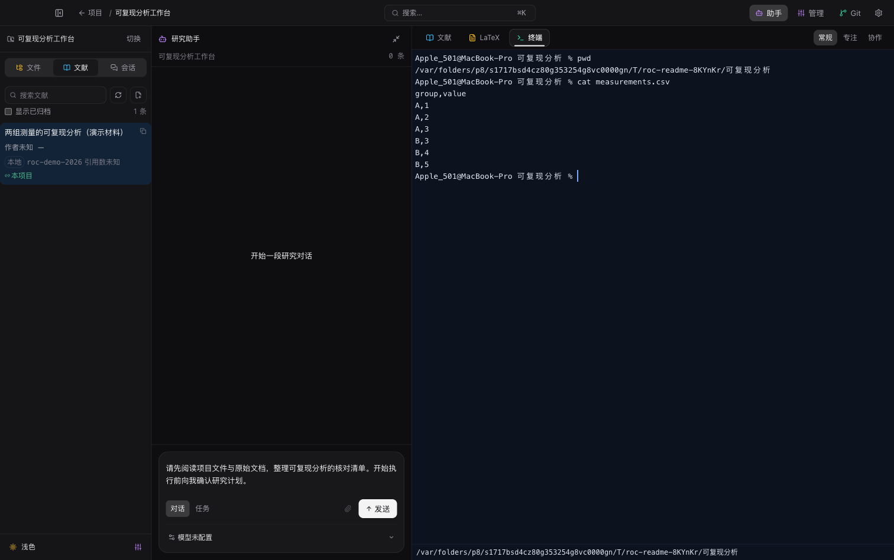
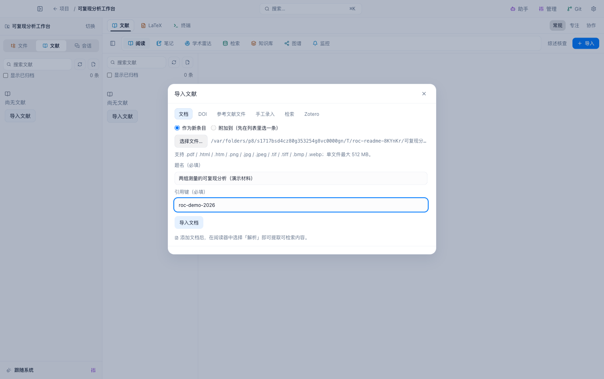
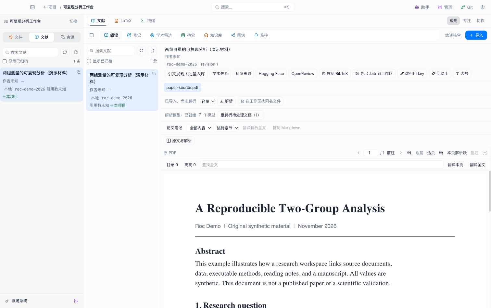
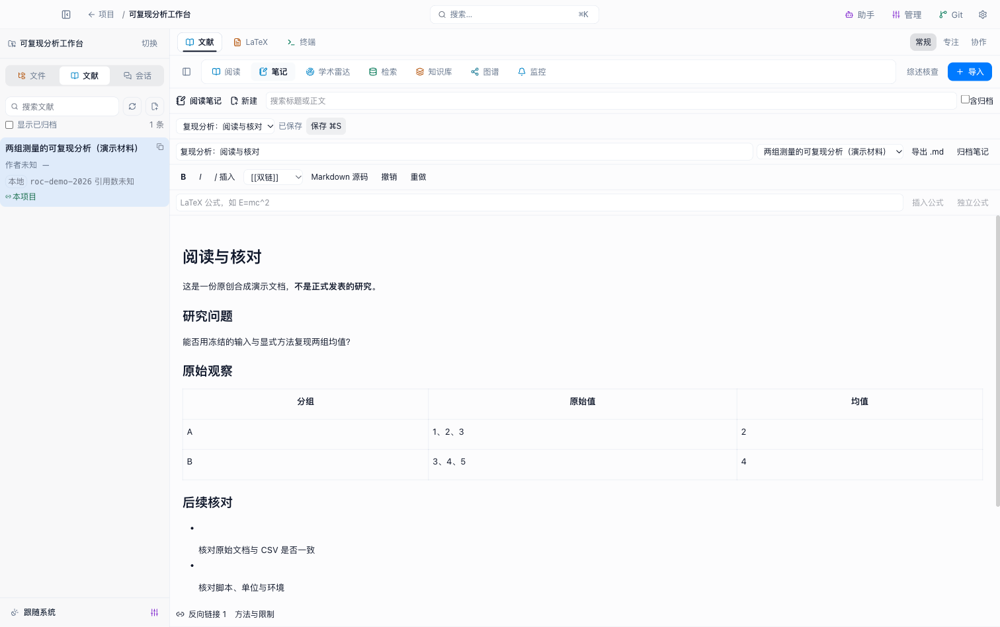
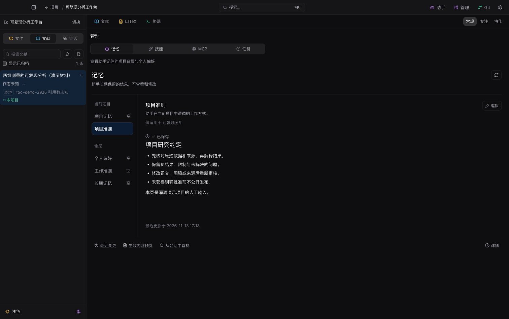
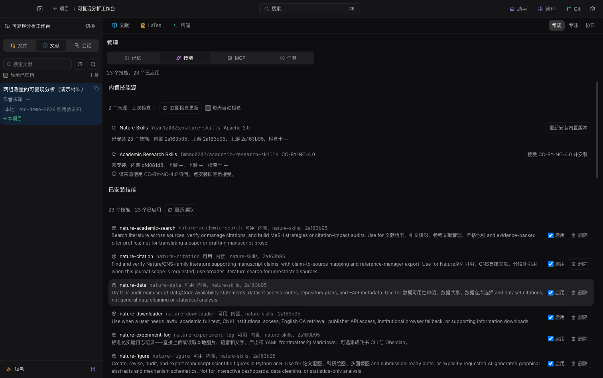
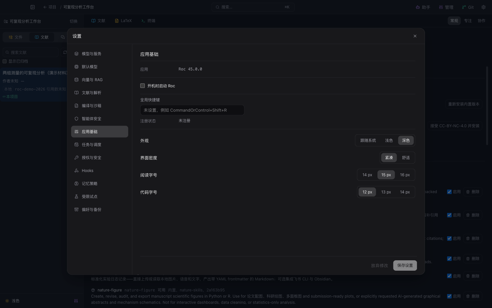

# Roc

Roc 是面向个人研究者的 **Apple Silicon macOS 桌面科研工作台**。它把项目文件、文献阅读、研究助手、实验记录、论文写作和人工审核放进同一个项目上下文，帮助研究者从研究问题走到可追溯的交付包。

应用使用 Electron、TypeScript 和 React，采用系统字体，支持浅色、深色外观和键盘操作。当前支持 macOS arm64。


> 本文截图来自实际运行的 Roc，使用独立的演示项目与原创合成材料，展示浅色和深色界面。助手输入展示任务指令的写法。

## 目录

- [快速开始](#quick-start)
- [界面与快捷键](#workspace)
- [项目、文件、LaTeX、终端与 Git](#projects-files)
- [研究助手与会话](#assistant)
- [文献导入、检索与阅读](#literature)
- [笔记、翻译与学术雷达](#reading-notes)
- [本地检索、知识库与图谱](#knowledge)
- [科研阶段、工件与证据审核](#research-workflow)
- [构思、研究方案与结果评估](#ideas)
- [实验、Python 环境与 Notebook](#experiments)
- [图稿、正文、审稿回复与期刊检查](#writing)
- [系统性综述](#systematic-review)
- [导出、模板与公开发布](#delivery)
- [记忆、技能、MCP 与任务管理](#management)
- [模型与应用设置](#settings)
- [外部资源、数据与隐私](#integrations-privacy)
- [开发、依赖与验证](#development)
- [常见问题与专题文档](#reference)

<a id="quick-start"></a>

## 快速开始

### 从源码启动

需要 Apple Silicon Mac、Node.js 26 和 pnpm 12.5.1。在仓库根目录执行：

```bash
pnpm install
pnpm dev
```

构建主进程、preload 和界面：

```bash
pnpm build
```

启动后首先进入项目门户。创建项目时填写项目标题、研究目标、中文或英文文稿语言，并选择本机工作目录；随后进入项目工作区。

### 第一次使用

1. **建立项目**：选择已有研究目录，或准备一个新的目录。Roc 的文稿、数据和脚本使用这里的真实文件。
2. **添加文献**：打开左栏「文献」，通过文档、DOI、参考文献文件或检索导入条目。普通 PDF 阅读可以直接使用。
3. **配置助手**：打开设置「模型与服务」，添加自己的服务地址、凭据与模型，再在「默认模型」选择模型。
4. **开始研究对话**：在助手输入研究问题、已有材料和预期结果。需要执行时切换到「任务」，在出现问题、工具审批或科研闸门时作出决定。
5. **核对与交付**：查看来源、实际运行和工件版本，完成相应人工审核，再准备导出包。

不同功能的准备条件如下：

| 使用目标 | 需要准备 |
| --- | --- |
| 项目管理、文件编辑、普通 PDF 阅读、笔记 | 本机工作目录与材料 |
| 助手对话、任务执行、模型翻译 | 对应模型服务与支持所需能力的模型 |
| 语义索引、每日 arXiv 相似文献推荐 | embedding 服务与已建立的索引 |
| OCR 与深度文档解析 | 用户主动下载或离线导入的解析模型 |
| 实验运行 | 对应语言环境、冻结输入与环境声明 |
| Git 操作 | 工作目录中的真实 Git 仓库 |
| 远程 MCP、特定学术服务、Zenodo 发布 | 对应连接配置；需要授权的步骤由用户决定 |

<a id="workspace"></a>

## 界面与快捷键

### 一个项目工作区

Roc 的项目界面由顶栏和三列组成，顺序为 **左栏｜助手｜画布**。

| 区域 | 用途 |
| --- | --- |
| 顶栏 | 返回项目门户、搜索、显示或隐藏助手、打开管理、Git 和设置 |
| 左栏「文件」 | 浏览真实工作目录、搜索文件名、新建文件和预览 |
| 左栏「文献」 | 搜索项目文献、导入条目、选择正在阅读的文献 |
| 左栏「会话」 | 新建、切换和删除项目助手会话 |
| 助手列 | 对话、任务执行、工具反馈、提问和人工决定 |
| 画布「文献」 | 阅读、笔记、学术雷达、检索、知识库、图谱和监控 |
| 画布「LaTeX」 | 编辑工作目录中的文稿及相关文本文件 |
| 画布「终端」 | 在项目工作目录中使用真实终端 |
| 管理抽屉 | 记忆、技能、MCP 和任务；记忆、技能、MCP 也可在画布打开 |
| Git 抽屉 | 查看改动、diff、暂存、提交、分支和推送 |
| 设置与搜索浮层 | 配置服务和应用；查找并执行界面提供的搜索结果或命令 |

可拖动列间分隔线调整空间，使用「常规」「专注」「协作」布局预设。窗口宽度不超过 1099px 时，左栏和助手改为抽屉，画布保留主要阅读与编辑空间。

科研构思、方案、实验、图稿、正文、导出等能力通过助手和工件检查器使用；它们没有独立的阶段导航页。

### 常用快捷键

| 快捷键 | 操作 |
| --- | --- |
| `⌘B` | 显示或隐藏左栏 |
| `⌘J` | 显示或隐藏助手 |
| `⌘K` | 打开搜索与命令浮层 |
| `⌘D` | 切换外观主题 |
| `⌘⇧F` | 切换聚焦布局 |
| `⌘,` | 打开设置 |
| `⌘N` | 新建项目 |
| `⌘S` | 在支持保存的文件、文稿或笔记编辑器中保存 |
| `⌘Enter` | 在记忆编辑器中保存 |
| `Enter` / `Shift+Enter` | 助手发送 / 换行 |
| `Esc` | 关闭最上层浮层或抽屉 |

按钮保留可见焦点、悬停、按下、选中与禁用状态；动效尊重系统「减少动态效果」偏好。具体界面合同见[科研工作台](docs/research-workbench.md)。

<a id="projects-files"></a>

## 项目、文件、LaTeX、终端与 Git

### 项目门户

项目门户是启动入口。每个项目有独立的研究目标、工作目录、关联文献、会话和研究记录。


门户支持按标题或描述搜索，在「进行中」「已归档」「全部」之间筛选，并切换网格或列表；最近访问和本机置顶帮助快速回到常用项目。项目菜单提供编辑、归档、恢复和删除。

创建或编辑项目时，一个工作目录只能绑定一个项目。归档后项目进入只读状态，恢复后可继续工作。删除项目记录不会删除工作目录中的研究文件；删除确认所列出的项目内记录应在操作前核对。启动不会自动进入上次项目。

### 文件浏览与预览

在左栏「文件」浏览目录树，按文件名搜索，刷新或折叠树，并新建文件。点击文件打开预览浮层：

- 文本和代码显示内容；可编辑且没有被截断的文本支持保存。
- 图片直接预览；PDF 使用应用的本地预览协议打开。
- `.ipynb` 显示冻结的 Notebook 结构、代码和可安全展示的输出。
- 保存文本前保留恢复点；归档项目禁写，未保存修改在离开或关闭时要求处理。

文件内容来自实际工作目录。预览被截断时不会允许把片段作为完整文件保存。

### LaTeX 文稿编辑

打开画布「LaTeX」，在文稿列表选择文件，再进行语法编辑、保存或重新读取。列表扫描工作目录根目录和下一层目录，支持：

```text
.tex .bib .cls .sty .bbl .txt .md .json .yaml .yml .csv
```

界面显示已保存、未保存或只读状态，`⌘S` 保存前保留原文件备份。当前画布承担文件编辑；模板编译和最终 PDF 生成经科研模板、导出链路完成。

### 终端

画布「终端」启动真实 PTY，工作目录就是当前项目目录。可输入命令、使用系统复制粘贴，终端尺寸随窗口变化；会话退出后可重新启动。



切换项目会关闭旧终端会话，归档项目不会启动终端。这里输入的命令是真实本机操作；科研实验的冻结、网络限制与运行记录由专门的实验执行流程提供。

### Git

顶栏「Git」打开当前工作目录的仓库抽屉。支持：

- 刷新变更列表，查看文件 diff。
- 暂存、取消暂存和提交。
- 浏览提交历史，创建或切换分支。
- 推送并取消正在进行的推送。
- 丢弃改动；确认框会明确说明不可恢复，并覆盖涉及的暂存内容。

Git 操作需要真实仓库。丢弃改动应按确认框核对文件，不属于文件恢复点或回收站操作。

<a id="assistant"></a>

## 研究助手与会话

### 对话与任务

助手是项目内统一的执行入口。输入框提供「对话」「任务」两种模式，可选择供应商和模型；模型选择会写入默认模型配置。输入 `/` 或打开技能选择器，可以选择当前启用的技能。

可以这样提出任务：

```text
围绕项目研究问题整理检索策略，说明数据库、查询式、范围与排除条件。
先给我研究计划，等待确认后再检索。
```

```text
根据已导入文献整理支持与反对这个假设的证据。
保留原文位置；没有找到支持时明确说明。
```

```text
检查这份正文的引文覆盖、实验数值和图稿映射，
列出需要我人工判断的项目。
```

示例是指令写法。实际可执行内容由项目状态、服务配置、模型能力、技能和工具准入共同决定。

### 输入与执行反馈

支持流式回复，以及工具调用、子代理、推理和 Hooks 的执行反馈。模型声明支持图片时，可添加或粘贴 PNG、JPEG、WebP，最多 4 张，每张不超过 5MB。

运行过程中，助手可能显示提问卡、普通工具审批、后台任务提议或科研人工闸门。用户在卡片中回答、批准或退回；停止按钮用于中止正在运行的任务。科研批准与普通工具权限分别处理。

### 会话历史与继续执行

首次发送时创建会话。左栏「会话」可切换历史、新建会话和删除会话；删除会清除该会话的全部消息，无法恢复。

等待人工决定的状态会持久保存，刷新后可继续处理。在满足恢复条件的状态下，可以「从检查点继续」；历史任务是否可续跑取决于其执行记录和恢复条件。

### 运行诊断

运行信息展示模型调用和 token 用量、工具错误、子任务、上下文摘要与压缩、资源准入等待以及本地 trace。服务未报告的用量显示未知，不按零计算。

任务管理可进一步查看执行树、工件、事实版本、来源漂移和诊断导出。当前没有金额预算或累计 token、调用次数、运行时长的硬配额；设置中的调度阈值和资源监测用于各自的准入与治理。

<a id="literature"></a>

## 文献导入、检索与阅读

文献画布有七个子视图：**阅读、笔记、学术雷达、检索、知识库、图谱、监控**。文献库可全局复用，文献与项目的关联独立保存。

### 六种导入方式

在左栏或文献列表点击「导入文献」：



| 入口 | 操作与结果 |
| --- | --- |
| 文档 | 选择本地文档，新建条目时填写标题和引用键；也可附加到已有条目 |
| DOI | 输入 DOI 或 DOI 链接，解析元数据后导入 |
| 参考文献文件 | 选择 BibTeX、BibLaTeX 或 CSL-JSON，导入书目条目 |
| 手工录入 | 填写标题、作者、年份、DOI、URL、摘要和引用键 |
| 检索 | 选择来源并查询，核对候选后显式收录 |
| Zotero | 连接本机 Zotero，选择库或集合，读取并导入条目 |

文档支持 PDF、HTML/HTM、PNG、JPG/JPEG、TIF/TIFF、BMP、WebP，单文件最大 512MB。参考文献文件入口当前支持的格式不包含 RIS。

项目文献列表支持搜索、刷新、显示归档条目、复制引用键。阅读页可编辑引用键，复制 BibTeX 或写入工作目录。引用键应在正文引用与参考文献之间保持一致。

### 多来源学术检索

Roc 可查询 OpenAlex、Crossref、Semantic Scholar、arXiv、PubMed 和 Europe PMC；PubMed 通过 Europe PMC 接入，DOI 通过 doi.org 解析。

融合检索用 RRF 合并多源排名，同时保留来源与排名、元数据和身份冲突、版本、许可、撤稿或更新观察。检索结果仍是候选，用户收录后才进入文库。

部分来源失败、分页边界或返回数量有限时，会保留相应回执与说明。结果列表不能视为已经穷尽所有相关研究；系统综述需要另外冻结协议、原始池与筛选记录。详见[学术检索融合](docs/research-literature-fusion.md)。

### PDF 阅读与原文定位

选择有 PDF 的条目后，可直接阅读原文、搜索文本、选取文本和保存高亮。普通 PDF 阅读不需要先安装 OCR。



高亮和研究批注关联原文、页码与位置。解析后的内容可从章节、图、表格、公式和算法分类浏览，跳转章节，定位到原文，复制 Markdown 或 LaTeX，并核对解析资产。

普通 PDF 阅读的逐字选择，与检查固定来源时的页/区域定位是两种不同的界面。科研证据需要保存对应原文版本与定位，不能仅凭屏幕上看到的段落认定来源已固定。

### 文档解析与 OCR

解析提供轻量、深度档位。首次使用相应本地模型时，用户选择下载；模型权重不随安装包分发，也不会在普通阅读时自动下载。

模型管理支持选包、下载、取消、离线目录导入、完整性校验和卸载。compact 约 19MB，complete 约 330MB，实际模型和大小以界面与[模型锁](resources/research-models/models.lock.json)为准。

更换档位或模型后，可显式重新解析。旧证据保留原有来源版本；来源迁移和重新审核见[证据审核](#research-workflow)。阅读操作见[结构化阅读](docs/research-reading-radar.md)和[PDF 导航](docs/research-pdf-navigation.md)。

<a id="reading-notes"></a>

## 笔记、翻译与学术雷达

### 阅读笔记

文献画布「笔记」支持新建独立笔记或关联文献，按标题、正文搜索，并在下拉框选择当前笔记。



编辑器支持富文本与 Markdown、`/` 块操作、公式、表格，以及 `[[笔记标题]]` 双链和反向链接。修改自动保存，也可 `⌘S` 手动保存；可以归档、恢复和导出 `.md`。

笔记保存在应用数据库中，关联文献与修订信息一起保存。出现修订冲突时，界面提供重读或将草稿保存为副本的处理方式。

### 翻译与原译对照

可翻译 PDF 选区、本页或全文，也可翻译解析文本选区、单个块或全文。结果以原文和译文对照展示，并可写入阅读笔记。

通道包括 Google、腾讯、OpenAI 兼容、DeepL、Azure、Google Cloud。后四种需要配置对应凭据；服务、地址、目标语言和模型按翻译设置生效。翻译内容发送到选定服务。

### 学术雷达

「学术雷达」帮助持续发现阅读线索：

- 嵌入浏览 Cool Papers 和魔搭学术页面，显式读取当前页面中的论文线索并选择入库。
- 添加 RSS/Atom，刷新订阅，置顶、标记已读和批量导入。
- 基于项目文库的 embedding，生成每日 arXiv 相似文献推荐；需要可用的向量配置和项目语料。

雷达条目和网页线索仍需核对，显式导入后才成为文库条目。

### 参考文献与后续被引

阅读页的引文发现入口可查看参考文献或后续被引，刷新、分页并批量收录。Roc 保存学术关系的来源快照、抓取时间与分页状态。

「某论文引用另一论文」是来源报告的关系，是否支持某个研究主张仍需单独审核。详见[学术关系来源快照](docs/research-scholarly-relations.md)。

### 持续监控

「监控」保存固定查询或 DOI 更新监控，支持每日/每周检查、立即检查、暂停、恢复、取消、提醒已读与历史查看。

建立基线后，后续检查识别新文献、撤稿或更正观察。监控不调用模型，提醒不会自动入库，也不会改变证据批准；用户核对后再收录或重新审核。详见[文献持续监控](docs/research-monitors.md)。

<a id="knowledge"></a>

## 本地检索、知识库与图谱

### 工作目录与文献检索

文献画布「检索」将关键词和语义搜索结合，展示来源、定位和排名。可以增量扫描或重建工作目录索引，暂停/继续作业，查看已索引文件、作业状态并重试失败项；生效配置在这里只读，修改在设置「向量与 RAG」进行。

命中可复制，定位到原文或文件，捕获为 Evidence，或写入笔记。文献向量任务持久保存，重启后可继续；关键词索引独立保存。语义服务故障时明确降级为关键词检索。

设置可启用实验性的查询词覆盖重排。检索排名反映相关性，科研支持仍需来源和主张审核。

### 持久 Wiki

「知识库」提供「持久 Wiki」与「主张与证据」两类视图。捕获 Evidence 会产生可追溯的来源摘录；建立主题、比较或争议 Wiki 页时，要选择作为基础的原始 Evidence 或 Claim。

Wiki 支持分页搜索、重新编译、人工编辑章节、交给助手综合、修订历史和回滚。人工章节在自动编译时保留，生成章节作为草稿。

来源 lint 会检查过期或缺失来源、无引文、断链、冲突候选等问题。它用于发现知识页的维护问题，科学支持判断仍由独立审核保存。

### 主张与证据视图

可浏览概念页、关联 Evidence、反向链接和年份时间线，把某项主张交给助手进一步分析，或跳到图谱查看关系。此视图是已保存知识事实的投影。

### 图谱

「图谱」按文献、主张、证据和文件组织节点，支持文本与类型筛选、分页、选择节点和查看邻域，并把选中内容交给助手。

当前图谱采用节点与邻域列表。关系的含义由类型和来源表达；相邻、共引或来源链接不能直接推导出因果关系。

<a id="research-workflow"></a>

## 科研阶段、工件与证据审核

### 十一阶段

助手根据项目状态通过 `research_run_stage` 调度阶段。每阶段有固定 Skill 和可用能力清单，产出保存为项目工件。

| 阶段 | 目标与主要产出 |
| --- | --- |
| discovery · 检索策略 | 核对原始研究问题、检索范围与检索计划 |
| retrieval · 文献集 | 按批准范围检索、保存来源回执与文献集 |
| reading · 阅读 | 结构化阅读、来源摘录与阅读笔记 |
| ideation · 构思 | Idea Canvas、假设、反证、风险与优先级 |
| planning · 研究方案 | 方法、指标、实验设计、分析与可证伪条件 |
| experiment · 实验 | 真实运行、输入/环境/日志/输出与指标 |
| figure · 图稿 | 图规格、实际绘制数据、图像与审核记录 |
| writing · 正文 | 正文、引用、数值映射和写作检查 |
| review · 审稿 | 审稿问题与需处理的意见 |
| revision · 修订 | 修订正文、回复矩阵与修改位置 |
| export · 导出 | 批准版本的主文、报告、来源与交付包 |

需要人工闸门的步骤会等待批准或退回。discovery 会核对原始问题并冻结检索计划；retrieval 应遵守已批准范围，扩大范围需要重新处理计划。

### 工件检查器

从助手的科研工件或审核卡进入检查器，查看该阶段的版本、来源、主张、Evidence、真实运行及生产文件。

审核依据绑定整个阶段的版本快照。预览只是查看；批准是独立决定。任一相关版本改变后，需要重新核对整个阶段，旧批准不能直接套到新产出。

生产文件和日志可查看；单文件预览上限 4MiB。ZIP 在检查器中展示元数据，生产检查器的 PDF 预览入口尚未接入；文献阅读和文件 PDF 预览使用各自入口。详见[科研工件检查器](docs/research-artifact-inspector.md)。

### Evidence 与来源版本

Evidence 是带固定来源的证据记录，可来自文献原文、解析片段、文件或真实运行指标，保存哈希、位置和版本。重新解析后，旧证据可能成为 superseded；原始记录仍保留。

替代来源或迁移 Evidence 是显式操作，需要核对新旧来源和受影响关系。系统不会因为出现新解析结果就自动把旧批准升级到新来源。

### 主张关系与人工决定

主张关系支持 `supports`、`contradicts`、`qualifies`、`depends_on`、`supersedes`，并保留历史状态。模型可以提出关系建议，人工确认独立保存。

已确认的反对关系会影响批准，相关阻断必须处理后再继续。来源链接、检索相关性、模型判断与人工科学支持决定分别记录。详见[证据来源与关系审核](docs/research-evidence-relations.md)。

<a id="ideas"></a>

## 构思、研究方案与结果评估

### Idea Canvas

通过助手开展构思，在工件中核对假设、支持证据、反证、实验风险、优先级与历史版本。经过人工批准的构思可晋升为研究项目。

Idea Canvas 用于把“想研究什么、为什么值得研究、如何可能被推翻”整理成可检查的结构。

### 方法计划

研究方案记录可证伪条件、指标定义、单位和方向、实验设计、分析方法与功效依据。用户审核后冻结版本，后续实验依据固定方案执行。

人工冻结表示在 Roc 中确定了计划版本；正式预注册的提交、平台要求和时间证明需按相应制度完成。

### 结果评估与比较

实际运行后，人工记录结果支持、反驳、无法判断或不可比，并保留负结果。实验比较需要核对输入、环境、参数、种子、指标定义和单位；条件不一致时保留不可比理由。

执行成功、数值一致与科学结论成立是分别核对的事项。详见[Idea Canvas、方法计划与结果评估](docs/research-ideas.md)和[实验结果与比较](docs/research-experiment-results.md)。

<a id="experiments"></a>

## 实验、Python 环境与 Notebook

### 支持的运行环境

由助手提出并准备实验，用户核对代码、输入和环境后执行。在工件检查器和任务管理中查看实际运行与结果。

| 语言 | 当前运行要求 |
| --- | --- |
| TypeScript | `.mts`，使用随包 Node 与受限实验接口 |
| R | 用户安装的 R，配合 `renv` 环境声明 |
| Julia | 用户运行时及 Project、Manifest、depot |
| Python | macOS arm64 的正式版 CPython 3.14 与标准 `venv`，需绑定项目和完整锁文件 |

Python 在管理「任务」的环境区域通过原生选择器选择并绑定项目。预检核对运行时、环境与 `roc-python.lock.json`；缺失或不匹配会报告原因。当前不会自动安装或修复环境，其他 Python 版本与 conda 环境不在本执行合同内。

### 冻结运行与资源治理

实验保存源码、输入、环境、参数、随机种子、日志和输出哈希，运行时关闭网络。执行有资源准入、采样监测、超时、取消及崩溃中断处理；中断后不会自动重跑。

资源监测和限额治理有明确的实现边界，不等同于操作系统对全部资源施加硬配额。运行成功表示这次执行完成，科研正确性由结果与方法审核决定。

结果可登记为结构化指标与 Evidence，并用于后续比较、正文数值映射和图稿核对。详见[科研实验](docs/research-experiments.md)、[Python 环境](docs/research-python-environment.md)及[资源治理](docs/research-execution-resources.md)。

### Notebook

可导入和预览 nbformat 4.5 Notebook，冻结其结构、源码和原始输出。原输出标记为 untrusted，HTML、SVG 和脚本不执行。

执行支持受限 Python cell 子集，沿用项目 Python 环境与实验冻结要求。完整 Jupyter/IPython 内核、任意 magic 和浏览器脚本输出不属于当前执行范围。详见[Notebook 合同](docs/research-notebooks.md)。

<a id="writing"></a>

## 图稿、正文、审稿回复与期刊检查

这些能力通过助手创建或检查工件，在检查器中核对产物与人工审核项；文稿实际文件可继续在 LaTeX 画布编辑。

### 图稿与实际绘制数据

图稿流程使用受限 Vega-Lite 6 规格和本地数据，生成 PNG、SVG、PDF，并保存真实绘制数据回执。审核包含视觉检查、数据来源、变换和映射。

坐标、聚合、过滤、单位及图注中的数值应与回执对应。当前图稿链路围绕固定规格与本地数据，不提供独立的任意 Python 绘图编辑器。详见[科研图稿](docs/research-figures.md)。

### 正文、引文与数值检查

写作检查覆盖正文引文、实验数值与图稿的一致性：

- **引文覆盖**：定位哪些论述有引用，哪些需要补证据；人工分别记录直接支持、间接支持或不支持。
- **数值映射**：正文数值关联到真实运行的指标 Evidence，检查单位、舍入和容差。
- **图注核对**：图注中的数值与实际绘制数据分别核对，避免只验证原始数据而遗漏图中变换。
- **措辞与拼写**：Vale 检查中英文措辞、证据口径与拼写，输出问题位置，不自动改写正文。

这些检查帮助定位问题；人工支持决定和科研批准保留独立记录。详见[科研写作检查](docs/research-writing-checks.md)。

### Review Response Matrix

审稿回复矩阵保留原始审稿意见，逐项记录人工状态 `open`、`addressed`、`declined`、回复、精确修改位置及关联 Evidence，并保存版本历史。

可以区分“已修改并回应”“有理由不采纳”“仍待处理”。保存矩阵并不批准论文，正文、图稿和交付版本仍按对应闸门审核。详见[回复矩阵](docs/research-response-matrix.md)。

### Journal Compliance

期刊检查依据用户建立并版本化的规则，保留官方或整理日期、来源和适用说明。可检查章节、参考文献数量和字段、图稿、补充材料及人工条目。

报告区分自动 `pass` / `fail` / `manual` 与人工判断。没有来源的默认期刊规范不会被当作已验证规则。详见[期刊符合性检查](docs/research-journal-compliance.md)。

<a id="systematic-review"></a>

## 系统性综述

系统综述通过助手和审核工件维护协议、检索、筛选、提取、质量评价与报告。它保留每一步的实际记录和人工决定：

1. **协议与检索计划**：按数据库记录查询、范围和计划，保存真实检索回执与原始池。
2. **冻结语料与去重**：固定纳入的原始记录；人工处理重复关系。
3. **标题/摘要筛选**：逐人保存决定，处理分歧和仲裁，冻结该轮筛选。
4. **取得并绑定全文**：记录是否取得全文，将实际文件绑定到报告。
5. **全文筛选**：保存逐人决定、排除理由、仲裁和冻结版本。
6. **数据提取**：人工填入结构化数据，关联原文 Evidence。
7. **质量评价**：选择与研究设计匹配的框架，逐域记录判断和依据。
8. **研究归组与报告**：人工把多份报告归为 study，生成真实计数、查询附录和证据表。

未取得全文与资格排除分别计数，报告数与研究数分别保存；计数核对包含四项守恒关系。用户应核对 PRISMA 模板是否适用于自己的综述类型。

当前不自动完成 meta-analysis，也不对所有设计套用统一质量量表。详见[系统性综述](docs/research-systematic-review.md)。

<a id="delivery"></a>

## 导出、模板与公开发布

### 文稿模板与编译

最终导出使用已批准且 accepted 的正文和批准图稿。中文默认采用 CTeX，英文默认采用 article；也可使用经过固定和核对的用户模板。

模板能力通过助手与工件工作流使用，保留模板文件和版本。主文 PDF 由随包 Tectonic 生成；研究过程报告使用 Typst。LaTeX 画布保存真实文稿文件，编译产物由科研链路记录。

### 最终交付包

导出流程为 **准备 → 送到审核闸门 → 人工批准 → 原生保存**。保存时不覆盖已有目标，取消或中断后不会自动再次生成。

ZIP 主要包含：

| 内容 | 用途 |
| --- | --- |
| `paper.pdf` | 编译后的论文主文 |
| `report.pdf`、`report.typ` | 研究过程报告及其源文件 |
| `source/` | 文稿、BibTeX/BibLaTeX 相关文件、图稿与模板来源 |
| `references.bib` | 参考文献 |
| provenance、公开日志与 manifest | 冻结版本、来源和产物完整性记录 |
| RO-Crate 1.2 侧车 | 交付资源与关系的机器可读描述 |

准备时核对作者、许可和逐资源交付方式，明确交付原件还是仅元数据；公开记录中的私有路径和凭据会脱敏。期刊补充材料在当前链路中仅登记元数据，不随包交付。

arXiv 预检提供问题或警告，最终平台接受由平台规则和实际提交决定。完整要求见[科研导出](docs/research-exports.md)和[RO-Crate 合同](docs/research-ro-crate.md)。

### Zenodo 草稿与公开发布

Zenodo 使用选定的已批准导出，sandbox 与 production 分开配置。创建远端草稿和最终公开发布分别需要批准；上传核对文件哈希，发布保存 DOI 与远端回执。

远端请求结果未知时，先查询已有状态，避免重复提交。导出批准不自动授予公开发布许可。详见[Zenodo 发布](docs/research-zenodo.md)。

<a id="management"></a>

## 记忆、技能、MCP 与任务管理

顶栏「管理」打开抽屉。在较长的阅读或编辑任务中，可把记忆、技能或 MCP 放到画布；任务管理保留在抽屉。

### 长期记忆

记忆帮助助手跨会话保留用户偏好、执行规则和研究事实。实际内容保存在 SQLite，界面的 Markdown 名称是虚拟槽：

| 作用域 | 槽位与用途 |
| --- | --- |
| 全局 `USER` | 用户背景与长期偏好 |
| 全局 `AGENTS` | 全局执行规则 |
| 全局 `MEMORY` | 跨项目保留的信息 |
| 项目 `AGENTS` | 当前项目规则 |
| 项目 `MEMORY` | 当前项目研究事实与长期信息 |



可查看与编辑 Markdown、查看容量、`⌘Enter` 保存，检查安全扫描结果和生效内容预览；还可搜索会话、查看自动沉淀审计，并请助手整理记忆。

项目槽只在对应项目生效。记忆内容与磁盘同名 Markdown 文件不是同一份数据。

### 技能

技能把某类任务的工作方法和资源带入助手。管理区可从包含 `SKILL.md` 的绝对目录导入，查看文件树和内容、启停、删除，并核对来源与许可。导入入口使用目录，不使用 ZIP。



Nature Skills 默认安装随包快照。Academic Research Skills 使用 CC BY-NC 4.0，安装前需明确接受许可。

内置技能默认每日检查 GitHub 上游更新；可关闭自动检查、手动检查或恢复随包版本，更新保留启停选择。科研十一阶段还使用固定的阶段技能资源。详见[内置技能](docs/builtin-skills.md)。

### MCP 连接器

管理「MCP」可新增、编辑、启停和删除本地 stdio 或远程 HTTP/SSE 服务，配置允许工具、风险和审批方式，并查看真实工具 manifest。

「校验配置」检查配置合法性，实际连接和工具发现有各自的运行状态。Exa Hosted MCP 是默认禁用的可选预设。

普通工具与 MCP 的审批取决于当前配置；科研人工闸门仍独立。连接器调用会访问对应进程或远端服务。

### 后台任务与调度

后台任务支持手动、一次和 cron 触发。创建时说明目标、触发时间或条件、允许动作与禁止动作，预览后创建；助手提出的任务由用户审批。

管理区可立即运行、暂停、恢复、取消、记录编辑理由或删除，并查看调度历史。全局后台暂停、启动补跑、最大注册数和准入阈值在设置中管理；界面显示下次触发与跳过原因。

### 科研任务与离线诊断

科研任务区展示执行树、关联工件、持久事件、任务事实版本、来源漂移、模型用量与资源状态；Python 环境选择也位于这里。

可导出本地脱敏诊断，用于定位模型、工具、恢复与执行问题。历史记录缺口会明确显示，不补造未保存事件。详见[任务观测](docs/research-task-observability.md)。

<a id="settings"></a>

## 模型与应用设置

设置采用共同草稿：修改可跨分区保留，统一保存；未保存离开时需要处理草稿。外观等本机界面偏好即时生效。



### 模型与服务

Roc 不预置聊天供应商或 API 密钥。可添加 OpenAI 兼容、Anthropic 兼容、NVIDIA、OpenRouter、llama.cpp、Ollama 或 custom 服务，配置地址与凭据，手工添加模型或读取服务模型目录。

模型配置包含能力声明和测试入口，例如是否支持图片、工具调用。凭据通过 Electron `safeStorage` 加密保存；界面只显示配置状态。默认模型分区决定助手使用的默认模型。

### 十三个设置分区

| 分区 | 可配置或查看的内容 |
| --- | --- |
| 模型与服务 | 供应商、地址、凭据、模型目录、能力与测试 |
| 默认模型 | 助手默认供应商与模型 |
| 向量与 RAG | embedding 与检索配置、索引参数、重排选项 |
| 文献与解析 | 文献服务、解析模型与相关接入状态；包含 Zotero 设置 |
| 编译与沙箱 | 随包科研工具链及 RTK 的真实状态 |
| 智能体安全 | 工具审批、记忆安全扫描、容量与会话保留 |
| 应用基础 | 登录启动、全局热键、外观、密度和阅读/代码字号 |
| 任务与调度 | 准入阈值、启动补跑、注册数、全局后台暂停 |
| 授权与安全 | MCP 审批模式、连接器启停、运行状态与配置校验 |
| Hooks | JSON 配置、事件处理器、启停与逐项信任 |
| 记忆策略 | 自动沉淀、低置信度记忆与审计保留策略 |
| 受限试点 | 试点模式、比例、失败熔断与回退 |
| 偏好与备份 | 无密钥设置快照、导入、导出和 UI 重置 |

编译与沙箱区展示工具链状态，可用于定位编译和命令执行问题。

### 权限、Hooks 与记忆安全

当前新建配置的普通工具权限和 MCP 审批默认 `fully_automatic`，普通命令、文件操作和 MCP 工具调用不会逐项请求确认；可切换到 `default` 审批方式。科研批准、外部发布等独立闸门按各自流程处理。

记忆安全扫描检查提示注入、凭据、SSH 内容和不可见 Unicode 等问题，并展示结果。容量和会话保留策略可配置。

Hooks 配置先通过 JSON 校验，启用前按 handler 哈希显式信任。修改事件、matcher、command、timeout 或失败模式会撤销原信任，需要重新核对。

### 外观与本机行为

支持跟随系统、浅色和深色外观；本机界面密度、阅读字号 14/15/16、代码字号 12/13/14 可调整。应用展示登录启动和全局热键的实际注册状态。

主题、列宽等 UI 偏好与后端设置分别保存。受限试点提供 read-only 或 low-side-effect 模式、分桶比例、连续失败熔断和关闭回退。

### 设置快照与备份

可导出不含密钥的 JSON 设置快照，写入工作目录 `roc-settings-export.json`；粘贴导入先进入草稿，核对后保存。

重置 UI 偏好不删除项目或凭据。设置快照也不包含完整项目、文献和数据库；数据库维护入口见[数据库存储](docs/database-storage.md)。

<a id="integrations-privacy"></a>

## 外部资源、数据与隐私

### 科研资源与外部观察

阅读页和科研工具可登记数据、软件、模型及公开评审资源，保留来源和版本：

| 服务 | Roc 的能力与边界 |
| --- | --- |
| DataCite | 观察数据/软件 DOI 的元数据、版本、许可和关联；不据此认定实际使用，也不下载内容 |
| Hugging Face | 固定完整 40 位 commit SHA，观察文件、许可与哈希；实际下载需单独用户批准 |
| OpenReview | 只读获取公开 Notes/Edits 与来源历史，不投稿或回复 |
| Zotero | 固定 `127.0.0.1:23119` 的 GET 只读接入，选择个人/群组库、集合，保存同步检查点 |
| Jina Reader | 获取用户请求阅读的网页内容 |
| Zenodo | 批准导出后的草稿、上传核对和独立公开发布流程 |

Zotero 附件需先显式检查，再通过原生单文件选择器授权读取；导入附件与解析分别进行，Roc 不写回 Zotero。当前不提供 OSF 写入同步连接器。

详见[科研资源](docs/research-resources.md)、[Hugging Face](docs/research-huggingface.md)、[OpenReview](docs/research-openreview.md)及[Zotero](docs/research-zotero.md)。

### 本地数据与网络请求

| 数据 | 默认位置或处理方式 |
| --- | --- |
| 配置、文献、笔记、记忆、索引、日志与运行记录 | `~/.roc` 下的应用数据与数据库 |
| 项目文稿、数据、脚本及普通文件 | 创建项目时选择的真实工作目录 |
| Provider 凭据 | `safeStorage` 加密后保存到 `~/.roc/secrets` |
| 布局、主题等本机 UI 偏好 | renderer 的 `roc.ui.` 命名空间 |
| OCR 模型权重 | 用户下载或离线导入后的本地模型目录 |

使用模型、翻译、文献、网页、MCP 或发布服务时，请求发送到相应服务。本地保存不改变这些调用的数据流向。

### 随包工具与模型来源

应用包含 Tectonic、Vale、Typst、TeX bundle、ripgrep 和 RTK OSS。版本、校验和与许可来源由[科研运行时](resources/research-runtime/README.md)、[ripgrep 锁](resources/ripgrep-binaries/ripgrep.lock.json)和[RTK 文档](docs/rtk-integration.md)维护。

OCR 权重按需获取，来源、revision 与 SHA-256 见[模型锁](resources/research-models/models.lock.json)和[模型说明](resources/research-models/README.md)。内置技能来源及许可见[技能说明](docs/builtin-skills.md)。

<a id="development"></a>

## 开发、依赖与验证

### 技术栈

Roc 是单一 Electron 应用。主进程管理数据库、服务和本机能力，preload 通过受限 API 连接主进程与界面，React renderer 提供项目工作区。

| 层 | 技术与用途 |
| --- | --- |
| 桌面运行时 | Electron、受限 preload 与原生窗口/菜单/文件能力 |
| 界面 | React、TypeScript、系统字体、语义 token 与统一图标 |
| 开发与构建 | pnpm、electron-vite、Vite、Tailwind CSS、electron-builder |
| 平台与产物 | `package.json` 限定 `darwin` / `arm64`，生成 macOS 应用 |

preload 通过 `contextBridge` 向 renderer 暴露受限 API，renderer 不直接使用 Node.js 或 `ipcRenderer`。画布视图懒加载，视觉与动效遵循仓库 [tokens.css](src/renderer/styles/tokens.css) 和 [motion.ts](src/renderer/shared/motion.ts)。

### 常用命令

在仓库根目录执行，按改动范围选择验证：

| 命令 | 用途 |
| --- | --- |
| `pnpm dev` | 启动开发应用 |
| `pnpm build` | 技能检查、类型检查和应用构建 |
| `pnpm typecheck` | TypeScript 检查 |
| `pnpm test` | Node 单元测试、renderer 测试和 Electron smoke |
| `pnpm check:skills` | 科研阶段技能与资源校验 |
| `pnpm check:ipc` | IPC 生成契约一致性 |
| `pnpm check:renderer-chunks` | renderer 懒加载与重依赖边界 |
| `pnpm verify:native-packaging` | 原生模块和随包资源校验 |
| `pnpm package:dir` / `pnpm package:mac` | 本机应用目录 / macOS 安装产物 |
| `pnpm logs:query` | 查询本地日志 |

科研集成、环境边界、检索质量和评测有独立入口，见[验证说明](docs/verification.md)和[评测目录](evaluation/README.md)。类型检查、构建或 smoke 的通过范围由具体命令决定，不能替代外部服务、科学支持或发布验收。

### 依赖清单与升级

直接依赖及固定版本以 [package.json](package.json) 为准，完整解析结果见 [pnpm-lock.yaml](pnpm-lock.yaml)。依赖涵盖 Agent/模型、SQLite/向量索引、PDF/OCR、文献检索、编辑器/终端和构建测试工具。

- 用 `pnpm outdated` 查看升级项；运行依赖使用 `pnpm add --save-exact package@version`，开发依赖使用 `pnpm add -D --save-exact package@version`，由 pnpm 更新 manifest 和 lockfile。
- LangGraph 同时受 [pnpm-workspace.yaml](pnpm-workspace.yaml) 中 `@langchain/langgraph` 与 `@langchain/langgraph-checkpoint` overrides 约束，升级时同步核对。
- 原生模块、Electron、OCR、ripgrep、RTK 和科研工具升级应核对架构过滤、完整性、资源锁及许可来源。
- 根据影响运行 `pnpm typecheck`、`pnpm test`、`pnpm check:renderer-chunks`、`pnpm verify:native-packaging`，并完成对应专题要求。

<a id="reference"></a>

## 常见问题与专题文档

| 问题 | 当前行为 |
| --- | --- |
| 必须配置模型才能使用吗？ | 项目、文件、普通 PDF 阅读和笔记可先使用；助手与语义功能需要各自服务 |
| 为什么 LaTeX 画布没有编译按钮？ | 它是工作目录文稿编辑器；编译通过模板和科研导出链路完成 |
| 为什么看不到构思、实验或导出导航页？ | 这些能力在助手与工件检查器中使用，项目只有一个壳 |
| 为什么重解析后旧证据仍保留？ | Evidence 固定原始来源；替代、迁移与重新批准是显式步骤 |
| Wiki lint 或实验成功能直接批准论文吗？ | 它们分别提供维护问题或执行事实，科研人工判断仍需完成 |
| 删除项目会删除本机目录吗？ | 删除项目记录不删除工作目录中的文件 |
| 设置 JSON 是完整备份吗？ | 它是不含密钥的设置快照；项目、文献、凭据与数据库需按各自维护方式保存 |

完整术语见 [CONTEXT.md](CONTEXT.md)，全部当前专题见[文档索引](docs/README.md)。常用入口：

- [科研工作台](docs/research-workbench.md)与[工件检查器](docs/research-artifact-inspector.md)
- [阅读、笔记与雷达](docs/research-reading-radar.md)、[证据审核](docs/research-evidence-relations.md)与[系统综述](docs/research-systematic-review.md)
- [实验](docs/research-experiments.md)、[Python](docs/research-python-environment.md)与[Notebook](docs/research-notebooks.md)
- [图稿](docs/research-figures.md)、[写作检查](docs/research-writing-checks.md)与[最终导出](docs/research-exports.md)
- [数据库维护](docs/database-storage.md)、[验证入口](docs/verification.md)与[架构决定](docs/README.md#架构决定)

## License

仓库尚未单独声明许可证，默认保留所有权利。随包工具、技能与模型的许可按各自来源文档维护。
