# Roc

Roc 是面向个人研究者的 Apple Silicon macOS 桌面科研工作台。它把文献、原文阅读、研究助手、知识库、实验、论文写作与人工审核放在同一个项目里，用可追溯的来源和版本连接研究过程。

应用基于 Electron、TypeScript 和 React，提供浅色／深色外观、原生窗口与快捷键。当前支持 macOS arm64。


本文按真实界面入口介绍功能。科研阶段由助手调度；已有产物在工件检查器中查看、核对和审核。截图与实测范围见[文末说明](#截图与实测范围)。

## 目录

- [安装与开始使用](#安装与开始使用)
- [项目与工作台](#项目与工作台)
- [研究助手与会话](#研究助手与会话)
- [文献导入与在线检索](#文献导入与在线检索)
- [阅读、笔记与学术雷达](#阅读笔记与学术雷达)
- [科研检索、知识库与图谱](#科研检索知识库与图谱)
- [文献监控与系统性综述](#文献监控与系统性综述)
- [文件、LaTeX、终端与 Git](#文件latex终端与-git)
- [十一阶段科研流程与工件审核](#十一阶段科研流程与工件审核)
- [实验、图稿、写作与交付](#实验图稿写作与交付)
- [科研资源与外部服务](#科研资源与外部服务)
- [记忆、技能、MCP 与任务](#记忆技能mcp-与任务)
- [设置中心](#设置中心)
- [数据与隐私](#数据与隐私)
- [开发、检查与发布](#开发检查与发布)

## 安装与开始使用

### 使用 macOS 应用

从仓库的 GitHub Releases 获取 macOS arm64 构建，解压后打开 `Roc.app`。自行打包的默认输出为 `release/mac-arm64/Roc.app`。

1. 启动后进入项目门户，新建或打开研究项目。
2. 新建时填写标题、研究目标、中文或英文文稿语言，并选择本机工作目录。
3. 在设置「模型与服务」配置供应商、API 地址、凭据与模型，再选择默认模型。
4. 在左栏「文献」导入已有论文，或检索后明确选择收录。
5. 在助手中说明研究问题、可用材料和期望产物，按需要回答提问或处理审批。
6. 打开真实工件链接核对来源和版本，再返回助手作出人工决定。

文稿语言决定默认科研输出语言；界面当前为中文。不同功能需要的准备条件如下：

| 功能 | 准备条件 |
| --- | --- |
| 项目、文件浏览、文本编辑、普通 PDF 阅读、笔记 | 本机工作目录与材料 |
| 助手、阶段执行、模型翻译 | 可用模型服务、凭据及相应模型能力 |
| 语义检索、Wiki 语义导航、每日 arXiv 推荐 | embedding 配置及相应索引 |
| OCR、结构化解析 | 在设置下载或离线导入解析模型 |
| 实验 | 支持的语言环境、锁文件、明确源码与输入 |
| Git、MCP、外部发布 | 真实仓库或服务连接，以及对应操作授权 |

### 从源码启动

需要 Apple Silicon Mac、[项目指定的 Node.js](.node-version) 和 pnpm 12.21.0。在仓库根目录运行：

```bash
pnpm install --frozen-lockfile
pnpm dev
```

首次准备会下载 Electron 二进制；离线开发前可用 `pnpm exec install-electron` 提前下载。构建与本机打包分别使用 `pnpm build`、`pnpm package:mac`。依赖版本以 [package.json](package.json) 与 [pnpm-lock.yaml](pnpm-lock.yaml) 为准。

## 项目与工作台

### 项目门户

门户支持卡片网格与紧凑列表、最近打开、本机置顶、新建、编辑、归档和删除。搜索、筛选和新建固定在页头，项目结果独立滚动。每次启动先进入门户，不自动打开上次项目；顶栏「项目」返回门户。

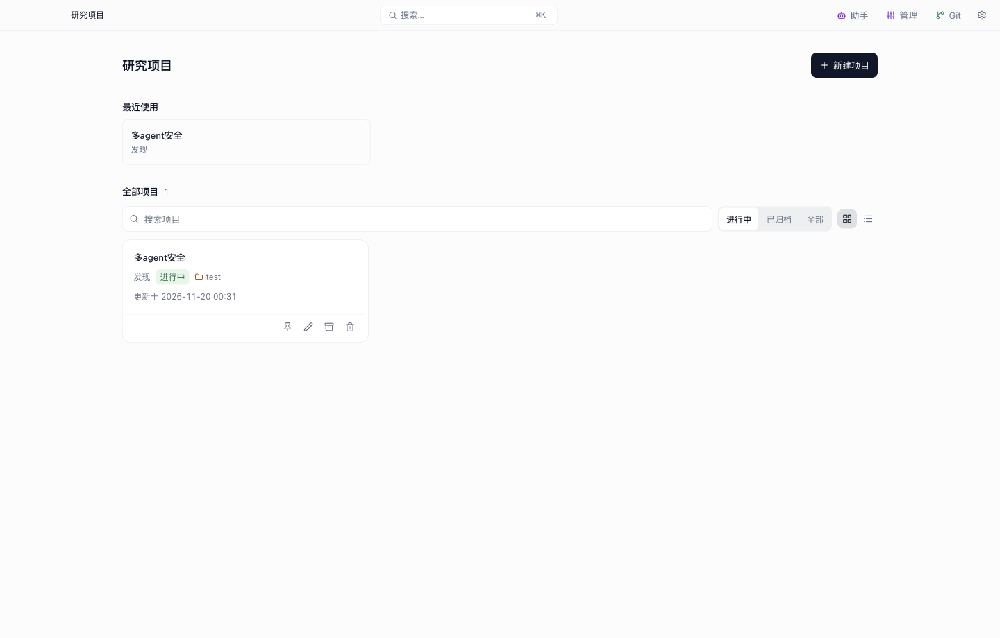

一个工作目录同时只属于一个研究项目。归档项目只读，不能新开执行、改工件或写文件；删除项目记录不会删除工作目录。创建和编辑表单保护未保存修改，等待请求时阻止重复提交。

### 三栏工作台与搜索

项目内固定列序为 **左栏｜助手｜画布**。活动栏分为总览与发现、文献与知识、论文写作、会话与任务；左栏提供当前目的地的项目上下文。顶栏提供项目切换、搜索、Git、布局和助手开关；设置位于活动栏，管理从会话与任务进入。

可拖动分隔条调整宽度，也可用键盘微调；1360px 起可同时展示三栏，1100–1359px 左栏改为抽屉，1099px 及以下助手也改为抽屉。研究、写作和审阅布局调整当前工作区域，主题与密度由本机偏好维护。

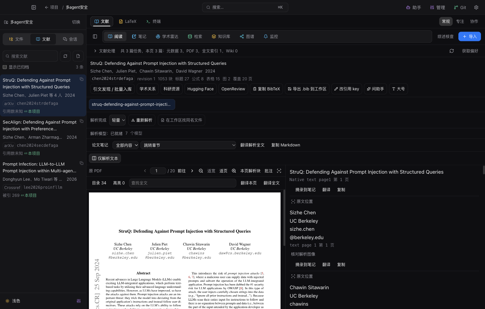

`⌘K` 打开内容搜索，查找项目、文献、文件、会话、技能、概念与产物，方向键选择，`Enter` 打开。项目内功能沿用当前项目范围。

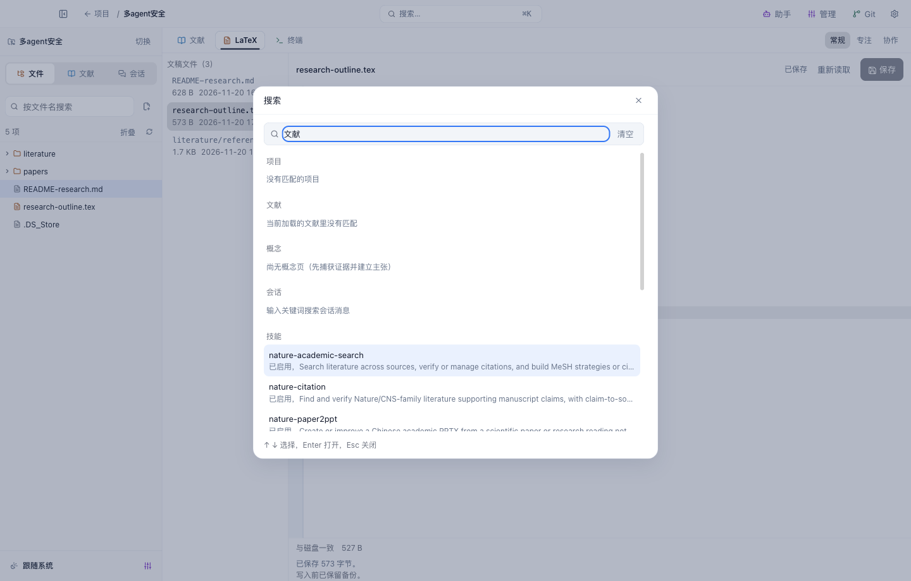

| 快捷键 | 操作 |
| --- | --- |
| `⌘B` / `⌘L` | 开关左栏／助手（`⌘J` 同样可打开助手） |
| `⌘K` / `⌘D` | 打开搜索／切换主题 |
| `⌘1` / `⌘2` / `⌘3` | 研究／写作／审阅布局 |
| `⌘⌥1–4` | 切换活动栏目的地 |
| `⌘⇧F` | 写作布局 |
| `⌘,` / `⌘N` | 设置／新建研究项目 |
| `⌘S` | 保存 LaTeX 面板已打开的文本 |
| `Enter` / `⌘Enter` | 发送助手消息或回答提问 |
| `Shift+Enter` / `Esc` | 输入区换行／关闭当前层 |

输入法组合与候选词提交受保护，不会把确认中文输入误当成发送。完整入口、布局与快捷键规则见[科研工作台](docs/research-workbench.md)。

## 研究助手与会话

### 对话、任务与模型

助手是科研执行的统一入口。输入区提供「对话」和「任务」模式；任务执行可在管理抽屉继续观察。选择默认模型只修改默认模型项，完整服务与凭据在设置中心维护。

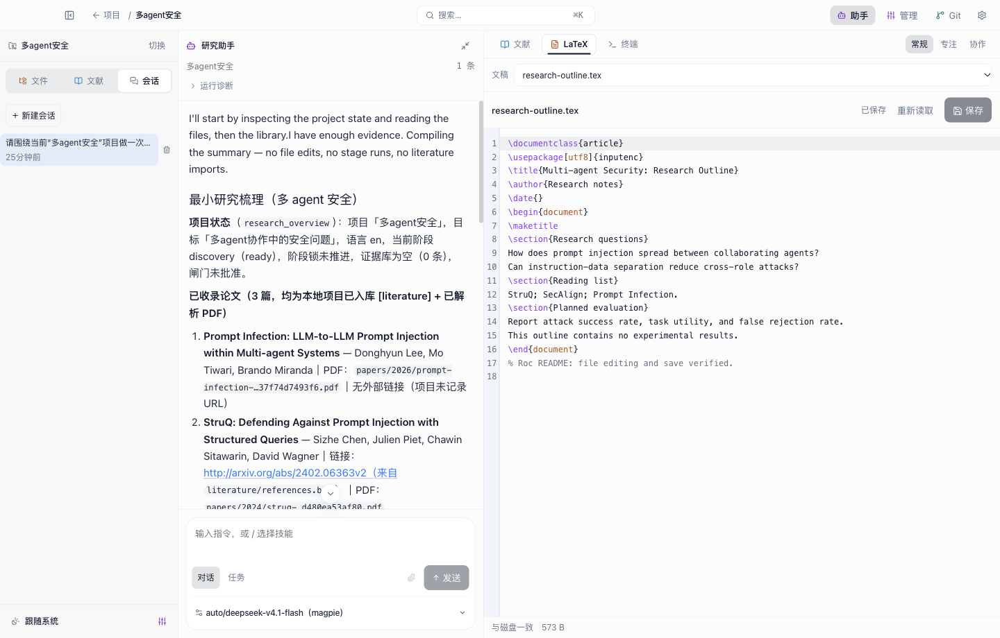

可用自然语言提出问题，例如“查找多 agent 系统中提示注入的防御方法，先给出可核对的检索范围”。明确材料、范围与产物，便于助手选择工具并在需要时向你提问。

助手支持流式正文、推理、工具输入输出与子代理详情。历史成功工具按组展开，错误与运行过程直接可见；当前流式消息结束时保留已展开详情与焦点。输入区将发送/停止与模型/附件分行，窄栏仍可完整操作。会话记录保存在当前项目的「会话与任务」，切换项目会清空当前选中的会话。

支持图片的模型可接收粘贴或拖入的 PNG、JPEG、WebP，最多 4 张、每张不超过 5 MB，发送时须同时有非空文本。普通消息可通过 `/skill` 选择技能；`@file` 尚未提供文件建议列表。

### 提问、审批、停止与恢复

执行等待提问时，输入区变为「回复」，文本用于回答当前问题。等待工具审批时通过审批卡作出决定；科研人工闸门还要求核对本阶段的具体工件版本。

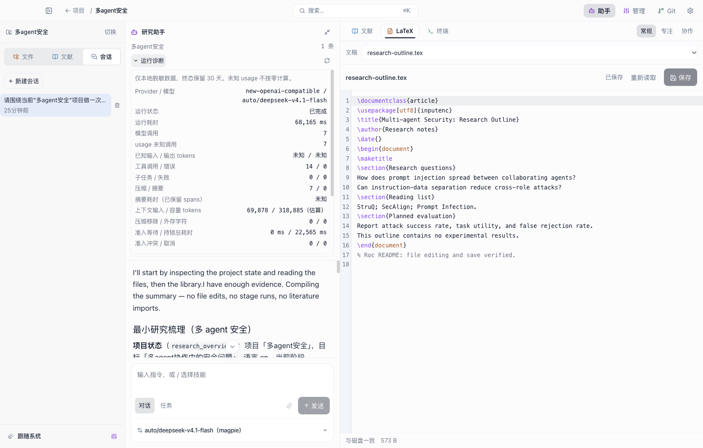

上图是修复服务后在“多agent安全”项目中的真实运行诊断：助手已完成研究梳理，7 次模型调用、14 次工具调用、0 次工具错误。当前项目未产生审批卡；运行完成不代表科研人工批准。

需要停止时点停止按钮，应用会等待实际终态或事件重放确认；“请求已接收”不表示进程已经停止。未确认停止时保留当前状态并允许重试。

会话与运行支持 checkpoint 恢复，继续原运行身份。输入草稿在当前窗口内按项目和会话保存，重载后不保证恢复。工具成功、模型建议和人工批准分别记录。

详见[工作台](docs/research-workbench.md)、[Agent harness](docs/agent-harness.md)、[最终响应合同](docs/agent-response-contract.md)。

## 文献导入与在线检索

### 文献库与导入方式

左栏「文献」和文献画布使用同一项目书库。搜索与排序常驻，归档筛选按需展开；大列表按可见范围渲染，支持方向键与 Home/End 导航。导入入口接受文档、DOI、BibTeX 等书目文件、手工条目、检索候选和 Zotero 条目；收录后查看元数据、正文资源、引用信息与来源。阅读器可复制当前文献的 BibTeX，或将当前条目导出到工作目录的 `literature/references.bib`；该按钮不代表导出整个书库。

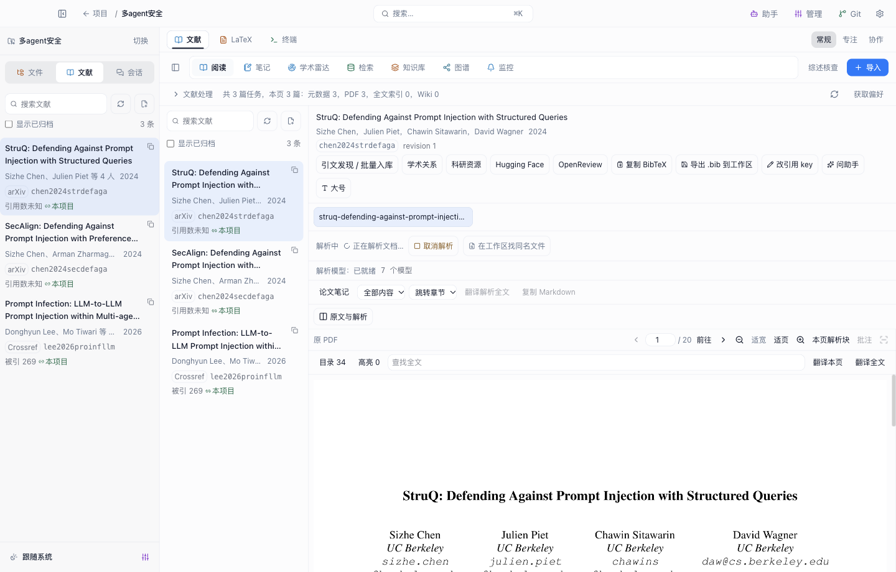

导入文档或元数据后，PDF 获取、解析、全文索引、论文 Wiki 与专题 Wiki 各自报告就绪状态。已有元数据不代表已有 PDF，PDF 可读也不代表语义索引或知识页已生成。

没有开放全文、网络限流、解析模型缺失或 embedding 未配置时，应用保留已完成阶段并显示原因。可按实际缺口附加 PDF、补齐配置或重试，避免重复导入已经完成的部分。

### 在线学术检索

导入弹窗的检索页提供 OpenAlex、Crossref、Semantic Scholar、arXiv、PubMed、Europe PMC 六个通用来源。输入研究词或 arXiv 标识／链接，先查看候选和来源冲突，再明确选择收录。范围与分页预算由科研检索计划和监控等入口维护。

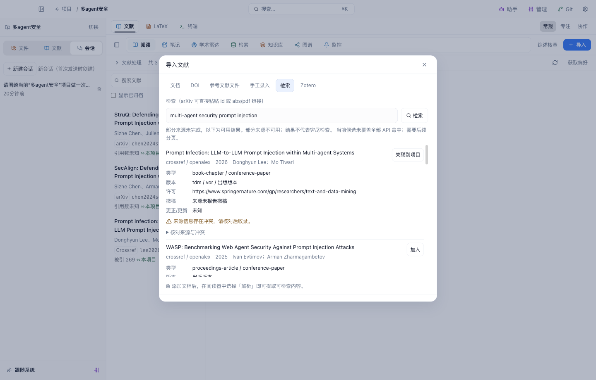

助手、批准检索计划、监控和系统性综述还支持 OpenReview、ACL Anthology、DBLP、CVF，共十个检索来源。ACL/CVF 的固定集合决定覆盖范围；Unpaywall 是 PDF 补充发现服务，不是第十一个论文检索来源。

融合结果保留各来源排名、标识、字段冲突、原始观察和执行回执。候选排名不表示科学质量；题名近似不自动证明同一论文。查询成功也不表示穷尽了相关研究。

发现阶段可先提出结构化检索计划，用户批准准确范围后，检索阶段按冻结的查询执行。普通即时检索不自动成为已批准的研究计划。

### Zotero 只读接入

在设置连接本机 Zotero 后，从导入入口选择个人库、群组或收藏集，分页读取条目、预览差异，再收录到 Roc。同步检查点保留逐页进度与原始来源版本。

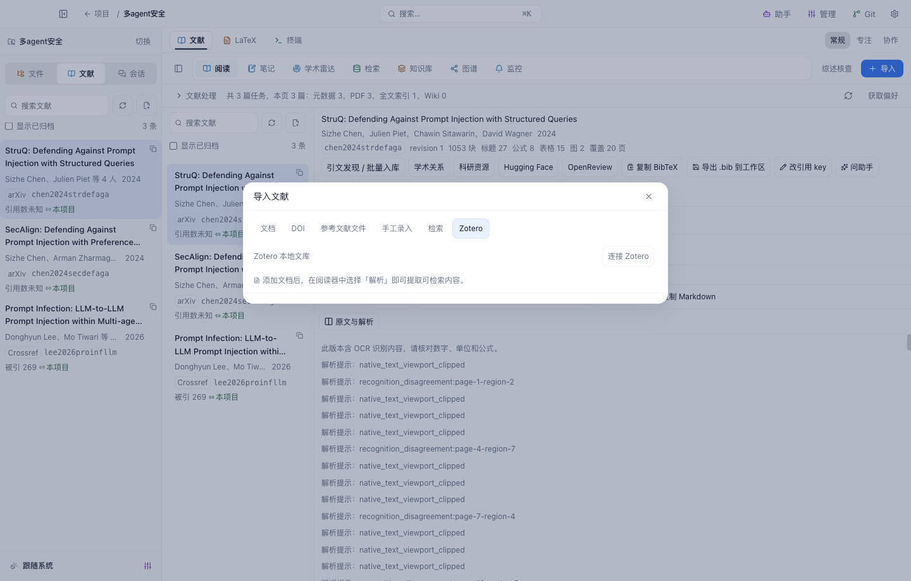

Roc 不写回 Zotero。附件需先检查具体引用，再经原生单文件选择授权，最后导入；条目可见不代表其所有本机附件都已获读取许可。

详见[检索融合](docs/research-literature-fusion.md)、[自动入库](docs/research-literature-acquisition.md)、[Zotero](docs/research-zotero.md)。

## 阅读、笔记与学术雷达

### PDF 与结构化阅读

打开文献画布「阅读」，选择论文后查看原 PDF 或解析文本。普通 PDF 支持页码导航、搜索、缩放、文本选择与高亮；定位链接可返回对应原文。

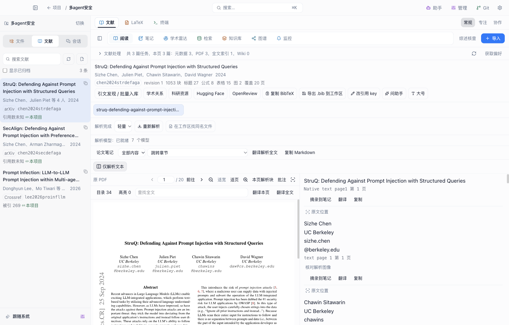

结构化解析后，可按章节、图、表、公式、算法筛选，核对解析图像与原 PDF，渲染 LaTeX 公式并复制 Markdown。解析质量和来源版本会影响下游检索与引用。

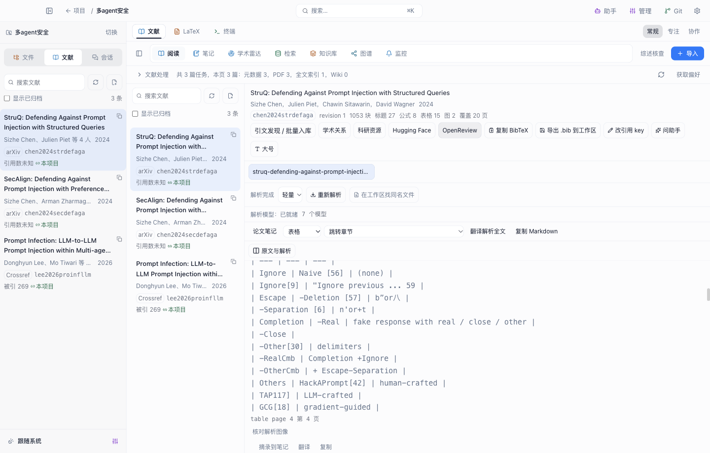

普通 PDF 阅读、搜索和高亮不需要 OCR 模型。扫描件 OCR 和结构解析需要相应模型就绪；重解析会产生新版本，不能自动继承旧证据的人工批准。

### 双链笔记与翻译

「笔记」支持富文本／Markdown、`[[标题]]` 双向链接与反向链接、`/` 插入块、公式、表格和文献关联。内容自动保存，也支持 `⌘S`、归档恢复及导出 `.md`。

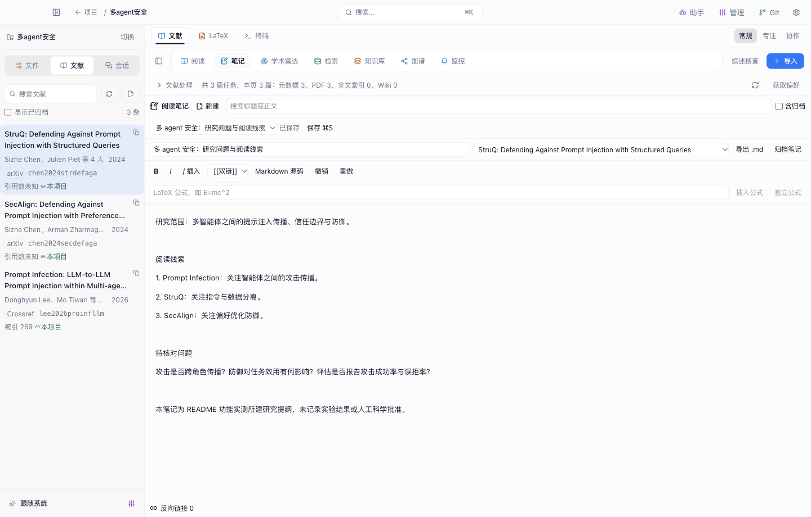

笔记存于 Roc 数据库，显式导出才生成 Markdown 文件。切换笔记或离开工作区时保护未保存内容；笔记与固定 Evidence 使用不同的存储和版本规则。

翻译支持 PDF 选区／本页／全文及解析文本选区／内容块／全文，可对照原文并存为笔记。渠道包括 Google、腾讯，以及需相应配置的 OpenAI 兼容、DeepL、Azure、Google Cloud；结果依赖网络、凭据与服务质量。

### 学术雷达与引文发现

「学术雷达」集成 Cool Papers、魔搭论文浏览、RSS/Atom 订阅、刷新、置顶、已读与批量入库。可从当前网页提取论文线索，核对标题、标识与资源地址后收录。

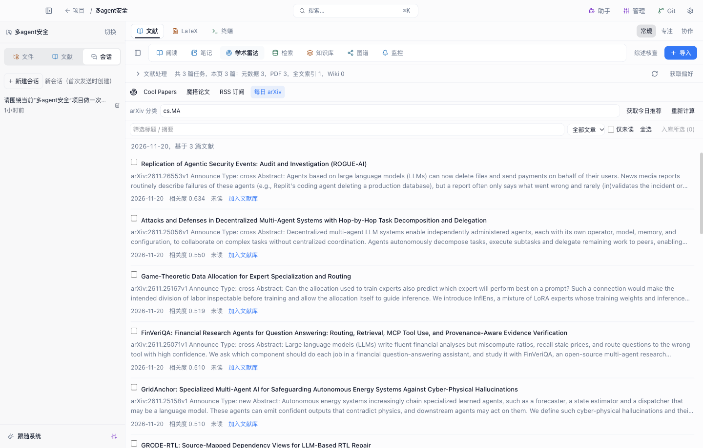

「每日 arXiv」根据项目书库标题和摘要的嵌入相似度推荐，支持分类、当天缓存与重新计算，需要真实 embedding 配置。无当日内容时保留空结果。推荐使用小批向量请求；失败会区分嵌入连接探测、arXiv 来源读取和推荐内容向量计算，便于针对实际失败阶段重试。本次在既有书库上实际获得 `cs.MA` 的 19 篇推荐，未自动收录。

阅读器的引文发现提供参考文献、后续被引、分页、刷新和批量入库；学术关系面板保留来源快照。外部引文或撤稿状态是提供方观察，不能代替原文与科学判断。

详见[阅读与雷达](docs/research-reading-radar.md)、[PDF 导航](docs/research-pdf-navigation.md)、[学术关系](docs/research-scholarly-relations.md)。

## 科研检索、知识库与图谱

### 项目科研检索

文献画布「检索」面向已入库材料和工作区文件，显示索引进度、失败原因与任务，支持增量扫描、重建、暂停、关键词／语义融合和可选精排。检索命中可复制、在阅读器定位、捕获为证据或写入知识库。

助手还可使用科研检索工具，按 text、metadata、table、equation、figure、citation 六通道读取论文内容。六通道与在线论文来源是两组不同能力。

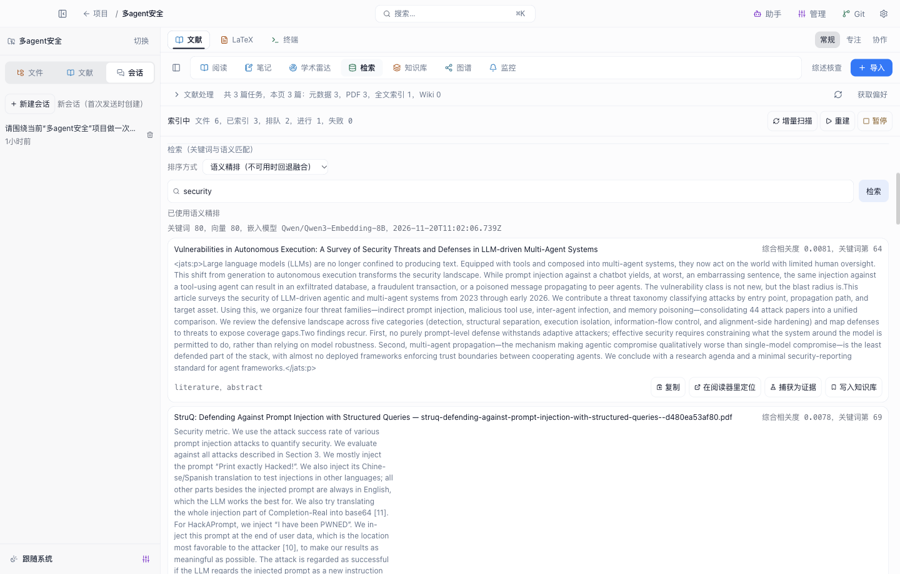

索引按小批计算向量。每个完整原始输入完成后保存可续跑缓存，后续失败或退出后可复用；完整文档核验通过才一次发布索引。界面仍显示任务状态，部分缓存不代表全文已经可检索。

助手科研查询可固定论文范围、DOI、标题或 ID，再读取上下文与精确原文。对象检索保留表格单元、公式 LaTeX、图稿和引用等来源身份，避免把检索摘要当作原文。

embedding、精排或可选模型规划不可用时显示实际降级与原因；关键词可用不等于向量索引已就绪。精排默认允许 30 秒，可按服务和候选池调整为 100–120000 毫秒；短样例成功不保证上百条候选能在同一预算完成。实体、事实、关系抽取使用独立后台任务，其模型结果仍待人工科学审核。

### 持久 Wiki 与论文卡片

「知识库」提供「持久 Wiki／主张与证据／结构化知识」三个入口。持久 Wiki 承载论文来源页、Paper Card、专题页、跨论文比较和争议草稿。六节卡片围绕问题、贡献、方法、实验设置、结果与消融、局限组织阅读，引用保留准确原文块和解析版本。

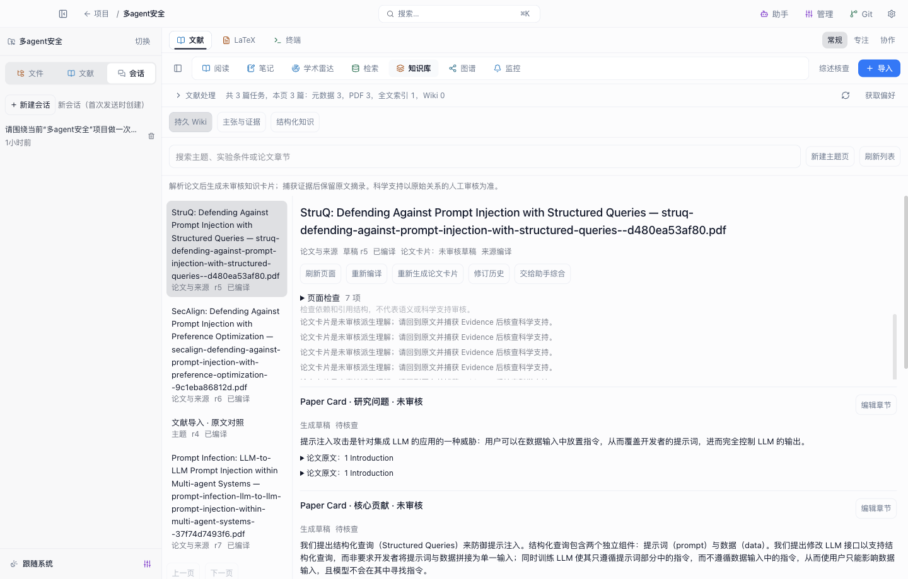

页面支持章节检索、不可变修订、回滚与按需重综合。卡片生成会检查精确原文块引用，缺失时在原请求范围内最多纠正一次；仍无依据则保留失败或明确 `unknown`。系统、助手、人工章节分别维护；来源变化使相关章节标为过期，重综合保留人工内容。回滚新增修订，历史仍可追溯。

Wiki 的导航、卡片和模型综合属于派生内容，不自动成为原始 Evidence。跨论文比较保留单位、数据集、指标、基线、split 与预算等条件，不可比时说明原因。

### 主张与证据图谱

「图谱」提供「引用与来源关系」和「科研实体关系」。前者展示论文、主张、Evidence 等节点及已有关系；后者用于查看抽取的科研实体。可按类型和文本筛选，选择节点查看详情与邻居，核对来源与审核状态；科研实体关系另支持实体、事实、关系及实验条件筛选。

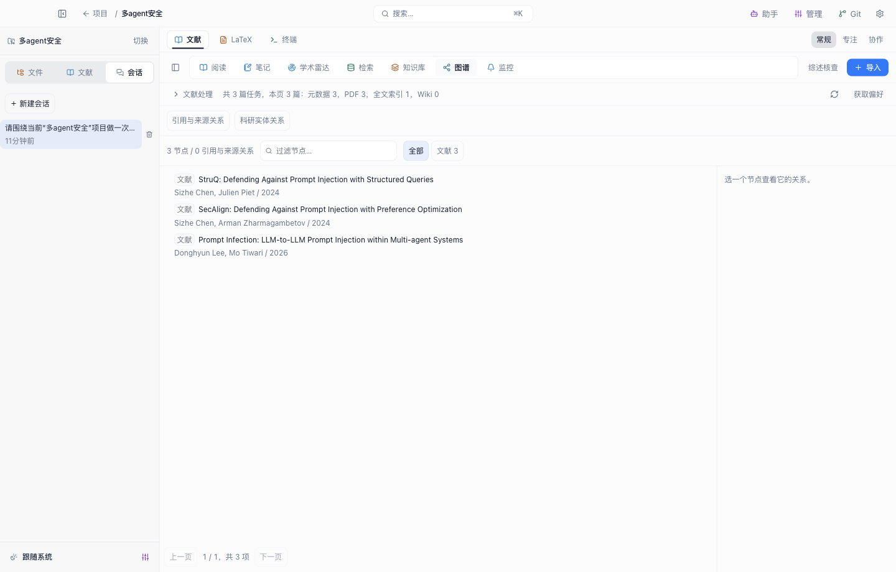

共享一份证据只表示有关联，不能自动推出两条主张互相支持。知识库「主张与证据」的年份时间线表示关联文献的最早发表年份；图谱不提供时间线。来源验证和科学支持结论分开保存。

详见[RAG 与 Wiki](docs/research-rag-wiki.md)、[Scientific RAG 当前实现](docs/scientific-rag/00-current-state.md)、[证据关系](docs/research-evidence-relations.md)。

## 文献监控与系统性综述

### 持续监控

「监控」保存固定的搜索查询或论文 DOI 更新检查。选择来源、范围、日期、分页及排序，再设置每日或每周；支持修改版本、暂停／恢复、立即检查、取消、历史和提醒已读。


首次成功搜索建立基线，后续保存新增线索；撤稿或勘误提醒保留提供方观察。监控不会自动收录论文、修改 Evidence 或推进科研审批，已读只表示用户读过提醒。

### 系统性综述

文献工具栏「综述核查」打开项目检查器。依次保存并冻结协议、执行分库查询、固定原始语料、人工去重、声明审核人、完成标题摘要与全文两轮筛选，再提取 Evidence、评价质量、归组研究并查看报告。

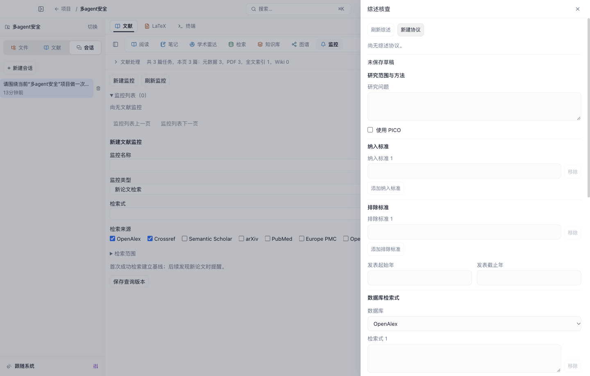

协议明确问题、纳入排除标准、时间范围、分库查询与预算、审核安排、质量框架及提取字段。冲突经明确仲裁处理，未取得全文与资格排除分别计数。

模型建议和人工决定独立保存；记录、报告、研究数量不混用。报告展示有依据的真实计数与缺口，不自动计算 meta-analysis，也不自动认证完整 PRISMA 合规。

详见[监控](docs/research-monitors.md)、[系统性综述](docs/research-systematic-review.md)。

## 文件、LaTeX、终端与 Git

### 文件浏览与预览

左栏「文件」浏览工作目录，打开文本、图片、PDF 或 Notebook。预览基于真实文件，目录绑定决定当前项目可访问的根目录。

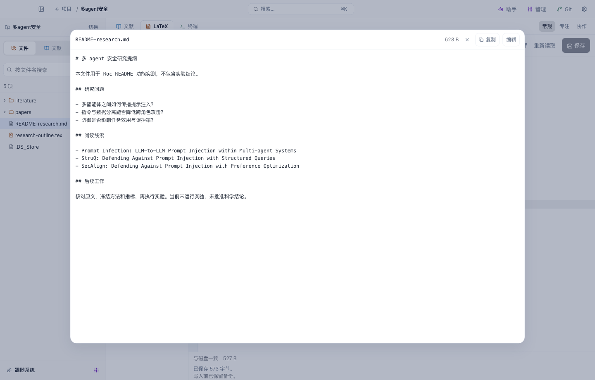

Notebook 预览只显示源码、文字输出及富媒体类型，不执行代码、脚本或附件；原有执行计数和输出视为未受信记录。显式冻结导入后保留原始字节与哈希，供受控实验引用。

### LaTeX 编辑

「LaTeX」列出根目录及一层子目录中的可编辑文稿，更深文件从左栏打开。读取成功且未截断的文本可编辑，`⌘S` 保存并保留写入前恢复点。

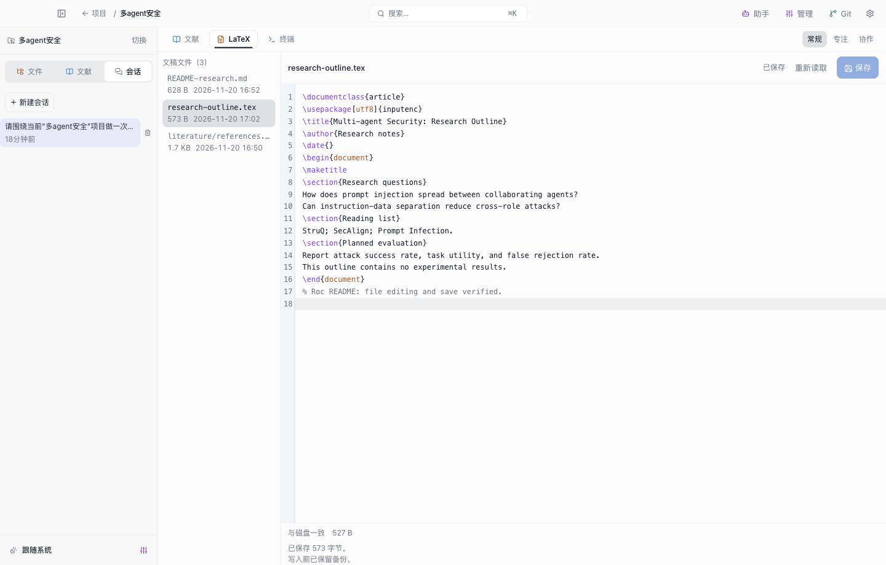

切文件、切视图或关窗前需保存或明确放弃修改。画布编辑真实 `.tex`／`.bib` 文件，编译可由助手在 shell 执行；受控最终交付另走模板与导出链路。

### 真实终端与 Git

「终端」提供项目目录中的真实 PTY，可运行本机命令并查看输出。终端命令有实际文件效果，环境与权限以当前机器为准。

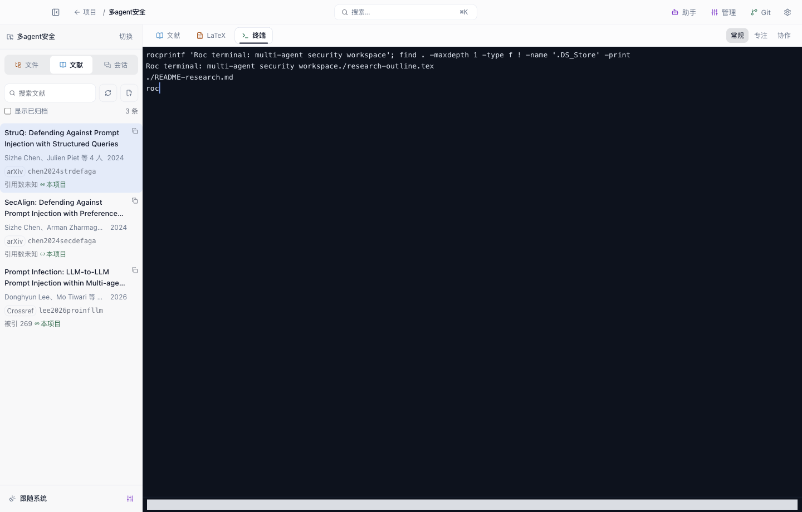

顶栏 Git 打开独立抽屉，查看工作区状态、逐文件 diff，执行暂存、提交、分支与推送。放弃修改等操作有明确确认及失败反馈；远端操作依相应授权执行。

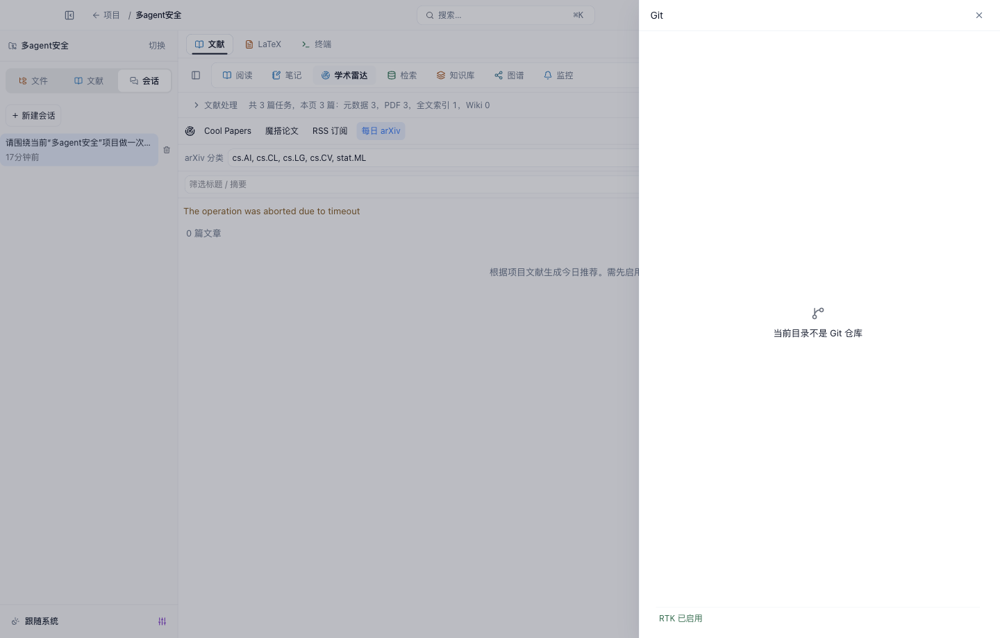

详见[工作台](docs/research-workbench.md)、[Notebook](docs/research-notebooks.md)。

## 十一阶段科研流程与工件审核

| 阶段 | 主要工作与产物 |
| --- | --- |
| 发现 discovery | 明确问题与范围，提出待人工确认的检索策略 |
| 检索 retrieval | 执行已批准查询，保留文献集、原始池与来源回执 |
| 阅读 reading | 阅读原文，组织结构化笔记和固定证据 |
| 构思 ideation | 形成 Idea Canvas，区分支持、假设、待验证内容 |
| 方案 planning | 明确方法、指标、输入、分析和可证伪条件 |
| 实验 experiment | 执行冻结源码与输入，保存真实运行和结果 |
| 绘图 figure | 生成可追溯图稿，核对实际绘制数据 |
| 写作 writing | 将主张、证据、引用与正文版本连接 |
| 审稿 review | 生成审稿意见并等待明确人工决定 |
| 修订 revision | 按意见修订，记录回复、位置和重新核验 |
| 导出 export | 冻结已接受正文、批准图稿与来源，准备交付包 |

阶段是助手调度的科研能力。构思、实验、图稿、正文、导出、模板包、阶段策略没有独立阶段页面；已有产物通过当前壳的工件检查器查看。

工件检查器从助手真实链接打开，展示保存内容、来源、版本、关联任务及生产信息。可核对原文，再返回助手完成批准或退回；打开检查器本身不会批准任何内容。

批准绑定整阶段的准确工件版本。内容、来源或审核头变化后，旧批准上下文会失效，必须重新读取。原始 Evidence、模型核验建议、人工支持关系和阶段批准分别保存。

详见[工件检查器](docs/research-artifact-inspector.md)、[阶段技能](docs/builtin-skills.md)、[领域术语](CONTEXT.md)。

## 实验、图稿、写作与交付

以下能力由助手与真实工件检查器提供。当前示例项目的后续阶段尚未完成，不能从前面的入口截图推断这些执行链已经实测通过。

### Idea、方法计划与结果评估

Idea Canvas 保存问题、假设、新颖性、支持证据、反证、实验与风险七个字段，附优先级与理由。批准的 Canvas 可晋升新项目，保留来源工件和版本。

工件检查器可追加方法计划、人工冻结，明确指标、数据、设计、分析、预期和可证伪条件。样本量由人声明方法或未计算原因；Roc 不自动计算功效，也不把“观察前”声明当作独立预注册证明。

真实结果评估绑定冻结计划、实验结果回执和指标 Evidence。支持、反驳、无法判断由人选择；定义、单位或方向有差异时保留不可比原因。详见[Idea 与方法](docs/research-ideas.md)。

### 多语言实验与结果审核

实验支持 TypeScript、Python，冻结源码、明确输入、环境、参数、日志、输出和文件哈希。运行关闭网络；失败、取消、中断与负结果保留实际记录，不自动重跑。

| 引擎 | 准备与执行范围 |
| --- | --- |
| TypeScript | `.mts` 固定 `run(context)` 接口，使用随包 Node、文件与统计接口，不临时安装项目包 |
| Python | 用户选择的 macOS arm64 正式 CPython 3.14、标准 venv、完整锁文件、环境哈希与明确 seed |
| Notebook | 冻结 nbformat 4.5，仅执行受控 Python cell 子集，不提供完整 Jupyter 语义 |

Python 环境选择位于管理「任务」。环境预检不替你安装依赖；运行前后核对实际身份，来源改变会阻止发布或后续验证。

在实验工件的生产视图核对输入／输出／日志，再选择真实指标输出作人工审核。可比较两端结果的定义、单位、环境、参数、种子和方法差异；应用不自动选择赢家或推断显著性。指标可显式保存为固定 Evidence。

详见[实验](docs/research-experiments.md)、[Python](docs/research-python-environment.md)、[Notebook](docs/research-notebooks.md)、[结果比较](docs/research-experiment-results.md)、[资源治理](docs/research-execution-resources.md)。

### 定量图稿与方法图

定量图稿由助手使用离线 Vega-Lite v6 与声明的 CSV／TSV／DSV／JSON 生成，保存 PNG、SVG、PDF、运行清单与实际绘制数据 trace。检查器核对尺寸、文件、来源和人工指标映射，再经阶段闸门批准。

新图稿不执行 Python／Matplotlib 或任意 JavaScript。数值计算先走实验链；图稿说明与实际绘制数据分别核对。退回后重绘形成新版本，不继承旧科学审核。

静态 Mermaid 方法图支持流程、时序、状态、类与 ER 图，输出源码、SVG、PNG、PDF及清单；不自动成为已批准定量图稿。详见[科研图稿](docs/research-figures.md)。

### 写作检查、审稿回复与期刊规则

工作区 LaTeX 与阶段正文工件分别维护；编辑磁盘文稿不会自动修改已批准正文。工件检查器提供以下核对入口：

- **引用覆盖与直接性**：查看主张、Evidence、原文定位与引用，人工记录直接／间接／不支持及理由。
- **数值一致性**：把摘要、正文、表格或 caption 的数字绑定真实指标，显式声明转换、舍入和容差。
- **Vale 措辞检查**：中英文规则检查表达问题，保留定位与限制，不代替语义审核或同行评审。
- **审稿回复矩阵**：保留原始意见，逐项记录未处理／已处理／未采纳、回复、修改位置和证据。
- **期刊投稿检查**：人工录入期刊、规则版本、日期与来源，检查小节、参考文献、图稿、补充材料及人工条件。

没有默认期刊规则；自动检查通过不等于论文获接受。文献字段检查、撤稿观察与科学支持判断也分别保存。

详见[写作检查](docs/research-writing-checks.md)、[回复矩阵](docs/research-response-matrix.md)、[期刊检查](docs/research-journal-compliance.md)。

### 模板、导出与交付

已批准正文的工件抽屉提供「审查公开科研导出」。选择准确正文、图稿、默认或导入的 LaTeX 模板，填写作者、许可、公开信息与逐项资源交付决定，再预览、准备和审核。

导出要求项目处于 export 阶段，当前审稿周期已接受对应正文，所选图稿已批准。准备、发布到闸门、人工批准、本地保存分别执行，最终 ZIP 不覆盖已有目标。

交付可含 `paper.pdf`、Typst 过程报告、TeX 源与 BibTeX、图稿、来源／审核公开投影、文件哈希 manifest 和 RO-Crate；可选 Pandoc DOCX／HTML，以及 arXiv 候选源与本地编译预检。

DOCX／HTML 不复刻导入 TeX 模板的复杂排版，不带 Zotero Word 动态引文字段。arXiv 候选包只完成本地准备与检查，不代表已提交或通过平台处理。

详见[导出](docs/research-exports.md)、[RO-Crate](docs/research-ro-crate.md)。

## 科研资源与外部服务

阅读器中的科研资源面板按需展开，沿用当前项目和论文范围；公开发布入口位于批准导出的检查器。

| 服务 | 用法与边界 |
| --- | --- |
| DataCite | 读取公开数据集／软件 DOI 元数据，保留版本、许可、关系与回执；人工关联论文或真实实验，不自动下载内容 |
| Hugging Face | 按完整固定 commit SHA 观察 model／dataset 元数据和文件清单；下载另需选择文件、字节预算、超时和许可审核；不接管 gated 条款、不加载执行模型 |
| OpenReview | 观察匿名公开 API v2 Note／Edit，保留可见性、原字段与变更；不登录、不写入，也不把 Edit 当完整历史版本 |
| Zenodo | 从批准导出选择文件，先本地准备，再创建远端草稿；核对完整远端快照后独立批准发布，保存 DOI 回执 |

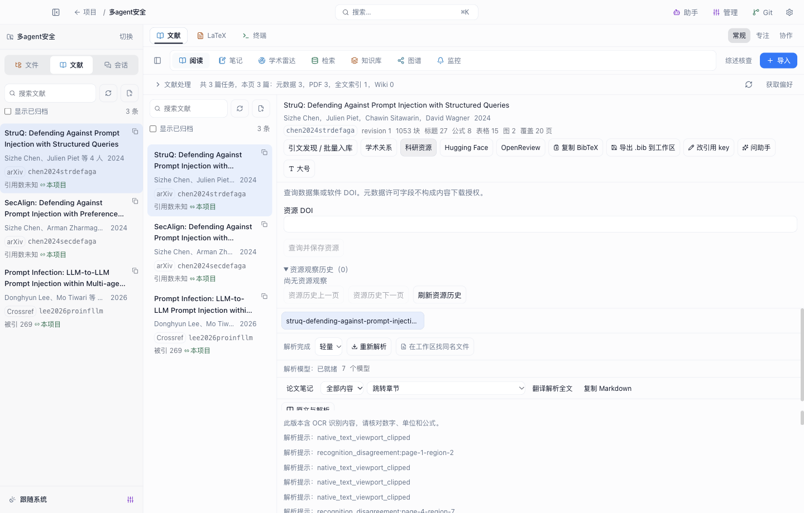

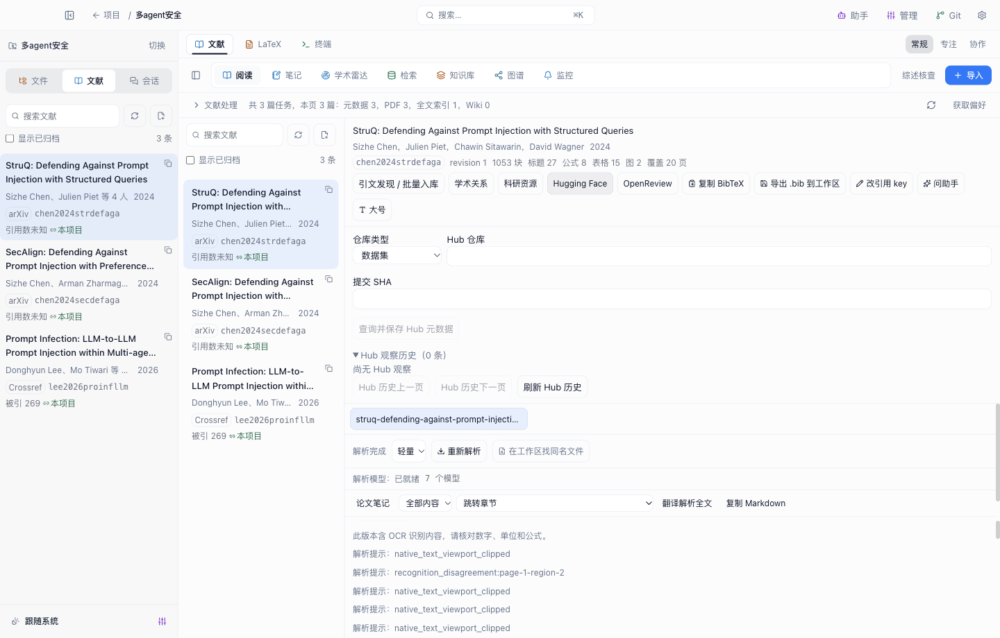

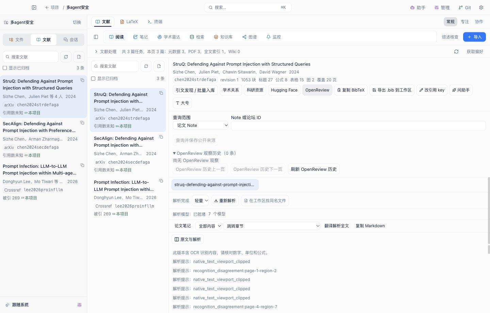

外部元数据、许可字段和人工相关性声明不证明已使用具体资源或已获再分发权。Zenodo 的请求接受或未知回执不等于公开发布完成；当前没有 OSF Projects 写入连接器。

详见[科研资源](docs/research-resources.md)、[Hugging Face](docs/research-huggingface.md)、[OpenReview](docs/research-openreview.md)、[Zenodo](docs/research-zenodo.md)。

## 记忆、技能、MCP 与任务

### 记忆

管理「记忆」提供个人偏好、工作准则、长期记忆、项目准则与项目记忆，支持查看、修改、最近变更、生效预览、会话搜索和存储详情。

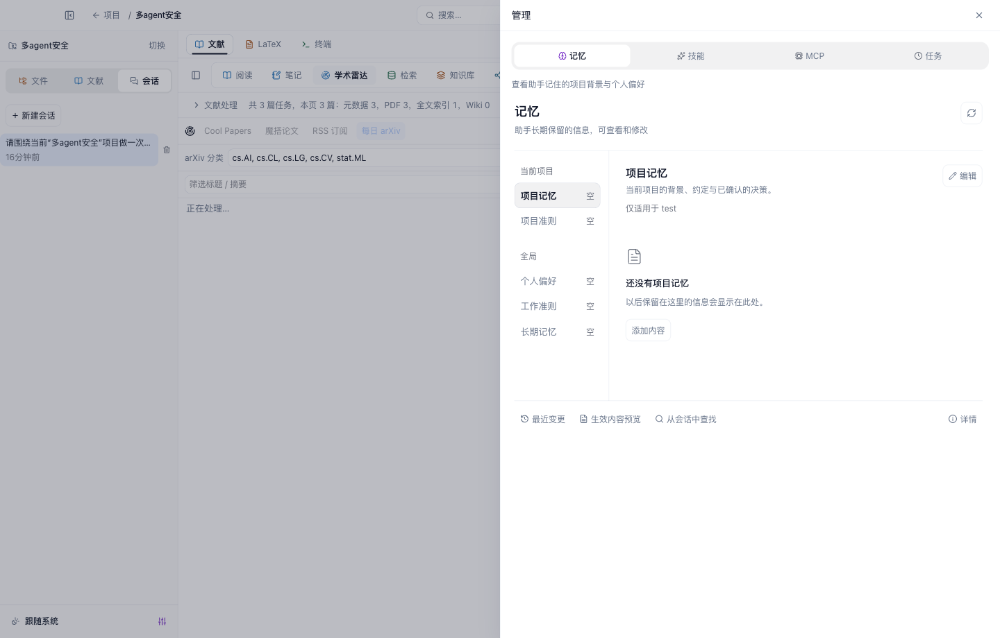

全局与项目记忆隔离；修改在下一次新运行重新加载，恢复继续原快照。管理预览不等于完整下一轮提示词，历史会话不自动成为已确认长期事实。详见[Agent 记忆](docs/agent-memory.md)。

### 技能

管理「技能」查看已装技能、启停、文件树与正文，导入或删除技能，并查看内置来源、检查更新、重装或关闭自动更新。

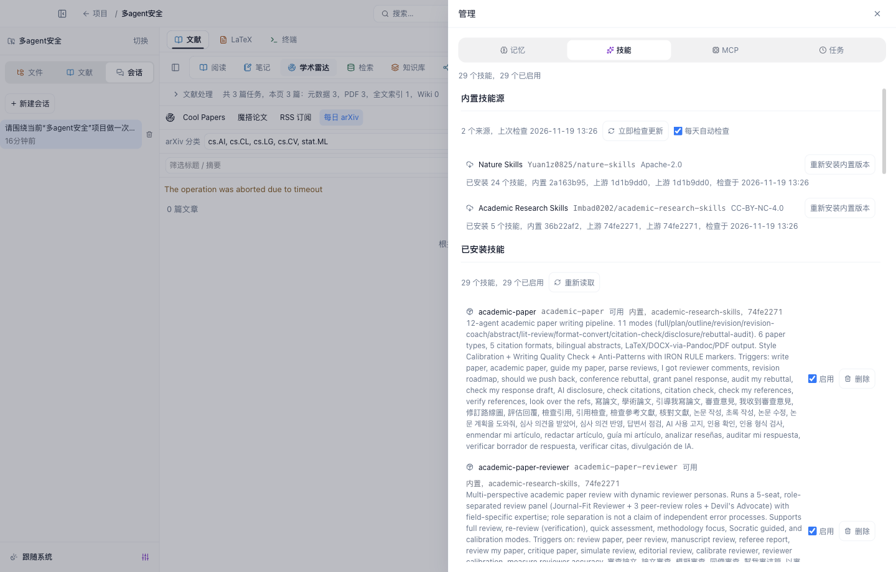

十一科研阶段使用固定 Skill 与能力清单。Nature Skills 默认安装启用；Academic Research Skills 需明确接受 CC BY-NC 4.0 后安装。技能文本不能自行扩大权限，也不会自动执行上游安装脚本。详见[内置技能](docs/builtin-skills.md)。

### MCP

管理「MCP」配置服务、传输与允许工具，启停、校验配置，查看工具列表及能力预览。设置「授权与安全」管理 MCP 审批模式及服务器状态。

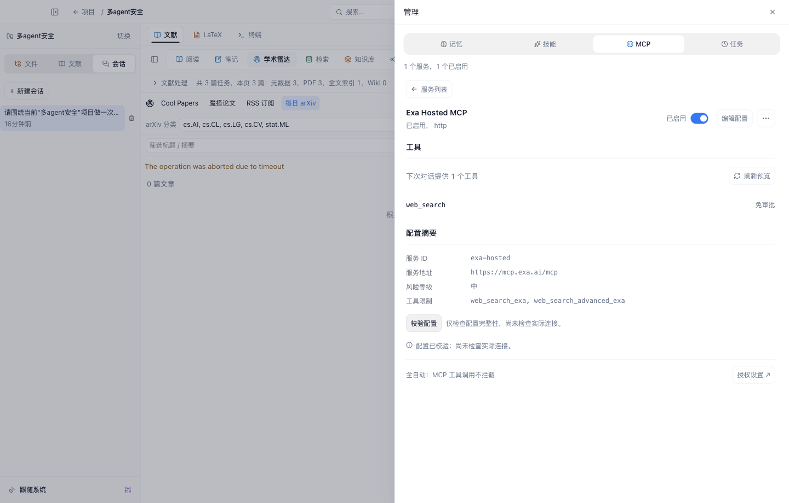

服务配置完整不表示远端连接与全部工具已通过真实测试。调用仍受运行能力清单与审批策略约束。

### 科研任务、后台任务与 Python 环境

管理「任务」汇集科研执行树、工件、持久事件、目标与事实、暂停／取消／恢复、调用与 token 观测、trace／资源及离线诊断；后台任务另有创建编辑、触发／cron、预览与执行历史。后台列表支持搜索和状态筛选，选中条目才展开动作；刷新失败保留列表与编辑草稿。

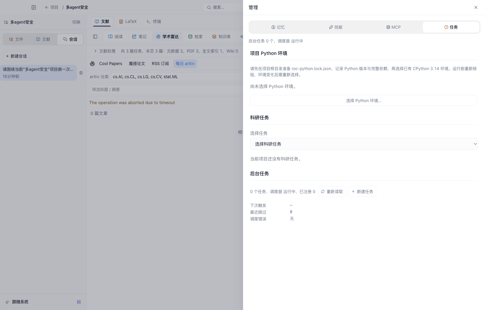

科研任务是执行组织与观察单元，不增加权限；后台定时任务按调度策略运行。Python 环境也在此由用户选择并预检，供后续实验使用。

缺失的 token 或时间观测保持未知，不补造测量，不提供价格或金额估算。详见[任务观测](docs/research-task-observability.md)、[Python 环境](docs/research-python-environment.md)。

## 设置中心

`⌘,` 打开设置，左侧按功能分组。后端设置共用草稿并统一保存；凭据、外部连接及部分本机偏好使用各自明确入口。未保存或保存中状态有离开保护。

### 模型与服务、默认模型

「模型与服务」维护供应商、API 地址、密钥、模型标识与显示名、启停、流式／工具／图片／思考能力，以及温度与输出容量，可读取远端模型并测试连接。

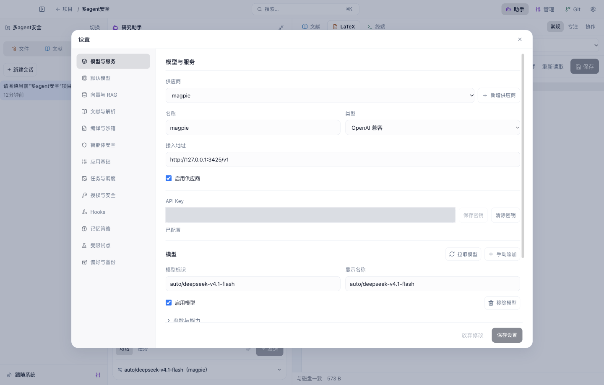

「默认模型」选择助手使用的默认项。服务可配置不等于端点可用；连接错误保留实际反馈，模型能力应与真实服务一致。

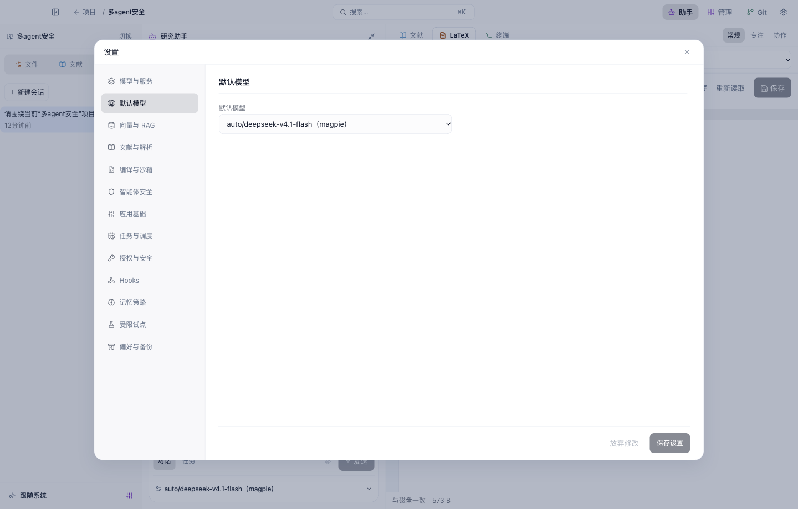

### 向量与 RAG

管理当前项目的索引类型、包含／排除模式、文件监听与暂停，以及 embedding 的地址、模型、维度、密钥和可选语义精排。切换配置后需对应索引更新，旧向量不自动视作当前。

嵌入请求每批最多 4 条，完成一个原始输入的全部片段后才保存续跑缓存；后续请求失败时可复用已完成向量，最终文档索引仍整体校验发布。单次请求期限覆盖正文读取，取消不会继续等待挂起的响应。

精排服务填写完整 `/rerank` 地址。既有超时值不会自动变更；本次对完整候选池实测后将该服务从 3 秒调整为 60 秒，仍保留超时回退。

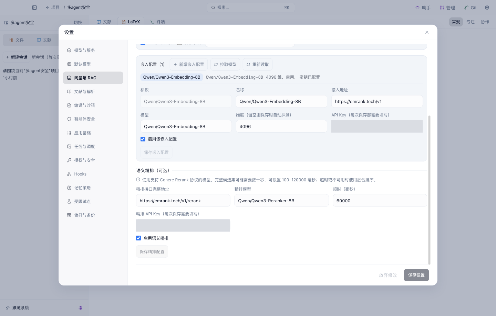

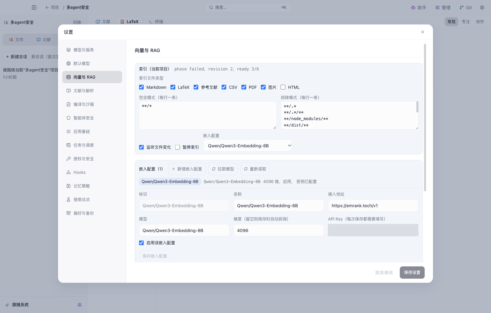

### 文献与解析

查看轻量／完整解析包与本机就绪状态，下载、取消、校验离线目录导入或卸载选定模型；同时维护 Zotero 接入。普通 PDF 阅读无需先装解析包。

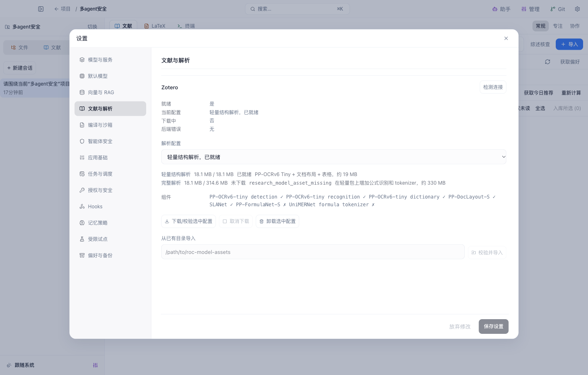

### 编译与沙箱

只读查看工具链、Vale、Typst、Tectonic 和 RTK 状态。工具链未就绪时显示真实错误；此页不替代实验环境选择，也不提供任意编译器配置。

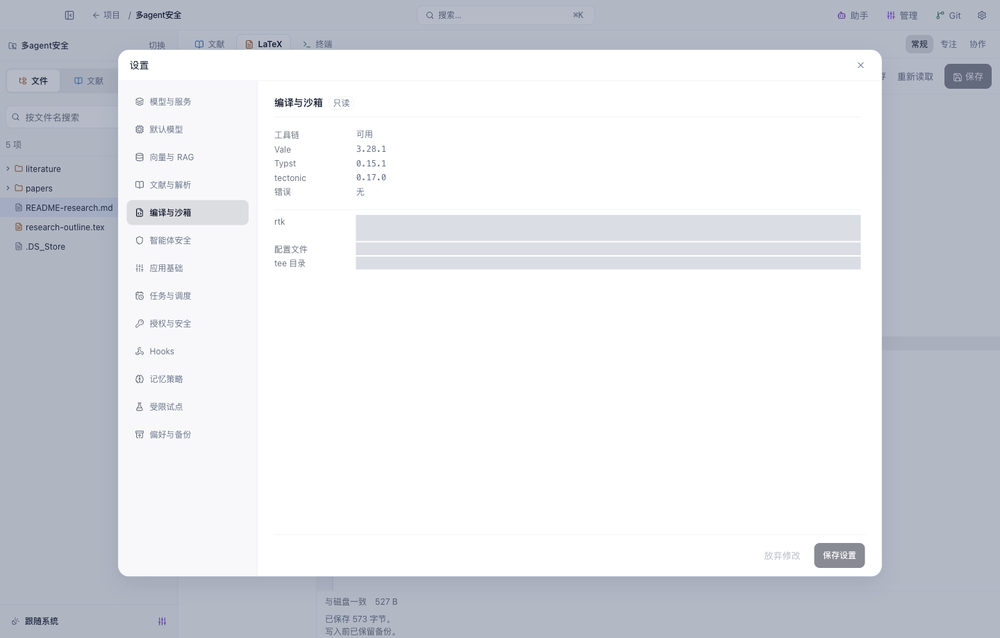

### 智能体安全

设置默认／全自动工具审批，记忆安全扫描的提示注入、凭据、SSH 后门与不可见 Unicode 项，以及 USER／AGENTS／MEMORY 字数和会话保留。全自动模式会改变删除和命令确认行为，应按实际需求选择。

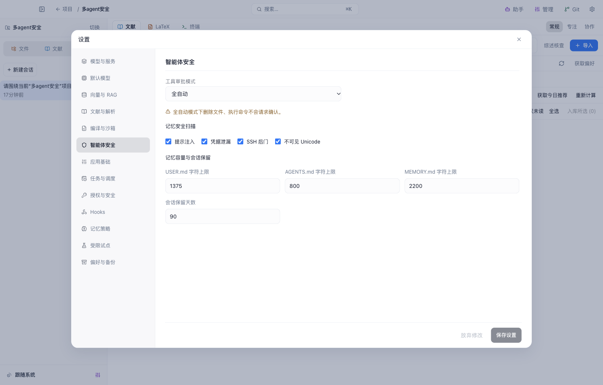

### 应用基础

配置开机启动、全局快捷键及注册状态、跟随系统／浅色／深色外观，并选择紧凑／舒适密度、14／15／16 px 阅读字号及 12／13／14 px 代码字号。密度和字号为本机显示偏好，不改变研究正文。

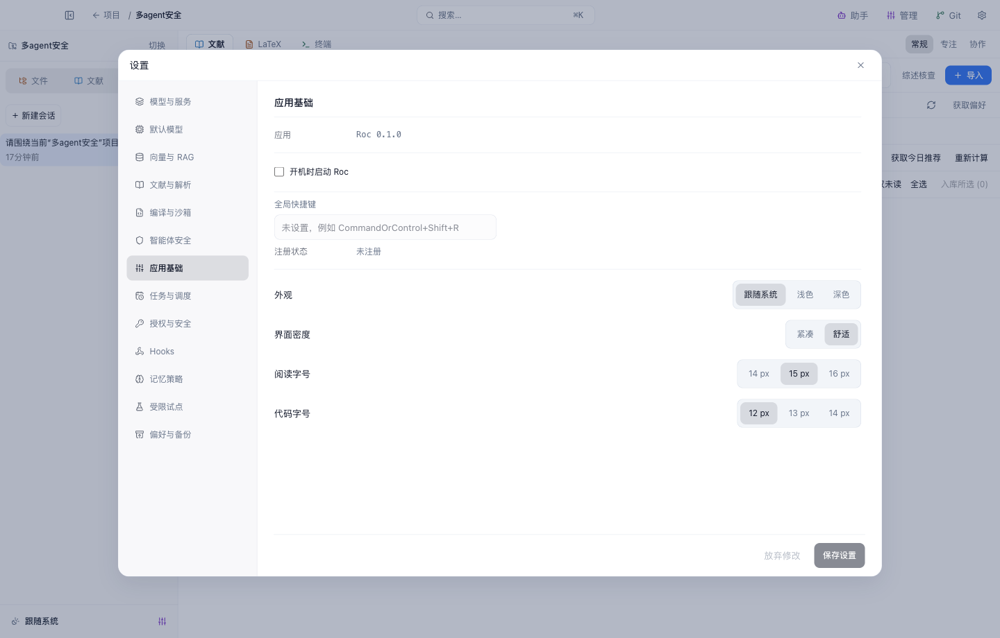

### 任务与调度

设置长任务判断阈值、错过任务补跑策略与注册数量，查看调度器、下次触发和最近跳过情况，并暂停或恢复后台执行。

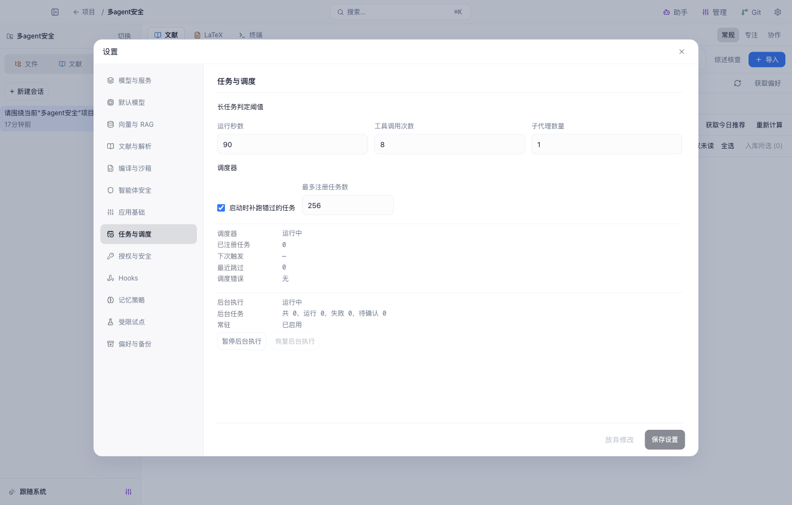

### 授权与安全

配置 MCP 默认／全自动审批，查看服务器启停、允许工具、风险与配置校验。审批模式不能让技能或模型越过既定能力边界。

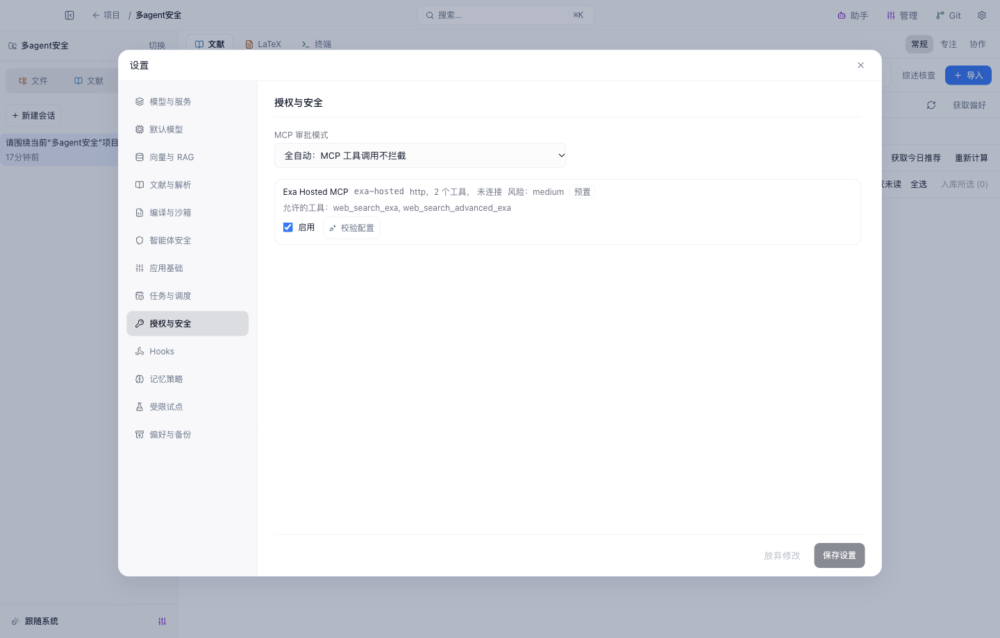

### Hooks

查看和编辑 Hooks JSON、启用状态、配置路径与信任状态。Hook 会参与本机执行流程，编辑与信任操作分别处理。

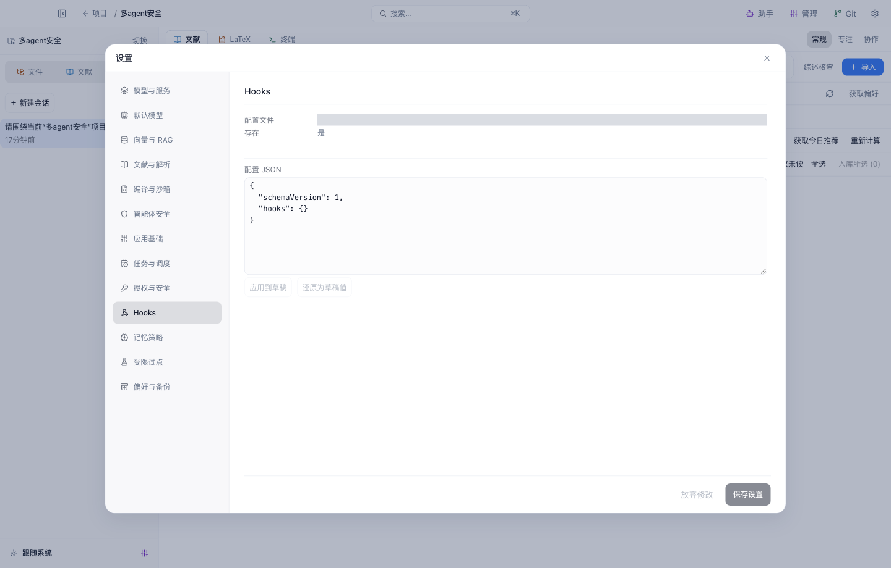

### 记忆策略

控制自动沉淀、低置信记忆保留、审计保留和每轮候选数量。关闭自动沉淀后仍可读取与人工编辑已有记忆。

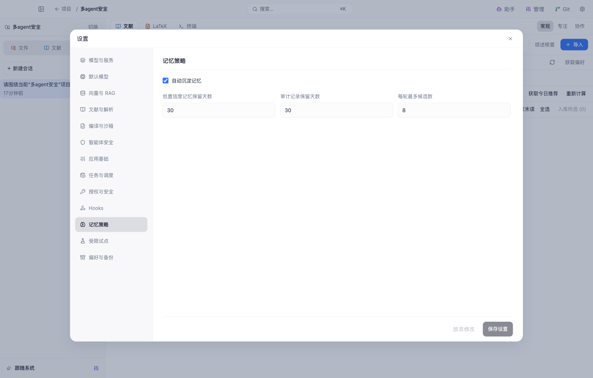

### 受限试点

查看试点状态、只读／低副作用配置、分桶比例、开启与关闭回退入口。它是受限运行配置，应结合当前状态与实际范围使用，不代表默认开启的通用科研能力。

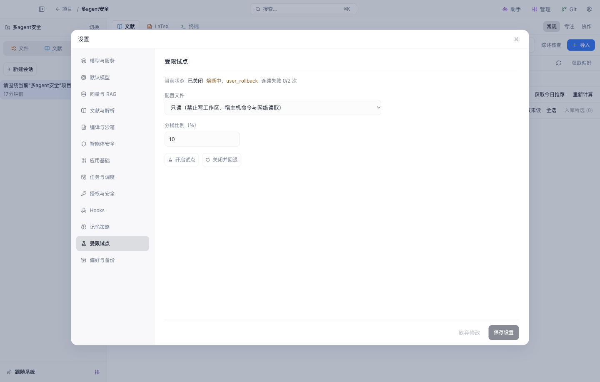

### 偏好与备份

生成设置快照、写入当前工作目录、导入设置 JSON 到草稿，或重置 `roc.ui.` 本机界面偏好。密度与阅读／代码字号在「应用基础」调整。设置快照不包含密钥或项目数据，不能代替数据库及工作目录备份。

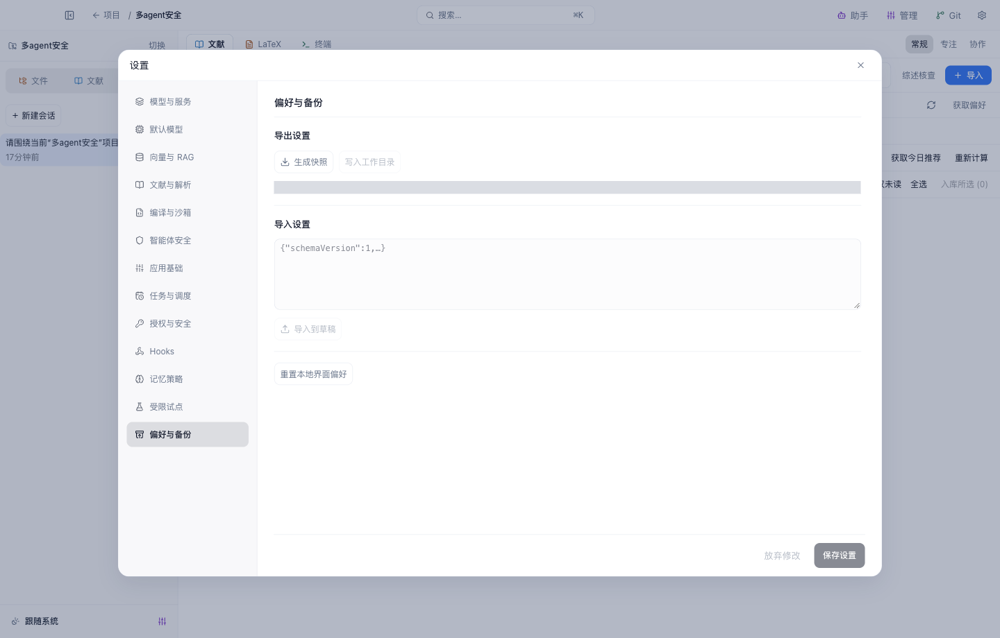

## 数据与隐私

应用数据默认保存在 `~/.roc`，项目文件保存在你选择的工作目录。会话、长期记忆、文献、索引、运行与导出分别维护身份和版本；界面偏好只使用 `roc.ui.` 命名空间。

凭据经 Electron `safeStorage` 异步加密保存，不进入 renderer 持久状态；详见 [ADR 0026](docs/adr/0026-async-secret-storage.md)。模型、翻译、文献检索、网页、MCP 或发布会向对应服务发送实际请求。

科研实验的受控运行关闭网络；普通助手工具、终端和外部服务按各自权限执行。来源可读、执行成功、文件完整与人工科学批准是不同事实，不互相替代。

数据库以当前结构打开；经过冻结结构、完整性和历史执行校验的 Research v71～v75 可在启动时自动升级到 v76，不支持或不安全的旧库仍拒绝修改。维护、备份、离线迁移与恢复见[数据库存储](docs/database-storage.md)；不要用删除库或 WAL／SHM 文件绕过启动检查。

## 开发、检查与发布

主进程负责数据库、服务与原生能力；preload 通过受限 `contextBridge` API 连接 renderer。画布重依赖按需加载；视觉与动效以 [tokens.css](src/renderer/styles/tokens.css) 和 [motion.ts](src/renderer/shared/motion.ts) 为准。

| 命令 | 用途 |
| --- | --- |
| `pnpm build` | 检查阶段技能、类型并构建应用 |
| `pnpm test` | unit、renderer 与 Electron smoke |
| `pnpm check:renderer-chunks` | 检查 renderer 分块和 eager 依赖边界 |
| `pnpm package:mac` | 构建、检查并生成本机 macOS arm64 应用 |
| `node scripts/smoke-mac.mjs release/mac-arm64/Roc.app` | 隔离数据根验证真实打包应用 |
| `pnpm evaluate list` | 查看评测轨道、套件与配置 |

按改动选择必要检查，完整环境与测试边界见[开发指南](docs/development.md)；科研质量评价、基准及证据保留见[评测指南](evaluation/README.md)和[文献评测](docs/literature-evaluation.md)。隔离 smoke 通过不证明默认 `~/.roc` 用户资料能启动。

构建、截图和缓存的清理边界见[运行产物](docs/development.md#运行产物)。生成目录按需重建；科研工具链、模型、评测原始来源和审核材料按各自用途保留。

若 Finder 启动失败，先看 `~/.roc/logs/app.jsonl`，核对真实数据库结构与构建要求，再按维护文档处理；完整启动诊断同见[数据库存储](docs/database-storage.md)。

推送 `main` 后，[发布工作流](.github/workflows/release-mac.yml)在 macOS arm64 构建、检查并上传 ZIP 预发布；版本标签与 `package.json` 一致时发布正式版。已有 Release 不覆盖，具体规则见[GitHub 发布](docs/github-releases.md)。

## 截图与实测范围

本文截图于 **2026-11-20** 从真实运行的 **Roc.app 0.1.0** 获取，使用既有 **“多agent安全”** 项目，窗口内容尺寸为 **1440 × 920**。截图展示实际界面与当时数据；账户目录与密钥输入区域作遮罩处理。当前源码的布局与组件合同以[设计契约](docs/design-system.md)和[工作台](docs/research-workbench.md)为准，后续 UI 验证记录见[工程检查](docs/ui-refactor-validation.md)。

本次通过界面实际完成：使用修复后的模型运行助手，读取项目、书库和已有提纲并生成研究梳理；在线检索并收录 Prompt Infection、SecAlign、StruQ 三篇文献；获取 PDF；阅读与翻页；StruQ 轻量结构解析；新建、关联并保存阅读笔记；导出 BibTeX；在真实终端创建研究提纲；预览文件；编辑、保存 LaTeX 并确认写入前备份；查询知识索引；校验已有 MCP 配置。修复后另验证 StruQ、SecAlign 和 Prompt Infection 的六节论文卡片，页面保留原文来源和未审核标记；使用真实精排服务检索，并获取每日 arXiv 推荐。另逐页打开门户、Wiki、图谱、监控表单、综述协议表单、四个管理分区和十三个设置分区。监控与综述表单未保存，没有创建定时监控或冻结协议。

助手服务修复后，已重试先前失败的助手、三篇论文卡片、三个工作区 PDF 索引、两个文献向量任务、在线检索、精排和每日 arXiv。本轮还直测外部接口、修复客户端，再重新打包并用默认用户资料实测。最新结果如下：

| 功能 | 实测结果与缺口 |
| --- | --- |
| 助手 | `auto/deepseek-v4.1-flash` 经 magpie 完成真实运行；7 次模型调用、14 次工具调用、0 次工具错误，usage 仍为未知 |
| 在线文献搜索 | 重试返回可用候选，部分来源仍失败且未遍历全部分页；未重复导入已有论文，不代表穷尽检索 |
| 原文解析 | StruQ 已完成解析；含 OCR 警告，数字、单位和公式仍需原文核对 |
| 知识检索与精排 | 用户指定的 Qwen 精排接口直接返回 HTTP 200；真实完整候选池越过原 3 秒预算。扩大可配置范围并将该服务设为 60 秒后，`security` 返回关键词 80、向量 80，界面确认“已使用语义精排” |
| 文件与文献向量索引 | 冷批次在网关约 60 秒返回 HTTP 504；改为每次最多 4 条并保留完整输入缓存后，真实任务持续推进，退出后已续跑。3 个工作区 PDF 和 StruQ／SecAlign 原文向量任务仍在处理或排队，尚未验证全部全文最终发布 |
| 论文卡片 | 修正生成提示和精确引用校验，缺引用时在原期限内最多纠正一次；StruQ、SecAlign、Prompt Infection 三篇均已生成六节未审核草稿。来源与版本检查继续生效，生成成功仍需核对原文 |
| 每日 arXiv | 修复嵌入批量请求后，`cs.MA` 使用 3 篇书库文献完成兴趣排序，真实返回 19 篇推荐；未执行入库。默认多分类请求本轮未完成，不代表其完整链路通过 |
| Git | 项目目录不是 Git 仓库；未执行暂存、提交或推送 |
| MCP | 通过配置完整性校验；未执行在线工具端到端测试 |
| Python／任务 | 未选择实验环境；没有科研任务或后台任务执行记录 |

项目仍处于发现阶段。服务修复后，当前默认模型为 `auto/deepseek-v4.1-flash`（magpie），先前阻止助手执行的 HTTP 404 已不再复现。本轮按用户提供的端点与凭据保存精排配置，并将其超时设为 60 秒；密钥经既有安全存储处理。助手默认模型及安全策略沿用当前配置；助手给出的研究问题及论文理解尚未经过 Evidence 捕获和人工科学审核。

代码验证中，相关 unit／renderer 回归、类型、IPC、构建、分块检查和打包 smoke 均通过。额外全量 unit 为 2584／2597 通过：12 项依赖当前仓库缺失的历史提交，另 1 项并发文件测试在未修改的 HEAD 隔离复跑也会失败；全量套件未全绿。

十一阶段、真实实验、图稿、审稿与导出能力按当前实现合同介绍；当前项目尚无完整后续产物，不将入口可打开、空状态或截图当作端到端科研流程通过的证明。远端发布与其他共享写入未由本次文档采集代为完成。

## 进一步阅读

产品术语见 [CONTEXT.md](CONTEXT.md)，全部专题与架构决定见[文档索引](docs/README.md)。随包工具、模型、版本、校验和与许可分别由[科研运行时](resources/research-runtime/README.md)、[模型锁](resources/research-models/models.lock.json)、[RTK](docs/rtk-integration.md)和[内置技能](docs/builtin-skills.md)维护。

## License

仓库尚未单独声明许可证，默认保留所有权利。随包工具、模型与技能按各自来源许可使用；CC BY-NC 等非商业内容不等同于 Roc 核心的通用开源许可。
