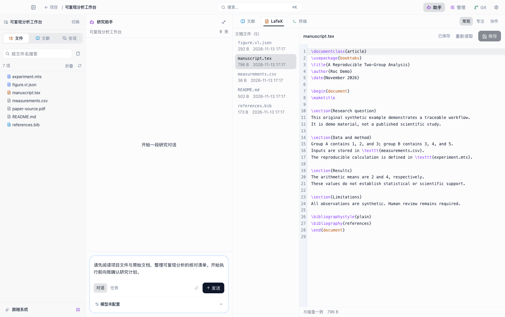

# Roc

Roc 是面向个人研究者的 Apple Silicon macOS 桌面科研工作台，在同一个项目中组织文件、文献、研究助手、实验、写作与人工审核。应用使用 Electron、TypeScript 和 React，支持浅色／深色外观和键盘操作；当前平台为 macOS arm64。



## 快速开始

需要 Apple Silicon Mac、Node.js 26 和 pnpm 12.5.1。在仓库根目录执行：

```bash
pnpm install
pnpm dev
```

`pnpm build` 检查阶段技能、类型并构建主进程、preload 和 renderer。直接依赖以 [package.json](package.json) 为准，完整解析版本见 [pnpm-lock.yaml](pnpm-lock.yaml)。

1. 在项目门户新建项目，填写研究目标、中文或英文文稿语言，并选择工作目录。
2. 在左栏「文献」导入文档、DOI、书目文件、手工条目、检索结果或 Zotero 条目。
3. 在设置「模型与服务」配置服务、凭据和模型，再选择默认模型。
4. 在助手中说明研究问题、材料和预期产物；按需要处理工具审批、提问与科研人工闸门。
5. 在工件检查器核对来源、版本和实际运行，完成审核后准备交付包。

| 功能 | 准备条件 |
| --- | --- |
| 项目、文件编辑、普通 PDF 阅读、笔记 | 本机目录与材料 |
| 助手、阶段执行、模型翻译 | 对应模型服务与能力 |
| 语义检索、每日 arXiv 推荐 | embedding 配置及已建立的索引 |
| OCR、深度解析 | 用户下载或离线导入的解析模型；普通 PDF 阅读无需安装 |
| 实验 | 对应语言环境、锁文件与冻结输入 |
| Git、MCP、外部发布 | 真实仓库或服务连接，以及对应操作授权 |

## 项目工作区

启动进入项目门户，不自动打开上次项目。一个工作目录同时只属于一个项目；归档项目只读，删除项目记录不删除磁盘目录。

项目内只有一个壳，列序为 **左栏｜助手｜画布**。左栏显示文件、文献和会话；画布一级页签为文献、LaTeX、终端。管理抽屉承载记忆、技能、MCP 和任务，Git 使用独立抽屉，设置与搜索为浮层。窗口宽度不超过 1099px 时，左栏和助手转为抽屉。

| 入口 | 主要用途 | 说明 |
| --- | --- | --- |
| 文件／LaTeX | 浏览、预览与编辑工作目录文件，保存时保留恢复点 | LaTeX 画布编辑 `.tex`／`.bib` 等文件；科研编译和交付走模板／导出链路 |
| 终端／Git | 项目目录中的真实 PTY、diff、暂存、提交、分支和推送 | 命令与 Git 操作作用于本机真实文件 |
| 助手／会话 | 流式对话、任务、工具反馈、提问、批准及检查点恢复 | [工作台](docs/research-workbench.md)、[任务观测](docs/research-task-observability.md) |
| 文献：阅读、笔记、学术雷达 | PDF、解析定位、批注、翻译、双链笔记、RSS 和论文线索 | [阅读与雷达](docs/research-reading-radar.md)、[PDF 导航](docs/research-pdf-navigation.md) |
| 文献：检索、知识库、图谱、监控 | 关键词／向量检索、持久 Wiki、邻域列表和固定查询提醒 | [RAG／Wiki](docs/research-rag-wiki.md)、[监控](docs/research-monitors.md) |
| 工件检查器 | 核对构思、方法、实验、图稿、正文与交付版本 | [检查器合同](docs/research-artifact-inspector.md) |
| 管理 | 编辑记忆、导入／启停技能、配置 MCP、管理后台任务和 Python 环境 | [内置技能](docs/builtin-skills.md)、[Python 环境](docs/research-python-environment.md) |
| 设置 | 模型、向量、解析、安全、Hooks、调度和本机偏好 | 后端配置共用草稿并统一保存；导出设置快照不包含密钥或项目数据 |

科研十一阶段由助手调度，构思、实验、图稿、正文、导出、模板和策略没有独立阶段路由；已有产物通过当前壳的工件检查器阅读和审核。

常用快捷键：`⌘B` 左栏、`⌘J` 助手、`⌘K` 搜索、`⌘D` 主题、`⌘⇧F` 聚焦布局、`⌘,` 设置、`⌘N` 新建项目、`⌘S` 保存、`Esc` 关闭当前层。完整行为见[工作台](docs/research-workbench.md#快捷键)。

## 科研流程与边界

| 主题 | 主文档 |
| --- | --- |
| 多源学术检索、冻结查询与原始池 | [文献融合](docs/research-literature-fusion.md)、[Zotero](docs/research-zotero.md) |
| 固定 Evidence、主张关系与人工判断 | [证据审核](docs/research-evidence-relations.md) |
| 方法、负结果、真实运行与可比性 | [Idea／方法计划](docs/research-ideas.md)、[实验](docs/research-experiments.md)、[结果比较](docs/research-experiment-results.md) |
| 协议、筛选、提取、质量评价与真实计数 | [系统性综述](docs/research-systematic-review.md) |
| 图稿、引文／数值／Vale 检查、审稿回复、期刊规则 | [图稿](docs/research-figures.md)、[写作检查](docs/research-writing-checks.md)、[回复矩阵](docs/research-response-matrix.md)、[期刊检查](docs/research-journal-compliance.md) |
| 批准正文与图稿、PDF、ZIP 和公开资源投影 | [最终导出](docs/research-exports.md)、[RO-Crate](docs/research-ro-crate.md)、[Zenodo](docs/research-zenodo.md) |

检索排名、模型建议、来源关系、执行成功和编译成功各自提供不同事实，科学支持与人工批准单独保存。Evidence 和批准绑定具体版本；重解析或修改产物后不能沿用旧版本的批准。准备、本地保存、创建远端草稿和公开发布分别执行。

TypeScript、R、Julia 和 Python 实验保存源码、输入、环境、日志与输出；运行关闭网络。Python 合同为 macOS arm64 正式版 CPython 3.14、标准 `venv` 和完整锁文件，Notebook 执行仅支持受控 Python cell 子集。运行环境和资源限制见[实验](docs/research-experiments.md)、[Notebook](docs/research-notebooks.md)、[资源治理](docs/research-execution-resources.md)。

## 数据与外部服务

应用数据默认保存在 `~/.roc`，项目文件保存在所选工作目录。凭据经 Electron `safeStorage` 加密后保存在 `~/.roc/secrets`；renderer 的本机偏好使用 `roc.ui.` 命名空间。模型、翻译、文献、网页、MCP 和发布请求发送到选定服务。

Zotero 为本机只读接入，不写回；附件读取需原生单文件授权。DataCite、Hugging Face 和 OpenReview 保存有界来源观察，内容下载或发布按各自授权执行，详见[外部资源文档](docs/README.md#科研资源与外部服务)。

随包工具、模型和技能的版本、校验和及许可分别由[科研运行时](resources/research-runtime/README.md)、[模型锁](resources/research-models/models.lock.json)、[RTK](docs/rtk-integration.md)和[技能说明](docs/builtin-skills.md)维护。OCR 权重按需获取。数据库仅接受当前结构，不自动升级旧库，维护方式见[数据库存储](docs/database-storage.md)。

## 开发与验证

主进程负责数据库、原生能力和服务；preload 通过受限 `contextBridge` API 连接 renderer。画布视图懒加载，视觉与动效以 [tokens.css](src/renderer/styles/tokens.css) 和 [motion.ts](src/renderer/shared/motion.ts) 为准。

| 命令 | 用途 |
| --- | --- |
| `pnpm build`／`pnpm typecheck` | 构建／类型检查 |
| `pnpm test` | unit、renderer 与 Electron smoke |
| `pnpm check:ipc`／`pnpm check:renderer-chunks` | IPC 一致性／懒加载边界 |
| `pnpm verify:native-packaging` | 原生模块与随包资源 |
| `pnpm package:dir`／`pnpm package:mac` | 本机应用目录／macOS 安装产物 |
| `pnpm logs:query` | 查询本地日志 |
| `pnpm evaluate list` | 列出统一评测轨道、套件与配置 |

按变更选择检查，完整入口与验收限制见[验证说明](docs/verification.md)；评测操作见 [evaluation](evaluation/README.md)。历史报告和工程 fixture 不能代替当前运行或独立科学验收。

产品术语见 [CONTEXT.md](CONTEXT.md)，全部专题与架构决定见[文档索引](docs/README.md)。

## License

仓库尚未单独声明许可证，默认保留所有权利。随包工具、技能与模型的许可按各自来源文档维护。
