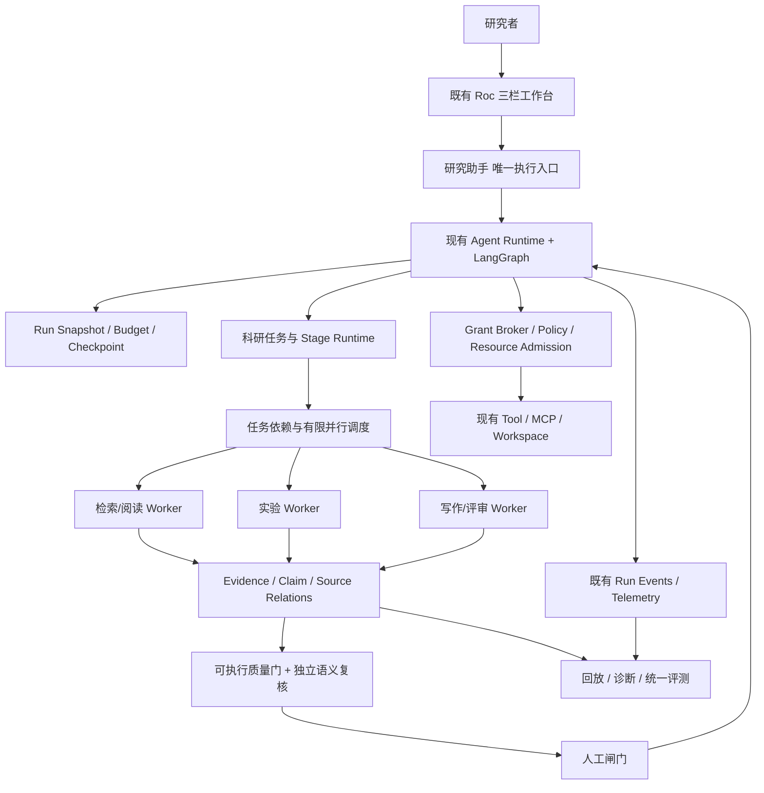
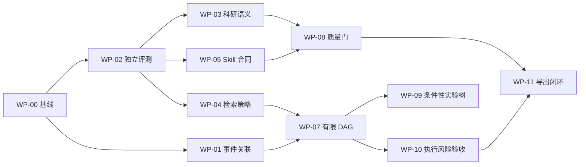

# Roc 科研 Agent Harness 完整优化实施计划

**版本**：v1.0（可执行计划草案）  
**编制日期**：2026-11-06  
**目标仓库**：[ryzqi/Roc](https://github.com/ryzqi/Roc)  
**核对范围**：仓库 `main` 分支、`CONTEXT.md`、`docs/research-workbench.md`、`docs/research-optimization-status.md` 及关键 Runtime/Research 代码；核对时看到的最新提交前缀为 `30bc77f`。  
**文档性质**：实施设计、任务分解和验收合同；**不是**已经执行完毕的开发报告。  
**项目定位**：个人研究者优先、本地优先、对话助手为唯一执行入口的科研工作台。

> **重要修订**：此前评审把 Event Log、ResearchTask、证据关系、预算、可恢复执行、安全准入、科研引用审查、评测等多项能力列为“待建立”。2026-11-06 的仓库核对证实它们已有不同程度的实现。本计划改为“盘点与补缺 → 固化现有合同 → 渐进扩展”，禁止平行造第二套相同基础设施。仓库的 `research-optimization-status.md` 是历史验收账本（核对点 `6268012b`），不能把其中的通过记录直接当作最新提交 `30bc77f` 的重新验收结果。

---

## 1. 执行摘要与最终交付标准

### 1.1 一句话目标

把 Roc 从“科研能力丰富的本地桌面 Agent”升级为**科研任务有计划、执行有边界、证据有来源、变化有追踪、结果可核验、失败可恢复**的 Research Agent Harness，同时保留现有桌面产品体验和唯一对话执行入口。

### 1.2 需要解决的五类核心问题

1. **科研流程质量缺少独立闭环**：已有结构化证据、引用覆盖和审核，但还需验证跨文献综合、反证、主张蕴含、方法质量和盲审效果；本地工程测试不等于科学有效性验证。
2. **长任务执行能力仍需提升**：已有 run、stage run、ResearchTask、event replay、预算和资源治理，下一步是显式依赖、并行调度、幂等 effect、任务级质量门，而不是引入另一套 Runtime。
3. **科研检索深度不够稳定**：已具备多源融合、冻结计划、检索回执和 RRF；可进一步增加受审查的多视角检索、证据重排、矛盾识别和可测量的覆盖率。
4. **Skill 仍需成为可验证研究过程**：保留现有 stage role/Skill，增加机器可检查的输入、输出、前置条件、许可证、工具、评价用例和质量门；不把第三方 Skill 的纯文本建议自动视为权限。
5. **评测由“工程正确”扩展为“科学可信”**：现有本地 harness/benchmark/fixture 已经足够支撑基础测试，最紧迫缺口是独立数据集、真实模型受控 Pilot、统计比较、费用授权和人工盲审。

### 1.3 北极星指标（均为拟定验收门槛，非已测得成果）

| 维度 | 核心指标 | 建议门槛 | 说明 |
| --- | --- | --- | --- |
| 基础正确性 | 关键不变量回归 | 100% 通过 | 项目隔离、冻结计划、审批版本、取消恢复、已归档只读、源码/证据版本校验 |
| 可观测性 | 关键状态变更可追溯率 | 100% | 只要求定义的关键事件；完整原始隐私数据不应默认外传 |
| 科研引用 | 引用键/来源版本/定位的结构正确率 | 100% | 确定性规则；语义正确率另测 |
| 科研语义 | 人工标注集上的主张—证据支持准确性 | 首先建立基线，再以误报/漏报预算改善 | 不设置未经验证的绝对“95%”作发布承诺 |
| 恢复 | 故障注入后的任务状态一致性 | 100%（定义好的不变量） | 与服务端已产生副作用的幂等恢复分开测量 |
| 安全 | 既定越权攻击样本中真实越权成功数 | 0 | 测到 0 不等于证明零风险；必须列覆盖边界 |
| 检索 | Recall@20、nDCG@20、Evidence Recall | 对照基线显著不下降，重点场景提升 | 以同一语料、查询预算、模型与费用比较 |
| 效率 | 同质量下端到端耗时/成本 | 探索目标：耗时下降 20%+ | 需质量约束成立后才能采纳优化 |
| 体验 | 人工返工次数、缺陷修复时长 | 用盲审和真实任务测量 | 优先质量而非过度自动化 |

### 1.4 交付边界

**本轮必须交付**：基线审计、版本化科研评测、主张语义验证 Pilot、合规 Skill Manifest、可追溯科研任务执行合同、受控多视角检索实验、任务级可视化观测、受控的有依赖并行任务原型、安全攻击回归及完整开发/回滚文档。

**本轮不交付**：微服务化、Kubernetes、多租户平台、默认自动发表论文、默认外网 Trace 上传、绕过人工闸门的全自动实验、无许可证审查的外部 Skill 直接分发。

### 1.5 强制保留的现有产品原则

- **唯一执行入口**：研究助手驱动阶段与工作流；后台阶段执行保持其内部工具身份。不另建“第二个智能体运行按钮体系”。
- **唯一壳层与面表**：不恢复已由 ADR 0024 删除的常驻阶段面/任务看板；任务细节继续使用管理抽屉，必要时在原有工件检查器上增加懒加载详情。
- **项目工作区是真实文件源**：`.tex`/`.bib` 等文件留在真实工作目录；数据库保留工件/版本/追溯，不创建另一份正文真身。
- **人工决定是最终授权**：阶段过闸门、检索计划审批、实验高风险 effect、外部发布仍须可信的用户确认；模型不传入项目身份或伪造授权上下文。
- **可解释的未知**：未知费用、缺失资源回执、来源不完整、外部状态未验证，都必须保留 `unknown`/`null`/`not_verified`，不得以零或成功替代。

---

## 2. 当前仓库能力盘点：已完成、待增强、新建

### 2.1 已有且应直接复用的基础设施

| 领域 | 仓库已存在的实现/合同 | 本计划处理方式 |
| --- | --- | --- |
| Agent Runtime | `src/main/plugins/agent/runtime.ts`、`run-harness.ts`、`run-execution-snapshot.ts`、Deep Agents/LangGraph | 维护现有执行入口；增加科研执行语义适配，不新建第二套聊天 Runtime |
| Event/Replay | `run-event-log.ts`、`run-telemetry.ts`、`docs/research-task-observability.md` | 保留现有有界 Chat 事件回放；补足科学语义 event 和独立确定性投影验证 |
| 任务身份 | `research-task-repository.ts`、`task-controller.ts`、ResearchTask 事件、任务事实与诊断 | 扩展任务依赖/调度所需的 schema；不引入同名平行任务数据库 |
| Stage Runtime | `stage-runtime.ts`、`role-profiles.ts`、人工闸门 | 用现有 stage/role 起步，先拆检索/阅读阶段试点 |
| 权限/资源 | `execution-grant-broker.ts`、`tool-resource-coordinator.ts`、Shell/Seatbelt 限制 | 增加攻击覆盖与审计；不把“支持 shell”误称为完全隔离 |
| 预算 | `run-budget-ledger.ts`、`project-budget-ledger.ts`、任务调用观测 | 用已存在的 reservation/settlement；禁止二次计费汇总 |
| 证据与引用 | Evidence Locator、关系审核、Citation Coverage、Claim/数值映射、Export 审批 | 优先增强语义校验与跨文献证据强度，而非重建 Evidence Ledger |
| 学术检索 | OpenAlex 等多源融合、RRF、检索计划人工冻结、查询回执、评价器 | 以冻结范围和已有排序合同为基线添加受控 rerank/perspective 实验 |
| 任务上下文 | `research-task-facts.ts`、不可变 task facts、context compaction 管线 | 在事实来源与冲突检测基础上增加长任务质量评价 |
| 科研流程 | 系统综述协议、实验/Notebook、图稿、RO-Crate、Zenodo 等 | 做集成质量验收和优先级筛选，避免继续无约束“堆生态” |
| 基础 Eval | `scripts/harness-eval/`、多项 benchmark、unit/integration/renderer tests | 扩真实模型、独立评价、反事实对比和统计报告；不拿 fixture 当科研证据 |

### 2.2 现阶段最有价值的真实缺口

- **G1 / 评估样本**：`docs/research-optimization-status.md` 记录 200 条独立冻结质量样本尚未建立；真实模型 L2/L3、独立科学质量验证、真实外部系统验收仍待授权与数据。
- **G2 / 科研语义**：已有检查“是否有来源、来源是否有效、审查是否通过”，仍需系统性测量“证据是否真正支持结论、是否存在不当因果推断、是否忽略反证”。
- **G3 / 调度**：已有任务树、stage run、资源准入，但公开核对到的代码中没有证实任务级 DAG lease+依赖调度已成为标准路径；须先写 feature inventory，再补最小可行版本。
- **G4 / 检索策略**：在**已批准**的查询范围内优化排序、召回与聚合；新的视角检索查询必须重新走人工计划审批，不能让子 Agent 擅自扩大检索范围。
- **G5 / Skill 契约**：11 个 stage Skill 现通过 `research-skills.ts` 静态导入，新增 manifest 先提供校验/兼容，不应直接破坏现有阶段角色和许可证机制。
- **G6 / 可复现**：现有事件重放偏向聊天/诊断，需区分“UI 状态回放”“工具结果回放”“真正重新跑实验”三种保证，不能承诺非确定性模型同字节重现。
- **G7 / 安全规模**：现有 macOS Seatbelt、执行 grant、资源/进程清理具备基础；容器/远程执行只能在新的隔离需求被真实证明之后立项。

### 2.3 能力成熟度声明规则

每个工作项使用六态：`Located`（已定位）→ `Designed`（合同设计完成）→ `Implemented`（代码已落地）→ `Verified local`（本地工程检查通过）→ `Validated scientific`（独立数据和人工评价通过）→ `Released`（用户环境发布完成）。若依赖外部授权，标记 `Blocked` 并附原因，不以自动跳过视为通过。

### 2.4 当前代码起点与改动策略

建议优先在**现有**目录中增加“薄层”而非马上建 `src/main/runtime/` 大总线：

```text
src/main/plugins/agent/          保留通用 Agent runtime、run log、telemetry、harness
src/main/plugins/research/       扩科研任务、证据/主张、阶段、质量门
src/main/services/deep-agent/    复用执行授权、资源协调、context、tool effect
src/shared/schemas/             版本化跨进程数据合同
scripts/harness-eval/           固定评测协议与分析器
resources/research-skills/      现有 11 阶段 Skill；增加可选契约文件
src/renderer/                   仅增强现有助手/管理抽屉/工件检查器
```

将来如逻辑真正跨多个插件且稳定复用，再通过独立 ADR 决定是否抽出 `src/main/runtime/`；**不以移动目录替代架构改进**。

---

## 3. 目标架构与统一运行合同

### 3.1 目标逻辑图



以上是**演进架构**，不是声称所有方框已完整落地。具体是否抽取跨域模块，以首轮代码盘点与 ADR 确认。

### 3.2 三种事实必须分开

1. **执行事实**：哪个 run 调了哪次工具、资源何时准入、哪次审批、产生了什么 effect。由 agent task/run/telemetry/event 和实际 receipt 支撑。
2. **科研事实**：哪篇论文的哪个固定版本、哪个段落/页/表格、支持或反驳了哪条 claim。由 evidence/claim/locator/审查关系支撑。
3. **用户决定**：批准检索范围、接受实验结果、确认引用关系或授权公开发布。仅由可信主进程的人类操作上下文产生。

这三者通过 ID 和版本关联，但**互不替代**：LLM 执行成功不等于结论真实；引用格式合法不等于科学蕴含；实验成功不等于用户允许外部公开。

### 3.3 运行状态与幂等原则

- **运行身份不变**：恢复运行必须延续原 `runId`，不得新建假运行。
- **副作用发生前落盘**：对于网络写入、实验发布、文件覆盖，先写 intent/idempotency key，再执行，返回 receipt；遇到崩溃先对账，不盲目重试。
- **审计事件可重读**：append-only 记录拥有 `schemaVersion`、`sequence`、`timestamp`、`actorType`、`correlationId`；消费方可以通过 version migration 处理旧事件。
- **无敏感数据默认传输**：原始 prompts、工具结果、文件路径、凭据只允许在可控本地安全范围按合同保存；用户导出采用脱敏/范围审批。
- **状态竞争有明确裁决**：version/CAS 限制并发写；过期 lease、旧 approval hash、旧来源版本必须拒绝提交。

### 3.4 推荐新增的科研运行事件（增量）

```ts
// 仅为拟新增的逻辑契约草案；实际合入前应映射现有 TaskEvent / ChatRunEvent。
type ResearchAuditEventV1 = {
  schemaVersion: 1;
  eventId: string;
  projectId: string;
  taskId: string;
  runId?: string;
  sequence: number;
  occurredAt: string;
  kind:
    | 'plan.approved' | 'task.dependency_ready' | 'task.lease_claimed'
    | 'task.lease_expired' | 'effect.committed'
    | 'evidence.source_invalidated' | 'claim.reviewed'
    | 'quality_gate.blocked' | 'quality_gate.passed';
  payloadRef?: string;      // 指向受控存储的原始收据，不在事件中写秘密
  immutableHash: string;
};
```

引入前检查已有事件类型；能添加到 `ResearchTaskEvent` 的不另建“科研日志表”。事件折叠/保留策略必须说明完整性缺口，UI Replay 只承诺已保留范围。

## 4. 工作包设计（Work Packages）

下面每个工作包给出：目标 → 现有基础 → 具体步骤 → 交付物 → 验收办法 → 依赖与风险。P0 = 基础必做，P1 = 质量与效率试点，P2 = 条件性扩展，不代表现有模块完全缺失。

### WP-00｜仓库基线审计与变更冻结（P0，1 周）

**目标**：让“已有、未有、已测、未测”具备可验证来源，阻止基于过时设计做错误重构。

**实施**：

1. 在固定 commit 上生成代码能力清单：Agent Run、Stage Run、ResearchTask、Event、Capability/Grant、Tool Effect、Evidence/Claim、Task Facts、Search、Sandbox、Benchmark。
2. 为每个能力登记 `接口/持久化表/拥有者/状态机/测试/现有 UI 消费者`，标明与本计划的重合度。
3. 对 `docs/research-optimization-status.md` 中历史 `Verified passing` 作出 **historical only** 标记；重新运行最新 commit 的轻量 smoke/contract 检查，收集新日志（不要用历史日志替代）。
4. 冻结现有高风险不变量：项目隔离、审批版本、模型不指定项目身份、研究助手唯一入口、已归档只读、检索计划已批准后不扩张、源版本失效拒绝导出。
5. 建立独立的 `docs/roadmaps/research-harness-v1.md` 与 ADR；所有计划任务只链接这份最新账本，避免 docs 中“早期下一步”互相冲突。

**交付物**：`capability-inventory.md`、`baseline.json`、接口依赖图、风险清单、任务追踪矩阵。

**验收**：仓库路径全部存在；每个“已实现”有测试或具体代码引用；本轮方案中不再含与已有能力重复的独立总线、日志库、预算数据库；`pnpm typecheck`、`pnpm check:ipc`、现有核心单测至少完成一次基线记录。

**风险**：最新 main 继续变化。**对策**：每次阶段验收固定 SHA，后续变更必须登记 baseline drift。

### WP-01｜统一科研执行事件与可验证回放（P0，2 周）

**目标**：在现有 `AgentRunEventLog`、`ResearchTaskEvent`、Telemetry 上补齐科研关键变化，使“恢复、诊断、审核、科学追溯”可关联。

**实施**：

1. 先制作**事件语义映射表**：ChatRunEvent 用于实时 UI；TaskEvent 用于任务与资源；科研审计 event 只用于无法由二者表达的不可变科研事实。
2. 在现有任务事件或旁表中增量增加 `plan.approved`、`dependency.ready`、`evidence.invalidated`、`claim.reviewed`、`gate.blocked` 等事件，定义版本、顺序、幂等键、保留期与最大单条大小。
3. 将 stage、实验、研究工具的执行 ID 与对应 Chat run、ResearchTask、Artifact 精确关联。无关联时返回 `not_linked` 而不猜测。
4. 实现三种**明确分离**的回放模式：`projection replay`（状态折叠）、`recorded tool replay`（模拟工具回执）、`live re-execution`（重新运行，明确非确定性且须重新授权副作用）。
5. 提供脱敏、有限范围的 `diagnostic bundle` 扩展；沿用已有 2 MiB 边界或设计独立的新版本，禁止擅自扩大隐私导出规模。
6. 以故障注入检查中途断电、缺事件、重复 event、乱序 replay、冻结审批版本改变和实验回执缺失。

**交付物**：事件合同/迁移、Replay contract、脚本化故障夹具、任务诊断与审计关联报告。

**验收**：关键科研状态变更能从 task/run/科研记录追踪到因果链；现有 Chat 事件投影结果无回归；投影回放对版本内确定性 fixture 精确一致；发现 gap 真实标记而不是静默补齐。

**依赖**：WP-00。**注意**：不能把 Event Log 直接当成 LangGraph checkpoint 的替代品；也不能把已有有界 UI 事件重放包装为完整原始轨迹存档。

### WP-02｜科研质量评测协议与独立标注数据（P0，4–6 周，关键路径）

**目标**：解决当前最影响路线决策的证据缺口：科研质量是否真的提升。

**实施**：

1. 复用 `scripts/harness-eval/quality-evaluation/` 的任务合同，扩充到**计划目标** 200 条独立样本；按仓库既有目标分布：文献核验 30、多论文证据 30、长记忆 25、文件/报告 30、实验脚本 25、MCP 恢复 20、权限注入 20、取消/崩溃 20。
2. 每个样本保存：任务家族、难度、授权来源、来源簇、版权/许可、可见输入、不可见评估期望、reviewer、版本、train/dev/holdout split。
3. 明确**同论文改写题不能算独立样本**；按来源簇切分，确保同一研究来源或同一模板不会跨集合泄漏。
4. 对涉及科学主张的任务至少由两名相互独立审核者标注证据支持/不支持/矛盾/需条件，保留分歧与仲裁记录。
5. 指标分四层：Harness（任务成功、恢复、调用错误、成本/时延），Retrieval（Recall@K/nDCG/Evidence Recall），Scientific（claim-support、citation、反证、可复现），Human（盲审偏好、返工次数）。
6. 对 Baseline 和 Treatment 固定模型、价格版本、temperature、上限、检索语料、工具集合、运行环境和任务顺序；随机化 A/B 顺序，报告均值、置信区间与失败类别；不把单次模型“感觉更好”当成证据。
7. 真实模型 Pilot 按最小费用上限先做 L2；所有付费模型/外部调用/数据上传需显式授权。L3 上线验证须单独立项。

**交付物**：冻结数据清单（含 hash 与 license）、标注规范、独立审核记录、可复现 Runner、A/B 报告模板、风险/统计预注册、Baseline 报告。

**验收**：对目标配额达到 200 条**独立合规标注**、holdout 未泄漏、审核分歧有报告，全部质量门可由 CI 检查；若授权或材料不够，正确状态是 `Blocked`，而不是使用合成 fixture 凑足。

**依赖**：WP-00；贯穿各工作包，P0 可先用小样本 Smoke，但**不得在缺少独立评测情况下宣称科学质量提升**。

### WP-03｜证据强度、主张蕴含与独立 Citation Verifier（P0/P1，3–4 周）

**目标**：在现有 Evidence/Claim/Locator/人工关系审查/引用覆盖功能上，加入对“是否真的支持”的多层核验。

**实施**：

1. **确定性层**：复用 `citation-coverage-service.ts`、`citation-integrity.ts`、evidence relations/locator；验证引用键存在、来源版本未失效、定位精确、数值来源一致、人工审核关系有效。
2. **语义层**：单独创建 `claim-evidence verifier`，输入只含待检 claim、冻结 evidence、反证、限定条件、文献元数据，返回结构化 verdict：`supports / qualifies / contradicts / unrelated / insufficient / unable_to_verify`，不得覆盖人工决定。
3. 分类型审核：事实主张、比较、数值、因果、实验结果、贡献/SOTA、假设。对因果和新颖性主张采用更严格的“需要什么证据”检查。
4. 检查**反证缺失**：同一问题下已收集的相关反例与负结果要进入对照视图，禁止仅使用支持证据提升强度。
5. 当模型与确定性检查、既有审核关系冲突时，产生**审查建议**并进入现有工件检查器/闸门；不由模型直接将 `claim.status` 改成 verified。
6. 冻结文稿版本和 Evidence 版本；任何来源替代、重解析、正文更新都会使对应语义建议失效，需要再核。
7. 与 writing/review/export 的既有 gate 集成：确保现有阻断规则不弱化，新增规则先 Shadow（只提示）→ 人工采纳 → 可选 Hard Gate。

**交付物**：verifier schema、分类评测集、研究者审核界面、来源/反证建议、质量门版本号与审计回执。

**验收**：冻结集上语义评判优于未加 verifier 的基线且无显著误杀；确定性校验仍 100% 通过；源版本改动能令旧 verdict 失效；任何 AI 语义建议均不能越过人类审批。

**依赖**：WP-02 最小标注集、已有证据关系合同。**风险**：Verifier 本身幻觉、模型自我确认。**对策**：与 writer 分离上下文、显示原文引用、人工最终判断。

### WP-04｜受控多视角检索与 Evidence Rerank（P1，3–4 周）

**目标**：提高跨学科综述、研究差距分析与反证寻找的相关性，而不破坏已批准的检索计划和检索回执。

**实施**：

1. 在 `discovery` 阶段生成**可审查的 perspective plan**：主流理论、竞争方法、负结果/批评、数据与评测、相邻学科、应用/局限。视角由研究问题决定，默认不强制凑齐固定数量。
2. 将每个视角转换为具体查询并附理由、来源、分页上限、预计费用/请求量，呈现在既有人工检索计划审批流程里；用户批准后才能进入 retrieval。
3. `retrieval` 严格只执行获批的 `query_id`，不在后台临时增加新查询。新发现的视角需要提交增量计划版本再批准。
4. 保持现有多 Provider RRF v1 作为不可变 Baseline，Rerank 作为**后处理层**；不得悄悄改写原始 API 排名回执。提供 `baseline_rrf` / `rrf_rerank` / `perspective_rerank` 的明确方案 ID。
5. 研究来源去重先对 DOI、arXiv ID、PMID 等进行 canonical identity/alias 合并；冲突记录显式显示，不能只靠标题相似度自动融合。
6. Rerank 优先处理**已有证据 chunk**：相关性、方法匹配、信息增益、反证覆盖、原文可定位性、来源版本新旧；给出 rationale 与可解释定位。
7. 请求缓存、Provider rate limit、部分失败、分页上限和取消都继续使用现有生产网络/资源治理；结果报告必须披露未完成检索源。

**交付物**：Perspective Schema、审批预览、Rerank 实验开关、排名审计、检索质量 benchmark、预算/缓存报告。

**验收**：固定语料上相对现有 RRF 报告 Recall@20、nDCG@20、Evidence Recall 与请求数/成本；用户未批准的 query 执行数 0；任一 Provider 故障时显示明确 partial coverage，不伪装完整综述。

**依赖**：WP-02；优先以 Shadow ranking 实现，不改变既有默认行为。**技术参考**：STORM 的多视角提问，PaperQA 的证据检索/Rerank，但不直接整体替换 Roc 数据层。

### WP-05｜Skill ABI、路由与科研质量门配置（P0/P1，2–3 周）

**目标**：把现有 `resources/research-skills/*/SKILL.md` 从只有文本的阶段指导扩展为具备稳定输入/输出/授权需求/验证条件的 Skill 合同。

**实施**：

1. 为现有 11 个 stage skill 增设**可选且可迁移**的 `skill.manifest.json`；旧 Skill 按明确规则读取，不能隐式追加工具权限。
2. Manifest 字段至少包含：`id/version/entry/license/source/inputs/outputs/requiredCapabilities/forbiddenEffects/qualityGates/evalCases/compatibleRuntime`；采用 Zod schema 并纳入 `pnpm check:ipc` 或独立 `check:skills`。
3. 设计两个加载阶段：目录/摘要用于选择；选中 Skill 后再注入正文与获批 references。记录 Skill 内容 hash，防止训练/运行时同名不同内容。
4. 将 Supervisor-Skills 的 deep-research、idea-evaluator、paper-writer、pre-submission-reviewer **方法论**提炼成对应 Roc stage 的可测规则：冻结问题、缺陷审查、引用核验、独立审稿、输出清单；不直接复制未知许可内容到 Roc 核心。
5. 禁止 Manifest 以自然语言授予权限；最终可执行的 capability 必须与 `role-profiles.ts` 白名单、run manifest、execution grant 做交集。
6. 先挑 `discovery / reading / review` 三阶段试点；统计自动路由错误、Skill 上下文占用、提示词冲突与效果，再逐步覆盖其他阶段。
7. 保留项目现有内置/非商业 Skill 许可证确认、来源 commit 和 SHA256 机制；任何分发变更需法律/许可证核对。

**交付物**：Manifest Schema、校验脚本、3 个试点 Skill、评估 fixtures、迁移说明、许可证审核记录。

**验收**：manifest 缺少许可证/版本/必要 capability 时拒绝加载或降级为只读提示；工具授权不扩张；同输入与固定 Skill hash 可复现选择；3 阶段 A/B 质量不下降，上下文开销变化有测量。

**依赖**：WP-00、WP-02 最小评测协议。**不建议**“安装整个 Supervisor-Skills 仓库即默认可执行全部能力”。

### WP-06｜长任务上下文管理与证据安全压缩（P1，2–3 周）

**目标**：改善长科研项目在多阶段间的约束保留、失败原因继承与成本稳定性。

**实施**：

1. 以现有 `context-compaction-pipeline.ts`、`research-task-context-middleware.ts` 和 `task-facts-store.ts` 为起点，不建第二个“项目记忆数据库”。
2. 划分四类输入：不可变约束/人工决定、可追溯 task facts、可检索 Evidence/Artifact、可压缩 conversation/tool transcript。**禁止**仅通过压缩摘要覆盖原始科学证据。
3. Compaction 记录触发原因、被压缩片段范围、摘要 hash、保留下来的 hard constraints 和丢失风险；过长的工具结果应放到 Artifact/引用而不是继续塞入 prompt。
4. 对事实冲突建立 `supersedes/contradicts/stale_source` 语义；来源版本过期时撤回用于回答的事实资格，保留历史。
5. 执行“恢复后再验证”：checkpoint/resume 对照事实与约束是否存在；模型 summary 不能成为新的权限或科研事实来源。
6. 对 25 个长记忆类任务 + 真实研究任务样本构造 50–100 turns 的试验，测 constraint retention、false memory、token/turn、成本、召回证据质量。

**交付物**：Context Assembly 合同、压缩诊断、冲突/来源过期检查、长任务 A/B 报告。

**验收**：关键约束丢失率、任务正确率与费用三者联合报告；旧事实不能越过过期来源检查；在模型回答等质条件下才采纳更激进压缩。

**依赖**：WP-02。**风险**：摘要压缩省 token 但降低正确性。**对策**：固定预算 A/B、强制保留硬约束、可溯源的检索式补充。

### WP-07｜Task DAG 与 Supervisor/Worker 最小协调协议（P1，4–5 周）

**目标**：把 `ResearchTask` 的已有执行树扩展为**有依赖、可认领、有限并行、可回收**的科研任务执行，而不是为“多 Agent”重新引入独立框架。

**试点范围**：只做 `discovery → retrieval → reading → evidence synthesis`。检索/阅读的只读工作负载可并行，写作保持单写者；实验分支放在 WP-09。

**实施**：

1. 从 `research-task-repository.ts`、`task-controller.ts`、`stage-runtime.ts` 中明确已有 task identity、stage run、后台任务、资源锁与取消传播，再新增**任务子节点**及 dependency edge。若当前 schema 已涵盖某字段，仅复用，不复制。
2. 定义子任务生命周期：`blocked → ready → claimed → running → result_pending_review → done`，以及 `failed/cancelled`；每个状态迁移绑定 `expectedRevision`。
3. SQLite 原子 claim 使用短事务与租约：比较任务状态 + lease generation，提交后再启动 worker；lease 超时只能返回 ready 重新认领，不允许旧 worker 上传过期结果。
4. 每个子任务有 `idempotencyKey`、`inputArtifactVersions`、`outputContract`、`resourceClaim`、`budgetReservation`，并遵守已有 `ExecutionGrantBroker`。
5. Scheduler 的依赖计算只负责**可运行性**；工具访问、网络、文件锁由已有 `ToolResourceCoordinator` 和执行授权系统决定，不能在 Scheduler 中再发一份绕过授权的 allowlist。
6. 相邻独立只读检索/文献读取可在固定并行度（默认从 2 起）并发；需要实际写入或变更项目状态的操作等待已有互斥/审批。
7. Supervisor 仅负责拆解、分配、验收输出契约与合并结果，不拥有额外工具特权；worker 不允许直接跳过工作流阶段闸门。
8. 任务失败后只按分类重试：`transient_network` 可退避重试；`policy_denied`、`source_stale`、`human_rejected` 需要重新计划或用户决定；`side_effect_unknown` 先做 effect 对账。
9. UI 仍只在管理抽屉现有“任务”分区中显示 DAG 关系、等待原因、worker 状态、失败原因和结果链接。不增设第二套任务看板/阶段面。

**接口草案（只表示拟增加的概念，实际以现有 schema 迁移为准）**：

```ts
interface ResearchTaskNodeV1 {
  id: string;
  rootTaskId: string;
  projectId: string;
  kind: 'search' | 'read' | 'synthesize' | 'experiment' | 'review';
  dependsOn: string[];
  state: 'blocked' | 'ready' | 'claimed' | 'running' |
         'result_pending_review' | 'done' | 'failed' | 'cancelled';
  leaseGeneration: number;
  leaseUntil?: string;
  inputVersions: Array<{artifactId: string; hash: string}>;
  outputSchemaVersion: number;
  idempotencyKey: string;
  budgetReservationId?: string;
}
```

**交付物**：schema migration、atomic lease/claim、并行调度器、Supervisor/Worker 适配器、故障恢复测试、任务抽屉增量观察界面。

**验收**：相同输入版本的重复回调不会重复提交；两个 worker 不能同时持有有效 claim；旧 lease worker 不可写；取消会向子节点传播；用户未批准的检索不执行；质量不下降时再评价耗时收益。

**依赖**：WP-00/01、WP-02、WP-04 的检索合同。**风险**：把“读并行”错误用于带缓存写入/远程副作用的工具。**对策**：基于真实 `effectClass` 和资源声明，不依据工具名称猜测纯只读。

### WP-08｜统一科研审稿：导师决策程序与可验证质量门（P1，3 周）

**目标**：让科研流程不是固定 11 步流水线，而是在关键节点进行“研究是否有价值、方法是否成立、证据是否足够、该不该继续”的审查。

**实施**：

1. 借鉴 Supervisor-Skills 的研究判断方法，不复制未经许可审核的全文。将评价分为 `fatal flaw`（致命缺陷）、`methodological fit`（方法与任务匹配）、`evidence sufficiency`（证据充分性）、`novelty support`（新颖性依据）、`reproducibility`（复现条件）、`writing integrity`（写作真实性）。
2. discovery 输出研究问题边界、关键词与排除标准；ideation 输出竞争假设、替代解释、失败条件；planning 输出明确变量、对照、指标、资源需求和停止规则。
3. 每个 Review Finding 保存 `severity / claim / evidence / action / reviewer / sourceVersion / status`，避免一段自由文本意见无法复用。
4. 分离 `Writer` 与 `Reviewer`：评审 Agent 不共享 writer 的推理上下文；读取工件版本、引用证据、反例和标准，不允许直接改动已批准稿件。
5. 与 Roc 现有 review/revision/response matrix 对齐：评审意见 → 修订任务 → 修改位置 → 重新核验 → 人工接受/退回。
6. 将建议项分为信息型、强建议、确定性 Hard Gate。语义性“新颖性不强”不能默认作为自动终止科研项目的硬闸门。

**交付物**：Quality Finding Schema、评分规则版本、3 类研究类型试点（综述、方法论文、实验报告）、评审反馈闭环。

**验收**：可以追踪每个严重缺陷到原始 evidence/experiment/claim；人类可以拒绝或修订 AI 意见；修订后旧审稿意见不静默被覆盖；人工盲审对比是否减少明显漏检与返工。

**依赖**：WP-03、WP-05、WP-02 的标注数据。

### WP-09｜受控实验探索树与复现实验包（P2，3–5 周，条件性）

**目标**：只为允许实验探索的科研任务增加多候选方案搜索，而非让所有阶段执行无限 ReAct/树搜索。

**立项前提**：已有实验运行的可复现收据、原生进程治理、工作区隔离和资源预算已经在当前 commit 复验通过；明确实验任务族、用户预算和安全边界。

**实施**：

1. 每个候选实验分支包含：`hypothesis / codeVersion / datasetHash / environment / seed / metric / negativeResult / budget`，并链接父问题与已批准方法计划。
2. 使用有限宽度/深度的 best-first 搜索；评分依据不是模型主观“有趣”，而是预定义的质量/成本/信息增益和真实实验指标。
3. 先做两个候选分支，均通过现有 Experiment Service/执行准入创建；禁止让自生成代码直接通过无隔离宿主 shell 运行。
4. 训练数据、原始数据、指标定义和停止准则在实验前冻结；明确保留负结果、未观测结果和失败分支。
5. 使用现有 Notebook/实验结果比较、Figure Data Trace 与 RO-Crate 导出链，形成 Repro Bundle；因外部模型/包版本不固定导致不可字节复现时，声明统计/功能可复现边界。
6. 用户必须审核要运行的高成本或高风险分支，超过预留费用/资源限额强制停下。

**交付物**：experiment branch schema、受限调度、候选比较、真实实验复现包、预算与失败记录。

**验收**：相同输入/依赖版本下的本地确定性实验结果符合预定义容差；不可复现分支明确显示；取消无残留子进程；超预算/越权运行 0；负结果不丢失。

**依赖**：WP-07、WP-02 和资源安全复验。**风险**：计算成本和论文“选择性报告”。**对策**：固定预算、记录全部分支和失败、用户控制是否继续。

### WP-10｜执行边界、安全 Policy 与可插拔 Workspace Backend（P1/P2，3–5 周）

**目标**：先巩固现有 macOS 本地执行安全，再决定是否有必要扩容到 Container/Remote；避免“设计一个抽象”却弱化真实隔离。

**实施**：

1. 梳理现有 `ExecutionGrantBroker`、文件系统路径策略、`ToolResourceCoordinator`、`runResearchProcess`、Seatbelt 的实际保证与不保证的边界。
2. 建立权限矩阵：工具类型 × 资源（项目目录、全局文献、MCP、网络、实验环境、发布平台）× effectClass × actor（main/subagent/human）× 审批状态。
3. 在**工具调用和真实文件/网络操作点**执行项目身份/目录/版本/授权校验；shell 不能依赖提示词承诺限制文件访问。
4. 加入恶意文献正文、prompt injection、恶意 MCP Tool Description、路径 traversal/symlink、时间竞争、过期 grant、越权发布、网络出口错误等测试。结果区分 `blocked_by_policy`、`sandbox_denied`、`not_dispatched`、`effect_unknown`。
5. 本地环境采用已有 Seatbelt 和进程清理；CPU/RSS 目前为监控/采样限制，不能声称内核硬配额，文档要准确体现。
6. 仅在实际出现 Linux/远程 GPU/多用户需求后创建 `WorkspaceBackend` 最小接口：`read/write/exec/inspect/snapshot/restore/limits`；不能为追求架构完整度而立即引入 Docker/Podman/Kubernetes。
7. 远程 Runner 必须使用最小权限、独立凭证、不可随意访问本地用户目录、受控网络和数据传输审批；服务端只接受已授权的任务清单与精确 hash。

**交付物**：Threat Model、Permission Matrix、攻击样本集、政策回归测试、可选 WorkspaceBackend ADR。

**验收**：预设越权测试真实 effect 为 0；不存在主/子 Agent 权限扩大；已有所有资源/原生进程测试通过；未支持的 hard limit 明确拒绝而不是模拟成功。

**依赖**：WP-00、WP-01；容器/远程部分依赖 WP-09 的真实需求与独立预算。

### WP-11｜科研工件闭包、可复现导出与生态互操作（P1，2–3 周）

**目标**：既有 Zotero、系统性综述、OpenReview、Notebook、RO-Crate 和 Zenodo 能力不是“连通即可”，而是形成科学来源、许可、版本和发布授权的一致闭环。

**实施**：

1. 利用现有 RO-Crate 1.2 profile，审核 `artifact → claim → source → experiment/data/code → export` 的实际闭包，逐字节核对文件、hash、版本、许可证。
2. 为导出增加机器可读的**检查结果清单**：哪些引用来源有效、哪些语义主张仍待人工确认、哪些实验可复现、哪些依赖不能再分发、哪些外链仅 metadata-only。
3. 将 Zotero 附件、OpenReview Revision、DataCite/DOI、HF revision 等纳入可信来源版本而非自动复制全部内容，避免版权与隐私越界。
4. 真实外部系统集成由显式用户许可驱动；Zenodo Sandbox 先验收后再考虑真实发布，不能复用科学闸门作为公开授权。
5. 对“尚未验证的外部服务支持”和“已经在本地 fixture 通过”使用不同状态标签。

**交付物**：Exporter Validation Manifest、互操作测试记录、可复现材料示例、发布前人工检查清单。

**验收**：没有证据的科学主张不能越过现有已设的 export 规则；许可不足资源不会被打包；真实 ZIP 内资源及元数据版本可对应；本地准备和外部发布为两个独立动作。

**依赖**：WP-03/08/09，可先实施确定性部分。

### WP-12｜现有界面增量优化与开发者诊断体验（P1，2 周）

**目标**：让研究者看到执行为什么停、证据为什么不足、模型成本为什么未知，而不破坏已确定的产品信息架构。

**实施**：

1. **管理抽屉 / 任务**：增量展示节点依赖、等待原因、当前任务预算/资源、重试判据和失败处置，不新增独立任务路由。
2. **研究助手**：沿用已有 tool/approval 卡片，增加下一步研究计划摘要、哪些步骤需要用户决定、哪些结论只是模型建议。
3. **工件检查器**：在已有引用覆盖和来源定位内加入 semantic claim review、反证和方法审查；点击即可打开真实 PDF 对应页/块，不制造第二份证据存储。
4. **运行诊断**：只在用户展开后按需读取已有观测，明确 `unknown cost`、`replay gap`、`source changed`、`not validated`；不默认泄露原始敏感 prompt/路径。
5. **长任务体验**：取消、恢复、断线、阶段等待、已归档只读、宽窄窗/键盘焦点都走现有 Shell/IPC，不新开一套状态机。

**交付物**：现有组件增量 PR、renderer 测试、窄窗/深浅主题 UI 回归、可访问性检查。

**验收**：产品 `surfaces.ts` 没有无依据新增面，单一任务数据源不分叉，所有动作经过可信 IPC；明暗主题及 720/380px 等小窗口无裁切，键盘可完成审核与返回。

**依赖**：WP-03/07/08/10 的后端合同先稳定。

---

## 5. 详细里程碑、依赖与 16 周路线

### 5.1 推荐路线（以 2 名核心工程师 + 兼职科研标注/评审为基准）

**周数是排程建议而非完成承诺**。真实数据标注、供应商认证、模型费用审批可能改变关键路径。1 人可执行时优先完成 Phase A/B，推迟并行调度和实验探索。

| 阶段 | 时间窗 | 重点 | 关口（未满足不得进入下一阶段的部分） |
| --- | --- | --- | --- |
| Phase A：归档与基线 | 第 1–2 周 | WP-00；WP-01 事件映射；WP-02 评测规范 | 最新 commit 合同盘点、风险冻结、CI Baseline；无平行架构 |
| Phase B：科学可信 | 第 3–6 周 | WP-02 标注集；WP-03 语义证据验证；WP-05 Skill 试点 | 证据支持标注规范、源版本失效测试、Skill 权限不扩张 |
| Phase C：研究质量/效率 | 第 7–10 周 | WP-04 多视角检索；WP-06 长任务上下文；WP-08 审稿质量门 | A/B 指标可重跑、查询严格受审批约束、保留人工决定 |
| Phase D：Harness 协调 | 第 11–14 周 | WP-07 DAG/lease 试点；WP-10 安全/执行边界；WP-12 UI | lease/fencing/cancel/recovery 通过故障注入；攻击样本安全门过关 |
| Phase E：闭环验收 | 第 15–16 周 | WP-11 复现包/导出；完整回归与文档；WP-09 立项评审 | 独立科学样本、受控 L2（获授权才执行）、性能/费用报告、用户发布决策 |
| 后续选项 | 单独立项 | WP-09 实验树、Container/Remote GPU、团队/集群 | 有明确任务需求和预算/安全证据再动工 |

### 5.2 关键依赖路径



**真正的关键路径**是独立样本和科研评测。如果没有可靠标注，程序可以继续做确定性重构，但不得用“模型输出看起来更好”代替质量验收。

### 5.3 并行开发分工（可兼任）

| 角色 | 主要负责 | 建议占比 |
| --- | --- | --- |
| Runtime/Harness 工程 | WP-00、01、07、10；状态、持久化、执行准入、故障注入 | 1.0 FTE |
| Research/RAG 工程 | WP-03、04、05、06、08、11；证据、检索、Skill、质量门 | 1.0 FTE |
| 科研审核者（独立） | WP-02 标注、科研质量盲审、错误分类和结果仲裁 | 0.3–0.6 FTE（视数据质量） |
| UI/测试（可由前两者承担） | WP-12、端到端与可访问性回归 | 0.2–0.4 FTE |

**单人独立开发压缩版**：先做 WP-00 → WP-02（小规模独立集）→ WP-03 → WP-04 → WP-05 → WP-01 → WP-07；WP-09/远程沙箱/团队协作明确暂缓。这样更容易获得真实科研价值，而不是将精力消耗在分布式框架上。

## 6. PR 级开发任务清单（可直接拆成 Issues）

为避免和仓库历史 `ROC-PR-xx` 冲突，本计划统一使用 **RH-xx** 作为新工作编号；这些编号是**建议任务编号，不代表仓库已有 PR/Issue**。

| 编号 | 优先级 | 对应 WP | 任务与最小提交范围 | 关键验收 |
| --- | --- | --- | --- | --- |
| RH-00 | P0 | WP-00 | 固定 commit、生成已有能力/表/事件/测试矩阵 | 无路径猜测，历史与当前验证区分 |
| RH-01 | P0 | WP-00 | 增加 Roadmap、ADR、基线 fixture、风险门槛 | Baseline 可通过单命令重建 |
| RH-02 | P0 | WP-01 | Task/Run/科研 audit 事件映射与 schema 版本 | 旧 Chat replay 不变，科研事件有因果引用 |
| RH-03 | P0 | WP-01 | 故障注入与 Replay 投影验证工具 | 重复、缺失、乱序事件有明确语义 |
| RH-04 | P0 | WP-02 | 质量数据集 manifest、来源簇/split/licensing 检查 | 不独立/不合规样本被拒绝进 holdout |
| RH-05 | P0 | WP-02 | 独立科学标注和仲裁协议、A/B 统计报告 | 能复查每个 verdict 原始证据 |
| RH-06 | P0 | WP-03 | Claim–Evidence semantic verifier 只读接口 | verdict 不修改人工审核状态 |
| RH-07 | P0 | WP-03 | 反证/来源过期/语义建议并入现有工件检查器 | 旧版本 suggestion 失效且可定位原文 |
| RH-08 | P0 | WP-05 | Skill Manifest Zod schema 与许可/权限检查 | Skill 不扩权，旧阶段不会失效 |
| RH-09 | P1 | WP-05/08 | 三阶段 Skill 试点与可执行科研质量规则 | 与原 Skill A/B 同质，覆盖致命缺陷/引用规范 |
| RH-10 | P1 | WP-04 | Perspective Plan 与现有检索审批绑定 | 未审批查询绝不分发 |
| RH-11 | P1 | WP-04 | RRF 后置 rerank、排序基准和版本记录 | 原始融合回执不变，质量/成本并列报告 |
| RH-12 | P1 | WP-06 | Context/Mem 约束保留与失效冲突测试 | 摘要不代替原始 evidence，source stale 可见 |
| RH-13 | P1 | WP-07 | ResearchTask 依赖边与 ready/blocked 状态迁移 | DAG 不产生环，CAS 事务一致 |
| RH-14 | P1 | WP-07 | Atomic claim/lease/fencing 与 worker 有限并行 | worker crash/late commit/取消测试通过 |
| RH-15 | P1 | WP-07/12 | Task Drawer 节点关系、状态、输出链接 | 单壳单任务源，窄窗/焦点不回归 |
| RH-16 | P1 | WP-08 | 独立 Reviewer 与 Finding/修订/审核闭环 | 冲突证据可见，人工可否决建议 |
| RH-17 | P1 | WP-10 | Threat Model 与工具/资源/路径/审批攻击矩阵 | 无高危越权 effect，通过测试有真实证据 |
| RH-18 | P1 | WP-11 | 工件/科研来源/许可证/版本导出检查闭环 | 真实 ZIP 闭包、未授权发布阻断 |
| RH-19 | P1 | 全部 | 首轮完整 Benchmark 与独立质量复核 | 对照组一致，费用/失败/未知情况不隐瞒 |
| RH-20 | P2 | WP-09 | 受控两分支实验树 Pilot（可选） | 预算、隔离、负结果、复现实验条件均通过 |
| RH-21 | P2 | WP-10 | Remote/Container Workspace RFC（可选） | 需求/安全/成本证明，先 RFC 后代码 |

### 6.1 每个 PR 的必须提交材料

- 变更目标：解决什么**现有、可复现**问题；之前采用什么路径，为什么不够。
- 增量范围：仅修改涉及的服务、schema、migration、renderer、tests；哪些现有模块明确不动。
- 合同定义：输入、输出、错误码、幂等性、用户身份/权限、版本、持久化、取消、未知状态。
- 实验与测试：固定 commit、命令、运行环境、成功/失败日志、预先声明指标、回归样本。
- 回滚办法：开关、schema 兼容/可逆性、回滚后数据可读性、已有旧运行如何处理。
- 价值证明：如果引入新的 Agent、算法、索引或接口，须有“质量/性能/风险”对照证据。

### 6.2 首三个 PR 的具体落地示例

**RH-00｜能力清单：**新增 `docs/roadmaps/research-harness-capabilities.md`，逐项引用 `src/main/plugins/agent/run-event-log.ts`、`src/main/plugins/research/research-task-repository.ts`、`src/main/services/deep-agent/execution-grant-broker.ts`、`src/main/plugins/research/citation-coverage-service.ts` 等。记录入口、schema、数据库 owner、当前测试、尚缺实验。只做只读记录，不修改 Runtime。

**RH-04｜评估数据合同：**复用 `scripts/harness-eval/quality-evaluation/`。新建 `dataset-manifest.schema.json`，约束独立来源簇、许可证、train/dev/holdout、审核人和 hash；加入数据集统计脚本。原 16 个 L1 Pilot 继续归类为 fixture，不提升为真实科学数据。

**RH-06｜Verifier Pilot：**从只读函数或独立服务接收 `{claimId, claimVersion, evidenceIds, evidenceVersions, taskId}`；输出模型语义审查建议和原文 locator，保存 suggestion 与基线模型/Skill hash。不得直接调用 `research.workflow.transition`，不得隐式“批准证据”。先做 30–50 条人工标注集的 blinded shadow evaluation。

---

## 7. 数据模型与接口迁移细节

### 7.1 新数据都应绑定现有身份

所有科研增强对象至少具备 `projectId`，并尽量携带 `taskId / stageRunId / agentRunId` 中真实存在的关联；数据源版本必须携带 `sourceVersion/hash`，工件关联必须携带 `artifactId/version`；人工审核必须携带不可由 wire 伪造的可信 user context。

绝不能因为某条 tool output 写着 `projectId=...` 就认可它属于该项目；项目身份只能来自已绑定的服务上下文。跨项目只读全局文献应通过既有授权机制，不能反向允许 Agent 读取其他项目的会话、文件或审批。

### 7.2 任务 DAG 的表结构草案

```sql
-- 草案：须先核对 ResearchTask 已有字段，避免新旧状态重复定义。
CREATE TABLE research_task_dependencies (
  parent_task_id TEXT NOT NULL,
  child_task_id  TEXT NOT NULL,
  project_id     TEXT NOT NULL,
  relation       TEXT NOT NULL CHECK (relation IN ('requires', 'blocks')),
  PRIMARY KEY(parent_task_id, child_task_id, relation),
  CHECK (parent_task_id <> child_task_id)
);

CREATE TABLE research_task_leases (
  task_id          TEXT PRIMARY KEY,
  project_id       TEXT NOT NULL,
  worker_id        TEXT NOT NULL,
  lease_generation INTEGER NOT NULL,
  lease_expires_at TEXT NOT NULL,
  expected_revision INTEGER NOT NULL
);
```

**事务规则**：`BEGIN IMMEDIATE` → 根据 projectId/taskId 状态和依赖检查 ready → 仅在旧 generation/expectedRevision 满足时写新 lease → `COMMIT` → 发送实际 worker；完成时再次在事务中校验租约代数、输入版本及 effect 回执。跨工作区写操作必须经过现有资源准入；DB 事务不能替代文件锁或实际副作用对账。

### 7.3 科研语义建议的独立数据合同

```json
{
  "schemaVersion": 1,
  "claimId": "claim-opaque-id",
  "claimVersion": "sha256:...",
  "evidence": [{"id":"evidence-opaque-id","version":"sha256:..."}],
  "reviewer": {"kind":"model","modelId":"frozen-model-id","skillHash":"sha256:..."},
  "verdict": "qualifies",
  "rationale": "证据仅覆盖特定样本与实验条件，不足以支持无条件结论",
  "supportingLocators": ["evidence-opaque-id"],
  "counterEvidenceIds": [],
  "status": "suggested_not_human_approved"
}
```

`modelId` 只是运行元数据，不应把供应商回答中的字符串视为可信模型事实；`confidence` 可以记录但不得直接变成科研概率或审核通过概率。

### 7.4 Skill Manifest 样例（拟新增）

```json
{
  "schemaVersion": 1,
  "id": "roc-paper-reading",
  "version": "1.1.0",
  "entry": "SKILL.md",
  "license": "project-defined-license",
  "source": {"kind": "local", "sha256": "sha256:..."},
  "inputs": ["literature_corpus@v1", "research_question@v1"],
  "outputs": ["reading_notes@v1", "evidence_links@v1"],
  "requiredCapabilities": ["research.evidence.list", "research.evidence.inspect"],
  "forbiddenEffects": ["publish.external", "workflow.approve"],
  "qualityGates": ["source_version_valid", "locator_present"],
  "evalCases": ["evaluation/paper-reading.v1.jsonl"]
}
```

其中 `project-defined-license` 为**占位符**，实际合入必须填写核验过的许可证表达，不得拿此样例直接作为发布元数据；Capability 名称必须与实际注册表严格一致。

### 7.5 模式演进与数据迁移规则

- 新 schema 一律有显式 `schemaVersion`；数据库 migration 每次只做可验证变更，保存 migration 前只读备份和恢复方法。
- 初期新增功能优先读侧/Shadow；写侧使用功能开关；默认保留老运行路径直至对照验证通过。
- 项目未更新到新 schema 时，明确提示或迁移；不能静默丢弃旧任务、来源、审批或实验收据。
- 运行跨版本恢复时：旧 run snapshot 的工具/Skill/角色/权限必须按原版本解析，不能偷偷用“当前最新”能力提升权限。
- 对于无法解释的旧事件/未知枚举，拒绝危险写操作并给出可诊断错误，而不是默默按默认值处理。

---

## 8. 评测、测试与发布关口

### 8.1 四层测试策略

| 层级 | 重点 | 示例 |
| --- | --- | --- |
| L0 静态/合同 | schema、类型、IPC、路径、许可、结构边界 | Typecheck、IPC check、Skill manifest validation |
| L1 确定性工程 | 事务、版本冲突、事件投影、工具 effect、进程与安全 | 单元、故障注入、本地 fixture、renderer、smoke |
| L2 受控真实模型 | 主张语义、检索质量、长任务记忆、成本、错误类型 | 固定预算、真实 Provider、冻结数据集、配对 A/B |
| L3 实际科研使用 | 多领域研究任务、人类修改效率、长期可用性 | 盲审、真实项目、边界披露、外部互操作与正式发布 |

L1 通过不能写成 L2/L3 通过；真实模型输出非确定性，必须报告方差、置信区间、失败与异常停止。

### 8.2 复用的现有命令（以仓库 `package.json` 为准）

```bash
pnpm typecheck
pnpm check:ipc
pnpm build
pnpm test:unit
pnpm test:renderer
pnpm harness:eval
pnpm harness:quality:check
pnpm research:retrieval-eval
pnpm research:local-retrieval-eval
pnpm research:retrieval-bench
pnpm research:graph-bench
pnpm research:admission-bench
pnpm research:network-bench
pnpm research:storage-bench
pnpm test:research-resources
node scripts/run-research-p0.mjs
node scripts/smoke-electron.mjs
```

**执行说明**：上述只是**已确认存在的脚本入口清单**，不是在本计划编制期间全部运行成功的声明。真实模型、native tool、macOS/Electron、资源负载试验应在项目的正确宿主环境与明确授权下执行。对长耗时测试可以分层运行，但合并发布前必须具备完整的代表性回归证据。

### 8.3 按工作包增加的专项测试建议

| 用例类型 | 代表失败注入 | 不变量 |
| --- | --- | --- |
| Event Replay | 缺包、重复、乱序、折叠、崩溃 | 精确识别 gap；已保留投影一致 |
| Evidence Gate | source 变更、locator 不一致、引用键缺失、反证 | 旧建议失效，无法绕过确定性检查 |
| Retrieval | 429、分页提前停止、缓存过期、同论文异 ID | 已批准 query 不变，partial coverage 显示真实 |
| Skill | 未许可、超权限、版本错、恶意 instructions | 不扩权，解析失败可见，不读取任意本地文件 |
| DAG Lease | 两个 worker 抢任务、租约超时、旧 worker 回传 | 最多一个有效提交者，副作用幂等 |
| Approvals | 旧人工审批、跨项目窗、伪造模型决定 | 拒绝，不改变阶段或已发布产物 |
| Security | symlink/path traversal、恶意 MCP、恶意 PDF 指令 | 未授权 effect 为零，拦截路径有日志 |
| Native Process | 超时、退出、子进程继承、资源超限 | 没有残留执行进程、未知限制不伪装成功 |
| Export | 许可证缺失、材料失效、版本错、未确认引用 | 不能发布；私有字段不泄露 |

### 8.4 实验设计与采纳标准

**实验 1：科研引用**。对同一 300 条人工审查的 claim，比较现有确定性引用检查与增强 semantic verifier。先测支持/反证/条件判断的 precision/recall、对真实错误的识别、误阻断率，再报告人类返工。所有模型建议须受人类审核，不使用 verifier 自打分。

**实验 2：检索**。50 个研究问题，每题有真实相关文献/证据的人工判断集；固定检索源和查询预算比较 `RRF`、`RRF+rerank`、`perspective+rerank`。至少汇报 Recall@20、nDCG@20、Unique Relevant Works、Evidence Recall、wall-clock、外部请求量。多视角新增查询数量须在等额查询预算中比较，避免不公平。

**实验 3：上下文**。25 个既有长记忆族样本扩为独立多轮任务，比较旧 compaction 与结构化 facts/来源失效检查。看关键约束丢失率、回答质量、token 和引用正确性，而不只看成本。

**实验 4：调度**。同一 30 个文献调查任务比较串行与 2-worker DAG。记录真实完成时间、重复查询、失败恢复次数、审批次数和质量差异；只有质量和费用门槛满足才可推广到 4-worker。

**实验 5：安全**。100–200 个来自文献、网页、MCP、文件路径、操作授权的攻击样本，运行同一权限策略。必须记录到达的真实执行边界、策略阻断、sandbox 阻断或无法调度，而不是只看模型是否输出拒绝语句。

**统计规则**：按来源簇配对；运行至少 3–5 次以估算不稳定性；报告失败数与置信区间，不只报告均值；多指标之间预先定义优先级，防止选择性汇报最佳结果。具体样本数要结合功效分析和预算调整。

### 8.5 发布分级

- **Developer preview**：L0/L1 全过，功能开关默认关闭，明示模型科学结论未经验证。
- **Opt-in research pilot**：小规模独立标注和受控 L2 完成，提供成本上限与人工干预；只对授权用户开放。
- **Default release**：科学质量、恢复、权限、UI、包构建和数据迁移都有完整报告；没有明显质量回退；外部服务/模型按适用范围声明支持条件。
- **External publish / unattended research**：独立更高风险审批，不随默认发布自动获得授权。

---

## 9. 风险登记、回滚与决策门

| 风险 | 影响 | 早期信号 | 避免/回滚动作 |
| --- | --- | --- | --- |
| 重复架构 | 双源状态、失去可恢复性 | 新加 Event/Task/预算表与现有同义 | 停止新总线，先作 schema 映射及 ADR，回滚新写路径 |
| 科研幻觉被自动“核准” | 错误论文结论 | Verifier 自行把 claim 标成 verified | 语义建议只读/待审；人工状态不可由 Agent 改写 |
| 检索越权扩大范围 | 违反用户批准的搜索边界 | Worker 未经计划增量审批新增 query | 阻断执行、关闭 perspective flag，保留旧批准计划 |
| 过多并行/多代理 | 重复查询、竞争与费用激增 | 费用上升、无效 claim、冲突锁增长 | 串行模式回退；默认并行度 1；对账后重试 |
| Replay 误称完全可复现 | 科研复现误导 | 模型输出/外部结果无法同字节重放 | 标注 replay 模式及不确定性，回退为投影验证 |
| 压缩遗忘科研约束 | 长任务偏题或错误引用 | hard constraints 恢复失败 | 恢复保守 context assembly，使用 source-linked facts |
| Skill 许可/权限问题 | 法律风险、prompt 注入 | 未知许可证、requiredCapability 超过角色白名单 | 拒绝安装/禁用 Skill；回退旧静态 Skill |
| 本地执行越权 | 数据泄露/损坏 | 外部下载代码意图访问项目外目录 | 阻断高危 effect；取消 run；保留证据与进程清理 |
| 数据迁移不可逆 | 旧运行/工件损坏 | migration 后回滚读不到旧数据 | 先备份、双版本读、做冷恢复演练；不直接删旧表 |
| 测试过拟合 | 指标好但真实研究不可信 | holdout 来源簇泄漏或样本都源于 fixture | 独立标注、盲审和真实任务 Pilot，不公开过度结论 |
| 外部成本/隐私 | 未授权账单或信息暴露 | Provider 价格未知、上传字段变化 | 超预算拒绝、不得自动外传 Trace、人工重新批准 |

### 9.1 必须作出继续/停止决策的 Gates

**Gate A（第 2 周）**：是否确认新增能力真正缺失？若已有现成代码与相同合同，关闭对应新建工作项并改为补测。

**Gate B（第 6 周）**：独立科学标注是否可靠？若数据与审核质量不足，只交付确定性检查和 Shadow 模型建议，不宣称科研语义收益。

**Gate C（第 10 周）**：多视角/Rerank 是否在等额预算下提升？若缺乏稳定收益，保持原 RRF 默认算法，保留可选实验实现。

**Gate D（第 14 周）**：多 Agent 并行是否在相同质量下节省时间？若引发更多重复、故障或成本，默认退回串行；保留任务依赖与故障修复价值。

**Gate E（第 16 周）**：是否值得立项实验树/容器/远程？只有科研使用场景、费用、隔离与可复现指标均证实需求后才进入 WP-09/21。

### 9.2 变更管理准则

- Feature flags 为灰度及回滚手段，但不做长期并行旧/新系统。新路径验证充分后删除废弃代码、开关和死测试。
- 数据写入一旦发生，不允许以“切回旧 UI”掩盖失效 schema。必须提供回滚读策略、修复脚本或安全停机策略。
- 每个工作包结束要记录**真实失败与定位**，不能只把最后通过的日志作为全部过程。
- UI/Prompt 调整不得未经批准更改真正的能力授权、文件系统身份、实际 Provider 操作和人工审批语义。

---

## 10. 项目文档体系与持续维护

建议在仓库中新建**少量、职责清晰**的文档，避免把每个 PR 都变成一份冗余方案：

```text
docs/roadmaps/
  research-harness-v1.md             # 本计划：目标、分期、状态与验收入口
  research-harness-capabilities.md   # 最新版本能力盘点与缺口
  research-harness-risks.md          # 风险、决策、已知限制

docs/adr/
  00xx-research-task-dependencies.md # Task 与 DAG 关系、租约、幂等、取消合同
  00yy-scientific-verification.md    # Verifier/人工审核/来源过期合同
  00zz-skill-contract.md             # Skill Manifest 与授权交集

scripts/harness-eval/
  research-quality/                  # 独立数据、协议、验证器；避免混入现有 synthetic fixtures
```

更新频率：每个 PR 更新能力清单与测试；每个里程碑更新状态、真实指标、基准 SHA；每个未完成的外部验收附 `Blocked reason + owner + required evidence`。老 `docs/research-optimization-status.md` 保留历史意义，不重写成“本轮已验收”。

### 10.1 统一完成定义（Definition of Done）

一个工作项仅当下列条件全部满足才算本地工程完成：

1. 原始需求、当前缺口与实现差异得到准确描述，改动不重复已有数据源。
2. 定义数据与权限边界，尤其 project/run/task/actor 和 artifact/source version。
3. 测试包含成功、取消、失败、重试、恢复、跨项目/版本冲突与必要安全攻击。
4. 存在可复用的确定性夹具，且脚本在正确运行环境通过并保存日志。
5. 如涉及模型/检索，具备独立标注与 A/B 报告；若未具备则停留在 `Verified local`。
6. UI 不破坏三栏壳、既有任务抽屉、工件检查器和人工闸门。
7. 文档包含限制、未知、未验证、回滚和来源链接；没有未授权网络发布。

---

## 11. 技术方案取舍与明确不做事项

### 11.1 为什么不整体替换 LangGraph/Deep Agents

Roc 已在现有框架上形成 checkpoint、resume、工具选择、预算、审批、内存、MCP 与 Shell 接线。整体替换的风险远高于得到的收益。应先利用现有 `run-harness`、`run-event-log`、`ResearchTask` 与资源协调器引入增量科研任务语义。仅当清晰的 benchmark 证明框架级开销或能力瓶颈，才讨论更换运行时。

### 11.2 为什么不是“Skill 越多越好”

外部科研 Skill 的价值在于审查程序、质量门、研究方法和反例纪律；单纯注入更多 Markdown 会增加上下文、版本冲突、权限误解。应选取 3 个 Skill 做输入/输出/证据/授权/评估契约试点，再逐步扩展，而不是先安装 30 个 Skill。

### 11.3 为什么不立即引入 Kubernetes 或向量数据库迁移

当前核心是个人科研桌面应用，本地 SQLite/FTS/向量索引、macOS 执行/资源治理与项目工作目录是匹配的。只有独立评测明确指出召回规模、CPU/GPU 工作负载和并发性瓶颈后，才值得评估新的服务化或存储方案。任何更换都需先测真实 corpus、延迟、内存、成本和恢复。

### 11.4 为什么先做科学评测而非炫目的多 Agent

多 Agent 可缩短独立检索时间，但同时会引入重复查询、意见冲突、不可控写入与成本。Roc 的核心价值是科研正确性与可复现性。没有独立证据证明质量提升时，复杂 orchestrator 只是新故障面。先建立可信评价，再用评价决定并行与探索算法是否值得。

### 11.5 哪些上游能力适合“借思想”而不是“复制实现”

| 参考项目 | 借鉴重点 | 不直接复制的原因 |
| --- | --- | --- |
| Supervisor-Skills | 研究问题冻结、致命缺陷、独立审稿、证据纪律、输出契约 | 与 Roc 项目/权限/许可证机制不完全相同 |
| STORM / Co-STORM | 多视角问题规划、知识覆盖和反例对话 | 需要遵守 Roc 已批准查询范围，不可直接放任动态搜索 |
| PaperQA | 专门科学文献 evidence ranking 与 contextual summary | Roc 已有文献存储、版本与 PDF 定位；整体换 RAG 会损失现有合同 |
| AI-Scientist-v2 | 有预算的实验树、多候选和负结果记录 | 仅实验探索阶段合适，写作/导出应依赖确定性流程 |
| Deep Agents / LangGraph | 可恢复状态、后端与 middleware 分层 | Roc 已使用，优先深挖复用而非叠第三套 runtime |
| OpenHands | 隔离工作区、远程执行和沙箱运维经验 | 个人本地阶段不需要大规模集群组件 |

---

## 12. 最终验收材料清单

项目评审会议应能直接打开并核查以下交付，而不只听口头汇报：

- **架构与合同**：固定 commit、现状能力清单、改动/未改边界、三个 ADR、数据库迁移记录、可视化依赖图。
- **科学可信**：真实独立样本与审核记录、claim support/反证/检索评测报告、A/B 统计对比、已知局限。
- **Harness**：事件/Task/Run 关联、恢复与幂等故障注入、工具资源/授权攻防测试、成本与运行诊断。
- **科研工作流**：至少一条从研究问题→批准检索→证据→方法/实验→正文审查→导出验证的端到端案例；含失败和修订分支。
- **发布与运维**：macOS 打包/回归、数据迁移与备份/回滚演练、许可证/外部发布审查、可追溯版本与变更日志。

最终阶段状态必须分别报告 `工程验证`、`独立科研验证`、`外部集成验证`、`正式发布`，任何一项缺失不得将总体状态表述为“全部完成”。

---

## 13. 来源与核对链接

**Roc 仓库事实（本轮直接核对）：**

- [Roc 项目](https://github.com/ryzqi/Roc)
- [CONTEXT.md：当前产品术语与不可违反的设计边界](https://github.com/ryzqi/Roc/blob/main/CONTEXT.md)
- [科研工作台与唯一执行入口](https://github.com/ryzqi/Roc/blob/main/docs/research-workbench.md)
- [科研优化历史实施/验收账本](https://github.com/ryzqi/Roc/blob/main/docs/research-optimization-status.md)
- [科研任务可观测性](https://github.com/ryzqi/Roc/blob/main/docs/research-task-observability.md)
- [证据关系与来源](https://github.com/ryzqi/Roc/blob/main/docs/research-evidence-relations.md)
- [科研写作检查](https://github.com/ryzqi/Roc/blob/main/docs/research-writing-checks.md)
- [学术检索融合](https://github.com/ryzqi/Roc/blob/main/docs/research-literature-fusion.md)
- [科研执行资源治理](https://github.com/ryzqi/Roc/blob/main/docs/research-execution-resources.md)
- [已有 harness eval 和质量数据合同](https://github.com/ryzqi/Roc/tree/main/scripts/harness-eval)
- [ADR 0024：为何删除独立阶段面](https://github.com/ryzqi/Roc/blob/main/docs/adr/0024-stage-surface-removed.md)

**方法参考（原评审基础上对照）：**

- [HKUSTDial / Supervisor-Skills](https://github.com/HKUSTDial/Supervisor-Skills)
- [Stanford OVAL / STORM](https://github.com/stanford-oval/storm)
- [FutureHouse / PaperQA](https://github.com/Future-House/paper-qa)
- [SakanaAI / AI-Scientist-v2](https://github.com/SakanaAI/AI-Scientist-v2)

**资料解释**：本计划取材于用户提供的《Roc 科研智能体工作台深度架构评审与可执行优化方案》，同时以 2026-11-06 实际核对的仓库为准，明确修订旧方案中对已实现功能的重复建设建议。参考仓库用于架构与方法借鉴，不意味着其内容/代码许可证自动允许复制分发。

---

## 14. 优先执行结论

**第一优先级不是写更多 Agent，而是做 RH-00、RH-04、RH-06、RH-08**：先锁定真实现状；建立可信科学评测；增加主张—证据语义验证 Pilot；为现有 11 个科研 Skill 设计可验证的授权/质量合同。

**第二优先级是 RH-10、RH-11、RH-13、RH-14**：在已有的冻结检索计划上做多视角/Rerank；在现有 `ResearchTask` 上做最小依赖调度和 lease，确保所有副作用仍受既有授权、资源与人工闸门保护。

**第三优先级才是实验树和远程 Workspace**：等前两阶段有真实科研结果及成本/安全证据，再决定是否需要新的计算架构。**不以微服务数量、多 Agent 数量或 Prompt 数量衡量 Roc 的科研成熟度。**
