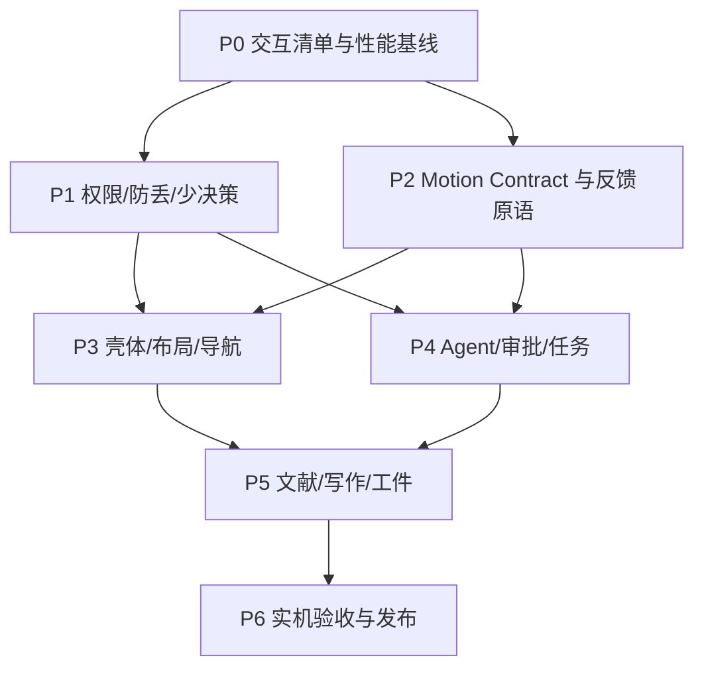

# Roc 全项目体验与动效重构：源码审查及分阶段实施方案

> 审查日期：2026-11-24
> 代码基线：`ryzqi/Roc`，`main`，commit `3eb8fd6ba1f6f5315ea7670f26c165994c2d34ef`
> 范围：Electron/React Renderer、与交互直接相关的状态/IPC 合同、测试及性能基础设施。**这是方案及执行记录；完成范围以阶段验证和 Git 提交为准。**
> 北极星：**复杂留给系统，清晰留给用户。动效传达因果和状态，不争夺注意力；可靠性、权限和可恢复性始终高于视觉效果。**

实施入口与当前验收范围见 [UX 与动效合同](docs/ux-motion/README.md)。各阶段完成必要检查后独立提交，检查结果随阶段文档更新；临时资料根、逐轮报告和截图在核验后清理。固定性能报告属于验收交付，保留于 `docs/ux-motion/`。真实刷新率、低功耗、物理输入设备和人工任务的未完成验收必须单列，不用自动化成绩替代。

## 0. 总结：不需要推倒重来，但需要补全「状态变化」这一层

Roc 已经有相当扎实的底层基础：语义颜色和密度 token、共享 `ModalShell`、全局 `MotionConfig reducedMotion="user"`、原生 `
` 双向展开、助手虚拟列表、可取消的历史滚动定位、分栏拖拽及 Escape 回滚、编辑草稿守卫、键盘焦点管理、宽窄窗口适配和成套布局测试。问题并不是「没有任何动效」或「没有设计系统」，而是**动效规范与实际页面状态变化尚未闭环**：部分内置预设未被使用，窄屏抽屉和画布切换仍瞬时改变，加载/成功/失败的可理解性分布不均，一些高级调试信息进入常规任务路径，且性能只留下较早的启动/内存基线，缺少当前版本的动效帧耗时验收。

本方案建议按 **P0 基线与状态清单 → P1 UX 风险与无谓决策 → P2 动效基础设施 → P3 壳体/导航/布局 → P4 Agent 与异步任务 → P5 文献/阅读/创作/工件 → P6 全量质量闸门与实机验收**推进。每阶段以独立 PR、真实功能回归和可回滚成果为交付条件。计划工期估计 7–11 周（1 名熟悉代码的前端开发者，加后端/QA 按需配合）；这不是承诺排期，P0 后用实际 issue 数量重新估算。

## 1. 源码已经确认的事实

### 1.1 应保留、复用的现成能力

| 现有能力 | 源码/证据 | 正确处理 |
| --- | --- | --- |
| 色彩、字体、圆角、间距、密度、深浅/纸张模式 | `src/renderer/styles/{semantic-tokens,tokens,index}.css` | 保持单 token 链，不再造新样式体系 |
| Motion 预设及减少动态效果 | `shared/motion.ts`、`shared/motion-features.ts`、`main.tsx`、`styles/index.css` | 增量补全语义，不引入第二套库 |
| 模态/抽屉进出、遮罩、焦点、离开守卫 | `shell/ModalShell.tsx`、`shell/use-overlay-behavior.ts` | 扩展共同状态合同，不替换成无焦点管理的自制组件 |
| 分栏跟手、RAF 合并、Escape 回滚、键盘操作 | `shell/ResizableDivider.tsx` | 保留直接跟手，优化存储写入及渲染隔离 |
| 助手窗口化、滚动接管和最新版跳转出场动画 | `assistant/transcript-panel.tsx` | 不对虚拟消息高度做整列 FLIP，保护可读位置 |
| 附件添加/删除过渡可中断 | `assistant/composer.tsx` 的 element-scoped View Transition | 复用其身份/中断思路，不能全局截图整页 |
| 离开未保存编辑保护、项目删除确认 | `app/navigation-guard.ts`、`settings/settings-editor-guard.tsx`、`project/ProjectPortalView.tsx` | 不应为了动画重建组件导致草稿丢失 |
| UI/版面/聚焦及打包测试 | `tests/renderer`、`scripts/ui-layout-audit.mjs`、`docs/ui-refactor-validation.md` | 复用并扩展状态/动效断言 |

### 1.2 需要安排整改的证据表

以下分为「**源码确认**」与「**运行风险，尚需实测**」。不把代码形态本身当成已经测出的卡顿。

| ID / 级别 | 源码位置 | 发现 | 面向用户的影响 | 拟议处理 |
| --- | --- | --- | --- | --- |
| F01 / P0 | `app/WorkspaceLayout.tsx` 的 `WorkspacePane` | **源码确认：** `hidden={!open}` 与 `flex/hidden` 直接切换，窄窗遮罩也条件挂载；未使用抽屉进退场 | 窄窗左右抽屉和遮罩瞬时出现/消失，空间来源不连贯 | 保持组件状态但隔离交互树，加入可反向打断的进退场 |
| F02 / P0 | `app/useLayoutPersistence.ts` → `app/ui-state.ts` | **源码确认：** 每帧宽度更新都会 `writeWorkspaceLayout`，它同步读取、解析、重写偏好 JSON | 拖动高频主线程同步存储；**是否掉帧待测** | 帧内只改视觉宽度，pointerup/键盘完成时提交，异常卸载兜底 |
| F03 / P1 | `app/ViewContent.tsx` | **源码确认：** 冷视图保持旧页直至模块就绪，随后 `display: block/none` 直接换页 | 无方向/上下文交代；但有正确的防空白策略 | 保留旧页防闪烁，仅对轻量内容容器做很短的交接反馈 |
| F04 / P1 | `canvas/WorkspaceCanvas.tsx`、`shell/AppNavigation.tsx`、`shared/motion.ts` | **源码确认：** 导航依靠背景色/伪元素即时切换，`tabIndicatorTransition` 定义但无调用点 | 同类选中态移动规则不统一，规范注释和调用事实有偏差 | 优先统一语义与状态，再决定低成本指示条是否需要 shared layout |
| F05 / P1 | `shell/WindowChrome.tsx` + `shell/chrome.css` | **源码确认：** 原生 popover 切换无进入/退出的共享状态语义；项目切换所有条目直接列出 | 菜单突现，大项目列表需要滚动查找 | 轻微淡入、关闭可打断；项目数多时优先最近项目/搜索 |
| F06 / P1 | `project/ProjectFormDialog.tsx` | **源码确认：** 新建必填标题、研究目标、工作目录；必须显式选择目录 | 首次操作需要多次判断；目录选择同时承载重要安全边界 | 非危险内容可建议默认值；目录采用可见建议+明确授权，不能默许写用户磁盘 |
| F07 / P1 | `literature/ImportDialog.tsx` | **源码确认：** 论文题名变更时重算并覆盖 `documentKey`，即使用户已手动改键 | 选择权被系统覆盖，用户修改可能丢失 | `auto/manual` 双态：默认派生，首次人工改写后不再覆盖，提供“恢复自动生成” |
| F08 / P1 | `settings/sections/RagSection.tsx` | **源码确认：** 常规设置头部展示 `phase`/`revision`/`ready` 原始技术字段 | 用户要理解内部状态机 | 常规页面说“已收录 48/52，剩余正在处理”，原始编号收进诊断 |
| F09 / P1 | `literature/RagStudio.tsx`、`literature/WikiPages.tsx`、`literature/MonitorEditor.tsx`、`literature/Zotero*Panel.tsx` | **源码确认：** 常规内容中显示版本号、`rN`、原始 JSON 或原始对象信息 | 科研流程与开发诊断混杂 | 默认呈现任务状态/下一步；追溯与技术字段保留在“详情/诊断/来源” |
| F10 / P0 | `research/tasks/TaskControls.tsx` | **源码确认：** `cancel` 从按钮直接调 `cancelTask`，无此处单独确认；`pause` 也在同组 | 相对高代价动作误触概率；是否可继续由任务状态决定 | 暂停保持一键；取消按实际后果加确认或可撤销等待，不伪称一定可恢复 |
| F11 / P1 | `settings/SettingsModal.tsx` | **源码确认：** 13 个分区已有搜索、领域分组、脏状态指示；切分区 key 触发内容即时更替 | 已有导航完备，但大表单上下文切换仍偏硬 | 保留草稿/焦点，极短弱转场；默认分区与上下文入口进一步减少导航 |
| F12 / P1 | `project/ProjectPortalView.tsx` + `ProjectRow.tsx` | **源码确认：** 40 条增量可见，筛选和布局瞬变，置顶/归档后列表原地重排；项目删除已有清晰确认 | 结果变化缺少留痕；绝不能牺牲快速列表操作 | 仅小规模稳定列表做位置连续性；大列表直接更新并保焦点/滚动 |
| F13 / P2 | `assistant/blocks`、`assistant/ResearchTaskProgress.tsx` | **源码确认：** 原生披露有动效、任务反馈不差；但同类 pending/成功/失败跨模块用不同零件拼装 | 同一类变化不够一致 | 统一 ActionFeedback/InlineStatus/StatusChange 合同与短暂成功反馈 |
| F14 / P2 | `styles/index.css`、`shared/motion.ts` | **源码确认：** 动效 token 与 CSS 微交互存在两层，`ResizableDivider` 仍用 `transition-all` | 扩展过程容易长出多个曲线/持续时间 | 建立语义映射与 lint；把 `transition-all` 缩成 opacity/transform 等特定属性 |
| F15 / P0 | `docs/ui-performance-baseline-2026-11-23.json`、`docs/ui-refactor-validation.md` | **源码确认：** 有旧版启动/内存与大量布局测试；2026-11-24 的最终验收明确跳过独立性能采样 | 不能由功能/布局通过推导当前版本丝滑满帧 | 重新固定基线，增加动作级帧、交互、GPU/compositor 实测 |
| F16 / P2 | `scripts/ui-audit/audit-design-rules.py` | **源码确认：** 现有静态审查为少量正则设计规则，尚无状态转场/中断/Reduced Motion 检查 | 新增页面容易重新出现割裂动效 | 补 AST lint+场景矩阵，视觉回归与交互回归并行 |

### 1.3 如何理解现有验收

`docs/ui-refactor-validation.md` 在 2026-11-24 记载完整 Renderer **1021/1021**、布局状态 **783**、控件/焦点检查 **2097**、裁切 **0**，以及 macOS 打包检查。这是已有流程的历史验收记录，不能当作本次在 commit `3eb8fd6` 上重跑的结果。尤其文档同时明确：性能被跳过；真人任务、外部服务、中文 IME、VoiceOver、物理触控板、真实刷新率还未完成独立验收。

旧性能基线采用 M1 Pro / 32 GiB、1440×900、每场景 5 轮；10,000 个合成事件的 startup `rendererReadyMs` P95≈1277ms、`firstPaintMs` P95≈228ms、输入区就绪 P95≈646ms，采样时只挂载 13 个消息行。它是更早的 `42c3a78` 基线，并且记录有测量时工作树差异；**不是当前主分支的 FPS 或交互流畅性成绩**。

## 2. 八条体验原则落实到具体交互

| 原则 | 具体产品决策 | 必须维持的边界 |
| --- | --- | --- |
| 系统能判断的，不留给用户 | 依据现有项目/选中对象自动确定导入目标、引用键候选、工作布局默认项、模型维度探测；展示依据，允许改写 | 自动建议不等于自动提交文件写入、连接外部服务、授权工具 |
| 此刻没用的，就不出现 | 限定主要操作 1 个；显示最近/当前任务；将版本号、原始 JSON、API 细节、使用量放进详情 | 重要失败原因、授权内容、证据来源必须始终可达 |
| 能替人做的，就直接做 | 自动检索元数据、校验字段、去重、显示真正可重试动作；恢复成功时收起成功历史 | 外部费用、破坏性副作用、权限申请不隐式执行 |
| 同一件事，处处一样 | 主按钮/次按钮/危险按钮、待处理/进行中/成功/失败、搜索清空、popover 与抽屉均使用共享语义组件 | 不强迫不同风险的动作使用同一种确认程度 |
| 按下有回应，再按能收回 | 响应先于服务完成；按钮提供 pending；切换开/关、菜单可重复点击；执行中需有取消/暂停语义 | 停止后台执行不等于撤销已经完成的外部副作用 |
| 不打断手上的事 | 不强制滚动列表、不抢焦点；后台完成留在状态中心；阅读保留位置、草稿保留 | 风险授权必须明确可见，不能因为“少打扰”自动放行 |
| 常用的好做，会丢东西的难误碰 | 常用搜索、切页、创建/导入入口直达；删除/取消有准确后果说明，能撤销的才给 Undo | 不用所有操作都弹确认；保留原项目删除已实现的确认 |
| 界面自己说明自己 | 以“正在读取/已导入/需你决定/重试成功”替代 `phase`/`revision`；空态给主行动；控件有可见标签 | 可审计性仍在详情与导出中提供，不能删掉底层证据链 |

### 2.1 两条不可合并的体验轴

1. **默认模式（任务导向）**：问题是什么、当前状态、下一步能做什么、失败如何恢复。主视图只展示这些。
2. **专业模式（证据与诊断）**：请求/运行 ID、版本、回执、来源、原始数据和栈信息。通过可明确识别的详情入口展开；保持复制/检索能力。

Roc 的可信 Agent 定位依赖第二条轴，不能以“简洁”为由删去可追溯性。目标是**分层呈现而非减少系统能力**。

## 3. 统一动效语言：Motion Contract v1

把 `shared/motion.ts`、CSS token、应用状态机与组件联成一张可执行的对照表。下面是**建议起始值**，不冒充 Apple 官方规定，也不是已经测定的最优值；在 P0 依据用户输入节奏和 Mac 实机调整。

| 语义事件 | 建议节奏 / 参数 | 视觉行为 | 别做什么 |
| --- | --- | --- | --- |
| Hover / Press / Focus | 0–100ms，按压可即时 | 颜色/1px 以内位移/明确焦点；重复操作无等待 | 控件大幅缩放、重复弹跳 |
| 开关、选中、切换图标 | 100–160ms，ease-out | 小范围选中标记、图标衔接或轻微透明度 | 360° 旋转或整页闪烁 |
| 小型 Popover / 命令建议 | 110–150ms；opacity + 0–4px 方向 | 从触发点附近出现；退出反向且可立即再打开 | 延时阻止菜单下一次点击 |
| Modal / 阻断授权 | 160–200ms；小幅 opacity/scale | 居中建立层级；退出还焦点；授权正文不失焦 | 大范围“飞入”、背景大模糊 |
| 浮动 Drawer / Inspector | 180–230ms；X 位移 + scrim | 从对应边缘进出；再次操作从当前进度反向 | `hidden` 导致退出首帧消失 |
| 内联侧栏展开/收起 | 120–180ms，视帧预算而定 | 只改变必要容器；主画布平稳调整，避免长文重排 | 对整个工作台所有子节点加 `layout` |
| 页面切换 | 80–140ms，弱 opacity 或指示标记迁移 | 新内容 ready 后短交接，旧内容保持至可用 | 对大 PDF / 图谱 / 终端做全屏截图过渡 |
| 任务提交/等待/完成 | 立即 pending；成功 120–180ms；失败保持 | 同一位置更新文字与图标，必要时用渐变文字；失败需常驻可操作 | 仅用打勾动画代替成功语义 |
| 小数字（计数/进度） | 100–160ms；只对显著的真实变化 | 使用 `tabular-nums`，固定宽度；低频计数可淡入 | SSE 每 token / 每进度点滚动数字 |
| List add/remove/reorder | 仅可见、稳定、数量小的集合 120–200ms | 位置连续、焦点不跳；被删除项退出后清理 | 10k 虚拟列表全体 FLIP/测量 |
| 拖拽、分割条、手势 | 直接跟手，**不设 tween** | 指针位置立即映射；释放时可极短吸附，Escape 恢复 | 对 pointermove 做延时 ease |
| 连续进度/骨架 | 有可确定进度优先数字/文字；不可确定才轻循环 | 不抢读者焦点；长任务可离屏保留状态 | 全局骨架闪烁或高频轮询动画 |

统一 `--duration-micro/fast/base/overlay` 与 `--ease-standard/exit` 的语义映射；原有 `--duration-fast/base/slow` 兼容别名迁移。spring 仅用于确实表达空间归属的短距离指示器/面板，不对文本正文“弹跳”。所有带方向的进入都沿同一方向退出；别让菜单向上进、向下走。禁用 `transition-all`、非必要的 `filter/blur/box-shadow/width/height` 高频动画；优先 `opacity`、`transform`，但不能无节制增加合成层。

**中断合同**：第二次点击必须立即使用最新状态改变目标；动画从当前状态接续，不排队、不强制等待 `finished`。`AnimatePresence` 所保留的退出子树必须只可见、不可操作；后续打开撤销旧关闭后不能触发旧回调。`ViewTransition` 要检查支持性、`ready/finished` rejection、`skipTransition` 和身份变化；已有 Composer 写法可参考。组件卸载、项目切换、窗口改断点、系统降低动态效果时都要清理异步动画引用。

**减少动态效果合同**：沿用根 `MotionConfig` + 全局 CSS 抑制；方向移动/缩放直接落最终态，必要信息靠文字/图标/焦点传达。避免自动循环，允许极短静态强调。布局恢复时临时禁用 transition（已有 `ReadingViewBoundary` 经验），防止滚动锚定被展开动画影响。

## 4. 分阶段落地计划

### P0（3–5 天）：冻结身份、全面状态审计与性能基线

**目标**：先知道改哪些状态、什么性能不可退化。此阶段原则上不改外观。

1. 在 `docs/ux-motion/` 建立 `surface-inventory.md`、`interaction-matrix.csv`、`motion-contract.md`、`benchmark-protocol.md`；每个可见交互至少记录：触发、before、pending、success、failure、cancel/undo、重新点击、reduced motion、焦点、长内容、路由切换、实现路径、负责人、验收证据。
2. 盘点页面树：项目门户、总览/发现、文献库/知识/RAG/阅读/PDF、写作/LaTeX/文件、终端/Git、Agent 会话/审批/任务、管理（记忆/技能/MCP/任务）、设置、工件审阅/发布。对所有 `button/details/dialog/select` 与路由作静态索引，人工审查真正可见的状态变化。每条记录有 issue ID，不只列动画 CSS。
3. 做优先级筛选：**数据丢失/越权 > 阻断任务 > 交互误解 > 频繁操作体验 > 装饰优化**。记录“点击前系统已知道什么”，判断能否自动得出结果，并保留可核验依据。
4. 复用 `scripts/performance/bench-ui-workloads.mjs`、`bench-macos-app.mjs`、`bench-repeated-workloads.mjs` 和 `docs/research-performance.md` 的生产 build 与独立采样原则；新增针对抽屉、菜单、分栏拖拽、列表重排、流式完成的短窗口 trace。基线固定 commit、lockfile、dist 摘要、macOS、电源状态、刷新率、窗口尺寸、缩放、样本数。禁止把 profiling 构建结果同普通 build 直接比较。
5. 用任务录屏确认实际感知：新建项目、导入 PDF、搜索→阅读→笔记→回助手、运行→授权→暂停/恢复、写作→切换面板→返回、归档/删除、慢网络/失败重试。

**输出**：有风险级别和文件定位的状态清单；3 类机器状态（60Hz、120Hz 可用时、低功耗）基线；PR 级任务列表。**门禁**：未重现/测量的条目仅标记“待验证”，不得以“卡顿已证实”进入实施结论。

### P1（5–8 天）：先解决误触、丢失、认知负担——动画之前的 UX

| 任务 | 主要代码 | 具体改法 | 验收 |
| --- | --- | --- | --- |
| 1A 高风险动作分级 | `research/tasks/TaskControls.tsx`、各项目/工件危险动作 | 区分暂停（可继续）、取消（可能终止后续）、删除（不可恢复）；按后端真实恢复能力设计确认/Undo；文案写清结果和对象 | 不可恢复动作不能一键误触；暂停无需额外确认；重复触发去重 |
| 1B 首次任务减输入 | `project/ProjectFormDialog.tsx`、`project/use-projects.ts` 与创建 API | 可提供项目名称推断、最近合法目录/安全建议；科研目标仅在业务合同允许后再改可选；工作目录授权仍明确选择，不自动写到任意路径 | 新建操作更短，默认值可编辑，权限边界未改变 |
| 1C 文献导入自动填充 | `literature/ImportDialog.tsx`、`literature/format.ts` | 文件/DOI 可推断时填元数据建议；引用键 `auto/manual` 锁定用户改写；优先已有条目/去重；字段不确定时允许纠正 | 用户修改不会被标题联动覆盖；低置信度不凭空生成结论 |
| 1D 高级信息分层 | `RagSection.tsx`、`RagStudio.tsx`、`WikiPages.tsx`、Zotero/Monitor 面板 | “正在建立知识索引、已收录 X/Y”取代 raw phase/revision；高级原值在可展开诊断卡；保留完整审计导出 | 主视图可读，原始状态可查、可复制，失败信息不丢 |
| 1E 恰当的时机与入口 | `WindowChrome.tsx`、`ProjectPortalView.tsx`、`SettingsModal.tsx` | 当前对象提供主行动；重复操作直达；项目切换多项时支持搜索；设置默认回到最近相关分区，危险选项收进明确领域 | 10 个常用任务完成步数不增加，默认页面主次分明 |

这阶段不要动 LangGraph 状态/幂等 receipt 语义。UX 的“自动”只授权**无需新风险判断**的派生与只读操作；文件写入、外部提交、模型付费调用、HITL 仍遵守原有权限。

### P2（4–6 天）：共享状态反馈与动效原语

**代码改动**：

- 扩展 `shared/motion.ts` 为面向事件的契约：`feedback`、`selection`、`popover`、`modal`、`drawer`、`content-handoff`、`list-small`；不改变已有 `ModalShell` 用法的合同。
- 增加少量 renderer shared 组件（建议 `ActionStatus`、`TransientStatus`、`MotionPopover`、`SelectionIndicator`）；只封装出现/消失和可访问状态，业务服务、风险与草稿由调用者掌控。
- 现有 `form-ui.tsx`、`page-ui.tsx`、`ErrorBar.tsx`、`DelayedFallback.tsx` 接入统一 `idle/pending/success/error/retry` 展示口径，包含 `role=status/alert` 与持久错误。已出现自带反馈的模块先复用，不做全仓强制改写。
- 让 CSS token 与 Motion 预设可追溯；旧 utility 显式迁移。对 `transition-all` 和随意写死 `duration-[...]` 加审核规则；白名单保留特定的原生 `details::details-content`。
- 在 `scripts/ui-audit/` 添加 AST 级约束，并提供代表性组件画廊+状态对照快照，取代“grep 到多少 `animate`”这种指标。

**先做独立 PR**：P2a token/契约与测试 → P2b 共享反馈 → P2c 迁移 3 个高频调用点 → P2d lint 防漂移。**门禁**：无视觉副作用、旧测试全部绿、reduced motion 有同等信息；菜单和 modal 在动画中二次点击不重入。

### P3（6–10 天）：窗口壳体、导航、分栏、弹层与项目门户

1. **浮动左右栏**（`WorkspaceLayout.tsx`）：保留重资源 mounted/inert 规则，区分逻辑 `open`、视觉 `present`、可点击 `interactive`；从实际边缘以 transform 进出，scrim 同步渐变。关闭时立即解除交互/焦点，退出完毕才移除视觉；重新打开立即反向。模式切换先决定布局几何，再决定是否需要动画；绝不在横跨 1100/1440px 断点时出现重叠焦点区。
2. **内联宽度/拖拽**（`ResizableDivider.tsx`、`useLayoutPersistence.ts`、`ui-state.ts`）：pointermove 只对必要宽度进行 RAF 更新；**持久化延到 pointerup、键盘操作结束或有限 debounce**，不能逐帧 JSON parse/stringify+localStorage。拖动中禁用宽度 tween，避免手指/鼠标“追不上”。Escape 恢复起点且**不留下已写入的中间值**；取消/窗口关闭时提交最终安全值或撤销。将宽度更新从全局昂贵树中隔离，经 Profiler 和 trace 验证。
3. **画布切换**（`ViewContent.tsx`、`WorkspaceCanvas.tsx`、`AppNavigation.tsx`）：保留旧页直到新模块就绪、滚动恢复和缓存策略。小的选中指标可用稳定 layoutId 或简单 transform；大画布切换只做极短弱淡化，重 PDF/终端/图谱不整体动画。正在加载的状态明确关联新目标，失败时旧内容仍可读且提供重试/返回。
4. **菜单/弹层**（`WindowChrome.tsx`、`SearchPaletteModal.tsx`、`ModalShell.tsx`、`radix-dialog-pilot.tsx`）：统一 Popover 生命周期，保证原生锚点、Escape、Tab、焦点恢复；可用 WAAPI/CSS 时不依赖额外完整 Motion 组件。避免原生 popover 关闭时 DOM 已消失造成退出动画不生效；必要时使用专门 presence 受控包装。
5. **项目列表**（`ProjectPortalView.tsx`）：仅对前几十个、当前可见且稳定的项目排序/置顶做轻微连续性反馈；大列表筛选立即生效，保留焦点和读屏状态。删除项目仍保持清楚确认、绝不把退出动画当数据删除事务。

**验收场景**：鼠标在 30% 进出动画时连续点击、ESC→立即重开、窗口拖至断点→反向拖回、双栏依次开关、最小窗、触控板拖拽、10000 条助手历史、宽度偏好重启恢复、Alt/Tab/VoiceOver。**阻断条件**：任何焦点被遮罩困住、草稿消失、layout shift 影响阅读位置、拖拽掉帧或存储写入仍在每帧发生。

### P4（5–8 天）：Agent 会话、审批、任务反馈

1. **Composer 与工具执行**（`assistant/composer.tsx`、`blocks/{message-row,tool-call-block,activity-shell}.tsx`）：发送后即时转 pending；模型执行与工具调用显示“正在做什么”，完成/失败回归同一消息位置，流式 token 不逐字动效。使用现有附件 View Transition，不扩大到整个编辑器。
2. **转录**（`transcript-panel.tsx`）：保留 `react-virtuoso` 及“用户滚动接管优先”的精心设计；只在真正的新消息/当前消息状态变化做低成本提示。新旧历史 prepend、tail trim、跨会话恢复不能用 layoutId 对整个历史列做 FLIP；离屏事件不触发可见动画。滚动到最新的按钮已有进退场，不再重写。
3. **HITL**（`HitlApprovalDock.tsx`、`approval-cards.tsx`）：对“需要用户批准”给足可见状态和影响范围，按钮 pending/拒绝结果清晰；审批进入时不突然跳走读者视口。不可用动画代替权限确认；撤回是拒绝尚未提交的授权，不宣称能撤销已发生操作。
4. **任务**（`ResearchTaskProgress.tsx`、`research/tasks/*`、`management/TaskCenterOverview.tsx`）：明确 `queued/running/needs_input/paused/completed/failed/cancelling`，每次任务状态变化有本地反馈且跨助手/任务中心一致。真正能取消的请求显示取消，不能取消的给原因/预计下一步；短暂成功反馈后收进历史，不抢焦点。重试沿用 request ID/receipt 防重复副作用。
5. **故障恢复**：从 Electron 崩溃恢复、断网续跑、工具超时、审批恢复、侧栏折叠/展开后状态仍准确。动画不对业务状态进行“乐观完成”假象。

**门禁**：对 500/5000 条历史与流式发送做逐场景 trace；再次运行时 pending 不能有两个同效请求；用户上滚后流输出绝不强制滚回；语义状态不靠颜色、动效单独表达。

### P5（7–12 天）：文献、知识、阅读、写作、文件、Git、终端、工件

按真实使用频次和复杂度拆小 PR，不做一次性覆盖 278 个组件的大重构：

| PR 顺序 | 业务区及文件 | 状态变化重点 | 关键限制 |
| --- | --- | --- | --- |
| 5A | `literature/DiscoverySearch.tsx`、`LibraryList.tsx`、`LibraryVirtualizedRows.tsx` | 搜索/筛选结果、选中、入库、重复提示、加载更多 | 虚拟列表仅动可见局部；手动滚轮/键盘位置绝对优先 |
| 5B | `literature/ImportDialog.tsx`、`ZoteroImportPanel.tsx`、`LiteratureProcessingPanel.tsx` | 选文件、抽取建议、去重、后台处理、成功/失败/重试 | 不误报“文献已索引”；收到回执只是入库阶段，不代表全链完成 |
| 5C | `literature/PaperReader.tsx`、`PaperPdfView.tsx`、`PdfReadingTools.tsx`、`ReadingViewBoundary.tsx` | PDF 翻页、批注、选择、译文、侧栏、失败披露 | 不在翻页上加大规模过渡；选择/定位/阅读滚动精确恢复，避免锚定抖动 |
| 5D | `literature/{RagStudio,WikiPages,KnowledgeGraphView}.tsx` | 查询/证据加载、图谱选中、知识页版本、结果切换 | 图谱变化仅标注当前关系，避免全图 spring；可追溯版本可点开 |
| 5E | `latex/*`、`canvas/files/*`、`canvas/terminal/TerminalView.tsx`、`canvas/git/*` | 文件选择、保存、编辑脏标记、编译、Git diff、终端状态 | 输入文本、CodeMirror、terminal 字符流没有字形动效，避免额外布局和 CPU |
| 5F | `artifacts/*`、`research/tasks/*`、`management/*`、`settings/*` | 工件检视/版本、方案步骤、发布、管理和设置保存状态 | 不在版本/来源引用之间错误绑定动画 identity，任何写入保留授权与预期 revision |

每个 PR 除 UI 外要写三个用例：**正常完成**、**失败/取消**、**中途第二次操作或换对象**。每个业务区至少覆盖窄/宽、深/浅、减少动态效果。完成后维护“已覆盖状态数 / 例外状态及原因”，而不是统计动效数量。

### P6（5–8 天）：性能、可访问性、视觉和交付质量门禁

#### 6.1 建议的性能验收指标（须在 P0 校准）

| 指标 | 建议发布门槛 | 测量方式 |
| --- | --- | --- |
| 动作反馈 | 高频点击在同帧/下一帧发生视觉回应；P95 输入→可见反馈目标 ≤100ms | 真实输入事件+CDP trace/录屏，拆分调用延迟与渲染 |
| 60Hz 帧稳定性 | 动效窗口 RAF 间隔 P95 ≤20ms、P99 ≤34ms，>50ms 间隔尽量为 0 并解释异常；不劣于基线 | 固定动作序列重复 ≥5 次，不把 RAF 当实际屏显 FPS |
| 120Hz 设备 | 按 ~8.3ms 帧预算另建验收，不将 60Hz 成绩视为 120Hz 达标 | 可获取真实高刷设备时实测；报告刷新率与节能状态 |
| 长任务 | 因新增动画引起的 ≥50ms 主线程长任务 = 0；已有非动画长任务单列 | Chrome tracing，标明源头是解析/渲染/IPC 还是合成 |
| 分栏拖拽 | pointermove 的 JS→视觉跟随稳定；本地持久化不在每帧执行；Escape 精确回滚 | 轨迹录制+Storage spy+性能 trace |
| 长内容 | 500/5000 条会话、10k 事件、千条文献、长 PDF、长代码文件无明显退化；DOM 行数仍有界 | 现有 `bench-ui-workloads`、虚拟列表门禁、React Profiler 单独定位 |
| 资源 | renderer eager chunk 不超过现有预算，动画后 heap/working set 无持续增长；离屏动画停 | `pnpm check:renderer-chunks`、多轮 heap/process metrics |
| 布局/功能 | 零新增裁切、溢出、重叠、焦点丢失、数据丢失；回归用例全部通过 | `pnpm audit:layout`、`pnpm test:renderer`、packaged smoke |

如果实际测量发现 20ms P95 门槛与某设备的刷新率/测量开销不匹配，应报告事实并调整策略，**不能修改仪器、扩大豁免或只留通过样本**。普通生产构建采用户感知成绩，profiling build 仅做定位；对照报告固定源码、依赖、构建摘要、数据夹具、宿主与运行环境。仪器抓取的 RAF 间隔、GPU 实际合成帧与显示帧须分别标注，不混称「FPS」。

#### 6.2 状态矩阵

最小集合：窗口 CSS 宽 360/720/1184/1440（实际 macOS 最小 1184 物理像素可通过缩放形成更小 CSS 视口），高度 225/450/640/900；系统 light/dark + paper；compact/comfortable；动态效果开启/减少；键盘/鼠标/触控板；离线/高延迟/报错；数据 0/1/500/5000；动画执行中二次触发。项目/助手与图谱等昂贵状态可采用正交覆盖，但 **P0/P1 风险路径与交互动画中断必须全组合**。

#### 6.3 自动化与人工验收

1. 单元：纯函数状态机、语义 duration/class map、prefers-reduced-motion fallback、presence 二次反转、timeout/unmount 清理、偏好持久化次数。
2. Renderer 真窗口：Playwright 驱动按钮/鼠标拖动/键盘输入，连续 5～20 轮；验证无焦点丢失、无重复回调、动画退出后 DOM 不可点击、视觉后状态与内核一致。
3. 视觉：浅深/高缩放/宽窄/hover/pressed/pending/success/error/exit/reverse 截帧；自动检测裁切/溢出，人工观察是否闪烁和抖动。
4. 实机：M1 Pro 与至少一台不同代/低功耗 Mac；物理触控板、中文 IME、VoiceOver、系统减少动态效果切换；外部服务必须使用隔离项目和可回滚测试数据。
5. 发布：`pnpm typecheck` → `pnpm test:unit` → `pnpm test:renderer` → `pnpm audit:design` → `pnpm audit:layout` → `pnpm check:renderer-chunks` → `pnpm smoke:electron` → 应用内存/帧对照 → 打包 smoke。不能用旧 commit 的通过记录替代当前结果。

## 5. PR 依赖图与优先级

**优先马上修复**：F10（取消任务是否需要确认的风险验证）、F07（手动引用键可能被自动覆盖）、F02（拖动同步存储风险）、F01（浮动抽屉瞬时切换）。这些直接影响信任、可理解性或高频操作。之后才是纯微动效的视觉打磨。

| 里程碑 | 可交付成果 | 合并准则 |
| --- | --- | --- |
| M0：基线冻结 | 状态矩阵、优先 issue、当前 trace | 每条问题标明已证实/待测；数据可复现 |
| M1：错误操作更难、常用操作更省 | 自动推断与安全反馈 PR | 没有权限越界和草稿损失 |
| M2：Motion v1 | token、原语、测试/静态规则 | 不产生第二套 CSS/JS 动效入口 |
| M3：Shell 质感 | 窄窗抽屉、布局/菜单/路由切换 | 反向中断、无焦点悬挂、实测无性能回退 |
| M4：长任务体验 | Agent 运行、审批、状态演变 | 长流/虚拟列表不会突然跳位置 |
| M5：全业务覆盖 | 文献/阅读/创作/工件状态覆盖清单 | 每区正常、失败、中断路径通过 |
| M6：可发布 | 当前版五轮报告+真机+截图/录屏+回滚方案 | 所有硬门禁通过，未完成项明确记录 |

### PR 切分约束

- 一个 PR 只覆盖一类状态合同或一个业务区；避免同时改导航、编辑状态和持久化数据合同。
- 不新增 animation package，优先使用已有 `motion@14`、CSS、原生 View Transition；新依赖需体积、可访问性和维护性论证。
- 每个 PR 附：前后状态矩阵、关键录屏（含反向打断）、Reduced Motion 视频或断言、帧对照、功能测试及 `git diff --check`。
- 大型组件（例如 `PaperReader`、`SettingsModal`）以抽离纯状态和局部原语为主，不为“动画统一”重写其业务逻辑。
- 新旧组件不应两套方案长期并存；先提供兼容封装，再分模块替换，最后移除死 token 与废弃样式。
- 从始至终以 `runId/toolCallId/receipt/expectedRevision` 等后端安全语义为唯一真相，显示层只能投影，不能虚构完成态。

## 6. 具体验收脚本：八个「一眼看得出品质」的用户旅程

1. **新建项目**：初始空态 → 主 CTA → 自动建议合法可改内容 → 选择目录授权 → pending → 成功进项目；途中 Esc 关闭不会丢输入，错误清楚说明哪一步。
2. **导入论文**：选 PDF/DOI → 能读的元信息自动填 → 用户手改引用键后保持 → 检测到重复给明确选择 → 回执与后台索引是两个不同进度；无假成功。
3. **跨视图研究**：检索 → 选论文 → 打开阅读 → 批注 → 返回结果 → 打开助手；保持滚动/选中/草稿、焦点有归属，路由不闪白。
4. **长任务授权**：开始运行 → 工具状态 → 等待审批 → 清晰风险内容 → 批准/拒绝 → 继续/失败/重试；HITL 不覆盖主要证据，状态改变不抢正在编辑的焦点。
5. **分栏手势**：快速拖动左栏/右栏 → 中途换向 → 释放 → 重启复原 → Esc 精确撤销；窄窗打开/关闭 5 次不抖不闪。
6. **阅读长内容**：10k 事件历史、200 页 PDF、带公式/图谱的知识页，持续滚动时异步状态到达；不能强迫滚回顶部/末尾。
7. **写作**：CodeMirror 中中文 IME 组合输入 → 侧栏打开/关闭 → 切换项目被草稿守卫阻止 → 保存后返回；光标、选区、未保存状态稳定。
8. **危险操作**：归档/恢复、项目删除、取消整个 Agent 任务：确认文案精确描述是否影响磁盘与是否可恢复；误触和重复点击不能引发双执行。

验收人每个旅程回答五个问题：**我现在在哪？刚刚发生了什么？系统正在做什么？我能如何继续？如果出错，能否恢复？** 任一问题需从日志里猜答案，就不算通过。

## 7. 明确不做的事情

- 不对所有元素统一加 `transition`、弹跳或玻璃模糊效果；“处处有动画”不等于 Apple 品质。
- 不重写现有虚拟列表、滚动接管、编辑草稿守卫、审批/回执安全链，也不更换 Electron + React + TypeScript 技术栈。
- 不为了“自动化”替用户授权文件写入、外部调用、费用或不可逆动作；不能自动决定的事情要解释原因并要求清楚选择。
- 不以历史布局全绿等同当前帧性能全绿，也不把 CSS 动画的理论合成优势等同实测 60fps。
- 不要求重度用户放弃诊断和证据追溯；保留专业详情，但避免默认占据任务主路径。

## 8. 源码与外部依据

**源码锚点（固定 commit，避免 main 后续变化）**：

- [布局与浮动栏](https://github.com/ryzqi/Roc/blob/3eb8fd6ba1f6f5315ea7670f26c165994c2d34ef/src/renderer/app/WorkspaceLayout.tsx)、[宽度与持久化](https://github.com/ryzqi/Roc/blob/3eb8fd6ba1f6f5315ea7670f26c165994c2d34ef/src/renderer/app/useLayoutPersistence.ts)、[UI state](https://github.com/ryzqi/Roc/blob/3eb8fd6ba1f6f5315ea7670f26c165994c2d34ef/src/renderer/app/ui-state.ts)
- [共享动效](https://github.com/ryzqi/Roc/blob/3eb8fd6ba1f6f5315ea7670f26c165994c2d34ef/src/renderer/shared/motion.ts)、[全局样式](https://github.com/ryzqi/Roc/blob/3eb8fd6ba1f6f5315ea7670f26c165994c2d34ef/src/renderer/styles/index.css)、[Modal](https://github.com/ryzqi/Roc/blob/3eb8fd6ba1f6f5315ea7670f26c165994c2d34ef/src/renderer/shell/ModalShell.tsx)
- [画布内容切换](https://github.com/ryzqi/Roc/blob/3eb8fd6ba1f6f5315ea7670f26c165994c2d34ef/src/renderer/app/ViewContent.tsx)、[项目创建](https://github.com/ryzqi/Roc/blob/3eb8fd6ba1f6f5315ea7670f26c165994c2d34ef/src/renderer/project/ProjectFormDialog.tsx)、[文献导入](https://github.com/ryzqi/Roc/blob/3eb8fd6ba1f6f5315ea7670f26c165994c2d34ef/src/renderer/literature/ImportDialog.tsx)
- [任务控制](https://github.com/ryzqi/Roc/blob/3eb8fd6ba1f6f5315ea7670f26c165994c2d34ef/src/renderer/research/tasks/TaskControls.tsx)、[助手转录](https://github.com/ryzqi/Roc/blob/3eb8fd6ba1f6f5315ea7670f26c165994c2d34ef/src/renderer/assistant/transcript-panel.tsx)、[RAG 设置](https://github.com/ryzqi/Roc/blob/3eb8fd6ba1f6f5315ea7670f26c165994c2d34ef/src/renderer/settings/sections/RagSection.tsx)
- [视觉与动效 ADR](https://github.com/ryzqi/Roc/blob/3eb8fd6ba1f6f5315ea7670f26c165994c2d34ef/docs/adr/0023-visual-and-motion-spec.md)、[UI 验证记录](https://github.com/ryzqi/Roc/blob/3eb8fd6ba1f6f5315ea7670f26c165994c2d34ef/docs/ui-refactor-validation.md)、[性能协议](https://github.com/ryzqi/Roc/blob/3eb8fd6ba1f6f5315ea7670f26c165994c2d34ef/docs/research-performance.md)

**原理参考（官方 / 一手文档）**：

- [Apple Human Interface Guidelines — Motion](https://developer.apple.com/design/human-interface-guidelines/motion)
- [Apple Human Interface Guidelines — Design Principles](https://developer.apple.com/design/human-interface-guidelines/design-principles/)
- [Motion for React — AnimatePresence](https://motion.dev/docs/react-animate-presence)、[Layout Animation](https://motion.dev/docs/react-layout-animations)、[Reduced Motion](https://motion.dev/docs/react-accessibility)
- [MDN — Element.startViewTransition](https://developer.mozilla.org/en-US/docs/Web/API/Element/startViewTransition)
- [web.dev — High-performance animations](https://web.dev/articles/animations-guide)

---

**推荐执行顺序**：先用 1 周冻结现状和解决最高风险问题，再把壳体体验做成样板；之后横向铺开至任务、文献、阅读和写作。Roc 的高级感来自**持续的可理解性、可靠中断、稳固的空间关系与真实性能**，不是每个控件都能动。
