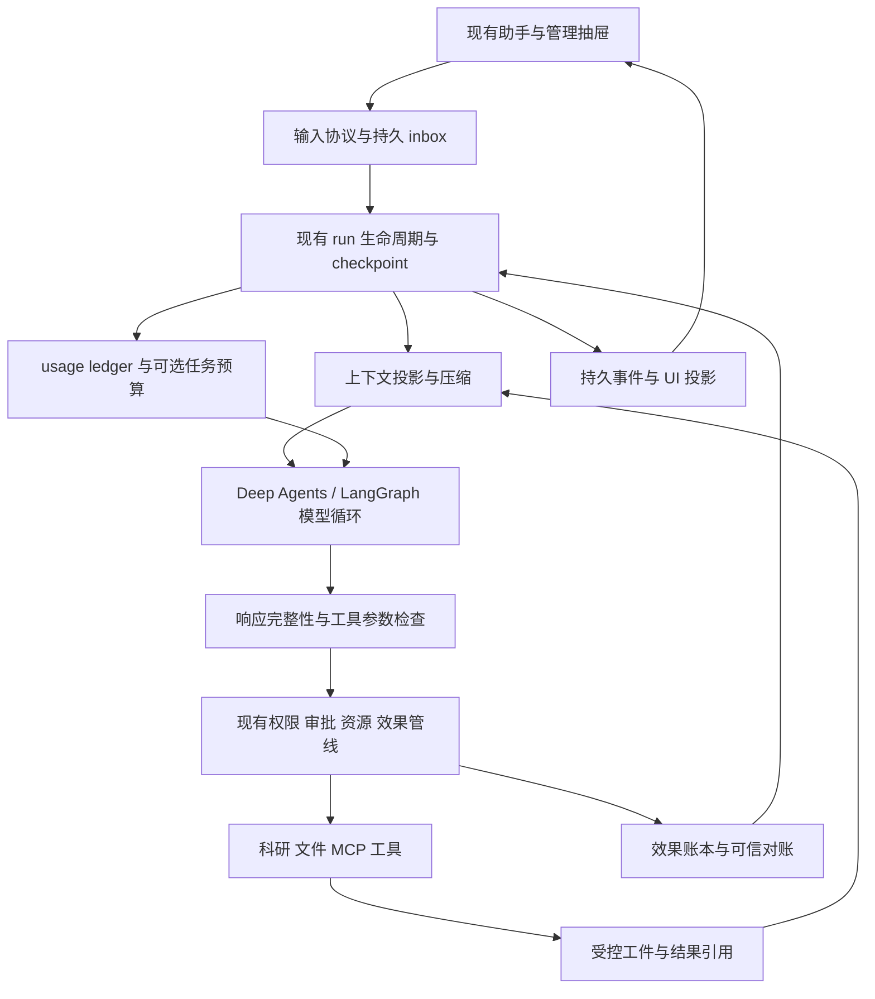

# Codex、Pi 的 harness 设计与 Roc 优化建议

研究日期：2026-11-20。本文保留固定源码研究与优化优先级；P0 三项随后已进入实现，当前产品合同见 [Agent harness](agent-harness.md)。下文“证据”描述改动前基线，验证记录另列实现后的检查。未运行上游测试或付费模型质量/性能对照。

**建议保留 Roc 的 Deep Agents / LangGraph 执行基础，围绕现有边界补齐输入、输出完整性和效果恢复闭环。** Codex 值得学习的是请求与执行的身份、政策和生命周期合同；Pi 值得学习的是小内核、明确消息投影、输入队列与工具结果合同。Roc 的科研证据、人工闸门、效果账本应继续由产品运行时拥有。

## 1. 源码范围与版本

| 项目 | 固定源码 | 本次重点 |
| --- | --- | --- |
| OpenAI Codex | `ea8ccc1d20ff65398e02490ac34f8c1012848625`，提交于 2026-11-20 05:28 UTC | turn/input、StepContext、工具调度与审批、预算、压缩、rollout 恢复、子代理资源 |
| Pi | `edfe6b2ef32283d31efc9e26db86fe48be19d3b2`，包版本 1.5.2 | agent loop、AgentSession、消息投影、steer/follow-up、工具执行与输出、session tree、compaction |
| Roc | `45267e88c3f99b69af275078ee50d526c8401cd1`，初始工作区干净 | 生产装配、上下文、输入、工具效果、任务账本、UI 接线与已有评测 |

Pi 原仓库 `badlogic/pi-mono` 已重定向到 `earendil-works/pi`；本文使用新地址的固定提交链接。Codex 比 [现有 harness 文档](agent-harness.md) 的 `10ca1749…` 更新；Pi 与该文档快照相同。

Roc 安装版本：`deepagents 1.17.0`、`langchain 1.6.6`、`@langchain/langgraph 1.7.5`、`@langchain/core 1.4.1`；验证环境 Node `26.13.1`、pnpm `12.21.0`。Context7 用于文档定位，结论以固定提交源码和本地安装代码为准。

## 2. 两者最值得学的设计思想

### 2.1 小内核与强合同可以同时成立

Pi 在 [SDK 装配](https://github.com/earendil-works/pi/blob/edfe6b2ef32283d31efc9e26db86fe48be19d3b2/packages/coding-agent/src/core/sdk.ts#L403-L463) 中先创建通用 Agent，再由 AgentSession 接管持久化、压缩、扩展与产品设置。内核关心模型、消息、工具和循环；产品策略留在外层。

Codex 则把复杂执行条件变成显式对象：[StepContext](https://github.com/openai/codex/blob/ea8ccc1d20ff65398e02490ac34f8c1012848625/codex-rs/core/src/session/step_context.rs#L26-L60) 固定单次模型请求的设置、工具路由、MCP 连接和环境；工具调用保留产生它的请求上下文。运行中可以调整之后的请求，已产生的调用不能悄悄改绑权限或 schema。

对 Roc：保留 `run-harness → agent-builder → middleware-stack` 装配和现有 adapter，把可见工具、执行授权、消息投影的合同做清楚即可。文件多、中间件多本身不能证明需要重写框架。

### 2.2 用户输入是运行时控制事件

Codex 的 [start / steer / start-if-idle](https://github.com/openai/codex/blob/ea8ccc1d20ff65398e02490ac34f8c1012848625/codex-rs/core/src/codex_thread.rs#L618-L635) 由 Core 决定，返回真实 turn 身份；[结果类型](https://github.com/openai/codex/blob/ea8ccc1d20ff65398e02490ac34f8c1012848625/codex-rs/protocol/src/turn_input.rs#L321-L397) 区分启动、注入、未提交。接收确认不等于持久化或模型已消费。

Pi 的 [双层循环](https://github.com/earendil-works/pi/blob/edfe6b2ef32283d31efc9e26db86fe48be19d3b2/packages/agent/src/agent-loop.ts#L184-L224) 分开 steering 和 follow-up：前者在继续当前任务的边界注入，后者在本来要结束时再开一轮。较慢的准备/压缩完成后还会再次检查 steering。**当前 Pi 等整批工具完成才注入 steering；它不撤销正在执行的效果。** 立即停止是 cancel 的职责。

对 Roc：需要区分已接收、已持久化、待模型消费、已消费，以及停止、纠正和追加任务。不能依靠 UI 先查询运行状态再猜测该调用哪个接口。

### 2.3 工具执行合同比 JSON schema 更大

Pi 在 [工具执行前](https://github.com/earendil-works/pi/blob/edfe6b2ef32283d31efc9e26db86fe48be19d3b2/packages/agent/src/agent-loop.ts#L267-L279) 检查 `stopReason=length`，拒绝该消息的所有工具调用；[错误结果](https://github.com/earendil-works/pi/blob/edfe6b2ef32283d31efc9e26db86fe48be19d3b2/packages/agent/src/agent-loop.ts#L481-L512) 引导重新提交完整参数。原因：流式 JSON 修复可能生成语法合法、内容却被截断的参数。

Codex 的 [ToolOrchestrator](https://github.com/openai/codex/blob/ea8ccc1d20ff65398e02490ac34f8c1012848625/codex-rs/core/src/tools/orchestrator.rs#L394-L473) 按错误类别和政策决定是否升级 sandbox、重新审批或直接失败。普通工具错误不自动获得扩大权限的重试。

对 Roc：工具提案必须同时满足响应完整、参数有效、能力允许、审批有效、资源可用、效果状态可重试。模型可纠正的错误与状态不明的副作用应走不同路径。

### 2.4 历史、模型上下文、UI 事件是不同投影

Pi 的 [SessionManager projection](https://github.com/earendil-works/pi/blob/edfe6b2ef32283d31efc9e26db86fe48be19d3b2/packages/coding-agent/src/core/session-manager.ts#L468-L583) 保留原始 entry 与模型消息的对应关系；压缩和分支不会把原始事件当作可随意覆盖的字符串。并行工具的 [结束事件](https://github.com/earendil-works/pi/blob/edfe6b2ef32283d31efc9e26db86fe48be19d3b2/packages/agent/src/agent-loop.ts#L592-L658) 随完成发出，模型的工具结果按原调用顺序提交。

Codex 的 [rollout reconstruction](https://github.com/openai/codex/blob/ea8ccc1d20ff65398e02490ac34f8c1012848625/codex-rs/core/src/session/rollout_reconstruction.rs#L12-L92) 从合法压缩检查点与后缀重建上下文。后台压缩候选有版本，采用前 [检查 history/model/auth](https://github.com/openai/codex/blob/ea8ccc1d20ff65398e02490ac34f8c1012848625/codex-rs/core/src/session/async_compaction.rs#L156-L199)，再 [原子替换前缀并保留后缀](https://github.com/openai/codex/blob/ea8ccc1d20ff65398e02490ac34f8c1012848625/codex-rs/core/src/session/compaction_replacement.rs#L35-L102)。该后台机制受 feature/provider 条件限制。

对 Roc：科研证据需要能解释“这次请求实际看到了哪些来源”。UI 显示成功、模型收到结果、效果已提交、checkpoint 已落盘是不同事实。现有 SQLite 和工件引用可以承担这些职责，无须改成 JSONL。

### 2.5 资源由任务树共享，等待后仍要重新准入

Codex 的 [RolloutBudget](https://github.com/openai/codex/blob/ea8ccc1d20ff65398e02490ac34f8c1012848625/codex-rs/core/src/rollout_budget.rs#L25-L61) 为 agent tree 共享状态；[记账与限额判断](https://github.com/openai/codex/blob/ea8ccc1d20ff65398e02490ac34f8c1012848625/codex-rs/core/src/rollout_budget.rs#L102-L165) 同锁完成。工具 [排队取得锁后再查预算](https://github.com/openai/codex/blob/ea8ccc1d20ff65398e02490ac34f8c1012848625/codex-rs/core/src/tools/parallel.rs#L322-L368)，避免等待时同伴耗尽额度后仍启动。

Pi 的 [文件变更队列](https://github.com/earendil-works/pi/blob/edfe6b2ef32283d31efc9e26db86fe48be19d3b2/packages/coding-agent/src/core/tools/file-mutation-queue.ts#L16-L60) 按真实文件路径串行；[write](https://github.com/earendil-works/pi/blob/edfe6b2ef32283d31efc9e26db86fe48be19d3b2/packages/coding-agent/src/core/tools/write.ts#L64-L82) 在底层写入 settle 前不提前释放锁。取消并不证明写入已回滚。

对 Roc：并行数量、资源冲突、累计预算、取消、结果消费应分别建模。Codex 的预算也不是严格的美元硬上限，在途请求仍会产生费用；其部分 WorkCheckpoint 方法为 stub，不能照名称推断完整能力。

## 3. Roc 已有的能力应保留

| 已有机制 | 核对入口 | 对后续优化的约束 |
| --- | --- | --- |
| run snapshot、冻结 manifest、主/子代理权限过滤 | [agent-builder.ts](../src/main/services/deep-agent/agent-builder.ts)、[model-tool-exposure.ts](../src/main/services/deep-agent/model-tool-exposure.ts) | 动态可见工具只能是授权集合的子集 |
| 单一中间件顺序与框架适配 | [middleware-stack.ts](../src/main/services/deep-agent/middleware-stack.ts)、[deep-agent-stream-adapter.ts](../src/main/services/deep-agent/deep-agent-stream-adapter.ts) | 新入口复用现有工具管线，不另建执行栈 |
| 工具效果身份、代际隔离、成功回放、unknown 阻断 | [tool-effect-idempotency.ts](../src/main/services/deep-agent/tool-effect-idempotency.ts)、[tool-effect-store.ts](../src/main/services/deep-agent/tool-effect-store.ts) | 保留无法确定效果时的保守行为 |
| 共享准入、公平排队、取消与等待遥测 | [prepared-tool-effect.ts](../src/main/services/deep-agent/prepared-tool-effect.ts)、[tool-resource-coordinator.ts](../src/main/services/deep-agent/tool-resource-coordinator.ts) | 先测瓶颈，再细化资源范围 |
| checkpoint、验收、handoff、事件重放 | [checkpoint-resume.ts](../src/main/plugins/agent/checkpoint-resume.ts)、[task-contract-store.ts](../src/main/services/deep-agent/task-contract-store.ts) | 恢复保留原身份，验收不靠模型自述 |
| 按能力提示、稳定块排序、token cache | [prompt-blocks.ts](../src/main/services/deep-agent/context/prompt-blocks.ts)、[context-capacity.ts](../src/main/services/deep-agent/context/context-capacity.ts) | 不把已有优化重复当成新增方案 |
| 大结果工件、SHA/作用域核验、结构化摘要、固定控制合同 | [context-compaction-pipeline.ts](../src/main/services/deep-agent/context/context-compaction-pipeline.ts) | 保持 [ADR 0027](adr/0027-retain-roc-context-compaction.md) 的单一压缩所有权 |
| 工程 harness、独立 verifier、实验/对照协议 | [evaluation/README.md](../evaluation/README.md) | 复用现有评测，区分工程合同与真实模型质量 |

## 4. 优化优先级与最小落点

### P0-A：为工具提案补统一的输出完整性门禁

**证据。** [rescue-parsing.ts](../src/main/services/forge-guardrails/middleware/rescue-parsing.ts) 第 13–62 行从模型文本恢复 tool_calls，但未检查截断标记；原生 tool_calls 直接返回。当前安装的 `createAgent` 加该生产中间件，在三种诊断输入中均执行了无害工具一次：`length-native`、`length-rescue`、`max-tokens-rescue`。正常对照也执行一次。诊断不等于完整 Roc 生产栈复现，但证明此组合本身没有完整性门禁。

诊断使用非流式模型替身、完整 JSON 参数与人工构造的截断标记，证明该组合未拦截这些标记；未模拟真实 provider 流截断或 JSON salvage。完整生产栈与流式 metadata 传递仍需回归验证。

Roc 的 [scientific-extraction-model.ts](../src/main/plugins/research/scientific-extraction-model.ts) 第 56–60 行已经拒绝 `finish_reason=length` / `stop_reason=max_tokens`。规则目前局限在科研提取调用。

**最小改动。** 抽取 provider 响应完成状态，在工具调度前统一处理原生和 rescue 调用。确知截断时不执行该批工具，保留 call ID，给模型可纠正反馈并限制重试。正常 `tool_calls` / `tool_use` 不应被误拒绝；未知 provider metadata 应有明确兼容合同，不能假装已确定完整。

**验收。** 完整生产栈中，截断但 schema 合法的写文件/研究变更调用执行次数为 0；正常调用为 1；重新提交完整参数后只执行一次。覆盖流式与非流式、原生与 rescue、OpenAI 与 Anthropic 兼容模型。

### P0-B：接通运行中纠正，再扩展 follow-up

**证据。** [index.ts](../src/main/plugins/agent/index.ts) 第 430 行已注册 `agent.run.correct`；[run-usage-ledger.ts](../src/main/services/deep-agent/run-usage-ledger.ts) 第 215–242 行已有按 submission ID 去重的持久 inbox；[run-usage-middleware.ts](../src/main/services/deep-agent/run-usage-middleware.ts) 第 128–135 行在主代理 `beforeModel` 注入。

但 [use-chat-session.ts](../src/renderer/assistant/use-chat-session.ts) 第 125–126 行拒绝运行中发送；[AssistantPanel.tsx](../src/renderer/assistant/AssistantPanel.tsx) 第 473–484 行只有回答问题或新建 run 两条分支。renderer 未发现 `correctRun` 调用。后端具备原语，日常助手尚不能使用。

**最小改动。** 第一阶段接现有纠正接口与队列状态，保持 run/thread 身份；第二阶段增加 follow-up 类型和结束时消费规则。主进程负责原子判定目标 run，UI 展示排队/生效，不把“已入队”显示成“模型已处理”。核对慢压缩期间到达、最后一次模型请求期间到达、等待批准时到达三种边界。纠正不等同于取消或批准；已完成效果不能靠新文本撤销。

**验收。** 运行中纠正、刷新、重启和重复 IPC 都不丢不重；final 与入队竞态有确定结果；pending correction 不被摘要吞掉；follow-up 不打断当前任务；cancel 确实停止后续调度。

### P0-C：把 unknown effect 的对账接到生产恢复入口

**证据。** [tool-effect-store.ts](../src/main/services/deep-agent/tool-effect-store.ts) 第 271–363 行已有 `reconcile`，校验 operation、generation、receipt 后从 unknown 转为 succeeded 或 failed_retryable。全 `src` 静态调用核查没有发现该方法的生产调用；已知调用在单测和 native evaluation。与此同时 [task-contract-store.ts](../src/main/services/deep-agent/task-contract-store.ts) 第 191–217 行拒绝带未决效果的恢复。

**最小改动。** 增加可信的效果对账服务，先覆盖能核实目标文件 hash 或 provider receipt 的工具。服务读取真实状态，调用现有 reconcile，刷新 handoff/验收，再允许原 run 恢复。现有助手/管理抽屉展示证据和未决原因；模型文本不能自行证明 applied/not_applied。证据不足时继续保持 unknown。

**验收。** 效果已发生但响应丢失 → 重启 → 生产服务核实 → 同 run 恢复，实际效果仍为一次。未发生时允许一次重试；错误 hash、旧 generation、跨项目引用拒绝。验收必须走生产服务/IPC，直接调用 store 的测试不能替代产品闭环。

### P1-A：可选的任务累计预算

**证据。** [RunUsageLedger](../src/main/services/deep-agent/run-usage-ledger.ts) 第 34 行明确“记录调用，不实施执行配额”；`reserve` 忽略 `_config`，但已有持久 reservation/settlement 和 task 汇总。摘要、主/子代理已共享记账。 [ADR 0028](adr/0028-execution-task-ownership.md) 第 15 行明确当前无任务累计 token、费用或时长配额。**这是已接受的产品政策，不能当作漏修 bug。**

**建议。** 如需约束长科研任务，在现有 task 所有者与 ledger 增加可选 BudgetPolicy：请求前原子预留、返回后结算、unknown 保留预留、恢复沿用余额。覆盖主代理、子代理、摘要、重试与有成本工具，排队获锁后重新检查。缺价目/usage 时报告 unknown。模型上下文容量与任务总配额继续分开。

**验收。** 并发调用共享余额；重启不会清零；摘要与重试计入；耗尽后不再启动新工作；允许明确扩额后恢复。落地时需同步更新 ADR 与现有“忽略旧限额”的测试。评测里的 host `requestBudget` 不构成生产预算证据。

### P1-B：先减少不必要的工具暴露，再考虑动态发现

**证据。** [model-tool-exposure.ts](../src/main/services/deep-agent/model-tool-exposure.ts) 第 74–87 行按 manifest/scope 过滤；已有按能力提示与工具排序。当前通用主代理可见性未形成面向每次任务步骤的独立策略。是否有明显 token 或选错工具成本，需要测量。

**建议。** 先给实际任务类别建立少量稳定工具集合，测 schema token、误选率和完成率。确有收益后，再在冻结 manifest 内做渐进发现。借鉴 Codex StepContext，为每次模型请求保存可见 schema/hash，已产生的调用绑定旧视图。动态发现改变可见性，不增加权限。避免每轮随意重排工具破坏缓存。

**验收。** 工具集合变小时任务完成率不降；未暴露/未授权工具仍受现有执行边界限制；相同任务重复有稳定 schema；工具不同的对照按既有 ablation 协议预登记。

### P1-C：把大结果保留前移到产出阶段

**证据。** 当前 [模型压缩路径](../src/main/services/deep-agent/context/context-compaction-pipeline.ts) 第 316–343 行和 [UI 投影](../src/main/services/deep-agent/tool-output-projection.ts) 第 15–29 行均接收完整结果再保存；[文件分页](../src/main/services/deep-agent/backend-file-read.ts) 第 9 行对完整字符串 `split`。已有事件队列字节上限不等于上游原始结果内存有界。

Pi 的 [OutputAccumulator](https://github.com/earendil-works/pi/blob/edfe6b2ef32283d31efc9e26db86fe48be19d3b2/packages/coding-agent/src/core/tools/output-accumulator.ts#L28-L77) 在产出时增量解码、保留有界预览，超限后落盘并释放 raw chunks。其写入处没有等待 drain，不能据此宣称全链路严格内存有界。

**建议。** 先定位尚无产出容量保护的大结果来源，增加流式 artifact writer、磁盘限额与背压；复用 Roc 的 thread/workspace/hash 恢复协议。模型和 UI 各取预览，完整证据留在受控存储。不要增加第二套临时文件地址协议。

**验收。** 大文件、超长单行、多字节跨块、慢磁盘、取消、磁盘满均可解释；内存峰值实测受限；恢复读取 hash 一致；失败不把不完整工件标为完整。

### P2：锁粒度、后台压缩、子代理返回合同

| 机会 | 当前事实 | 触发条件与验收 |
| --- | --- | --- |
| 细化文件/工件锁 | [resource coordinator](../src/main/services/deep-agent/tool-resource-coordinator.ts) 第 340–434 行主要用 workspace 根身份/project claim，同 workspace 写入保守串行；已有 waitMs/holdMs | 先证实等待占比高；只为可证明独立效果增加可信 claim，同文件/别名/祖先仍互斥，shell 保留保守锁 |
| 后台预压缩 | Roc 当前 beforeModel 同步压缩，已有 sourceHash、summaryHash、artifact refs、控制合同 | 先证实前台摘要阻塞明显；候选绑定上下文版本，采用时保留新消息并拒绝过时结果，废弃候选费用仍计入；符合 ADR 0027 |
| 子代理结构化返回 | 已有 task envelope、输入 artifact refs、权限过滤、结果 hash/失败记录 | 增加证据引用、未完成项与下一动作的返回合同；父代理独立验收。先补真实模型委派评测，再决定更复杂多代理策略 |

## 5. 建议保持的职责边界

下图是职责视图；input/follow-up、输出完整性和文件效果核对属于 P0 实现范围，可选 task budget 仍为建议项。



首批工作建议只做 P0 三项，并把各自故障场景加入已有 runner。随后根据 usage、工具 schema、资源等待和结果大小数据选择 P1。后台压缩、会话分支、idle 子代理卸载等机制应等明确需求与测量出现再做。

Pi 缺省无内建 sandbox、subagents、plan mode，是其通用扩展型产品的取舍；不适合据此删掉 Roc 科研合同。Codex 的远程压缩、复杂子代理驻留管理也不需要整体迁移。当前没有证据支持为了 harness 优化而替换 LangGraph。

## 6. P0 实现与验证边界

工作目录：仓库根目录。P0 复用已安装的 LangChain middleware、LangGraph `Command`/checkpoint 和 Deep Agents 工具执行；未新增执行器、队列、效果账本或数据库迁移。

| 范围 | 实现与回归 |
| --- | --- |
| P0-A | 统一终止状态分类；审批前隐藏截断工具批次；保留调用身份、metadata 与 usage；受 checkpoint 约束的单次纠正。OpenAI/Anthropic 真实 SDK 传输夹具覆盖 SSE/JSON、原生/rescue、子代理和取消；完整生产 harness 验证截断零写入、完整重发一次写入。 |
| P0-B | 助手接入纠正/追加与排队回执；复用持久 inbox，事件保存输入类型；幂等提交与完成事务竞态保护；同线程续接。真实 SQLite 重开和生产图验证身份、顺序、重复提交、终结竞态；Electron 验证键盘、IME、重挂载、停止、迟到响应隔离和窄栏明暗主题。 |
| P0-C | 只对内置 write_file 使用可信原子发布证明；原效果账本回填结果或安全重试状态；刷新 handoff/验收后恢复原 run。子进程退出、SQLite 重开、路径/内容/代际漂移回归；生产恢复入口与诊断 UI 有独立测试。 |

最终定向验证：**171/171 unit、52/52 Electron renderer、14/14 Electron smoke 通过**；IPC 生成检查、类型检查、生产构建与 renderer 分块检查通过。使用实际 SDK 与本地固定传输，不调用付费模型。

完整命令（仓库根目录）：

```sh
node --test \
  tests/unit/model-output-integrity.test.mjs tests/unit/agent-cold-resume.test.mjs \
  tests/unit/run-input-projection.test.mjs tests/unit/agent-effect-reconciliation.test.mjs \
  tests/unit/effect-reconciliation-service.test.mjs tests/unit/run-usage-ledger.test.mjs \
  tests/unit/run-usage-observer.test.mjs tests/unit/run-telemetry-trace.test.mjs \
  tests/unit/tool-effect-store.test.mjs tests/unit/tool-resource-coordinator.test.mjs \
  tests/unit/context-compaction-pipeline.test.mjs tests/unit/context-contract-audit.test.mjs \
  tests/unit/harness-tool-errors.test.mjs tests/unit/framework-capability-middleware.test.mjs \
  tests/unit/agent-recovery-policy.test.mjs tests/unit/agent-filesystem-path-invalidation.test.mjs \
  tests/unit/scientific-extraction-wire.test.mjs tests/unit/ipc-execution-boundary.test.mjs \
  tests/unit/run-event-log.test.mjs tests/unit/run-usage-events.test.mjs \
  tests/unit/deep-agent-interrupt-stream.test.mjs
node --test --test-concurrency=1 tests/renderer/assistant-panel-guards.test.mjs tests/renderer/desktop-interactions.test.mjs tests/renderer/run-diagnostics.test.mjs
pnpm check:ipc
pnpm typecheck
pnpm build
pnpm check:renderer-chunks
ROC_SMOKE_TARGET=dist node scripts/smoke-electron.mjs
git diff --check
```

调研用上游 checkout、探针、规划日志与本次 smoke 数据/截图已清理；固定提交链接、产品合同和持久回归测试保留。

扩大运行既有 renderer lifecycle 套件时，两个 transcript 滚动测试曾超时；隔离重跑仍有一项距底 32px。对应 `transcript-panel.tsx` 的 HEAD 与工作树 blob 一致（`69a601c11acb3edf8d051bd82ea8a30ae60d35f9`），本次未改其滚动逻辑。上面的 52 项通过是本次变更的定向范围，不代表全仓所有测试通过。

当前 [capability adapter](../evaluation/adapters/capability/data.mjs) 仍将子代理编排、生命周期故障等任务族列为 unsupported；[评测指南](../evaluation/README.md) 也明确相关套件缺独立审批状态证据。这些工程检查不证明真实模型任务成功率、费用或延迟改善。

后续沿用现有任务、独立 verifier 与实验协议，比较任务验收、来源正确性、重复效果、纠正延迟、恢复成功率、token/费用、工具等待与内存峰值。先补生产观测，再解除 unsupported；本次没有调用付费模型。
