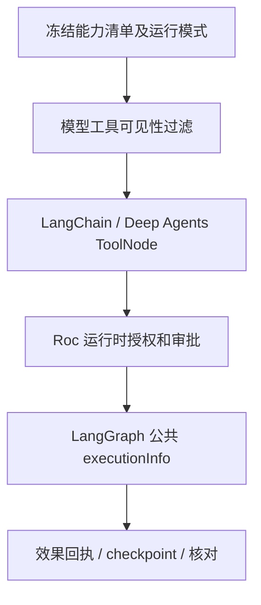

# LangChain / LangGraph 原生能力收敛（2026-11-26）

基线：Roc `main` 的 `4d0c238ca09afe8028218cecdb21f9a0851aebac`。依赖版本以仓库 `package.json` / `pnpm-lock.yaml` 为准：LangChain 1.6.6、LangGraph 1.7.5、Deep Agents 1.17.0、`@langchain/mcp-adapters` 2.0.3。**目标是减少适配胶水代码，同时保持运行授权、断点恢复、副作用与科研验收的语义。**

## 结论及实施矩阵

| 优先级 | 原实现 / 风险 | 原生替代或简化 | 本次边界 | 验证 |
| --- | --- | --- | --- | --- |
| P0 | MCP 手工将远端 JSON Schema 封装为 `DynamicStructuredTool`，手工映射文本/图片/音频/资源块 | `@langchain/mcp-adapters` 的 `loadMcpTools` | 保留 Roc 的运行时白名单、服务器选择、超时/取消、输入输出字节预算、并发门禁及远端输出校验 | 本地 MCP schema、远端错误和生命周期测试 |
| P0 | 依赖私有 `configurable.checkpoint_map`、`ls_agent_type` 和 `tools:` 节点前缀确认效果身份 | LangGraph 公共 `executionInfo` 与 `getConfig()` | `main` / `subagent` 范围仍由运行时冻结的能力上下文传入；身份缺失则拒绝有副作用工具 | 真实 LangGraph ToolNode 测试 + 幂等/恢复测试 |
| P0 | Plan Mode 与能力清单分别包装模型工具，救援解析和未知工具错误另有名单 | 单一 `filterRocModelVisibleTools` + 一个模型边界中间件 | 模型可见集合 = 冻结 manifest ∩ 执行范围 ∩ 执行模式；执行前权限、审批、只读保护独立保留 | Plan Mode、跨范围和错误提示测试 |
| P1 | 简单 JSON 输出和复杂科研合同统一运行自定义响应纠错 | 对纯结构、完全必填、不含 `uniqueItems` / 长度数量上下界 / 枚举约束的对象使用 `toolStrategy` / `structuredResponse` | QASPER 与旧版带约束合同继续使用 Roc 的 checkpointed 单次纠错；最终验收始终以 Roc 验证器为准 | Deep Agents 真实工具策略流、合同测试、流投影测试 |
| P1 | 模型输出投影只读取末尾 `AIMessage` | 优先读取 LangGraph 的 `structuredResponse` | 否则保持文本路径；原生事件仍经 Roc 的脱敏、审计、恢复/UI 投影，不替换产品状态机 | stream adapter 定向测试 |
| P1 | 工具救援和不存在工具反馈可泄露实际不可用的候选工具 | 复用模型可见集合策略 | Rescue 不绕过执行时授权；Plan Mode 错误只列其允许的工具 | tool protocol / capability tests |

## 调用边界

- `filterRocModelVisibleTools` **仅控制模型看到什么**，不构成授权。`tool-protocol`、只读模式的运行时阻止器、能力门禁和效果账本仍执行强制检查。
- 官方 MCP 适配器只负责远端工具转换；Roc 传入仅允许单一工具的 Client facade。facade 在实际 `callTool` 时再次比对原始工具名和运行时取消令牌，不授权加载其它远端工具。
- LangChain `ToolNode` 的工具 `runtime` 不一定携带 `executionInfo`，因此从 LangGraph 的公共 `getConfig().executionInfo` 读取同一异步执行上下文；若既无公开 runtime 字段又无上下文，则拒绝带效果的调用。
- 对可用原生结构化响应的纯结构合同，`toolStrategy(schema)` 在图内输出 `structuredResponse`；Roc 最终的合同校验不会因为模型声称符合 schema 就省略。带标量范围、枚举和数组约束的既有合同保留每 run 一次且可断点恢复的旧纠错协议。

## 有意保留的代码（不得机械删除）

1. **`RocSqliteCheckpointer`：暂不替换为新的 SQLite saver。** Roc 已有 `langgraph_checkpoints` / `langgraph_checkpoint_writes` 既有表、数据保留和恢复工具、待审批 interrupt 投影、旧 checkpoint 的向后可读性。官方 saver 的表结构及迁移路径未与这些生产依赖完成逐项双向等价验证。在没有「带旧数据升级、跨进程断点恢复、写入 taskPath 排序、特殊写 index、清理与备份恢复」全部验证之前，替换持久化层会显著增加数据丢失风险。后续独立迁移需先做只读迁移演练，再双写对账，最后灰度切换。
2. **Roc 的副作用效果账本及核对服务**：LangGraph checkpoint 记录图状态，但不会自动保证 `write_file` 等外部副作用在崩溃后的精确一次执行。未证明效果时继续阻断、需要人工核对的语义必须保留。
3. **Roc 的科研响应验收、资源预算、审批、脱敏、UI 事件投影**：原生通用工具策略/事件流未覆盖这些产品合同，不能直接用 `streamEvents` 的原始数据驱动用户界面。
4. **Roc 的文档证据保留与上下文压缩**：框架默认大结果落盘和 Roc 的虚拟工作区、SHA-256 证据恢复并非同一个存储合同。替换前需做大结果、恢复引用和取消的双轨回放。

## 分步验收与回退

1. **静态 / 单元合同**：执行 `pnpm typecheck` 和定向单测；检查 Plan Mode 不可见/不可调用副作用工具，MCP 的远端错误 `ToolMessage.status` 不被误判成功。
2. **真实图与崩溃恢复**：用 `getConfig().executionInfo` 的真实 ToolNode 运行，针对主代理、子代理、相同 toolCallId 的重放及未知身份拒绝验证效果回执；任何失败不得进行隐式重试。
3. **MCP 兼容性**：覆盖 `structuredContent`、多模态块、资源链接、服务器断连、取消、超限输入/输出、相同名称碰撞；比较官方适配器映射与老版本行为，产品消费方不得假设旧 `artifact` 内部结构仍存在。
4. **原生响应合同**：只为明确合格的合同启用；真实模型与固定假模型分别检查修正次数、最终 JSON、UI 流及取消。对 QASPER 和可选字段继续使用已有校验/修正路径。
5. **生产环境**：在仓库支持的 macOS arm64 环境执行 `pnpm install --frozen-lockfile`、`pnpm build`、`pnpm test`、`pnpm test:research-p0`，对比重构前后批准、恢复、验收的固定夹具。
6. **灰度与回退**：先从一个开发者构建/固定会话库试跑；出现 checkpoint/效果身份不一致时停止副作用并回退至前一发行版本（保留 DB 快照），不自动迁移或清空会话。

## 重要兼容性提醒

- 新版本用 `executionInfo.checkpointId` 加执行范围确定效果路径，不能仅凭字符串名字与旧版基于 `checkpoint_map` 的效果键视为完全相同；**尚未完成的旧版本运行应先结束或停机核对，不能直接宣称就地热升级等价。**
- MCP 官方适配器可能改变多模态内容块的 `content/artifact` 投影。调用协议仍保持 MCP 原始输出；正式发布前须检查所有消费方及历史回放，不应依赖未承诺的内部展示字段。
- **验收状态不是“所有生产检查均通过”**：Linux 沙箱不是项目指定的 macOS arm64；全套原生二进制和最终发行构建须由对应 CI / 开发设备补跑。此限制不能以小范围测试通过代替。

## 一手参考

- [LangGraph 持久化 / checkpointer](https://docs.langchain.com/oss/javascript/langgraph/persistence)
- [LangChain structured output](https://docs.langchain.com/oss/javascript/langchain/structured-output)
- [LangChain MCP adapters](https://docs.langchain.com/oss/javascript/langchain/mcp)
- [LangGraph 运行时与配置 API](https://reference.langchain.com/javascript/langchain-langgraph/index/)
