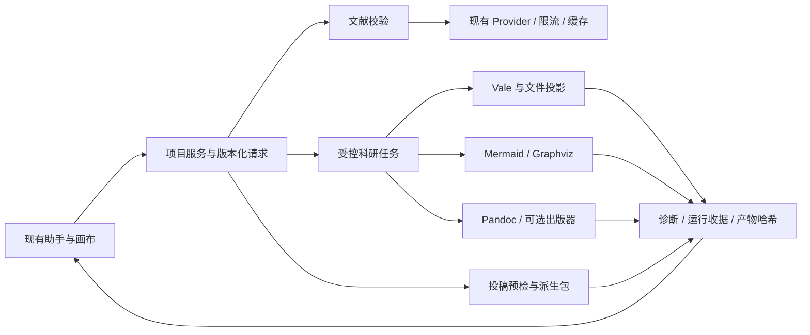

# Scientific Writing 生态对 Roc 的集成与替换评估

调研日期：2026-11-07。Roc 基线：`27d26daf01f96bc7c678e3fc999692da508f9d3d`。

实施更新：用户已授权并实施 P0/P1。第 1–10 节保留调研时的基线、建议和范围；当前功能入口、验证结果及限制见第 11 节。P2 尚未实施。

## 1. 决策摘要

这份清单对 Roc 最大的价值，是补齐文献互操作、投稿交付和科学表达。Roc 已经具备文献检索、引用解析、实验运行、图稿溯源、写作检查和多种导出基础，整体替换编辑器、图表引擎或科研运行时的收益不足以支持迁移成本。

建议按以下顺序推进：

| 优先级 | 方向 | 推荐做法 | 主要收益 |
| --- | --- | --- | --- |
| P0 | Zotero / Better BibTeX 引文键互操作 | 修正导入时的键保留策略，显式记录来源键与本地键；覆盖 Zotero 8 原生字段迁移 | 防止已有论文引用键失配；提高往返编辑可靠性 |
| P0 | 借鉴 citecheck 的参考文献校验 | 复用 Roc 的 provider、请求治理和解析器，吸收经过审查的匹配算法 | 发现 DOI 与题名不符、作者/年份冲突，以及需要人工复核的模糊匹配 |
| P0 | Vale 检查对象与版本一致性 | 明确工件正文和工作区 `.tex` 的边界，再考虑增量检查 | 避免“检查通过的不是当前编辑内容”；减少重复检查 |
| P1 | 借鉴 latex2arxiv 加强投稿预检 | 扩展依赖分析与阻塞项；另产出可审阅的投稿派生包 | 降低缺图、缺 `.bbl`、minted 与模板依赖导致的投稿失败 |
| P1 | CSL 样式与模板配置扩充 | 精选常用期刊样式、locale 和模板组合，固定版本及许可 | 较低工程成本扩大可用期刊范围 |
| P1 | Pandoc 可选导出 | 先做受限 DOCX / HTML 输出，声明不支持的语义 | 支持 Word 协作者及多渠道交付 |
| P1 | Mermaid 方法与流程图 | 增加独立的非数值图稿类型；隔离渲染，按需加载 | 补齐研究流程、实验设计和综述筛选图 |
| P2 | Graphviz、MyST / Jupyter Book、Quarto | 按明确需求提供可选适配器 | 大型关系图、课题组研究网站、可执行文档交换 |

性能方面，当前证据支持“先减少重复工作，再考虑替换组件”：检查单元缓存、图稿跨运行缓存、校验请求去重，值得测量；“换 Rust 工具就会让 Roc 更快”没有得到本次调研支持。本文没有运行第三方工具基准或 Roc 性能基准，不提供虚构的速度、内存或安装包收益。

## 2. 证据范围与阅读深度

目录以 [awesome-scientific-writing 固定版本](https://github.com/writing-resources/awesome-scientific-writing/blob/f4a041f9b029662debe237ba1098fe793070ccfe/README.md) 为准，提交日期为 2026-09-15，目录许可为 CC0。本文逐项覆盖其 66 个工具、嵌套插件、模板、教程和其他列表条目；其他 awesome 列表仅作为导航评估，没有递归审计其中所有项目。

阅读包括上游 README、官方文档、项目清单与必要的许可证文件，并对优先候选及 Roc 对应调用链做了源码检查。初次 GitHub 批量抓取取得 50 个成功的仓库 README/元数据记录，随后补读迁移项目与官网；这个数字包含目录本身，不代表 50 个项目都完成了完整代码审计。citecheck 的匹配、网络和状态逻辑做了更深检查。两个 DevGenius 教程只取得公开摘要/节选，不能据此评价付费全文。docutils 官网读取受限，补读了项目镜像 README 与 COPYING。

上游移动分支链接反映调研当日观察；除明确写出的固定版本外，不把网页状态当作永久保证。许可证列是选型线索，分发前仍需核对锁定版本及传递依赖。初次调研只修改文档；后续实施及运行时验证记录见第 11 节，不代表已完成发布许可审查。

## 3. Roc 的真实基线与缺口

| 领域 | 已核实的实现 | 对选型的影响 |
| --- | --- | --- |
| 桌面架构 | Electron、React、TypeScript；唯一壳层，画布模块惰性加载，助手为执行入口 | 不嵌入另一个完整编辑器/IDE，不增加平行前端。见 [AGENTS](../AGENTS.md)、[视图注册](../src/renderer/app/view-registry.ts) |
| 写作真源 | 工作区 `.tex/.bib` 是用户源文件；LaTeX 编辑器使用 CodeMirror，保存走 `files.writeText` | 不把旧的 claim 投影当成所有工作区文件的最新正文。见 [CONTEXT](../CONTEXT.md)、[LatexPanel](../src/renderer/latex/LatexPanel.tsx)、[SourceEditor](../src/renderer/latex/SourceEditor.tsx) |
| 文献编解码 | 已有 BibTeX / CSL 处理，通过隔离的 TypeScript 科研任务调用 | Pandoc 不应替换高频文献解析路径。见 [bibliography](../src/main/plugins/research/bibliography.ts)、[toolchain](../src/main/plugins/research/toolchain.ts) |
| Zotero | 本地 API 导入与来源记录已存在；新记录导入会重新选择本地生成键 | 重点是稳定键互操作，不是再做一套 Zotero 接入。见 [适配器](../src/main/plugins/research/zotero-adapter.ts)、[导入服务](../src/main/plugins/research/literature-import-service.ts) |
| 检索与网络 | 已有身份合并、融合排序、provider 限流、退避与熔断，以及带 TTL/LRU/字节预算的项目响应缓存 | 新校验应接入已有治理；不能把“加缓存/并发”描述为从零补齐。见 [governor](../src/main/plugins/research/literature-provider-governor.ts)、[cache](../src/main/plugins/research/literature-response-cache.ts) |
| 撤稿信息 | 已读取 OpenAlex `is_retracted`、Crossref 更新关系；文献库检查按四条一组执行 | 新增价值是统一证据、时间与一致性结果，不是首次支持撤稿。见 [library-service](../src/main/plugins/research/library-service.ts)、[retraction-check](../src/main/plugins/research/retraction-check.ts) |
| 写作检查 | Vale 3.24.0、17 条 Roc 中英文规则；当前服务检查 manuscript 工件的 section/claim Markdown 投影 | 不等同于实时检查任意 `.tex` 文件。先修正目标与版本语义，再讨论缓存。见 [prose-lint-service](../src/main/plugins/research/prose-lint-service.ts)、[prose-projection](../src/main/plugins/research/prose-projection.ts) |
| 定量图稿 | Vega-Lite/Vega、SVG/PNG/PDF 产物、变换后的数据轨迹、环境哈希和输出记录 | 保留可追溯的定量图稿链；Mermaid 等补充另一类表达。见 [figure-renderer](../src/main/plugins/research/figure-renderer.ts)、[figure-service](../src/main/plugins/research/figure-service.ts) |
| 排版与导出 | Typst 0.15.0 用于过程报告；Tectonic 0.17.0 保留 LaTeX；已有批准工件导出与 arXiv 预检 | 多格式转换与投稿包是扩展点，不应取代全部导出合同。见 [tools.lock](../resources/research-runtime/tools.lock.json)、[ADR 0025](adr/0025-typst-report-engine.md)、[export-builder](../src/main/plugins/research/export-builder.ts) |
| 实验与 Notebook | 当前 schema/service 支持 TypeScript、R、Julia、用户选择的 Python 环境；Notebook 执行有冻结输入及运行收据 | Python 仍可执行；不能把“移除随包 Python 文档运行时”解释成“Roc 不支持 Python”。见 [schema](../src/shared/schemas/research-experiments.ts)、[环境解析](../src/main/plugins/research/experiment-environment.ts)、[执行服务](../src/main/plugins/research/experiment-service.ts) |
| PDF / OCR | 隔离的 TypeScript、PDF.js、PaddleOCR/ONNX，模型包按需管理 | Zotero OCR 不适合作为默认重复管线；本次没有比较 OCR 准确率或速度。见 [运行时目录](../resources/research-runtime/README.md) |
| 期刊规范 | 已有规则版本、来源和检查服务 | 投稿规则应扩充现有合同，不能重复建规则系统。见 [journal-compliance-service](../src/main/plugins/research/journal-compliance-service.ts)、[说明](research-journal-compliance.md) |

仓库部分说明落后于源码：实验文档仍把 Python 视为历史合同；旧 prose 注释强调 claims 真源；ADR 0025 中的 Python/MinerU/PDFium 体积和计时属于旧架构。本文以当前实现为判断依据，没有把这些历史数据用作今天的性能结论，也没有顺手修改这些无关文档。

## 4. 全目录逐项评估

“借鉴”指复用规则、算法或交互思想；“可选适配”指在明确需求下接入文件/工具协议；“保留”表示 Roc 已有适合的实现。许可针对所述代码或资源，不能自动覆盖插件、字体、字典、模板或分发包全部内容。

### 4.1 编辑器与写作环境

| 项目 | 能力与依赖边界 | 对 Roc 的建议 |
| --- | --- | --- |
| [Marktext](https://github.com/marktext/marktext) | MIT；完整 Markdown 桌面编辑器，所见即所得与多种编辑模式 | 借鉴编辑体验；不替换 CodeMirror 或壳层。迁移会连带改变文稿模型、快捷键、IME 和保存语义 |
| [R Studio](https://github.com/rstudio/rstudio) | AGPL-3.0；完整 R IDE，含调试与项目环境 | 保持外部工具互操作；嵌入 IDE 与当前助手/终端职责重叠 |
| [bookdown](https://github.com/rstudio/bookdown) | GPL-3.0；R Markdown 长文、章节引用和图书编译 | 有整本专著需求时适配源文件或成品；不替换 Roc 的实验执行 |
| [R Markdown](https://rmarkdown.rstudio.com/) | R/knitr/Pandoc 组成的动态文档工作流 | 支持用户现有 `.Rmd` 项目时再做环境适配；运行代码需经过 Roc 的执行授权、资源和记录边界 |
| [Vim](https://www.vim.org/) | 完整终端编辑器；Vim 自身许可 | 外部打开及键盘效率参考，不能作为 React 编辑组件直接替换 |
| [fzf-bibtex](https://github.com/msprev/fzf-bibtex/#readme) | BSD-3-Clause；Go 程序配合 fzf/bibtool 做文献模糊选择 | 借鉴“搜索—预览—插入 cite key”和索引复用；无需随包引入终端工具链 |
| [vim-pandoc](https://github.com/vim-pandoc/vim-pandoc) | MIT；Vim 中的 Pandoc 写作支持 | 借鉴引用补全、折叠与导航；插件依赖 Vim 宿主 |
| [vim-pandoc-syntax](https://github.com/vim-pandoc/vim-pandoc-syntax) | MIT；Pandoc Markdown 语法高亮 | 用于语法边界对照，不直接迁移 Vim 高亮规则 |
| [Visual Studio Code](https://code.visualstudio.com/) | 完整 IDE；源代码与微软分发产品的条款有区别 | 支持外部编辑工作流；不引入第二个编辑器宿主 |
| [Markdown All in One](https://github.com/yzhang-gh/vscode-markdown/#readme) | MIT；VS Code 扩展，目录、格式与快捷编辑 | 借鉴小交互，不能按普通 npm UI 库接入 |
| [Markdown Preview Enhanced](https://github.com/shd101wyy/markdown-preview-enhanced) | 列表所链仓库目前偏文档；代码在 [VS Code 扩展仓库](https://github.com/shd101wyy/vscode-markdown-preview-enhanced)，NCSA 许可 | 参考预览/导出体验；不整体接入其转换与代码执行栈 |
| [Zettlr](https://www.zettlr.com/) | GPL-3.0；集成 CSL、BibLaTeX、Pandoc 的 Electron 写作应用，[源码](https://github.com/Zettlr/Zettlr) | 产品参考价值高，直接替换价值低；借鉴导出配置与引文交互，保留 Roc 的证据与任务模型 |

### 4.2 文献与引文

| 项目 | 能力与边界 | 对 Roc 的建议 |
| --- | --- | --- |
| [CSL styles / editor](https://editor.citationstyles.org/) | [样式仓库](https://github.com/citation-style-language/styles) 使用 CC BY-SA 3.0；locale 为独立资源 | P1，精选扩展。现有 APA、IEEE、GB/T 7714 无需重做；固定样式、父样式和 locale 版本 |
| [citecheck](https://github.com/tobiasosDev/citecheck) | MIT，TypeScript/Node；参考文献存在性、字段匹配和撤稿线索 | P0，借鉴纯匹配逻辑；不要直接把 CLI 的 `verified` 当作科学可靠性结论 |
| [JabRef](https://www.jabref.org/) | [MIT Java 桌面文献管理器](https://github.com/JabRef/jabref)，以 `.bib` 为中心 | 通过 `.bib` 往返互操作；不替换 Roc 文献库或随包加入 Java GUI |
| [ScholarRef](https://github.com/brodie-neuro/ScholarRef) | MIT；Python，Windows 优先的 DOCX APA 7/Harvard/Vancouver 转换；公开校验管线有限 | 暂不集成。不能据 README 推断其能保留所有 Word 引文字段、修订和复杂排版 |
| [Zotero](https://www.zotero.org/) | 外部文献管理应用，[源码](https://github.com/zotero/zotero)；Roc 已接本地 API | P0，完善现有适配器、版本兼容和来源映射，不嵌入整个 Zotero |
| [Better BibTeX for Zotero](https://retorque.re/zotero-better-bibtex/) | [MIT 插件](https://github.com/retorquere/zotero-better-bibtex)；公式、稳定键与 BibLaTeX 导出；Zotero 8 引文键已迁移到原生字段 | P0，兼容外部键与导出文件；不直接读取 BBT 私有数据库 |
| [Zotero OCR](https://github.com/UB-Mannheim/zotero-ocr) | AGPL-3.0；依赖 Tesseract/Poppler 使扫描件可搜索 | 接收其处理过的 PDF 即可。替换现有 OCR 需先比较相同语料上的准确率、延迟与资源成本 |
| [ZoteroBib](https://zbib.org/) | 在线快速参考文献服务；[FAQ](https://zbib.org/faq) 说明默认浏览器本地保存，分享会上传副本 | 交互参考；不通过自动化网页作为生产文献后端 |

### 4.3 科研插图

| 项目 | 能力与代价 | 对 Roc 的建议 |
| --- | --- | --- |
| [draw.io / app.diagrams.net](https://app.diagrams.net/) | [完整图形编辑器](https://github.com/jgraph/drawio)，源码 Apache-2.0；图标/模板资源另有条款 | P2，优先导入/导出 `.drawio`、SVG/PDF 互操作；完整嵌入会增加大编辑器、工具栏和序列化体系 |
| [Graphviz](https://graphviz.org/) | DOT 图布局；当前 EPL-2.0，原生或 WASM 均需评估 | P2，较大关系图/依赖图候选；需验证 macOS arm64 构建、包体和复杂布局稳定性 |
| [Mermaid Live Editor](https://mermaid-js.github.io/mermaid-live-editor/) | Mermaid 文本生成流程、时序等图；Live Editor 为完整网页，不能等同于渲染库 | P1，接入 [Mermaid](https://github.com/mermaid-js/mermaid) 渲染能力即可；不要内嵌整个在线编辑站 |
| [Vega Lite](https://vega.github.io/vega-lite/examples/) | BSD-3-Clause；声明式定量图表、数据变换和编码 | 保留。Roc 已集成并附带数据轨迹；更换会损失现有可复现能力 |
| [PlantUML](https://plantuml.com/) | Java 生态，UML 强；不同分发包有不同许可证选项 | 暂缓。只有明确 UML/工程图需求才选定具体产物；不能用一个仓库标签概括全部分发许可 |

### 4.4 转换与出版

| 项目 | 当前能力与依赖 | 对 Roc 的建议 |
| --- | --- | --- |
| [Cicero](https://cicero.xyz/) | 目录仍称 Python；[原仓库](https://github.com/bast/cicero) 说明 2026 年重写为 Rust，并迁到 [Tangled](https://tangled.org/radovan.xyz/cicero)，服务 remark/reveal/marp 幻灯片 | 低优先级可选幻灯片适配；新实现未做源码审计，不按旧目录描述安装 Python 包 |
| [docutils](https://docutils.sourceforge.io/docs/) | Python，reStructuredText 转换；主要公共领域，个别文件另有许可 | 仅有 RST 输入需求时引入；[镜像](https://github.com/docutils/docutils) 可查 COPYING，非统一无条件许可 |
| [Jupyter Book](https://jupyterbook.org/en/stable/) | 当前第 2 代以 MyST 引擎为基础；旧 v1 是 Sphinx 路线 | P2，研究网站/可复现书籍出版；不要照旧教程默认搭建 Sphinx + MyST-Parser 全栈 |
| [Manubot](https://manubot.org/) | [Python/Pandoc/Panflute 工作流](https://github.com/manubot/manubot)，持久标识符引用、可复现构建；BSD-2-Clause Plus Patent | 借鉴标识符规范化、引用追踪与构建记录；Roc 已有 provenance，无需移植整套写作系统 |
| [latex2arxiv](https://github.com/YuZh98/latex2arxiv) | MIT Python CLI；依赖收集、删无用文件/注释/草稿标记、投稿检查 | P1，借鉴算法与检查集合。其清理会改字节，不能直接覆盖 Roc 已批准源文件和哈希记录 |
| [MyST / MyST-Parser](https://myst-parser.readthedocs.io/en/latest/) | MIT；Python 的 Markdown 解析器，面向 docutils/Sphinx | 有 Sphinx 项目互操作需求时使用；不要和 Node 的 mystmd 混为一个可替换库 |
| [MyST Markdown CLI](https://mystmd.org/) | [MIT Node/TypeScript 工具链](https://github.com/jupyter-book/mystmd)，语义 Markdown、引用、交叉引用与多格式出版 | P2，可作语义出版适配器；不能直接替换当前 LaTeX 真源和执行账本 |
| [nbconvert](https://nbconvert.readthedocs.io/en/latest/) | BSD-3-Clause；Python/Jinja，Notebook 转 HTML/PDF/Markdown/Slides 等 | 可选 Notebook 出版适配；转换与执行要分开，不替换 Roc 的安全解析和冻结运行 |
| [Pandoc](https://pandoc.org/MANUAL) | GPL-2.0-or-later；独立转换程序，内置 citeproc、Lua filters | P1，优先 DOCX/HTML；不替换引用编解码，不能承诺复杂 LaTeX 无损往返 |
| [Pandoc filters](https://github.com/jgm/pandoc/wiki/Pandoc-Filters) | 插件目录，包含交叉引用与 AST 变换等；每项版本/许可各异 | 先用内置 citeproc 和最少的 Lua filter；确有缺口再引入特定 filter |
| [Panflute](http://scorreia.com/software/panflute/) | BSD-3-Clause；Python 的 Pandoc AST 操作接口 | 仅复用已有复杂 Python filter 时有必要；简单转换优先 Lua，避免额外环境 |
| [Quarto](https://quarto.org) | 当前 [CLI 源码 MIT](https://github.com/quarto-dev/quarto-cli)；组合 Pandoc、Jupyter/Knitr/Observable 等，依赖仍各自许可 | P2，外部项目与出版配置适配；不默认引入第二套执行与缓存体系 |
| [Typst](https://github.com/typst/typst) | Apache-2.0；排版、公式与参考文献，支持增量编译 | 保留并扩展现有报告模板。LaTeX 期刊模板继续走 Tectonic，不能以“快”证明应全面替换 |

### 4.5 拼写、语法与格式检查

| 项目 | 解决的问题 | 对 Roc 的建议 |
| --- | --- | --- |
| [GNU Aspell](http://aspell.net/) | 拼写；LGPL 系列核心，字典另有许可；官方仍有新版本 | 暂不新增并行拼写引擎；若发现 Vale 词典能力缺口再评估，不能仅凭项目年代认定过时 |
| [Hunspell](http://hunspell.github.io/) | 词形/拼写；LGPL/GPL/MPL 三许可选择，字典独立 | 可作为词典能力专项候选；先测目标语言语料，避免与现有检查重复 |
| [LanguageTool](https://languagetool.org/) | LGPL-2.1+ 核心；Java 本地服务或远程语法 API | P2，补充真正的语法需求。需实测常驻内存、冷启动与目标语言覆盖；不承诺完整中文语法支持 |
| [LanguageCheck](https://github.com/JohannesBuchner/languagecheck) | BSD-2-Clause；Python/NLTK/Hunspell/ImageMagick，英语 LaTeX 写作启发式 | 借鉴规则与定位案例，优先转成 Roc/Vale 规则；不引入整套依赖 |
| [Markdown lint tool](https://github.com/markdownlint/markdownlint) | 清单指向 Ruby 的 `mdl`，不是 DavidAnson 的 JavaScript markdownlint | 暂不集成 Ruby runtime；仅结构规范需求不值得引入完整新运行时 |
| [mdformat](https://mdformat.readthedocs.io/en/stable/) | MIT Python；CommonMark 格式化，可加 MyST/GFM 插件 | 有 Markdown 真源时才考虑；格式化会改文本，必须预览 diff，验证公式/引用扩展兼容 |
| [proselint](https://github.com/amperser/proselint) | BSD-3-Clause Python；英语文风 | 借鉴少量高质量规则；与 Vale 重叠较多，不能用文风偏好机械判错 |
| [remarklint / remark-lint](https://github.com/remarkjs/remark-lint) | MIT JavaScript/unified；Markdown 结构规则 | 如果扩展 Markdown 写作，优先验证这类现有 JS 生态方案；与 prose 检查分层 |
| [restructuredtext-lint](https://github.com/twolfson/restructuredtext-lint) | Unlicense Python；RST 语法检查 | 无 RST 编辑需求时不接入 |
| [rumdl](https://github.com/rvben/rumdl) | MIT Rust；Markdown lint/format、缓存和多种方言 | P2 性能候选，须与同语义的 Markdown linter 比较；不能替换 Vale 的科研文风规则 |
| [textlint](https://textlint.github.io/) | MIT Node，可插拔自然语言/Markdown 检查；核心不带默认规则 | 有明确且 Vale 无法满足的语言规则包时再选用；评估具体插件质量，不能只比较引擎 |
| [textidote](https://sylvainhalle.github.io/textidote/) | GPL-3.0 Java，结合 LanguageTool 做 LaTeX 文本检查与定位 | 借鉴 LaTeX 到文本的 source map；整包接入须证明语法收益足以承担 Java 常驻成本 |
| [Vale](https://github.com/errata-ai/vale) | MIT；可扩展 prose lint、术语与风格规则 | 保留。优先解决检查对象、规则质量、定位和缓存；它并非完整语法分析器 |
| [write-good](https://github.com/btford/write-good) | MIT JavaScript；英语被动语态、冗词等启发式 | 少量规则参考。科研方法段的被动语态不应一律判错；默认增加会造成重复和噪声 |

### 4.6 模板

| 项目 | 适用场景 | 对 Roc 的建议 |
| --- | --- | --- |
| [Paper Templates for GitHub Pages](https://github.com/dev-onejun/paper-templates-for-github-pages) | Apache-2.0；论文/CV 展示网站 | 可作项目展示模板参考，不能当作期刊官方排版要求 |
| [bookdown-demo](https://github.com/rstudio/bookdown-demo/#readme) | CC0；最小图书项目 | 用作外部 bookdown 互操作样本，不默认增加 R 出版链 |
| [Eisvogel](https://github.com/Wandmalfarbe/pandoc-latex-template) | BSD-3-Clause；Pandoc 3 + LaTeX 宏包，讲义、报告与练习版式 | 可选报告模板。先验证 Tectonic 宏包兼容；不能取代所有期刊模板或现有 Typst 报告 |
| [PhD thesis Markdown template](https://github.com/tompollard/phd_thesis_markdown#readme) | MIT；Pandoc、crossref 与 TeX 的论文目录组织；仓库更新较早 | 借鉴目录和资源组织。固定可运行版本，不能直接复制旧安装脚本作为当前方案 |

### 4.7 教程

| 教程 | 阅读与适用性 | 对 Roc 的启发 |
| --- | --- | --- |
| [3 frameworks into one — R Studio](https://blog.devgenius.io/write-your-whole-paper-in-r-it-is-better-77e1843f0c09) | 2022 年文章，仅公开节选；R Markdown + Zotero + Notion | 说明文献、笔记、写作互通的重要性；不能据此推荐新增 Notion 同步或沿用旧命令 |
| [Book on Riemann solvers](https://github.com/clawpack/riemann_book/#readme) | 阅读项目说明；Notebook 输出与版本控制分离、执行后出版；代码许可不自动覆盖全书内容 | 借鉴“源文件简洁、发布物带执行结果”，但执行由 Roc 冻结环境与账本管理 |
| [Tenen / Wythoff：Sustainable Authorship](https://programminghistorian.org/en/lessons/sustainable-authorship-in-plain-text-using-pandoc-and-markdown) | 纯文本、引用与 Word/Pandoc 工作流；安装细节需按当前手册复核 | 支持保留开放源文件格式，并明确转换边界 |
| [Quarto combines R & Python](https://blog.devgenius.io/heads-up-quarto-is-here-to-stay-aa861ef87491) | 2022 年文章，仅公开节选；包含早期 M1/reticulate 环境经验 | 证明环境兼容是实际成本；不把旧修复步骤直接用到当前 macOS |
| [Write your dissertation in RMarkdown](https://ourcodingclub.github.io/tutorials/rmarkdown-dissertation/) | 学位论文的章节、图表、参考文献组织 | 可转为 Roc 模板示例与验收语料，而非要求用户迁移写作真源 |
| [Emacs Org-mode for ACPD](https://www.draketo.de/english/emacs/writing-papers-in-org-mode-acpd) | 文本与 LaTeX 混合；作者后续建议细节投稿修改转到 LaTeX 处理 | 支持保留可直接编辑的 `.tex` 交付；不必给 Roc 添加 Org 编辑器 |

### 4.8 其他资源列表

| 列表 | 后续用途 | 本次边界 |
| --- | --- | --- |
| [Awesome Jupyter](https://github.com/markusschanta/awesome-jupyter/#renderingpublishingconversion) | Notebook 渲染与出版的下一轮候选库 | 未递归阅读所有项目 |
| [Awesome LaTeX](https://github.com/egeerardyn/awesome-LaTeX/#readme) | TeX 工具、编辑辅助及模板专项调研 | 未据目录数量判断集成价值 |
| [Awesome Markdown](https://github.com/BubuAnabelas/awesome-markdown/#readme) | Markdown 解析与编辑生态 | 仅在确定新的 Markdown 产品需求后筛选 |
| [Delightful Open Science](https://codeberg.org/teaserbot-labs/delightful-open-science) | 开放科研与数据发布的导航 | 不构成新增服务、账户或远程发布的授权 |

## 5. 优先候选的具体接入方案

### 5.1 Zotero / Better BibTeX：优先修正稳定引用键

这是本次找到的最具体的互操作缺口之一。[BBT 当前 README](https://github.com/retorquere/zotero-better-bibtex#readme) 明确说明：Zotero 8 已有原生 citation key 字段；原先固定在 `Extra` 的键发生迁移；旧的“是否 pinned”概念已经改变；Zotero 7 不再由最新版持续支持。仅实现 `Extra: Citation Key` 解析或直接读取 BBT 数据库，会依赖已经变化的存储细节。

Roc 的 CSL 解析会读取 `citation-key`，但在 [literature-import-service](../src/main/plugins/research/literature-import-service.ts) 新记录提交路径中，仍以既有本地键或 `betterBibtexKey(...)` 选键，再覆盖 `prepared` 里的键。[cite-key](../src/main/plugins/research/cite-key.ts) 的本地生成规则并不等同于 BBT 完整公式、迁移和冲突处理。普通 `.bib` 导入的键保留行为也不能证明 Zotero 路径已经兼容。

建议把“文献身份”和“引用键”明确分开：

1. 文献身份仍用现有 DOI、来源对象和身份合并规则。引用键不参与替代身份判定。
2. 保存来源对象、来源版本、来源键、Roc 本地键与冲突状态。已有被论文引用的本地键保持稳定；来源更名不自动改坏现有 `.tex`。
3. 新记录优先接受可验证、无冲突的来源键；没有来源键时才生成本地键。对于冲突给出明确映射，不能静默覆盖另一篇文献。
4. Zotero 7/8 分别取得真实 API 与导出样本，确认原生键在哪个响应字段可用。不能仅凭上游介绍假设 `include=csljson` 永远含有该键。
5. 需要改键时，把 `.bib` 和所有受影响 `.tex` 引用做成可预览、可撤销的本地变更；自动导入不顺带改写用户论文。

验收应包括：带自定义 BBT 公式的库、Zotero 8 已迁移键、缺键、两篇文献同键、一篇文献多来源键、重复导入、已经被正文引用后的来源改键，以及 `.bib` 导出再导入。最关键的结果是“来源可追踪、既有引用不断裂”，不是本地生成格式看起来像 BBT。

### 5.2 citecheck：吸收匹配算法，重写状态边界

citecheck 适合借鉴的部分，是无 DOI 时把题名、作者、年份和出版容器组合成候选查询，以及分字段识别冲突。[match-score.ts](https://github.com/tobiasosDev/citecheck/blob/main/src/match-score.ts) 使用题名 token 的 Jaccard/包含关系，结合作者和年份评估；缺少信息与信息矛盾被区别处理。这能补充 Roc 现有身份合并的质量检查，但不能直接复制其最终结论。

源码检查发现几个会影响集成的细节：

| 观察 | 为什么重要 | Roc 应如何处理 |
| --- | --- | --- |
| [quick-check.ts](https://github.com/tobiasosDev/citecheck/blob/main/src/quick-check.ts) 的 DOI 路径可设 `status = verified`，题名/年份冲突仅进 warnings | “DOI 存在”与“这条引文引用了正确论文”是不同判断 | 独立保存身份匹配和逐字段一致性；错误 DOI 对应真实论文时仍应报告冲突 |
| `retracted` 初值为 false | 尚未查到撤稿，不等于已证实未撤稿 | 使用 `retracted / not_reported / unknown` 等明确状态，并保留来源与查询时间；可映射现有 Roc 状态 |
| [http.ts](https://github.com/tobiasosDev/citecheck/blob/main/src/http.ts) 有自己的 fetch、退避和 host cooldown，未提供调用方 transport/取消接口 | 整包调用会形成第二套网络治理，难与 Roc 项目取消和请求账本一致 | 经现有 provider 层查询；借鉴或小范围移植纯匹配代码，保留 MIT 声明 |
| 题名分词主要依赖空白与词归一化 | 多语言 stopwords 不等于经过中文分词验证 | 使用中英文、音译作者、机构作者语料校准；低置信度进人工复核 |
| CLI 的 `check_failed` 不会自然等同于失败退出 | 自动化可能把网络故障当作检查成功 | Roc 显式保存失败、可重试、取消、结果过期状态，不只看退出码 |
| 包含 BibTeX parser 10.x、Zod 3、mammoth、MCP SDK 等依赖 | Roc 已有自己的解析器与任务入口，整包引入会叠加版本和维护面 | 维持现有编解码；不为一个校验功能安装重复的文档/MCP 栈 |

建议结果至少区分：身份是否确定、题名/作者/年份/容器各字段一致性、撤稿证据、检查时间、来源和查询失败原因。这里的字段是设计建议，不是现有 schema 声明。不得把 `not_found` 自动解释为伪造文献，也不能把“不在 DOAJ”解释为掠夺性期刊。即便所有元数据一致，也没有证明该文献支持某一论断；论断支持度仍属于 Roc 的证据/引用关系。

接入点是现有文献库与写作检查服务，查询经 provider/governor/cache 复用；不要假定所有历史 library 调用都已使用同一网络治理，需要在实现时明确接线。对手动编辑的 `.bib`，以冻结文件哈希检查，结果不能误贴到后来修改的版本。

验收重点：正确 DOI 配错误题名、同题不同作者、在线发表年与卷期年差异、中英文题名、预印本与正式论文关系、无 DOI 图书、缺作者、429/Retry-After、超时、离线、取消、过期缓存和已撤稿/未知状态。新增校验还需披露会向外部索引发送哪些字段；未发表参考文献内容不能作为未说明的后台查询。

### 5.3 latex2arxiv：加强依赖分析，单独生成投稿派生包

Roc 已有 [arxiv-preflight](../src/main/plugins/research/arxiv-preflight.ts)：入口可达性、缺失引用、草稿标记、路径/图稿警告，以及剪除不可达 `.tex`；[export-builder](../src/main/plugins/research/export-builder.ts) 已调用并记录日志。它刻意保留模板源文件字节，且不把一般投稿警告升级为内部导出失败。

[latex2arxiv](https://github.com/YuZh98/latex2arxiv) 的增量价值在更完整的项目依赖收集、`graphicspath`、参考文献路径、草稿宏清理、`.bbl` 与 biblatex 兼容、minted 缓存及 shell-escape 检查。其清理行为会改变内容。上游示例中的 ZIP 缩小幅度只属于那个示例，不能外推到 Roc。

建议分两步：

1. **先补只读预检。** 扩展现有依赖图与检查项，记录规则来源、目标投稿环境及日期。宏展开或动态路径无法确定时给出“不确定”，保守保留文件；不能让正则匹配不全导致误删。源码注释中的 arXiv 编译步骤也需按当前官方环境核验，不能作为硬编码永久事实。
2. **再做派生投稿包。** 从明确版本的用户源文件或批准导出包生成候选 ZIP；逐文件显示保留/删除/变更及原因，保存原哈希和派生哈希。原项目、模板和内部 provenance 包保持可复查。清理注释或 draft 宏必须处理嵌套、verbatim 与转义，不能简单字符串替换。

当前导出有批准工件投影的语义。实现前必须标明这次打包来自“工作区哪个文件版本”或“哪个批准工件快照”，不能默默混合两种来源。外部 Python CLI 可以作为可选受控任务验证方案，也可以依据其算法扩展现有 TypeScript 模块；这项检查不需要默认新增随包 Python 文档运行时。

验收语料至少覆盖多级 `input/include/subfile`、`import`、宏构造路径、同名文件、`graphicspath`、扩展名省略、外部 `.bst/.cls/.sty`、biblatex `.bbl`、minted 缓存、嵌套草稿宏、注释中的文件名以及路径越界。要求原始字节/哈希不变、可达文件不丢、变换可审阅；在选定投稿配置中完成编译才算运行验证，不能只用 ZIP 成功作为通过标准。

### 5.4 Pandoc：从有明确边界的 Word 导出开始

Pandoc 最有价值的新增能力是 DOCX/HTML 输出，尤其是与 Word 协作者交换。Roc 的 BibTeX/CSL 处理、Typst 过程报告与 LaTeX 论文编译已有明确职责，不应为了统一工具而全部移交 Pandoc。

建议第一版定义有限支持面：标题、段落、基础表格、常见公式、图及图注、文内引用、参考文献和必要交叉引用。以规范化的文档快照进入转换，附带原始 `.tex/.bib` 和转换说明。对于从已有 LaTeX 导出 DOCX 的需求，明确列出自定义宏、复杂表格、浮动布局和包专有命令的限制；遇到不可表达内容生成诊断，不能静默遗漏。

[Pandoc 手册](https://pandoc.org/MANUAL) 明确其 AST 转换有信息损失。内置 `--citeproc` 可以处理引文，Lua filters 不需要另装 Python；filter 顺序会影响结果，应固定并测试。先使用这些内置能力，再决定是否真的需要 Panflute 或第三方 crossref。Pandoc 生成可读的 Word 引用并不自动生成可由 Zotero 接管的动态 Word 字段；这是不同的兼容目标。

以主进程受控工具任务执行，固定二进制、版本、模板与 filter 哈希；预览复用现有文件协议。安装方式可在按需管理的工具包和用户选择的外部 Pandoc 间决策，必须通过 macOS arm64、签名/打包和离线运行检查。GPL 分发义务及传递资源许可需要在选定分发形式后处理，不能以“独立子进程”一句话代替评估。

验收使用包含中文、重音作者名、数学、跨节引用、多张图、长表格、脚注、参考文献和自定义宏的样稿；核对 DOCX 内的正文、引用顺序、公式可编辑性和缺失诊断。Word/LibreOffice 实际打开与目视对比属于必要环节。不能承诺双向无损，也不能仅凭文件生成成功宣称等价。

### 5.5 Mermaid / Graphviz：补充非数值科学表达

Roc 现有 Vega-Lite 轨迹描述的是经过变换的数值图形及其数据来源。方法流程、研究设计、知识关系和 PRISMA 风格流程图有不同语义；给 Mermaid 伪造一份数值 `figure-data.json` 会削弱现有溯源合同。

建议增加明确的图稿种类，冻结文本源、渲染器版本、主题、字体和输出哈希，并链接到方法计划或综述记录。若流程图里显示筛选人数，数字应来自对应记录或标记为手填，不能由绘图模型随意补齐。Mermaid 优先覆盖简单流程与时序；Graphviz 留给较大图的自动布局，只有实测显示价值时引入第二引擎。

不要把 Mermaid CLI 当作没有资源代价的轻量程序。[mermaid-cli](https://github.com/mermaid-js/mermaid-cli) 当前清单有 Puppeteer 依赖，还包括 Mermaid、字体和图标包。Roc 已有 Electron，可先验证复用隔离的隐藏渲染上下文是否合适，或采用受控工作进程；不能默认再随包安装一套 Chromium。无论哪种方案，外部资源访问、SVG 内容、字体可复现性、超时和进程退出都要明确控制。

新增 UI 仍进入现有画布/助手工具，渲染依赖惰性加载。验收包括复杂度上限、长标签、中英文混排、窄图、离线字体、恶意链接/HTML、取消与失败清理、SVG/PDF 结果，并检查是否意外增加首屏 JavaScript。若要求矢量 PDF，必须检查实际导出结构；SVG 输入不自动证明最终 PDF 是矢量。

### 5.6 CSL 与模板：高收益的小步扩充

[现有 CSL 资源说明](../resources/research-runtime/csl/README.md) 记录 APA、IEEE、GB/T 7714，固定了来源版本。新增样式不是简单复制一个 `.csl`：需要检查 dependent style 的父样式、locale、工具包哈希及允许选择的样式合同。

建议根据目标用户的期刊集中度，先补少量高频期刊/学会配置，并把“引文格式”“排版模板”“投稿规则”分开管理。CSL 决定参考文献格式，不保证全文符合期刊版式；Eisvogel 是通用报告模板，GitHub Pages 模板也不是官方投稿模板。每个配置记录来源、版本、许可、适用语言和人工复核项。

验收包含中英文作者、多作者截断、机构作者、同作者同年、网页访问日期、DOI/URL、预印本、数据集、图书章节和中英文标点。对同一输入做固定版本的预期输出对比；不能只看“能加载样式”。

### 5.7 Vale、textlint 与 LanguageTool：先修检查面，再增加引擎

现有 Vale 是值得保留的基础。优先问题是检查对象：`prose-lint-service` 从 manuscript 工件的 sections/claims 生成 Markdown，而 `LatexPanel` 保存工作区文件。两者可能处于不同版本。应在用户可见结果上标明检查目标、快照哈希和时间，并提供准确的定位；不能对用户显示一个没有版本限定的“当前论文已检查”。

如果需要检查正在编辑的 LaTeX，新增独立文件投影与 source map，保留原始路径/行列以及忽略公式、命令、代码区的边界。textidote/LanguageCheck 可提供测试案例和投影思路；不必立即引入整个 Java/Python 引擎。宏无法可靠还原时应保留局限说明，不能错误定位后自动改正文。

规则层先衡量 Roc 现有规则在真实中英文论文中的误报与漏报。proselint/write-good 的规则可选择性吸收，但语体、学科和段落角色会改变判断；“被动语态”与“长句”不能天然作为错误。textlint 的价值来自特定插件，核心本身没有默认规则。LanguageTool 只有在目标语料证明语法增益时才值得承担本地 Java 服务或远程 API 成本。

保留段落/节上下文再设计缓存。只按单句拆分可能破坏跨句规则；缓存原始诊断及其相对位置，运行后映射到当前 claim 或文件定位。内容相同但 claim ID 改变时，不能返回旧 ID。

### 5.8 MyST / Jupyter Book / Quarto：按需出版，不另建执行账本

三者适合研究网站、课程书籍、Notebook 集合与多语言出版。但它们也带来另一套工程配置、缓存、主题和执行方式。Roc 当前支持 Python/R/Julia/TypeScript，新增 Quarto 不应被描述为第一次获得多语言研究能力。

建议先只输出已冻结的 Notebook、图稿、引用和方法说明，构建静态网站或书籍。默认不在出版阶段重新运行代码；确需运行时，通过 Roc 的环境选择、网络策略、资源预算、取消和运行收据完成，再把结果交给出版器。这样既能互操作，也能避免论文中的图由未记录的另一环境重算。

Jupyter Book 2 的 MyST 路线与旧 Sphinx 路线要分开选型。mystmd 本身是 Node/TypeScript CLI，MyST-Parser 则是 Python/docutils/Sphinx 组件。Quarto 源码当前使用 MIT，但其 Pandoc 等依赖不因此变成 MIT。选定发布形态后才评估总体包体和许可，不能只看主仓库语言或许可证。

## 6. 哪些组件值得替换

| Roc 当前部分 | 决策 | 原因与替换条件 |
| --- | --- | --- |
| Zotero 新导入记录的引用键选择策略 | **局部替换/修正** | 当前会覆盖准备好的来源键；改成明确的稳定键保留、冲突映射与迁移策略 |
| arXiv 预检中的部分正则依赖分析 | **渐进增强，必要时局部替换** | 引用路径/宏复杂度超出正则能力；先用语料证明漏检，不替换整个导出服务 |
| Vale 工件投影的检查入口与版本语义 | **扩展入口，修正定位合同** | 保留工件检查；若目标是实时 LaTeX，再增加文件投影，不能用一个入口假装覆盖全部 |
| 重复的 prose/figure 工作 | **新增受控缓存** | 以正确性、失效和指标为前提；不更换渲染/检查引擎 |
| BibTeX / CSL 解析器 | **保留** | 已有隔离任务与调用者；Pandoc/citecheck 会引入重复解析及版本差异 |
| CodeMirror 与单壳层 | **保留** | Marktext/Zettlr/VS Code 是完整宿主，不是低成本组件替代 |
| Vale | **保留** | rumdl/remark-lint 解决结构，LanguageTool 解决部分语法，职责不等价 |
| Vega-Lite | **保留** | 定量图稿已有数据轨迹；Mermaid/Graphviz 作为另一图稿种类补充 |
| Typst + Tectonic 分工 | **保留** | 过程报告与期刊 LaTeX 模板不同；没有统一替换的证据 |
| Notebook 解析/实验账本 | **保留** | nbconvert/Quarto 增加出版能力；不能替代冻结输入、资源限制和运行记录 |
| PDF.js / PaddleOCR / ONNX | **暂不替换** | 清单没有提供同语料质量、速度、内存与打包的可比数据 |

“替换”应以用户可观察的准确率、性能或维护收益为条件。不能仅凭语言较新、README 宣称更快、GitHub 热度或依赖列表较短做决定。

## 7. 集成架构与执行边界

所有新能力都应复用现有壳层、助手工具与项目服务。以下是建议的关系，而非已经实现的新模块：

集成顺序是“明确源文件/工件版本 → 规范化输入 → 受控任务 → 诊断及产物 → 原有界面呈现”。renderer 不直接调用文件系统、命令行或外部工具。新重依赖留在任务端或懒加载视图，不进入首屏。转换失败、环境缺失或不支持的语义是显式结果，不用空白文档或旧产物伪装成功。

默认集成配置应足够轻：用户不使用 Word 导出、网站出版或 Java 语法服务时，不为这些功能启动后台进程。涉及远程发布、分享或外部服务账户的操作是独立产品动作，不夹带在本地转换中。

## 8. 性能机会：已有优化、候选措施与验证方法

### 8.1 本次没有建立新的性能基线

[research-performance](research-performance.md) 中已有检索、网络、存储、任务准入和图遍历的历史测试。网络脚本使用注入 provider，可用于本地调度回归，但不能证明真实 Crossref/OpenAlex 网络耗时。ADR 0025 的排版比较也不等于当前整机、当前版本下的结果。

Roc 已有 provider 治理、响应缓存和文献身份去重；library 撤稿检查已按四条一组执行。图稿渲染内部有单次任务的数据缓存，Vega View 也会在 `finally` 中释放。不能把这些已存在的能力再次包装成新增优化。

### 8.2 值得先做的四项测量

| 候选措施 | 代码依据与具体设计 | 应测收益 | 正确性约束 |
| --- | --- | --- | --- |
| Vale 检查缓存 | 当前每次投影、启动任务，私有目录用完删除；在确定检查版本后，按完整节/投影单元缓存原始诊断 | 重复检查与小改动的耗时、进程启动次数、CPU 时间 | key 含文本、规则/词典、语言、Vale/工具链和投影版本；每次重新映射当前 ID/位置，规则变化必须失效 |
| 图稿跨运行产物缓存 | 当前每个任务重新 compile/parse/View/render，再输出 SVG/PNG/PDF；未在所读服务路径看到持久跨运行结果缓存 | 相同输入重复生成、只改论文文字后再导出的耗时 | key 含规范化 spec、全部输入内容、渲染器/字体/主题、尺寸/DPI、输出格式；验证产物与 data trace 哈希、保留新运行来源记录 |
| 文献校验复用已有治理 | 相同 DOI 和同一规范化检索请求可共用查询；沿用现有缓存/限流而非 citecheck 另开通路 | 每份文献表请求数、429 比例、队列等待与取消延迟 | 字段修改后重新匹配；撤稿类结果带时效，未知/失败不缓存成通过；项目隔离与外发内容边界不变 |
| 新出版/绘图能力按需加载 | Pandoc、Mermaid CLI、Java、Python 插件有不同体积与冷启动成本 | 首屏 eager JS、应用启动、空闲 RSS、首次与再次执行耗时、安装增量 | 禁止只测热缓存；把额外 Chromium、字体、语言包计入完整成本 |

缓存键应覆盖真正影响结果的输入。不能只用文件路径或 mtime；改字体可能改变布局，改规则可能改变诊断，修改输入数据即使同名也必须失效。缓存需要容量预算、清理策略、并发去重与损坏检测。对于新的运行，复用结果也应记录其来源；不能因命中缓存跳过本次所需的输入/环境验证。

图稿 PDF 当前经 canvas/PDF 绘制路径输出，本文没有验证矢量保真。如果用户遇到放大模糊，应该把“PDF 输出结构与视觉质量”单列实验，而不是把换 Mermaid/Graphviz 当作定量图表修复。

### 8.3 可执行的基准设计

建议先冻结一组可公开或脱敏的语料；规模是实验设计建议，不是本次已跑的数据：

| 语料 | 场景 | 指标与判定 |
| --- | --- | --- |
| 1千/1万/5万条文献，中英文与缺字段混合 | 初次校验、重复校验、修改 1% 字段、429/离线/取消 | p50/p95、请求数、缓存命中、峰值 RSS；同时比较误匹配/漏检，不能以少查换快 |
| 5千/2万/10万字文稿，固定规则 | 冷启动、重复检查、只改一节、重排 claim、换规则/词典 | 总耗时、CPU、启动次数；缓存前后诊断与当前定位一致 |
| 20–100 张不同复杂度 Vega 图 | 首次生成、原样重跑、数据/字体/DPI 改动、损坏缓存 | 总耗时、单图 p95、峰值 RSS、命中率；SVG/数据轨迹语义一致 |
| 小/中/大 LaTeX 项目 | 深层依赖、动态路径、minted、不同 bibliography 配置 | 预检耗时、漏文件率、误删率、ZIP 体积；正确性优先于压缩比 |
| 20 份多语种转换样稿 | Pandoc DOCX/HTML 与可选 MyST/Quarto | 转换耗时、包体/依赖增量、正文/公式/引用保真、显式不支持项 |
| 100/1千节点图与较长文本流程图 | Mermaid/Graphviz 冷/热渲染 | 首次可用时间、p95、峰值 RSS、布局可读性；大图预算由实测确定 |

同一机器、同一版本、同一输入和相同资源预算下比较，分别报告冷启动与热缓存。记录试运行、重复次数、失败样本和波动，不能只选择最快一轮。性能门槛应在基线取得后设定；缓存导致诊断错位、丢图或错误引用，直接判为失败。

已有脚本可辅助回归，在仓库根目录按受影响范围选择：`pnpm research:retrieval-bench`、`pnpm research:network-bench`、`pnpm research:storage-bench`、`pnpm research:admission-bench`、`pnpm research:graph-bench`。新增 renderer 依赖需跑 `pnpm check:renderer-chunks`。调研阶段未执行这些命令；后续实施已执行 chunk 检查，尚未执行上述性能基准。它们也不能替代新功能的端到端验收。

## 9. 分阶段实施建议

以下是熟悉 Roc 的一名工程师的粗略工作量区间，包含针对性实现与测试，不是排期承诺，也不包含完整许可审查、产品设计反复和上游问题等待。需要先用小样本原型收敛。

| 阶段 | 内容 | 粗估 | 完成条件 |
| --- | --- | --- | --- |
| 第一批：可信数据 | Zotero 键映射与版本样本 | 3–7 人日 | 新旧库往返稳定；已有正文引用不失效；冲突显式可处理 |
| 第一批：可信数据 | 元数据匹配与撤稿/未知状态整合 | 1–3 人周 | 错 DOI、模糊匹配、中文、限流、取消均有正确结果；不输出误导的统一“已验证” |
| 第一批：检查一致性 | Vale 检查目标/版本标识；若需 `.tex` 则做文件投影原型 | 约 1–2 人周起 | 结果对应用户实际目标；投影与源码定位有测试，复杂宏范围明确 |
| 第二批：投稿交付 | 预检增强，先只读，后可审阅派生 ZIP | 1–2 人周起 | 原始内容不变、依赖不丢、目标环境编译通过；清理差异可追踪 |
| 第二批：格式覆盖 | 精选 CSL 样式与配置 | 3–5 人日 | 样式/父样式/locale 固定，常见条目类型输出正确 |
| 第二批：科学表达 | Mermaid 图稿类型与隔离渲染 | 1–3 人周 | 流程图来源可追踪、资源受控、按需加载、输出可用 |
| 第三批：协作出版 | 受限 Pandoc DOCX/HTML | 2–4 人周 | 转换语料通过；不支持语义有诊断；Word 实际打开验证 |
| 按需求启动 | MyST/Jupyter Book 或 Quarto 出版适配 | 4–8 人周 | 不隐式重跑实验；已有运行结果、引用和图稿能正确出版 |
| 穿插测量后实施 | Vale/图稿缓存与请求复用 | 每个小项约 3–7 人日起 | 冷/热指标与正确性同时通过；不在没有基线时承诺提升比例 |

若只能做三个具体工程任务，建议选：**Zotero 稳定引文键、参考文献一致性检查、投稿依赖预检**。它们直接减少科研工作中的引用错误与投稿失败，且能复用 Roc 大部分现有基础。若目标首先是性能，则先测 Vale 重复检查与图稿重复渲染；目录里没有一个项目可以在不验证语义和集成成本的前提下，直接证明应替换 Roc 的核心引擎。

## 10. 初次调研的交付与验证边界

本次产物为这份调研报告和文档索引入口，并按仓库的文档白名单惯例在 `.gitignore` 中放行本报告。未修改应用代码、安装依赖、运行候选科研工具、提交 Git commit 或发布内容。调研期间的下载文件保存在临时目录，计划记录保存在项目忽略的 `.planning` 目录，不是产品运行依赖。

文档验收包括：逐项对照固定目录链接、检查报告内仓库相对链接、核对关键判断对应的源码与上游说明、检查修改差异和空白错误。应用运行、性能数值、第三方工具效果以及完整分发许可审查均不在本次已验证范围内。后续实施应按上述各项验收语料验证，不能将本报告的推荐视为已经通过产品测试。

## 11. P0/P1 实施结果（2026-11-07）

### 11.1 功能入口与交付内容

| 优先级 | 已实现 | 使用入口与输出 |
| --- | --- | --- |
| P0 | Zotero / Better BibTeX 稳定引文键 | 现有 Zotero 导入审核展示来源键、本地键和冲突；支持原生字段、CSL `citation-key` 与 Extra 候选，保留已有本地键及来源快照 |
| P0 | 参考文献一致性检查 | 助手工具 `research_check_references`，每次最多 10 条当前项目文献；复用 Crossref/OpenAlex 请求治理，分别报告字段差异、撤稿观察、未知和失败；缺 DOI 时可显式启用题名候选查询，候选始终需要人工复核 |
| P0 | Vale 目标、版本与缓存 | 原工件检查保留；新增 `research_lint_tex` 检查已保存的单个 `.tex`，返回源码哈希、原文件位置及覆盖限制；检查前后核对版本，缓存原始诊断并按当前 claim ID 重新定位 |
| P1 | arXiv 依赖预检与派生包 | 原导出流程生成 `submission/source`、`submission/manifest.json` 和本地编译诊断；仅在无阻塞项、Tectonic 编译成功且大小预算允许时生成 `submission/submission.zip`，原始 `source/` 完整保留 |
| P1 | 六种固定 CSL | 现有导出面板可选 APA、IEEE、GB/T 7714-2015、Nature、AMA、Chicago author-date；应用于 Typst 报告及附加转换稿，LaTeX 主稿仍由自身模板控制；样式提交、SHA256 和许可记录于 `resources/research-runtime/csl/provenance.json` |
| P1 | Pandoc DOCX / HTML | 导出面板的“附加转换稿”可勾选 DOCX/HTML；从批准的章节、主张、引用和图注生成 `paper.docx` / `paper.html`，同时交付 `conversion/` 中的转换输入和哈希清单 |
| P1 | Mermaid 非数值图稿 | 保存 `.mmd` 后通过 `research_render_diagram` 生成；产物在项目 `diagrams/<id>/`，含 `source.mmd`、SVG、PNG、PDF 和 manifest，可从文件栏打开 |

上述能力沿用现有助手、能力合同和导出界面。新增主要服务为 `reference-check-service.ts`、`tex-prose-projection.ts`、`arxiv-submission.ts`、`pandoc-export.ts`、`diagram-service.ts` 和 `diagram-renderer.ts`，均位于 `src/main/plugins/research/`。Mermaid 使用独立、按需启动的 Electron 渲染窗口和 renderer entry；没有 preload、Node 权限或网络访问，不随主界面首屏加载。

工具链固定为 Tectonic 0.17.0、Vale 3.24.0、Typst 0.15.0、Pandoc 3.13，Mermaid 固定为 12.3.0。开发默认目录 `.runtime/research-toolchain/darwin-arm64` 已更新；旧目录保留在 `.runtime/research-toolchain/darwin-arm64.pre-p0-p1-20261107-223433`。构建、打包要求和许可证资源已补入 Pandoc。工具缓存与导出来源使用完整工具链 manifest 指纹；原文档解析身份保持独立。

### 11.2 已执行的验证

所有命令的工作目录为仓库根目录。以下通过结果仅覆盖所述用例；未运行整个仓库的全量测试或签名发布流程。

| 检查 | 结果 |
| --- | --- |
| `node --test tests/unit/zotero-import.test.mjs` | 40/40 通过，覆盖键保留、冲突和导入版本 |
| `node --test tests/renderer/zotero-import.test.mjs` | 20/20 通过 |
| 14 个受影响单元/界面测试文件，完整命令见本任务 `progress.md` | 91/91 通过，覆盖文献检查、Vale、arXiv、导出合同、样式/格式预览失效与重放、界面键盘和窄窗口状态 |
| `node --test tests/integration/research-scientific-writing-runtime.test.mjs` | 真实 Vale、六种 CSL 的 Typst PDF、Pandoc DOCX/HTML、Tectonic 派生 ZIP 共 4/4 通过；默认工具链路径也已实跑 |
| `node --test tests/integration/research-diagram-runtime.test.mjs` | 真实隔离 Electron 渲染 1/1 通过，验证 SVG 内容、PNG 像素、PDF、产物哈希及失败窗口清理 |
| `pnpm generate:ipc`、`pnpm check:ipc` | 通过，生成文件没有额外差异 |
| `pnpm build` | 通过，包含技能检查与 TypeScript 类型检查 |
| `pnpm check:renderer-chunks` | 通过；主界面 eager JS 为 1,135,605 bytes / 8 files，Mermaid 未进入 eager graph |

曾在并发构建/测试期间遇到一次 Chicago 样式 Typst 非零退出且 stderr 为空；相同输入直接编译及后续隔离运行均通过，已保留逐样式退出诊断，根因未确定。这不能作为“稳定性问题已修复”的证据。

### 11.3 使用与验证限制

- 文献字段一致不代表研究结论可靠；候选匹配、缺字段、网络错误和撤稿观察保持独立。自动化测试使用受控 provider 响应，不构成真实网络可用性或数据质量的保证。
- Vale 的 `.tex` 检查仅针对保存内容，不递归展开 `input/include`，不展开任意宏；无告警不能解释为整篇论文通过检查。
- arXiv 只通过 Roc 固定 Tectonic 环境验证；未上传 arXiv，也未执行 arXiv 的目标编译环境。动态依赖时保守保留文件，manifest 提供删减依据，投稿前仍需人工复核。
- DOCX/HTML 转换针对 Roc 已批准的结构化正文，不转换 TeX 模板布局；正文中的复杂公式、表格和 Markdown 标记保留为文本，只嵌入已验证的 PNG 图稿。没有 Zotero 动态 Word 引文字段；已检查 DOCX 包内 XML/媒体与 HTML 内容，尚未用 Word/LibreOffice 人工目视验收。
- Mermaid 当前支持受限的静态流程图、时序图、状态图、类图和 ER 图，拒绝配置指令、HTML 与外部资源；不提供定量图稿的 data trace，出版前需检查布局和字体。
- Vale 重复输入已验证命中缓存并避免再次启动检查进程；尚无端到端速度、内存或安装包增量基准。chunk 检查只证明首屏依赖隔离，不能据此宣称 Roc 整体性能提升。

代码和依赖变更保留在本地工作树；未提交、推送或发布。P2 的 Graphviz、MyST/Jupyter Book、Quarto 不包含在本轮实施中。
