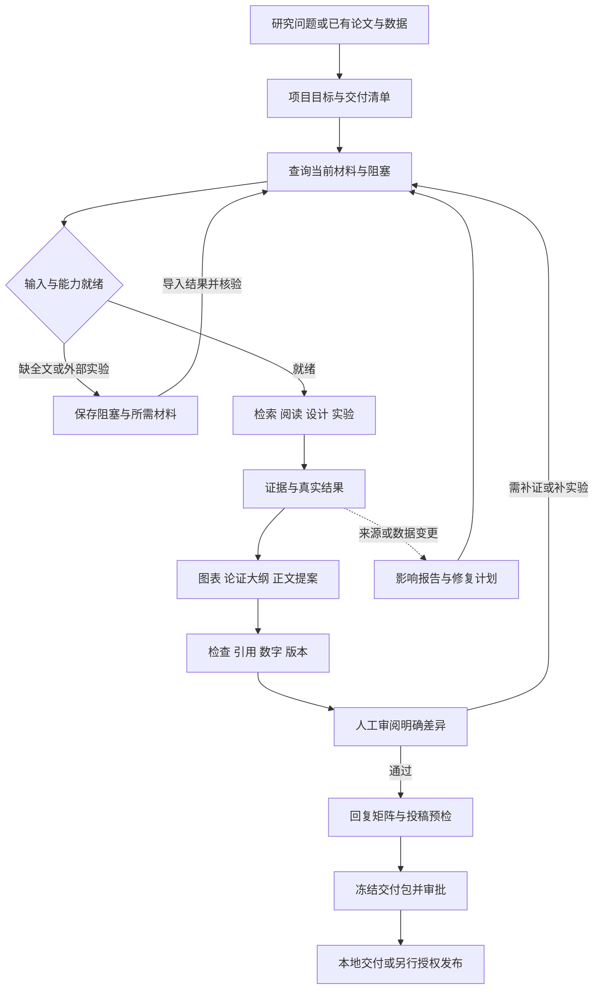

# Roc 科研全流程优化调研

调研日期：2026-11-21。本文保留实施前的产品与架构分析，不替代当前功能合同。后续八项优化的提交、实际验证和边界见[实施验收记录](research-workflow-validation-2026-11-23.md)。下文“已有”“缺口”和“未运行”均指调研时点。

**核心判断：下一步应把已有科研能力接成可恢复、可核对、可修订的工作流。** Roc 已有十一阶段、证据与主张、实验执行、图稿、写作检查、审稿回复、期刊检查和交付包。最高价值增量集中在 Agent 提案覆盖、稿件同步、变更影响、科研结果自动进入论文，以及真实全流程验收。

“贯通”应定义为：每一步产物可被下一步消费；缺材料有明确阻塞；人审后可继续原任务；数据或稿件变化后能定位需要重做的内容；最终交付与实际证据、运行一致。物理实验、科学判断、署名和对外提交仍有明确的人类或外部系统责任。

**调查范围与证据强度**

- 对照 9 个科研系统/工具的官方正文或 README，未安装运行竞品。产品声明不能当作独立成功率或市场排名；HKUDS 与 PaperQA README 达读取长度上限，未作全文穷尽审计。
- 收集 12 条社区讨论：7 条读取原帖正文/官方 API，5 条只有搜索摘录。排除明显推广帖；样本偏英语、博士和理工，中文社区证据不足。痛点有具体案例支持，排序属于结合 Roc 现状的判断，未验证发生频率。
- 核对当前工作区文档、工具注册、阶段角色、阶段回退、任务依赖和技能文件访问代码；未运行 Roc 科研闭环。使用已有 CodeGraph 索引，没有刷新索引。
- 本轮 web 搜索触发限流后停止该渠道；来源不是截至调研日的完整市场清单。外部链接与读取边界列在下文；任务临时资料按授权在交付时清理，长期依据保留在本文、专题合同和 Git 历史。

**其他科研 Agent 值得借鉴什么**

| 系统与一手来源 | 已观察的侧重点 | Roc 的可用设计 | 不能据此声称什么 |
| --- | --- | --- | --- |
| [K-Dense BYOK / Kady](https://github.com/K-Dense-AI/k-dense-byok) | 本地科研工作区；研究笔记与工具自动溯源分开；冻结分析计划、偏离记录、阴性结果、Methods 与证据包 | 从实际执行生成 Methods；区分研究者解释、模型解释与机器记录；结果分类贯穿写作 | beta 产品的内部评测不能证明比 Roc 更可靠 |
| [ClaudePrism](https://github.com/delibae/claude-prism) | LaTeX/PDF、逐块接受/拒绝修改、Git 快照、PDF 区域提问、Zotero 插入 | 用户可局部采纳 Agent 改稿；来源定位与改稿处于同一工作区 | README 的本地优先不等于模型推理全部离线 |
| [Edison Kosmos](https://edisonscientific.com/news/announcing-kosmos)（2025-11-05） | 结构化研究状态跨长轨迹保持目标；结论追溯到代码或文献段落 | 在现有 task facts、执行记录和工件上增加跨阶段研究状态与影响查询 | 官方也承认会钻无价值分支、追逐科学意义不足的显著性；不用“六个月研究”等宣传换算效率 |
| [Google AI co-scientist](https://research.google/blog/accelerating-scientific-breakthroughs-with-an-ai-co-scientist/)（2025-02-19） | 假设生成、反思、排序、演化与专家反馈 | 假设比较表、反证任务、下一实验建议 | 模型互评或 Elo 不等于科学真值；真实实验仍需专家 |
| [Sakana AI Scientist-v2](https://github.com/SakanaAI/AI-Scientist-v2)（论文 2504.08066） | 实验管理与树搜索、代码运行、分析、论文 | 有停止条件的探索分支；保留 baseline、失败和阴性结果 | 开放探索成功率不必高于模板；Linux/CUDA 环境不等于 Mac 本地可直接复用；代码许可并非普通 MIT |
| [HKUDS AI-Researcher](https://github.com/HKUDS/AI-Researcher) | 从详细想法或参考论文进入检索、实现、实验、写作 | 多种项目起点和明确的产物交接 | 示例偏 ML、容器/GPU，不能外推成全学科自动实验能力 |
| [FutureHouse Robin](https://www.futurehouse.org/research/demonstrating-end-to-end-scientific-discovery-with-robin-a-multi-agent-system)（原文 2025-05-20） | 文献、候选设计、实验结果回流后再次决策 | 等待外部实验、导入结构化结果、恢复原任务 | 官方明确物理实验由人类执行 |
| [Elicit Systematic Reviews](https://support.elicit.com/en/articles/14759154-systematic-reviews-in-elicit) | 检索、双轮筛选、逐格证据、提取列试跑、冲突裁决、报告 | 在已有系统综述上补提取建议、少量样本试跑和覆盖率展示 | 套餐、报告规模与解析范围有边界；检索池不是已核验纳入集 |
| [PaperQA](https://github.com/Future-House/paper-qa) | 反复检索、证据抽取/重排、来源回答及反证配置 | 对照现有 RAG 的主张支持检查、反证与多跳检索 | 文献问答不等于实验、协作和投稿全流程 |

最贴近 Roc 的产品对照是 K-Dense BYOK 和 ClaudePrism；Sakana、Google 更适合研究编排参考。Robin、Kosmos、PaperQA 有组织渊源，不能当成三个完全独立的市场需求样本。很多竞品亮点 Roc 已有对应对象，应比较用户完成任务所需的接管次数和产物质量。

**社区痛点如何转成产品需求**

下表 A 为已读原帖，B 为仅搜索摘录。旧帖仅支持长期工作流问题，不描述今天工具的能力。

| 证据 | 具体困扰 | 产品含义 |
| --- | --- | --- |
| C1 [综述笔记难恢复上下文](https://academia.stackexchange.com/questions/177198/efficient-note-taking-during-literature-review)，2021-10-27，A；C2 [150 篇论文难提取和综合](https://www.reddit.com/r/PhD/comments/1js443m/how_do_you_organize_and_extract_info_from_100/)，2025-04-05，B | 摘要和笔记越多，越难比较与组织综述 | 正式连接“跨文献证据矩阵→论证大纲→正文”；显示支持、反对、未知和证据空缺 |
| C3 [ChatGPT 参考文献导入](https://forums.zotero.org/discussion/104253/how-to-transfer-bibliographic-references)，2023-04-09，A；C4 [分析 PDF 时编造引文](https://www.reddit.com/r/ChatGPTPromptGenius/comments/1m97t6a/research_help_hallucinating_quotes_and_forgetting/)，2025-07-25，B | 文献存在、引文原文存在、内容支持论断，是三个不同问题 | 引用身份解析、工具返回原文跨度、语义支持建议及人工决定分别保存 |
| C5 [七位作者协作](https://academia.stackexchange.com/questions/98306/how-to-effectively-write-a-paper-of-n2-co-authors)，2017-11-02，A；C6 [不使用 LaTeX 的合作者](https://academia.stackexchange.com/questions/44981/collaborative-paper-writing-with-non-latex-using-colleagues)，2015-05-07，A | Word/LaTeX 来回转换，手工合并修改与参考文献 | 优先意见导入、版本定位、冲突与逐条采纳；不要求所有合作者迁入 Roc。部分回答也表示 Word 流程有效，不能认定人人需要实时协作 |
| C7 [论文重新排版](https://www.reddit.com/r/PhD/comments/hkvoe4/reformatting_research_articles/)，2020-07-04，B；C8 [期刊要求可编辑图表](https://www.reddit.com/r/PhD/comments/1b1gynf/providing_editable_images_to_a_journal/)，2024-02-27，B | 投稿排版重复劳动；接收后才发现图片不满足交付 | 版本化期刊配置、可编辑表格、矢量图与源数据打包；检查实际材料类型 |
| C9 [有原始数据仍复现不一致](https://academia.stackexchange.com/questions/1401/how-to-get-the-data-to-reproduce-a-published-result)，2011-10-24，A；C10 [论文数据链接失效](https://academia.stackexchange.com/questions/217418/dataset-links-provided-in-the-paper-not-working-authors-not-responding-next-st)，2025-03-18，A | 复现数值不一致，怀疑样本筛选差异；另有数据访问受阻案例及必要元数据缺失的提醒 | 资源预检、清洗和排除记录、结果回执；缺输入时保存可恢复阻塞。数据变更联动正文属于由此提出的设计推论，样本不能证明其发生率 |
| C11 [AI 会话引用格式](https://forums.zotero.org/discussion/126912/zotero-connector-apa-automatic-llm-citation-format)，2025-09-20，A | 引用软件、会话、AI 使用说明的规则不同 | 从真实运行生成 AI 使用披露草稿，套用目标期刊规则；保留用户复核，不能默认把私有聊天公开 |
| C12 [AI 写稿纠错负担](https://www.reddit.com/r/academia/comments/1siehpx/how_does_anyone_even_rely_on_ai_for_writing/)，2026-04-11，B | 反复解释、虚构论证、重复段落，纠错可能比写作更费时 | 先审阅论点和证据再逐段生成；衡量核查时间、误改和返工，不能只量字数 |

**Roc 当前已实现什么，哪里仍需要贯通**

以下“已有”表示代码与当前合同存在，不表示本轮运行验收通过。“缺口”仅针对所审计入口，不声称穷尽全仓库行为。

| 环节 | 当前基线 | 本轮发现的增量机会 |
| --- | --- | --- |
| 检索与阅读 | 多源检索、获取/解析、Zotero、结构化阅读、RAG/Wiki、来源定位与关系 | 把读取结果直接转为可编辑证据矩阵和大纲；资源不足时提供可执行下一步。见[文献获取](research-literature-acquisition.md)、[阅读](research-reading-radar.md) |
| 系统综述 | 协议、去重、双轮筛选、全文绑定、提取、质量评价、研究归组、计数与报告 | 主助手现有综述工具提供读取、标题/全文筛选建议；补协议、提取和质量评价的独立提案、列定义试跑。不是重做 PRISMA。见[综述合同](research-systematic-review.md)、[工具表](../src/main/plugins/agent/review-tools.ts) |
| 研究设计与实验 | Idea Canvas、冻结方法计划、结果评估；Python/R/Julia/TS 执行、环境/输入/输出摘要与结果回执 | 方法与统计参数预填、受控计算、从实际回执生成 Methods；外部实验结果回流。现有样本量记录不执行功效计算。见[方法计划](research-ideas.md)、[实验](research-experiments.md)、[结果](research-experiment-results.md) |
| 图稿与正文一致性 | 可追溯定量图、方法图；正文数值与实际指标映射、舍入/容差/单位转换 | 自动发现候选映射，逐项确认；结果变更时定位受影响图表和段落。见[图稿](research-figures.md)、[写作检查](research-writing-checks.md) |
| 主稿与阶段工件 | 工作区 `.tex/.bib` 直接编辑；阶段正文与受控导出冻结另一组主张/来源版本 | 明确两者同步状态、生成可接受的补丁、回写新工件版本。当前工作区修改不会自动修改批准工件。见[工作台](research-workbench.md)、[术语](../CONTEXT.md) |
| 审稿与投稿 | Reviewer/Verifier、回复矩阵、期刊规则、PDF/DOCX/HTML、arXiv 预检、RO-Crate、Zenodo | 外部意见导入、自动回复提案、规则采集与复用、交付材料缺口；Word 意见往返。当前 DOCX 不含 Zotero 动态引文字段，复杂公式/表格保持字面文本。见[回复](research-response-matrix.md)、[规则](research-journal-compliance.md)、[导出](research-exports.md) |
| 执行与恢复 | 冻结权限、幂等效果、checkpoint、任务依赖、事实账本、取消与诊断 | 在现有任务上提供面向科研的 readiness、阻塞对象、输入变更影响与修复提案。现有 `moveStage` 按阶段重开后续工件；已有执行依赖图不能等同科学对象的最小重算图。见[任务](research-task-observability.md)、[阶段实现](../src/main/plugins/research/repository.ts)、[任务图](../src/main/plugins/research/execution/task-graph.ts) |
| Skills 与评测 | 11 份自有阶段技能；Nature 23 份快照技能；Academic 5 份可选；已有 capability/E2E/security 套件 | 显式技能资源依赖闭包；完善完整综述/写作投稿和真实审批证据。评测文档明确部分任务仍 unsupported。见[技能](builtin-skills.md)、[评测](../evaluation/README.md) |

**科研 skills：选哪些、怎么吸收**

| 来源与本次读取版本 | 实际读到的内容 | 建议归属 |
| --- | --- | --- |
| [K-Dense Scientific Agent Skills](https://github.com/K-Dense-AI/scientific-agent-skills/tree/ec59a29a03d5c40f73ab40878df04860bc00e876)，旧名 Claude Scientific Skills；[MIT 原文](https://github.com/K-Dense-AI/scientific-agent-skills/blob/ec59a29a03d5c40f73ab40878df04860bc00e876/LICENSE.md) | database-lookup、statistical-analysis、uncertainty-and-units 等具体技能；科学设计、写作、可视化原文 | 统计/实验方法作可选 skill；单位与不确定度成为受控计算工具；数据库访问做 connector，保留版本/过滤条件/分页回执 |
| [Orchestra AI Research SKILLs](https://github.com/Orchestra-Research/AI-Research-SKILLs/tree/773a52944ba4747a18bd4ae9ade53fff041adcbc)；[MIT 原文](https://github.com/Orchestra-Research/AI-Research-SKILLs/blob/773a52944ba4747a18bd4ae9ade53fff041adcbc/LICENSE) | ML paper writing、autoresearch、ARA compiler/research-manager/rigor-reviewer | ML 专项包按需启用；将失败方向、转向理由、主张与实验关联融入现有事实/工件。不要引入平行 `.ara/` 事实库，也不要照搬固定节点数配额 |
| [Research Paper Lifecycle Skills](https://github.com/ShaishavMaisuria/research-paper-lifecycle-skills/tree/cf30d6452cc6fd0570dd760eb65696f4a3485398)；[Apache-2.0 原文](https://github.com/ShaishavMaisuria/research-paper-lifecycle-skills/blob/cf30d6452cc6fd0570dd760eb65696f4a3485398/LICENSE) | preflight-check、anonymize-paper、verify-results、fit-page-limit、work-with-overleaf、orchestrate-paper | 页数、PDF metadata、匿名材料和必需声明转内置检查；期刊适配/回复策略保留 skill；Overleaf 走 Git/ZIP/连接器，skill 本身不是集成 |
| [WenyuChiou AI Research Skills](https://github.com/WenyuChiou/ai-research-skills/tree/b3b615748f9050ba16d912dee0369b273fbc1cf0)；[MIT 原文](https://github.com/WenyuChiou/ai-research-skills/blob/b3b615748f9050ba16d912dee0369b273fbc1cf0/LICENSE) | 只读 registry README、目录与许可证；未审计下游各仓库 | 对照跨 skill 的 schema、章节完成条件和发布准备度；复用 Roc harness，不再引入另一个执行系统 |

已有 [Nature Skills](https://github.com/Yuan1z0825/nature-skills) 快照含统计、写作、审稿、引文验证、实验日志等；已有 [Academic Research Skills](https://github.com/Imbad0202/academic-research-skills) 是 CC BY-NC 4.0 的可选来源。应先解决可用性和产物合同，再按学科补技能。上表许可为本次固定版本原文，不代表每个依赖和历史资产都同许可；选取分发时核对具体文件并保留声明。

判定边界可固定为：

- **内置功能**负责稳定 ID、来源版本、确定性计算、文件/格式验证、可恢复状态、权限、审阅差异和实际交付。
- **Skill**负责研究方法、叙事组织、检索策略、分析建议、审稿回复和学科惯例；输出仍须映射 Roc 的工件合同。
- **Connector**负责远端数据、参考管理器、Overleaf、GPU/HPC、实验平台；授权、分页、取消与外部任务身份由产品工具实现。
- **Agent**选择并编排这些能力，提出解释与修改；模型文字不能充当运行记录或人工科学批准。

**优先内置的功能与验收**

优先级依据：是否阻断现有链路、覆盖多个阶段、能否复用当前服务、能否给出可观察验收。工作量为相对工程范围，未做工期估算。

| 顺序 | 功能 | 当前基础上的具体增量 | 验收场景 | 范围 |
| --- | --- | --- | --- | --- |
| P0-1 | Agent 可提交的科研提案与下一步查询 | 为计划、指标映射、引用直接性、回复矩阵、期刊规则增加独立 proposal；聚合现有校验输出为 blockers / next actions；复用人工保存入口采纳 | 用户只给审稿意见，Agent 形成补实验/改稿/回复提案；每项有来源和当前版本；确认后继续原任务 | 中；优先贯通 |
| P0-2 | 工作区稿件与正文工件同步 | 保留段落/主张锚点、基准版本和来源；从 `.tex/.bib` 修改生成差异，部分采纳，形成新稿件版本；显示工作稿与已审稿是否一致 | 用户手改 Results 一句后，旧审核变为待复核；导出不得静默交付旧内容或将新内容当已批准 | 大；跨编辑器/工件/导出 |
| P0-3 | 真实结果自动进入图表、正文和 Methods | 从现有实验回执提取指标/定义候选，生成图表输入、数值映射、Methods 草稿及差异；记录技术失败、阴性和不确定结果 | 更改输入数据重跑后，摘要、结果段、图注与表格可定位更新；Methods 来自实际执行而非原计划 | 中；复用结果/图稿/一致性 |
| P0-4 | Skill 依赖与运行准备检查 | 显式冻结只读参考资源依赖；检查所需工具、环境和许可；新 run 与恢复使用明确版本 | 选定 skill 的共享参考能被合法读取；缺依赖在运行前解释；不能借资源依赖获得额外工具权限 | 小到中；可先独立落地 |
| P1-1 | 变更影响和定向修复 | 聚合 Claim/Evidence/Run/Figure/Manuscript/Review/Export 的版本关系，先给影响报告；再支持必要的局部重算与重新审核 | 换一份数据只重做相关实验/图/段落；无关文献阅读不重跑；旧回执和历史导出仍可追溯 | 大；先只读影响，再改回退策略 |
| P1-2 | 证据矩阵与论证大纲 | 正文每节明确问题、主张、支持/反证、适用条件、缺口；系统综述先试跑少量论文的提取列，再批量提案 | 用户从 30 篇文献进入综述时能解释哪些证据支持哪一节，哪些全文缺失，哪些观点互相冲突 | 中；复用阅读/Wiki/综述 |
| P1-3 | 可复用投稿配置与预检 | 从官方规范生成规则提案，冻结来源/日期；扩展编译页数、匿名化、PDF metadata、声明、可编辑表格和实际补充文件检查 | 换期刊后得到规则差异；匿名审稿包和最终署名包来自同一冻结稿，私有恢复映射不进入交付 | 中；扩展现有 compliance/export |
| P1-4 | 外部协作与实验回流 | 先导入 Word/PDF 意见、逐项定位合并；外部实验记录缺什么、谁执行、回传格式与外部 ID，结果导入后继续 | 合作者不安装 Roc 也能反馈；等实验跨天退出后可恢复；不重复提交远端作业 | 中到大；按目标用户选一条先做 |

P0 表示优先产品增量，不代表这些项目全部必须同时完成。最先验证 P0-1、P0-2、P0-3 的一条窄流程；P0-4 可单独推进。完整增量重算与多人实时编辑都不宜成为第一版前置条件。

**第一优先：把人工表单变成可审阅提案**

现有[主助手工具表](../src/main/plugins/agent/research-tools.ts)与[阶段角色](../src/main/plugins/research/role-profiles.ts)覆盖检索、读取、执行和阶段调度；多项科研审核入口需要真实窗口身份。直接把这些保存接口开放给模型，会混淆提议与批准。可以复用当前综述 `suggest` 模式，补三个层次：

1. **读和检查**：返回当前资料、准确版本、未满足条件、相关原文与可执行修复动作。错误不能只给一句“失效”，要有受影响对象与修复入口。
2. **保存提案**：Agent 提交候选字段、理由、原文/运行引用、基准 hash 与验证结果。正文/数据变化使提案过期。低风险可逆工作在既有授权内自动执行。
3. **明确采纳**：同一壳中的审阅卡展示差异，用户逐项或对明确列出的集合做决定；主进程绑定身份，调用现有服务。保持条目级版本与人工决定，不把一次泛化批准覆盖未来变化。

先覆盖高频五项：实验指标定义/数值映射、方法段草稿、引文直接性候选、审稿回复及修改位置、期刊规则草稿。系统综述的协议/提取/质量建议随后接入。提案只减少搬运、选区和重复录入，最终科学裁决仍与模型建议分开。

**第二优先：明确稿件版本，再做依赖修复**

当前[写作 skill](../resources/research-skills/writing/SKILL.md)要求未支持内容不进入受控正文 sections。这适合交付验证，但创作过程中需要提纲、占位、待核实句子。建议保留工作草稿的这些状态，再在晋升为受控稿件时逐项核对；不能为提高“成稿率”放松批准正文的证据要求。

同步采用显式基准版本和可审阅 patch：工作区变更→定位到段落/主张→发现数字/引用/结构变化→补证或修订提案→人工采纳→新工件版本。复杂 TeX 宏、外部插入和无法可靠定位的内容返回未匹配状态，不猜测映射。初版先覆盖 Roc 生成的正文和稳定段落标识，随后扩大任意 TeX 与 DOCX 往返范围。

当前[阶段回退](../src/main/plugins/research/repository.ts)的 `moveStage` 会将目标及后续阶段工件置为 superseded；已有 source migration/replacement 也不会自动重绑 Claim。先增加只读影响预览，解释为什么哪些材料过期；证据充分后再支持按对象重建和最小审核。由既有任务图执行修复，避免出现第二个调度器或第二套权威状态。

依赖结构应能回答两种问题：一句结论用了什么原文/数据/代码/运行；某个来源变化会影响哪些结论、图、回复和包。当前已有许多版本与来源边，增量是统一查询、可读呈现和修复编排。

**实验和统计的后续增强**

把 baseline、预定主要指标、比较族、失败条件、探索性分析和方案偏离挂到已有冻结方法与真实运行上。学科 skill 提议方法，受控代码计算效应量、区间、功效与单位/不确定度；缺设计、方差、相关性等必要输入时给出不足条件。方法选择与“显著即可成功”不能成为自动通行规则。

目前[生产任务合同](research-task-observability.md)明确没有累计 token、费用、调用或时长配额，评测宿主的 budget 不等于产品预算。若增加自主探索模式，应另立可选、显式的试验次数/费用/时间和停止条件合同，不能假装已有，也不宜从外部 skill 硬搬固定论文节点数量要求。

首批数据库与计算适配依据目标学科选择，建议每批少量来源。Roc 的 macOS 本地执行适合可控计算；Linux/CUDA、HPC 和湿实验应有正式外部作业/结果回执。导入外部结果时标明证据级别与执行身份，不能伪装成本机已复跑。

**流程如何连起来**

复用现有单一助手、Task、阶段角色、工件检查器与能力清单。项目可从“文献综述”“已有数据写论文”“复现实验”“审稿后修订”启动，生成交付目标与任务计划；保留现有阶段闸门，不能通过模板暗中跳过批准。已有材料通过明确导入和版本核验进入流程，无须为了形式重新做一遍研究。

每次阶段交接至少包含：准确输入版本、实际产物、未支持主张、尚未完成动作、失败/阻塞原因、下一步、需要哪项人工决定。由已有持久记录重建，不仅存一段聊天摘要。物理实验等待、缺全文与工具故障应区分原因，恢复时继续同一研究任务。

**先完成一条能演示、能评分的垂直流程**

建议首个目标：**已有论文和 CSV + 一条要求补实验的审稿意见 → 重跑 → 更新图表/正文 → 回复 → 重新交付**。它覆盖 Roc 已有组件，结果容易对比；比无边界“从零自动发现并发表论文”更适合作为第一条产品验收。

1. 导入或选择现有稿件、数据、脚本、审稿意见；准确记录基准版本。
2. Agent 从意见生成补实验计划、修改位置与验收条件，用户确认必要的科学选择。
3. 复用现有环境预检与实验执行；输出真实结果。失败时保留失败状态和日志，不能进入已完成 Results。
4. 生成指标/图表/Methods/正文/回复的关联提案；一次展示具体差异与出处，采纳后形成新版本。
5. 检查引文、正文数值、图表数据和回复位置；新稿的旧位置或旧指标引用必须被发现。
6. 按版本化期刊规则准备包；核对真实 PDF、参考文献、图源、补充文件与回复，完成现有审批。
7. 在实验完成后、人工审阅前强制退出并重启：恢复原任务，保持已完成运行，不重复实验或外部提交。

**如何证明“贯通”**

扩展已有 `roc-e2e-research`，先补真实审批/人工决定证据。当前[评测说明](../evaluation/README.md)明确完整系统综述、写作投稿等仍可能标为 unsupported；应让它们有合格的生产轨迹和独立评分，不能仅改标签或增加提示词。

| 验收对象 | 必须看到的证据 |
| --- | --- |
| 流程完成 | 实际文件/数据库/任务终态符合交付合同；无模型口头完成代替产物 |
| 引文与数字 | 引文可回到固定原文；DOI 存在与语义支持分开；受测所有数字/图表映射核对实际结果；未知与未映射保留 |
| 上游变更 | 注入数据、Evidence 或正文版本变化，旧成功标记不能继续授权交付；修复后关联一致 |
| 人工决定 | 精确版本的真实批准回执；模型提案不能成为人工审核记录；拒绝后不推进 |
| 恢复与外部效果 | 重启后继续同一任务；已完成实验/导入/外部提交不重复；不确定效果先核对 |
| Skill 可用性 | 在实际阶段文件后端读到声明的参考资源，环境可用；缺失时明确失败；没有隐式扩权 |
| 交付质量 | 内容与已接受稿件一致；图/表可编辑性及补充文件按所选规则检查；实际目标应用/PDF 排版另做实测 |
| 用户成本 | 记录主动核查分钟、手工录入字段、复制粘贴次数、必要/可避免中断、误改/返工，以及模型调用与耗时 |

质量基准至少保留文献综述、系统综述、实验复现、写作投稿四类；每类选独立来源项目，固定模型、工具与材料，同当前 Roc 做成对比较。引用幻觉、错误数字、越权批准与重复外部效果属于不可接受失败；总体完成率、耗时和核查负担先测基线，再制定有依据的改善目标。本轮没有运行这些评测，不给出完成率预测。

推荐实施顺序：先建立这条真实基线 → 补提案与稿件同步 → 接结果到图文/回复 → 做重启和上游变化验收 → 再扩展综述、投稿配置、协作与外部实验。用户研究可补 5–8 位目标研究者的真实修订包，特别补中文写作和非计算学科样本，核对本报告排序。

**具体代码落点与本轮验证范围**

| 工作 | 优先读取或扩展位置 |
| --- | --- |
| 提案与工具覆盖 | [research-tools.ts](../src/main/plugins/agent/research-tools.ts)、[review-tools.ts](../src/main/plugins/agent/review-tools.ts)、[role-profiles.ts](../src/main/plugins/research/role-profiles.ts)；沿既有能力和领域服务增加 proposal 合同 |
| 稿件/数字/回复联动 | [research-consistency.ts](../src/shared/schemas/research-consistency.ts)、[consistency-service.ts](../src/main/plugins/research/consistency-service.ts)、[response-matrix-repository.ts](../src/main/plugins/research/response-matrix-repository.ts)；编辑器保存与新稿件版本转换另定显式合同 |
| 影响报告与任务修复 | [repository.ts](../src/main/plugins/research/repository.ts)、[task-graph.ts](../src/main/plugins/research/execution/task-graph.ts)、[任务上下文](../src/main/services/deep-agent/context/research-context-assembly.ts)；复用 source migration/replacement 与版本查询 |
| Skill 依赖闭包 | [skill-backend.ts](../src/main/services/deep-agent/skill-backend.ts)、[阶段技能目录](../resources/research-skills/)、[builtin catalog](../resources/builtin-skills/catalog.json)；资源权限与工具权限分别解析 |
| 投稿预检 | [journal-compliance-checks.ts](../src/main/plugins/research/journal-compliance-checks.ts)、[research-journal-compliance.ts](../src/shared/schemas/research-journal-compliance.ts)、[arxiv-preflight.ts](../src/main/plugins/research/arxiv-preflight.ts)；复用真实编译与交付 manifest |
| 全流程证据 | [evaluation/README.md](../evaluation/README.md)、[E2E Task](../evaluation/tasks/roc-e2e-research/Task.md)；保留 supported/unsupported 与来源资格边界 |

本轮只新增本报告和忽略目录内的调研计划/证据文件，保留原有未提交编辑，未改产品代码、安装外部 skill、执行上游脚本或修改用户数据。报告的来源完整性、仓库相对链接和 Markdown 空白检查单独验证；这些验证不证明产品或竞品的运行质量。
