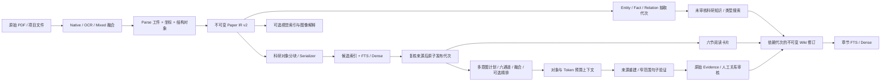

# Scientific RAG 架构与职责

当前实现使用 Electron main、TypeScript、SQLite/FTS5、现有 embedding service 和 LangChain structured output；renderer 通过 preload/IPC，科研能力属于唯一项目壳。版本和验收边界集中在[当前实现](00-current-state.md)。

## 分层职责

| 层 | 当前所有者（`src/main/plugins/research/`） | 边界 |
| --- | --- | --- |
| Source / Parse | `document-service.ts`、`document-repository.ts`、`document-parser.ts` | 原件、blocks、assets 和坐标按 source/parse 发布；融合保留来源和替代结果，不覆盖旧证据。 |
| Canonical IR | `paper-ir-builder.ts`、`paper-ir-repository.ts` | 独立不可变 IR v2；对象共用 Source Locator，linked/candidate/unknown 保留实际状态。 |
| Chunk / Index | `scientific-index-builder.ts`、`scientific-index-repository.ts`、`scientific-library-index.ts`、`index-service.ts` | 通用与科研候选完成后再事务发布；失败保留旧 active，来源变化仍使旧引用失效。 |
| Retrieval | `scientific-query-planner.ts`、`scientific-retrieval-router.ts`、`scientific-reranker.ts` | 项目范围固定；六通道、快照、取消、配置与预算共同约束结果，来源检查跨越异步模型调用。 |
| Knowledge | `scientific-extraction-service.ts`、`scientific-extraction-repository.ts` | 独立 Entity/Fact/Relation 生成与发布；来源验证不等于人工科学审核。 |
| Wiki | `paper-card-service.ts`、`wiki-repository.ts`、`wiki-scientific-synthesis.ts`、`wiki-search.ts` | 依据摘要传播失效；新增修订，保留 human 内容与历史；导航命中不是事实支持。 |
| Optional visual | `visual-index-service.ts`、`figure-understanding-service.ts` | 显式模型和环境配置、原始资产复核；派生解释保持未审核。 |

生产装配在 `research-plugin-production.ts`，知识能力注册在 `research-plugin-knowledge.ts`；Agent 工具使用当前注册与共享 schema。没有第二套引用图、证据审核、数据库或前端。Citation 通道复用 Scholarly Relations；科学主张的批准与导出仍经过既有 Evidence/Claim/人工关系审核。

抽取模型、provider 转换和业务校验分别守住自己的边界。Fact 的预算预检与实际 adapter 共用 `scientificExtractionToolSchema`；provider wrapper 转换 structured tools 后核对对象根，不支持的根在发请求前拒绝。返回结果仍需通过 Zod、codec、proposal 与原始来源校验；工具 Schema 合法不能证明科学正确性。源码与定向验证入口见[Provider 工具边界](extraction.md#provider-工具-schema-边界)。

## 发布、迁移与验收

Parse/IR、索引、抽取和 Wiki 分别拥有发布身份。跨越异步模型调用时要重新核对来源与配置，候选失败保留已有发布结果；消费者仍须识别来源漂移。完整链路的科学验收需要独立 gold、真实 Fact/Wiki/最终答案及真实项目的实际证据，资格与配对条件见[评测](evaluation.md)。

Research schema 为 74；数据库启动拒绝不兼容版本。v71/v72/v73 升级必须走[独立离线迁移](../database-storage.md)，核验输入、备份、业务身份、历史引用、完整性与隔离启动后再发布。保留的索引代次切换是当前来源下的显式操作，与数据库迁移及历史科学审核恢复不同。
