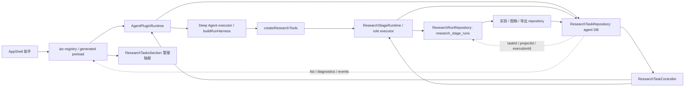
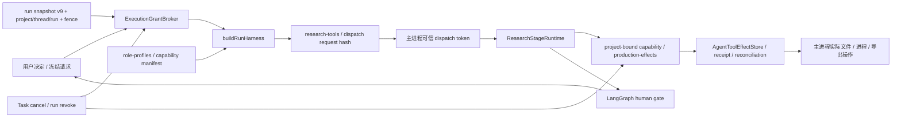
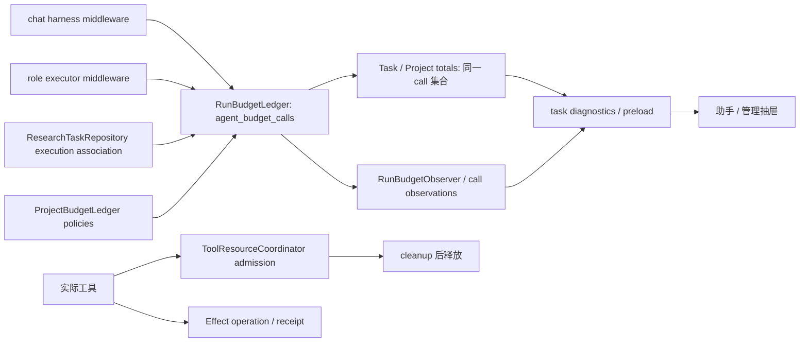
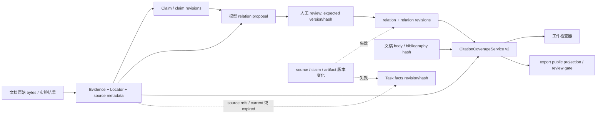

# S00 当前能力、所有权与消费者清单

日期：2026-11-06。源码基线：`eea2087b5d2d79df3b2fea7764ce48e4975fd764`。
本文件的“当前”来自源码与隔离 schema 探测；运行结果见 [baseline.json](baseline.json)。
“目标/缺口”尚待后续阶段实施，不能当成已通过的行为。

本清单保留 S00 历史基线。S01 已切换评测数据/runner/隔离合同，最新接口与限制见
[评测协议](evaluation-protocol.md)；下表中的旧 pilot 名称不代表当前生产入口。

## 1. 存储与组合根

组合根 [main-kernel-bootstrap.ts](../src/main/main-kernel-bootstrap.ts) 将
`ResearchTaskRepository`、`RunBudgetLedger`、`ExecutionGrantBroker` 注入 agent/research
插件。Task 与预算共用 agent DB；stage、文稿、证据及领域 job 使用 research DB。
两库之间没有跨库事务保证。memory DB 的长期记忆、task DB 的后台/定时任务不是第二份科研 Task。

当前隔离空库版本：core 1、agent 19、memory 2、task 1、workspace 1、diagnostics 1、
research 60。完整表、索引、迁移 checksum 和完整性结果见
[schema 探测](../.artifacts/research-harness/S00/2026-11-06T10-35-39.451Z/schemas.json)。
本阶段没有读取、转换或检查生产用户库。

## 2. 执行能力

| 能力 | 实际接口 / 拥有者 | 实际表与合同 | 状态、取消与恢复 | 消费者 / 缺口 |
| --- | --- | --- | --- | --- |
| AgentRun | [AgentPluginRuntime](../src/main/plugins/agent/runtime.ts)、[AgentSessionRepository](../src/main/plugins/agent/session-repository.ts)、[createAgentDeepAgentExecutor](../src/main/plugins/agent/deep-agent-executor.ts)、[buildRunHarness](../src/main/plugins/agent/run-harness.ts) | agent DB：`agent_runs`、`agent_threads`、`session_messages`、`agent_run_leases`、`agent_pending_interrupts`；snapshot 当前 v9，仍有 v7/v8 运行时升级 | 通用聊天负责启动、流式输出、中断与 checkpoint 恢复；恢复读取冻结 snapshot；取消须撤销 grant 并等待工具清理 | 助手与研究工具、Task diagnostics；S02 删除旧 decoder，统一科研执行协议，补故障一致性 |
| StageRun | [ResearchStageRuntime](../src/main/plugins/research/stage-runtime.ts)、[ResearchRunRepository](../src/main/plugins/research/run-repository.ts)、[createResearchRoleExecutor](../src/main/plugins/research/role-executor.ts) | research DB：`research_stage_runs`、`research_stage_states`、`research_stage_policies`、`research_workflow_events`；冻结角色、输入、Skill hash、policy | queued/running 到 completed/failed/cancelled/interrupted；父 run 管 review children；`retry` 是新阶段尝试，当前 role executor 没有配置 stage checkpointer | research tools、领域 production effects、human gate；`start` 的 dispatch 可为 null，executor/effects 可选；S02 收束必需执行输入与恢复，保留领域输出职责 |
| Task | [ResearchTaskRepository](../src/main/plugins/research/research-task-repository.ts)、[ResearchTaskController](../src/main/plugins/research/task-controller.ts) | agent DB：`research_tasks`、`research_task_executions`、`research_task_events`、`research_task_budgets`；Task v2、execution v1 | active/paused/waiting_approval/interrupted/completed/cancelled/failed；先保存 pause/cancel，再停止 chat/stage/job 并等待 cleanup；`linkStage/linkOwned/requireExecution` 校验关联 | agent/research、预算、任务抽屉；S06 尚无 DAG node/edge/revision/lease；跨库关联需持久化 intent 与幂等对账 |
| Event | [AgentRunEventLog](../src/main/plugins/agent/run-event-log.ts)、Task repository | agent DB：`agent_events`、`agent_outbox`、`agent_run_events`、`agent_run_event_cursors`、`agent_run_event_snapshots`、`agent_run_event_snapshot_pending`、`research_task_events`；Task event 当前无统一 versioned envelope | Chat projection 有数量/字节裁剪与 gap；Task event 含创建、状态、execution/call 关联和计费；事件不是 checkpoint，也不授予工具执行 | IPC streaming、diagnostics、Task event 分页；S02 补科研事件、correlation/causation 与事务边界 |
| Checkpoint | [RocSqliteCheckpointer](../src/main/services/deep-agent/sqlite-checkpointer.ts)、[resolveCheckpointResume](../src/main/plugins/agent/checkpoint-resume.ts) | agent DB：`langgraph_checkpoints`、`langgraph_checkpoint_writes` | 图状态与 pending writes；聊天同身份恢复；裁剪事件不能恢复缺失 checkpoint | Deep Agent executor；未证明 StageRun 同身份持久恢复，不能用 retry 冒充 |
| Grant | [ExecutionGrantBroker](../src/main/services/deep-agent/execution-grant-broker.ts)、[research-tools.ts](../src/main/plugins/agent/research-tools.ts)、[role-profiles.ts](../src/main/plugins/research/role-profiles.ts) | agent DB：`agent_execution_approvals`、`agent_execution_grants`、`agent_execution_run_fences`、`agent_research_dispatch_grants` | 绑定 run/thread/project、tool/manifest/request hash、范围、期限与 fence；dispatch token 主进程可信；取消撤销；冻结输入变化重新审批 | harness、stage dispatch、真实 I/O；S02/S03 显式 broker 与权限交集；不能把 null dispatch 或模型字段当审批主体 |
| Effect | [AgentToolEffectStore](../src/main/services/deep-agent/tool-effect-store.ts)、[production-effects.ts](../src/main/plugins/research/production-effects.ts) | agent DB：`agent_tool_effects`、`agent_tool_effect_reconciliations`；operation/idempotency key、attempt、generation、receipt；存在历史 identity v0 对账 | unknown 必须按相同 operation/generation 对账；换 attempt 不重获执行权；Task lease 与 Effect lease 各管自己的提交 | workspace/实验/图稿/导出真实操作；S02/S06 补组合故障回归，保留旧副作用原始回执 |
| Budget | [RunBudgetLedger](../src/main/services/deep-agent/run-budget-ledger.ts)、[ProjectBudgetLedger](../src/main/services/deep-agent/project-budget-ledger.ts)、[RunBudgetObserver](../src/main/services/deep-agent/run-budget-observer.ts) | agent DB：`agent_budget_calls`、`agent_budget_call_observations`、`research_project_budget_policies`、`research_project_budget_states`、`research_task_budgets` | 单次 call reservation/settlement；启动时 reserved 对账为 unknown；费用可以未知；当前 settle 的重复提交报错，不等于幂等 receipt 验收 | chat/stage middleware、Task/project 总额与 UI；S02 幂等结算，S06 引用既有 call，禁止三重计费 |
| Resource | [ToolResourceCoordinator](../src/main/services/deep-agent/tool-resource-coordinator.ts) | 进程内 read/write conflict 与 CPU/GPU/parse admission；持久操作另由 effect/job 表记录 | 资源占用随实际工具清理释放；不是持久 Task claim/lease；重启须由 job/effect 状态判断 | 工具、实验、文档 parse；S06 scheduler 复用 admission，不另授权或计费 |

## 3. 科研、上下文与评价能力

| 能力 | 实际接口 / 拥有者 | 实际表与版本 | 状态、取消与恢复 | 消费者 / 缺口 |
| --- | --- | --- | --- | --- |
| Evidence/Claim | [ResearchEvidenceRelationRepository](../src/main/plugins/research/evidence-relation-repository.ts)、[ResearchCitationCoverageService](../src/main/plugins/research/citation-coverage-service.ts)、research repository | research DB：`research_claims`、`research_claim_revisions`、`research_evidence`、`research_evidence_source_locators`、`research_evidence_source_metadata`、`research_evidence_relations`、`research_evidence_relation_revisions`、`research_citation_reviews`；coverage report v2 | 模型 propose，人工 review confirmed/rejected；expected version/hash、revision、source invalidation；确定性核对 bibliography/locator、人工 relation、directness receipt | 文稿、检查器、export；S04 新语义 verdict 单独保存可失效建议，不能覆盖人工结论 |
| Facts | [ResearchTaskFactsStore](../src/main/plugins/research/task-facts-store.ts)、[ResearchTaskFactsService](../src/main/plugins/research/task-facts.ts) | agent DB：`research_task_facts`；contractVersion 1、不可变 revision/hash、来源 refs | current/expired 来源视图；CAS 更新；事实是 research_data_only；没有自动变成用户长期记忆或授权 | stage context、Task facts panel；S03 压缩前后保留约束与来源，不能复制成第二份记忆事实源 |
| Retrieval | [research-search-plan.ts](../src/shared/schemas/research-search-plan.ts)、[literature-retrieval-evaluation.ts](../src/main/plugins/research/literature-retrieval-evaluation.ts)、research literature/review services | research DB：`research_literature_searches`、`research_literature_search_pools`、`research_literature_search_executions`、`research_literature_request_receipts`、`research_review_searches` 及 owner/cancellation 表；当前 search plan 无独立 schemaVersion | 用户审批冻结查询；最多 3 queries、总候选最多 60；来源 identity/receipt、分页、取消归属已有 | retrieval stage、literature/review 检索、导出闭包；S05 重排为新候选，必须等额预算与来源/查询版本回执 |
| Skill | [getResearchSkillInstructions](../src/main/plugins/research/research-skills.ts)、[role-profiles.ts](../src/main/plugins/research/role-profiles.ts) | 11 份 `resources/research-skills/<stage>/SKILL.md`；raw 文本映射；StageRun 保存 skillHash，尚无强制 manifest registry | discovery/retrieval/reading/ideation/planning/experiment/figure/writing/review/revision/export；角色限制 toolNames；提示文本不授予权限 | run repository `captureContext`、role executor；S03 同阶段全量 Manifest 切换，未知许可/hash/output schema 拒绝 |
| Context | [assembleContextHarness](../src/main/services/deep-agent/context/context-assembler.ts)、[context-compaction-pipeline.ts](../src/main/services/deep-agent/context/context-compaction-pipeline.ts) | agent DB：`agent_task_contracts`、`agent_harness_revisions`、`context_artifacts`；checkpoint 和 memory store 各自持久化 | Roc 是唯一 compactor；硬约束/人工决定、task facts、证据引用、transcript 分层；context artifact 不是证据真身 | chat harness；role executor 仍另拼 prompt，assembler 的 allowedToolNames 有省略默认；S03 合并装配并显式权限 |
| Export | [ResearchExportService](../src/main/plugins/research/export-service.ts)、[export-repository.ts](../src/main/plugins/research/export-repository.ts)、[export-public-projection.ts](../src/main/plugins/research/export-public-projection.ts)、[export-publication.ts](../src/main/plugins/research/export-publication.ts) | research DB：`research_export_executions`、`research_manuscripts`、`research_templates`，引用 artifact/provenance 和既有来源记录 | prepare/publish/交付分别校验；public projection、文件与 body gate、人工审批；取消由 Task/owned job 路径 | export stage、工件检查器、实际归档；S08 才验证真实 ZIP 完整来源闭包与外部交付 |
| Eval | [quality-evaluation/](../scripts/harness-eval/quality-evaluation/)、`runQualityPilot`、`runQualityPilotWithJournal`、`qualityPilotAudit` | 文件协议、task data、hidden evaluator view、journal 与统计；16 pilot-only tasks；`fullDatasetReady:false`；无 production live adapter | runner 校验 protocol lock、隔离期望与中断日志；fixture/audit 是工程结果 | quality CLI、quality tests；S01 扩展同一 runner，独立标注/holdout/真实模型评价尚未成立 |
| Observability | [task-capabilities.ts](../src/main/plugins/research/task-capabilities.ts)、[task-diagnostics-export.ts](../src/main/plugins/research/task-diagnostics-export.ts) | agent DB：`agent_run_telemetry`、budget observations、Task event/facts，research DB 的领域输出 refs | 有界分页、迟到响应身份校验、本地脱敏诊断，既有 2 MiB 上限；缺事件、未知费用须显式呈现 | [ResearchTasksSection.tsx](../src/renderer/management/sections/ResearchTasksSection.tsx)、助手、检查器；S07 增强同一管理抽屉 |

## 4. 四条当前消费者流

下图是当前调用与数据流，不表示 DAG/Manifest 目标已实现。虚线表示跨库引用、
诊断读取或数据约束。可复核图副本与路径清单存于 S00 evidence 目录。

### 4.1 Execution identity

根 Task 不是阶段状态机；同一次操作的 execution 与 effect 也不是一个 ID。
Task Controller 的控制动作不创建第二个助手入口。

### 4.2 授权与真实提交

当前 grant 存在并不证明所有 nullable 边界已切换。S02/S03 将必需身份与权限交集
固定到装配和实际 I/O；人工 gate 留在同一助手会话中。

### 4.3 预算与资源

资源是并发约束；预算是账务；effect 是副作用。未来 scheduler 不复制造账逻辑。
reserved 在重启对账为 unknown，不能把未知费用记为零。

### 4.4 证据与版本

S04 语义 verdict 将另存为建议，绑定规则/模型/Skill 及全部输入版本。
它不能把模型 proposal 改成 confirmed，也不能替代公开发布授权。

## 5. 已有验证消费者与未测边界

下列路径均为当前仓库已有测试；是否在本轮执行见 baseline 的具体命令。
本轮 `test:unit` 不包含 renderer/integration 全集。

| 能力 | 当前测试路径 | 本阶段不能推断 |
| --- | --- | --- |
| Run / Event / Checkpoint | [run-event-log](../tests/unit/run-event-log.test.mjs)、[checkpoint-write-order](../tests/unit/checkpoint-write-order.test.mjs) | 裁剪后完整重建、StageRun checkpoint 恢复、所有进程崩溃点 |
| Task | [identity](../tests/unit/research-task-identity.test.mjs)、[cancellation](../tests/unit/research-task-cancellation.test.mjs)、[events](../tests/unit/research-task-events.test.mjs)、[renderer tasks](../tests/renderer/research-tasks.test.mjs) | DAG 原子 claim、租约 fence、生产库一次性迁移 |
| Grant / Effect / Resource | [execution-grant-broker](../tests/unit/execution-grant-broker.test.mjs)、[tool-effect-store](../tests/unit/tool-effect-store.test.mjs)、[tool-resource-coordinator](../tests/unit/tool-resource-coordinator.test.mjs) | 全组合攻击、外部 unknown effect 自动安全重试 |
| Budget / Facts / Context | [run-budget-ledger](../tests/unit/run-budget-ledger.test.mjs)、[task facts](../tests/unit/research-task-facts.test.mjs)、[context-compaction-pipeline](../tests/unit/context-compaction-pipeline.test.mjs) | 新幂等结算协议、长上下文科学保真、跨版本执行权限 |
| Evidence / Citation | [evidence relations](../tests/unit/research-evidence-relations.test.mjs)、[invalidation](../tests/unit/research-evidence-invalidation.test.mjs)、[citation coverage](../tests/unit/research-citation-coverage.test.mjs) | 语义 verdict 正确率、独立 Reviewer 科研有效性 |
| Retrieval / Skill | [research-search-plan](../tests/unit/research-search-plan.test.mjs)、[literature-retrieval-evaluation](../tests/unit/literature-retrieval-evaluation.test.mjs)、[builtin-skills](../tests/unit/builtin-skills.test.mjs) | 重排收益、11 阶段强制 Manifest、查询变更重新批准全链路 |
| Export / Eval | [export-publication](../tests/unit/research-export-publication.test.mjs)、[export-public-projection](../tests/unit/research-export-public-projection.test.mjs)、[quality-evaluation](../tests/unit/quality-evaluation.test.mjs)、[quality-runner](../tests/unit/quality-runner.test.mjs) | 独立 holdout、真实模型质量、真实外部出版与归档闭包 |

smoke 使用隔离数据与 loopback 模型，仅对脚本覆盖的 Electron 用户路径建立运行证据；
不能从 smoke 推断完整 UI 状态矩阵、真实科研收益或外部服务可用。

## 6. 固定目标拆分与实现顺序

| 阶段 | 选定责任边界 | 保留的当前拥有者 | 要收束的调用 |
| --- | --- | --- | --- |
| S02 | `research/execution/` 管可信执行输入、关联 intent、恢复与终止协调；通用 executor 接受显式科研输入 | agent runtime、Task repository、effect/budget/checkpointer | stage-runtime/task-controller/role-executor 的身份与恢复分支；领域 begin/complete 不复制通用 run |
| S03 | `research/skills/` 必填 Manifest registry；共同 context assembler 接受分层来源与约束 | Roc compactor、facts、context artifacts | raw Skill 映射与 role executor 单独装配；全部消费者同步切换 |
| S04 | `research/verification/` 管确定性检查与独立可失效建议 | Evidence/Claim/人工 relation 与 citation coverage | 新语义建议写入独立合同；review/export 只读其有效版本 |
| S05 | `research/retrieval/` 管冻结检索和排序回执 | 既有来源/检索执行与预算 ledger | 同一搜索计划与候选集，不新增第二套来源 store |
| S06 | Task repository 扩展 DAG 持久事实，scheduler 使用既有 grant/budget/resource/effect | agent DB 的 Task/execution 事实源 | 用 node revision/lease 拒绝旧提交；不要复制 root 状态机 |

目录只在相应阶段实现责任拆分时创建，移动后原文件删除且调用方全部更新。
S00 没有移动或删除生产代码。具体删除与持久化处理分别见
[删除台账](deletion-ledger.md)、[迁移台账](migration-ledger.md)。
