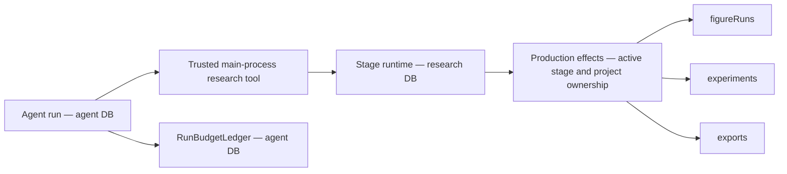

# Research optimization execution ledger

Task source: [execution plan](research-optimization-execution-plan.md).
User authorized sequential implementation and one commit per verified increment on 2026-11-03.
New contracts replace obsolete interfaces directly. No compatibility aliases are added.
Ownership, authorization, byte integrity and explicit failure contracts remain required.

## M0 — baseline and offline preparation

Status: `Verified passing` for local baseline and deterministic fixture contracts.

Workspace: `/Users/Apple_501/Desktop/Roc/Roc`, branch `main`.
Baseline: `c4bb32769b7815472966c6c620f143b914376752`.
Environment: Node `v26.13.0`, pnpm `12.5.1`, TypeScript `7.0.2`,
macOS `27.0.1` (`26A434`), `arm64`. No dependency installation required.

Pre-existing changes: `docs/README.md`, deletion of six Harness documents,
and untracked `plan/` source documents. These are excluded from implementation commits.
Relevant existing CodeGraph index used; no index creation or refresh.
ADRs 0020/0022/0023/0024/0025 reviewed.

The actual figure reproduction created
`research_run_13a5f9d6-617b-4a53-8455-3656497a44b1` and
`figure_run_3c8742c3-43fb-4852-9a40-a97ade07f30d` in isolated SQLite.
The figure remained `preparing`; passing its ID to the exposed experiment query raised
`research_experiment_not_found`. Its frozen role tools included `get_experiment`.
Evidence: `.artifacts/research-optimization/m0-figure-reproduction.log`.

### Ownership and storage

Agent and research plugins get separate managed SQLite connections through `DatabasePool`;
schemas, migrations, health probes and backup/restore apply per logical database.
The agent budget ledger is the existing authority for reservations and settlement.
Stage `createAgent()` currently runs outside that ledger. Research task accounting will use
the agent database authority for atomic aggregate admission; research execution rows retain
their own domain lifecycle. Cross-database execution startup must be idempotent and repairable,
without claiming one transaction spans both databases.

`research.*Owned` names in role profiles map to internal tool factories and production effects.
They are not public capability registrations. Public `research.figure.getRun` already exists
and uses `runId`; adding an internal owned read must not expose arbitrary renderer ownership.
Role names/policy/skill instructions are frozen in stage run snapshots. Changed tool contracts
must reject incompatible retries and require a new request.

### Samples and verification

Original CC0 synthetic PDF, metadata, CSV, TypeScript source, Vega-Lite specification,
LaTeX manuscript and bibliography are fixed in `tests/fixtures/research-workflow/manifest.json`.
PDF text/page and all byte hashes are exercised by
`tests/unit/research-workflow-fixture.test.mjs`. The sample is an engineering fixture, not an
independent scientific evaluation dataset.

Commands below ran from the workspace above:

| Command | Actual result |
| --- | --- |
| `pnpm typecheck` | Passed |
| `pnpm check:ipc` | Passed, generated files current |
| `node --test tests/unit/research-workflow-fixture.test.mjs tests/unit/research-job-cancellation.test.mjs tests/unit/database-migrations.test.mjs tests/unit/literature-import.test.mjs tests/unit/research-export-body-gate.test.mjs` | 32 passed, 0 failed |
| `pnpm harness:eval` | 94 deterministic cases passed |

Logs: `.artifacts/research-optimization/m0-{contracts,typecheck,ipc,harness}.log`.
These checks cover the current retrieval/import, job cancellation/cleanup, migration and
export body invariants; they do not establish live-provider quality or full scientific workflow
completion. PDF parsing here is PDF.js fixture readback, not a live OCR benchmark.

Real-model L2: `Blocked, not run`. No isolated account, trusted price table, task/total spend
limits or named operator authorization supplied. Continue offline runner and contract work.
No remote writes, public publication or model spending performed.

## Remaining scope

ROC-PR-02A/B/C, ROC-PR-03A/B, P0 integration, ROC-PR-04/05,
X-UI, ROC-PR-06/07/09, X-SAFE, ROC-PR-08, X-NB/X-EXP, X-IDEA/X-WRITE,
ROC-PR-10, X-ECO/X-MON and X-PERF/X-CONTEXT/X-OBS remain pending.

## ROC-PR-01 — owned figure polling and publication

Status: `Verified passing` for local tool contracts and real figure service integration.
Baseline: M0 commits `525b1ae2` and `5805839`.

The figure stage now exposes `get_figure` through the internal
`research.figure.getOwned` mapping. Start/query/publish all use `runId`; obsolete
`experimentId` figure inputs fail strict schema validation. Experiment tools keep their own
experiment contract. The effects boundary checks active stage, project and owner before reading.
No new public Owned IPC capability was registered; generated IPC remains current.
Old frozen figure snapshots cannot execute/retry with a changed contract; a new request is required.

The first regression failed against baseline. Real integration then found three additional
blockers needed to satisfy the planned start/query/publish path:

- Relative spec paths reached a job boundary requiring absolute paths.
- Default Vega padding expanded a requested 216×144 figure to 256×189 pixels/points.
- Published figures left their run snapshot's `artifactId` null.

Path resolution remains inside the existing file ownership boundary. Pipeline `/2` uses
fixed overall fit sizing and preserves physical SVG/PDF dimensions at high and fractional DPI.
Publication now attaches its artifact in the same SQLite transaction.
Original failure output is retained under
`.artifacts/research-optimization/figure-dimensions-before/`.
No validator was weakened. Fit limitations for composed/step-based Vega charts are documented.

Commands ran from `/Users/Apple_501/Desktop/Roc/Roc`:

| Command | Actual result |
| --- | --- |
| `node --test tests/unit/research-figure-owned.test.mjs tests/unit/research-figure-integration.test.mjs` | 9 passed before the additional fractional-size case |
| `node --test tests/unit/research-figure-integration.test.mjs` | Latest 3 passed: real render/publish, 300-DPI fractional dimensions, cancellation |
| `pnpm test:unit` | 582 passed, 0 failed |
| `pnpm check:ipc` | Passed, generated files current |
| `pnpm harness:eval` | 94 deterministic cases passed |
| `pnpm build` | Passed, includes typecheck and Electron production build |

Logs: `.artifacts/research-optimization/pr01-{before,contracts,integration,unit,ipc,harness,build}.log`.
The full unit run began before the additional fractional-size test was added; that final case
was independently exercised in the latest 3-case integration run.
Tests cover foreign project/owner rejection, terminal errors, restart interruption, stage
cancellation, request drift, duplicate starts/publication and immutable old snapshots.
Real renderer tests use original CC0 inputs and Skia PNG/SVG/PDF outputs. Human scientific
approval and real-model quality remain outside these deterministic checks.

Changed modules: role profiles/tools/prompts, production effects, stage snapshot execution,
figure renderer fingerprint/sizing, figure publication/run repositories, figure documentation
and focused tests. No model spending or external writes.
