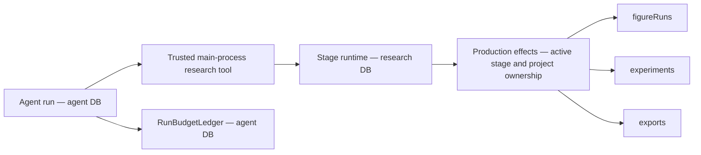

# Research optimization execution ledger

Task source: [execution plan](research-optimization-execution-plan.md).
User authorized sequential implementation and one commit per verified increment on 2026-11-03.
New contracts replace obsolete interfaces directly. No compatibility aliases are added.
Ownership, authorization, byte integrity and explicit failure contracts remain required.

## M0 — baseline and offline preparation

Status: `Verified passing` for local baseline and deterministic fixture contracts.

Workspace: `/Users/Apple_501/Desktop/Roc/Roc`, branch `main`.
Baseline: `c4bb32769b7815472966c6c620f143b914376752`.
Environment: Node `v26.13.0`, pnpm `12.5.1`, TypeScript `7.0.2`,
macOS `27.0.1` (`26A434`), `arm64`. No dependency installation required.

Pre-existing changes: `docs/README.md`, deletion of six Harness documents,
and untracked `plan/` source documents. These are excluded from implementation commits.
Relevant existing CodeGraph index used; no index creation or refresh.
ADRs 0020/0022/0023/0024/0025 reviewed.

The actual figure reproduction created
`research_run_13a5f9d6-617b-4a53-8455-3656497a44b1` and
`figure_run_3c8742c3-43fb-4852-9a40-a97ade07f30d` in isolated SQLite.
The figure remained `preparing`; passing its ID to the exposed experiment query raised
`research_experiment_not_found`. Its frozen role tools included `get_experiment`.
Evidence: `.artifacts/research-optimization/m0-figure-reproduction.log`.

### Ownership and storage

Agent and research plugins get separate managed SQLite connections through `DatabasePool`;
schemas, migrations, health probes and backup/restore apply per logical database.
The agent budget ledger is the existing authority for reservations and settlement.
Stage `createAgent()` currently runs outside that ledger. Research task accounting will use
the agent database authority for atomic aggregate admission; research execution rows retain
their own domain lifecycle. Cross-database execution startup must be idempotent and repairable,
without claiming one transaction spans both databases.

`research.*Owned` names in role profiles map to internal tool factories and production effects.
They are not public capability registrations. Public `research.figure.getRun` already exists
and uses `runId`; adding an internal owned read must not expose arbitrary renderer ownership.
Role names/policy/skill instructions are frozen in stage run snapshots. Changed tool contracts
must reject incompatible retries and require a new request.

### Samples and verification

Original CC0 synthetic PDF, metadata, CSV, TypeScript source, Vega-Lite specification,
LaTeX manuscript and bibliography are fixed in `tests/fixtures/research-workflow/manifest.json`.
PDF text/page and all byte hashes are exercised by
`tests/unit/research-workflow-fixture.test.mjs`. The sample is an engineering fixture, not an
independent scientific evaluation dataset.

Commands below ran from the workspace above:

| Command | Actual result |
| --- | --- |
| `pnpm typecheck` | Passed |
| `pnpm check:ipc` | Passed, generated files current |
| `node --test tests/unit/research-workflow-fixture.test.mjs tests/unit/research-job-cancellation.test.mjs tests/unit/database-migrations.test.mjs tests/unit/literature-import.test.mjs tests/unit/research-export-body-gate.test.mjs` | 32 passed, 0 failed |
| `pnpm harness:eval` | 94 deterministic cases passed |

Logs: `.artifacts/research-optimization/m0-{contracts,typecheck,ipc,harness}.log`.
These checks cover the current retrieval/import, job cancellation/cleanup, migration and
export body invariants; they do not establish live-provider quality or full scientific workflow
completion. PDF parsing here is PDF.js fixture readback, not a live OCR benchmark.

Real-model L2: `Blocked, not run`. No isolated account, trusted price table, task/total spend
limits or named operator authorization supplied. Continue offline runner and contract work.
No remote writes, public publication or model spending performed.

## Remaining scope

ROC-PR-02B/C, ROC-PR-03A/B, P0 integration, ROC-PR-04/05,
X-UI, ROC-PR-06/07/09, X-SAFE, ROC-PR-08, X-NB/X-EXP, X-IDEA/X-WRITE,
ROC-PR-10, X-ECO/X-MON and X-PERF/X-CONTEXT/X-OBS remain pending.

## ROC-PR-01 — owned figure polling and publication

Status: `Verified passing` for local tool contracts and real figure service integration.
Baseline: M0 commits `525b1ae2` and `5805839`.

The figure stage now exposes `get_figure` through the internal
`research.figure.getOwned` mapping. Start/query/publish all use `runId`; obsolete
`experimentId` figure inputs fail strict schema validation. Experiment tools keep their own
experiment contract. The effects boundary checks active stage, project and owner before reading.
No new public Owned IPC capability was registered; generated IPC remains current.
Old frozen figure snapshots cannot execute/retry with a changed contract; a new request is required.

The first regression failed against baseline. Real integration then found three additional
blockers needed to satisfy the planned start/query/publish path:

- Relative spec paths reached a job boundary requiring absolute paths.
- Default Vega padding expanded a requested 216×144 figure to 256×189 pixels/points.
- Published figures left their run snapshot's `artifactId` null.

Path resolution remains inside the existing file ownership boundary. Pipeline `/2` uses
fixed overall fit sizing and preserves physical SVG/PDF dimensions at high and fractional DPI.
Publication now attaches its artifact in the same SQLite transaction.
Original failure output is retained under
`.artifacts/research-optimization/figure-dimensions-before/`.
No validator was weakened. Fit limitations for composed/step-based Vega charts are documented.

Commands ran from `/Users/Apple_501/Desktop/Roc/Roc`:

| Command | Actual result |
| --- | --- |
| `node --test tests/unit/research-figure-owned.test.mjs tests/unit/research-figure-integration.test.mjs` | 9 passed before the additional fractional-size case |
| `node --test tests/unit/research-figure-integration.test.mjs` | Latest 3 passed: real render/publish, 300-DPI fractional dimensions, cancellation |
| `pnpm test:unit` | 582 passed, 0 failed |
| `pnpm check:ipc` | Passed, generated files current |
| `pnpm harness:eval` | 94 deterministic cases passed |
| `pnpm build` | Passed, includes typecheck and Electron production build |

Logs: `.artifacts/research-optimization/pr01-{before,contracts,integration,unit,ipc,harness,build}.log`.
The full unit run began before the additional fractional-size test was added; that final case
was independently exercised in the latest 3-case integration run.
Tests cover foreign project/owner rejection, terminal errors, restart interruption, stage
cancellation, request drift, duplicate starts/publication and immutable old snapshots.
Real renderer tests use original CC0 inputs and Skia PNG/SVG/PDF outputs. Human scientific
approval and real-model quality remain outside these deterministic checks.

Changed modules: role profiles/tools/prompts, production effects, stage snapshot execution,
figure renderer fingerprint/sizing, figure publication/run repositories, figure documentation
and focused tests. No model spending or external writes.

## ROC-PR-02A — trusted task identity and dispatch

Status: `Verified passing` for local task identity, dispatch and persistence contracts.
Baseline: `9ba15a00`.

Research tasks and immutable execution associations live in the agent database (migration 11).
Stage runs store their task ID in the research database (migration 6).
Existing snapshots acquire an explicit null task ID; no historical chat parentage is inferred.
Startup repairs task links only when the authority already contains the matching execution.

Chat dispatch requires a one-use, short-lived broker reference bound to a running chat,
thread, project, frozen manifest and exact stage request. Copied tokens, request drift,
expired/revoked references, changed project/manifest and inactive parents fail before scheduling.
The reference crosses the capability call through main-process asynchronous context.
It never enters renderer input or model arguments.

Direct stage starts create independent roots. Retries share the previous task. Review
roles preserve scientific stage parentage separately from chat parent execution.
Experiments, figures and exports associate before background work starts. Association failure
records a failed domain execution and sends no model/rendering request.
Public capability and IPC schemas reject ownerRunId; internal production effects supply it.
No compatibility aliases or permissive failure fallbacks were added.

Commands ran from `/Users/Apple_501/Desktop/Roc/Roc`:

| Command | Actual result |
| --- | --- |
| `pnpm test:unit` | 592 passed, 0 failed |
| `pnpm harness:eval` | 94 deterministic cases passed |
| `pnpm generate:ipc` and `pnpm check:ipc` | Passed, generated files current |
| `pnpm build` | Passed, includes typecheck |
| `node --test tests/unit/research-task-identity.test.mjs tests/unit/ipc-execution-boundary.test.mjs tests/unit/database-migrations.test.mjs tests/unit/research-figure-integration.test.mjs` | Final consumer audit: 24 passed, 0 failed |
| `git diff --check` | Passed |

The final IPC consumer correction occurred after the full unit run; the focused final run
exercised actual public IPC parsing and all affected contracts, and production build was repeated.
Logs: `.artifacts/research-optimization/pr02a-{unit,harness,ipc,build,contracts-final}.log`.
This increment establishes execution identity, not unified budget admission or task cancellation.
Those remain ROC-PR-02B/02C. Real-model L2 and scientific review remain unrun.

## ROC-PR-03A — offline protocol and runner foundation

Status: `Verified passing` for offline protocol, runner and data audit.
The full reviewed corpus and live Harness adapter remain `Blocked, not run`.

Protocol v2 requires complete baseline/candidate commit SHAs and permits same-model
comparisons across different commits. Active runner configuration is copied and frozen.
Each task receives three fixed paired repetitions, with counterbalanced arm order.
Adapters receive only the public task view. Independent validators never execute output scripts.
Null, invalid, oversized and failed outputs remain classified in the fixed denominator.
Unsent calls have zero spend; dispatched calls with unknown consumption retain their full ceiling.
Cost ceiling violations and unconfirmed aborts block later dispatch.

Exclusive journals are synced before each call and refuse rerun after process restart.
Reports distinguish fixture execution from live-model evidence.
No live adapter, model call, external account access or external write occurred.
Trusted adapter ceilings alone do not prove Provider enforcement or sandbox fidelity.

The current pilot has 16 tasks, all in the pilot split. Literature/evidence/memory/file/script
families have one source cluster each; the other three families have two clusters each.
The audit reports these actual deficits. No task duplicates or fabricated human reviews
were added to reach the target of 200. Domain review and independent train/dev/holdout
data remain necessary before full quality claims.

Commands ran from `/Users/Apple_501/Desktop/Roc/Roc`:

| Command | Actual result |
| --- | --- |
| `node --test tests/unit/quality-evaluation.test.mjs tests/unit/quality-runner.test.mjs` | Final 17 passed, 0 failed |
| `pnpm typecheck` | Passed, includes runner |
| `pnpm harness:quality:check` | Passed, reports actual pilot deficits, zero model/network calls |
| `pnpm harness:eval` | 94 deterministic cases passed |
| `pnpm check:ipc` | Passed |
| `git diff --check` | Passed |

Logs: `.artifacts/research-optimization/pr03a-{contracts,typecheck,audit,harness,ipc}.log`.
Continue authorized offline PR-02B/02C while the independent corpus, live adapter,
isolated credentials, attributable prices and spending authorization are prepared.

## ROC-PR-02B — shared task and stage accounting

Status: `Verified passing` for shared task/stage admission and model accounting.
Project-wide budget configuration remains pending.

Agent migration 12 preserves existing calls and progress records while admitting linked
stage executions. Tasks freeze their parent chat policy or the explicit direct-root default.
Missing historical task policies reject dispatch; no guessed caps are introduced.
One immediate SQLite transaction checks task and execution calls, tokens, concurrency
and integer microdollar reservations. Linking a chat attaches its existing calls once.
Unknown consumption survives restart. Permanent stop reasons survive retries and stages.
Temporary concurrency denial does not permanently stop a task.

Stage createAgent now uses the existing budget middleware and observer, with a capped
model output. The real structured-output handler returns messages with structuredResponse;
the middleware reads its raw AIMessage for trustworthy usage. Successful stage settlement
reads stage budget status without requiring a chat row. Envelopes record provider/model.
No model/network calls occurred; the integration model is a local BaseChatModel fixture.
Dollar-capped dispatch without trustworthy pricing rejects.

Commands ran from `/Users/Apple_501/Desktop/Roc/Roc`:

| Command | Actual result |
| --- | --- |
| `pnpm test:unit` | Final 610 passed, 0 failed |
| `pnpm harness:eval` | Final 94 deterministic cases passed |
| `node --test tests/unit/research-task-budget.test.mjs tests/unit/run-budget-observer.test.mjs` | Final 15 passed, including actual createAgent success/failure |
| `pnpm typecheck` | Passed |
| `pnpm build` | Final production build passed |
| `pnpm check:ipc` | Passed |
| `git diff --check` | Passed |

Logs: `.artifacts/research-optimization/pr02b-{unit,harness,success,typecheck,build,ipc}.log`.
Task cancellation, aggregate diagnostics and shell presentation continue in PR-02C.

## ROC-PR-02C.1 — persistent task cancellation

Status: `Verified passing` for the task cancellation API and cleanup propagation.
Pause, continuation, interruption diagnostics and shell presentation remain pending.

Task cancellation persists the cancelled identity before aborting executions. Shared budget
admission and stage retries refuse cancelled tasks before starting another execution.
Task get, execution tree and cancel capabilities have strict project-scoped IPC contracts.
Agent cancellation resolves its trusted task association and awaits task cleanup, including
when the chat has already ended but its stage is still active.
Task status prevents cancellation recursion.

Only the task's stage roots, review children, owned jobs and direct domain jobs stop.
Owned domain cleanup uses existing stage cleanup; direct experiment, figure and export
tasks use their own services. Concurrent cancellation requests share one pending cleanup.
Cleanup errors are reported after all affected operations settle.
Late model output cannot publish an artifact or run the human gate.
No separate shell, compatibility alias or model/network call was added.

Commands ran from `/Users/Apple_501/Desktop/Roc/Roc`:

| Command | Actual result |
| --- | --- |
| `pnpm test:unit` | Final 616 passed, 0 failed |
| `pnpm harness:eval` | Final 94 deterministic cases passed |
| `pnpm generate:ipc` and `pnpm check:ipc` | Passed |
| `pnpm build` | Final production build and typecheck passed |
| `git diff --check` | Passed |

Unit coverage includes the actual Agent plugin capability, actual stage runtime, review
child termination, unrelated active stage isolation, delayed cleanup, late output,
direct domain service routing, cleanup failure, persistent identity and IPC boundaries.
Logs: `.artifacts/research-optimization/pr02c-{unit,harness,build,ipc,contracts}.log`.

## ROC-PR-02C.2 — stage pause, continuation and recovery states

Status: `Verified passing` for stage lifecycle and persisted task states.
Aggregate diagnostics, task events, approval-only pause restoration and shell controls remain pending.

Task schema v2 and agent migration 13 distinguish active, paused, waiting approval,
interrupted, failed, cancelled and completed states. Status reasons persist with snapshots;
the checked task status column governs budget admission. Migration upgrades old task records
without inventing execution links or reasons. A schema change is required because the existing
migration engine skips data-only SQL when schema objects already match.

Pause refuses new dispatch before stopping executions and awaits cleanup.
The task policy explicitly keeps its original deadline running during pause.
Continuation of stopped stage work creates a new execution under the same task and frozen
budget. Failed continuation rolls back task activation; old executions remain terminal.
Existing stage retries can explicitly continue failed/interrupted/paused tasks.
Cancelled tasks require the task continuation API.
Permanent budget stop reasons and unknown reservations are retained.

Restart interrupts only linked executions actually left running, preserves cancelled identity,
and starts no new execution. Human approval remains distinct from task completion.
Task states follow actual gate outcomes. A stage cancellation signal is checked again before
the human gate commits after asynchronous verification, fencing late workflow advancement.

Commands ran from `/Users/Apple_501/Desktop/Roc/Roc`:

| Command | Actual result |
| --- | --- |
| `pnpm test:unit` | Final 623 passed, 0 failed |
| `pnpm harness:eval` | Final 94 deterministic cases passed |
| `pnpm generate:ipc` and `pnpm check:ipc` | Passed |
| `pnpm build` | Final production build and typecheck passed |
| `git diff --check` | Passed |

Seven lifecycle regressions exercise pause cleanup, unchanged deadline/budget, new execution
identity, activation rollback, real approval, cancellation during verification, restart and
the real v12 database upgrade. Logs: `.artifacts/research-optimization/pr02c-lifecycle-*.log`.

## ROC-PR-02C.3 — task diagnostics and approval restoration

Status: `Verified passing` for authoritative summaries and paused approval restoration.
Task event correlation and shell presentation remain pending.

Task and execution budget views share one aggregation implementation and the same call rows.
The task summary reports known, unknown and reserved consumption without adding run totals
again. Domain diagnostics expose execution status, actual model identity, error codes,
timestamps, parent associations and artifact IDs. Prompt envelopes and credentials are omitted.
External service costs remain explicitly unknown, separate from application model amounts.
Chat lookup validates the persisted thread and task project before returning diagnostics.
It supports the actual chat lifecycle states, including recovery and dispatch transitions.

Paused approval can be restored to waiting approval without recreating the completed stage,
resetting its budget/deadline or calling a model. Pending cleanup still blocks restoration.
The diagnostics contract identifies stopped stage continuation and approval restoration
from authoritative domain records, not renderer counters.

Commands ran from `/Users/Apple_501/Desktop/Roc/Roc`:

| Command | Actual result |
| --- | --- |
| `pnpm test:unit` | 626 passed, 0 failed |
| `pnpm harness:eval` | 94 deterministic cases passed |
| `node --test tests/unit/research-task-diagnostics.test.mjs tests/unit/research-task-cancellation.test.mjs tests/unit/research-task-lifecycle.test.mjs tests/unit/run-budget-ledger.test.mjs` | Final consumer audit: 19 passed, 0 failed |
| `pnpm generate:ipc` and `pnpm check:ipc` | Passed |
| `pnpm build` | Final production build and typecheck passed |
| `git diff --check` | Passed |

The final consumer audit expanded diagnostics to the canonical chat status schema after
the full unit run. Focused contracts and production build were repeated after that change.
Logs: `.artifacts/research-optimization/pr02c-diagnostics-*.log`. No model/network calls.

## ROC-PR-02C.4 — durable task and model-call events

Status: `Verified passing` for task event correlation and replay.
Shell presentation and live invalidation remain pending.

Agent migration 14 records task creation/status, execution linkage, prior-call attribution,
reservations, settlement and startup uncertainty. SQLite triggers write each event in the
same transaction as its authoritative change. Activation rollback removes its status event;
denied/duplicate calls and duplicate settlement create no success event.
Events carry task, execution kind/ID and call ID, with monotonic sequence cursors.
Project-scoped replay uses explicit page size and cursor and returns actual stored events.
Migration retains existing tasks without fabricating historical event rows.
Event payloads contain no prompt envelopes or credentials.

Commands ran from `/Users/Apple_501/Desktop/Roc/Roc`:

| Command | Actual result |
| --- | --- |
| `pnpm test:unit` | Final 630 passed, 0 failed |
| `pnpm harness:eval` | Final 94 deterministic cases passed |
| `pnpm generate:ipc` and `pnpm check:ipc` | Passed |
| `pnpm build` | Final production build and typecheck passed |
| `git diff --check` | Passed |

Coverage includes actual createAgent success/failure correlation, prior billed chat linkage,
startup unknown conversion, rollback, duplicate attempts, pagination/project isolation and
the real v13 database upgrade. Logs: `.artifacts/research-optimization/pr02c-events-*.log`.
No model/network calls; integration model attempts use local fixtures.

## ROC-PR-02C.5 — live invalidation and cleanup refusal

Status: `Verified passing` for backend notifications and persistent cleanup failure.
Shell presentation remains pending.

Native task notifications carry only task and project identifiers. Trusted linkage,
model budget observations, terminal stage state and task actions invalidate persisted
diagnostics. Delivery failure logs a warning without changing accounting or execution.
Cleanup failures persist their reason; continuation and approval restoration refuse
unconfirmed cleanup. Foreign-project requests produce no notification.

Commands ran from `/Volumes/Macintosh HD/Users/Apple_501/Desktop/Roc/Roc`:

| Command | Actual result |
| --- | --- |
| `pnpm test:unit` | 633 passed, 0 failed |
| `pnpm harness:eval` | 94 deterministic cases passed |
| `pnpm generate:ipc` and `pnpm check:ipc` | Passed |
| `pnpm build` | Production build and typecheck passed |
| `LANGSMITH_TRACING=false LANGCHAIN_TRACING_V2=false ROC_SMOKE_TARGET=dist node scripts/smoke-electron.mjs` | 12/12 passed, zero renderer errors, exit 0 |
| `git diff --check` | Passed |

Logs: `.artifacts/research-optimization/pr02c-notifications-*.log`.
Smoke used temporary application data/workspace and a local stub Provider.
No paid model requests or tracing exports.

## ROC-PR-02C.6 — assistant controls and management task diagnostics

Status: `Verified passing` for shell presentation, cursor task listing and event replay.
PR-02C implementation is complete; broader P0 integration remains pending.

The assistant shows persisted task progress and known/unknown/reserved budget amounts.
Pause, whole-task cancellation, continuation and approval restoration use authoritative
APIs. Pending stop actions remain pending until resource cleanup responds; failures remain
visible and unconfirmed cleanup disables continuation. User actions are the only dispatch
trigger. A task notification invalidates reads rather than incrementing a local counter.

The existing management drawer lists project tasks with stable creation cursors and shows
parent execution associations, provider/model identity, timestamps/duration, errors,
artifact IDs and paginated stored events. The shell owns selected task identity.
Project/thread/task changes drop stale reads and notification subscriptions are disposed.
Task metadata uses 12px system tokens. No extra route, shell or dependency was added.

Commands ran from `/Volumes/Macintosh HD/Users/Apple_501/Desktop/Roc/Roc`:

| Command | Actual result |
| --- | --- |
| `pnpm test:unit` | 634 passed, 0 failed |
| `pnpm harness:eval` | 94 deterministic cases passed |
| `pnpm generate:ipc` and `pnpm check:ipc` | Passed |
| `pnpm build` | Final production build and typecheck passed |
| `pnpm check:renderer-chunks` | Passed; eager JS 1,131,037 bytes across 6 files |
| `pnpm test:renderer` | Parallel run: 42 passed, 2 existing window/anchor tests timed out |
| `node --test --test-concurrency=1 tests/renderer/` | 44 passed, 0 failed before the final pagination test addition |
| `node --test tests/renderer/research-tasks.test.mjs` | Final 8 passed, 0 failed including added task pagination |
| `LANGSMITH_TRACING=false LANGCHAIN_TRACING_V2=false ROC_SMOKE_TARGET=dist node scripts/smoke-electron.mjs` | 12/12 passed, zero renderer errors, exit 0 |
| `git diff --check` | Passed |

The parallel renderer failures were transcript anchor and settings dialog focus timeouts;
their unchanged checks passed with serialized test files. The new renderer suite first
failed because its audit helper was evaluated as a function without invocation; corrected
the invocation and retained the cut=0 assertion. No production check was relaxed.

Logs: `.artifacts/research-optimization/pr02c-ui-*.log`. Real Electron screenshots and
four light/dark assistant/drawer audits are in `.artifacts/research-optimization/task-ui/`;
each audit reports cut=0 and hidden=0. The isolated smoke uses a localhost stub Provider.
No paid model requests or tracing exports. Artifact opening/inspection belongs to X-UI.

## ROC-PR-02B.2 — project-wide model budget authority

Status: `Verified passing` for project/task/stage model admission and explicit configuration.
Project model budgets are now complete; P0 integration/live evaluation remain pending.

Agent migration 15 attributes original call rows to their trusted project and records the
project policy revision used for each new model reservation. Root chats use their frozen
project snapshot before any research stage association. Later task linkage does not create
another call or charge. Historical calls gain only stored project attribution; historical
budgets/revisions are not invented.

An explicit project policy caps model calls, concurrency, aggregate Tokens and optional
integer microdollar cost. Missing policies refuse model dispatch. Project, task and stage
admission plus call INSERT share the same SQLite immediate transaction. Unknown attempts
retain their ceilings; missing cost ceilings reject dollar-capped dispatch. Revision history
is immutable, all project consumption remains cumulative, and raising a cap does not reset
spend. Temporary concurrency refusal is not permanent. A delayed old-policy refusal cannot
block a new policy revision. Project stop reasons do not permanently exhaust task budgets.

The existing management drawer provides explicit project budget configuration and live
known/unknown/reserved summaries. Writes retain the draft's original revision, surface
conflicts and lock inputs until completion. Native get/save/notification IPC validates the
project and contains no model prompts. Smoke fixtures configure their isolated budget.

Commands ran from `/Volumes/Macintosh HD/Users/Apple_501/Desktop/Roc/Roc`:

| Command | Actual result |
| --- | --- |
| `pnpm test:unit` | Final 641 passed, 0 failed |
| `pnpm harness:eval` | Final 94 deterministic cases passed |
| `pnpm generate:ipc` and `pnpm check:ipc` | Passed |
| `pnpm build` | Final production build and typecheck passed |
| `pnpm check:renderer-chunks` | Passed; eager JS 1,131,037 bytes across 6 files |
| `node --test --test-concurrency=1 tests/renderer/` | 47 passed before the final write-lock review |
| `node --test tests/renderer/research-tasks.test.mjs` | Final 10 passed including project policy configuration/revision and pending write locks |
| `LANGSMITH_TRACING=false LANGCHAIN_TRACING_V2=false ROC_SMOKE_TARGET=dist node scripts/smoke-electron.mjs` | 12/12 passed, zero renderer errors, exit 0 |
| `git diff --check` | Passed |

Initial failures were outdated v14 assertions, two hand-written database fixtures and
missing required thread goal/workspace values in new fixtures. The hand-written ledger
schema was removed in favor of real migrations, and required inputs were supplied without
relaxing constraints. Seven project regressions cover independent task competition, two
connections, retained unknown spend, actual provider refusal, root chat attribution, v14
migration, project ownership/revisions and stale-policy refusal.

Logs: `.artifacts/research-optimization/pr02b-project-*.log`. All model attempts are local
fixtures or the isolated localhost smoke Provider. No paid requests or tracing exports.

## P0.1 — fixed-data experiment, figure and human gate integration

Status: `Verified passing` for this bounded offline production chain. Full P0 remains
unfinished: retrieval/PDF/manuscript/review/export and the fault matrix need separate
checks; live L2 still requires isolated credentials, pricing and spending authorization.

The real TypeScript service launches Electron as Node under the native sandbox and Node
permissions, computes A=2/B=4 from the frozen CSV, indexes the output and publishes the
experiment. The figure stage captures that actual located result as evidence, renders
PNG/SVG/PDF with Skia, polls the correct figure repository, publishes and completes both
human gates. Chat, stage and owned domain jobs share one task identity. Original call
rows account for three local fixture attempts and 60 settled Tokens; costs remain unknown.

This regression exposed a production startup failure: the sandbox allowed Electron's
executable but omitted its bundled Frameworks. The bundled-node environment now declares
that directory for read access. Execution, networking and writes retain their existing
policies. The test uses public published figure source reads and actual template/export
services for cleanup; no approval or source evidence is mocked. The role model response
and tool choices are deterministic fixtures, so this does not establish model quality.

Commands ran from `/Users/Apple_501/Desktop/Roc/Roc`:

| Command | Actual result |
| --- | --- |
| `LANGSMITH_TRACING=false LANGCHAIN_TRACING_V2=false node --test tests/unit/research-p0-production-integration.test.mjs` | 1 passed; real process, renderer and approval |
| `LANGSMITH_TRACING=false LANGCHAIN_TRACING_V2=false pnpm test:unit` | 642 passed, 0 failed |
| `pnpm harness:eval` | 94 deterministic cases passed |
| `pnpm build` | Production build and typecheck passed |
| `pnpm check:ipc` | Passed |

Failed draft runs retained in planning progress: missing raw C loader, missing cleanup
dependency, then the reproduced dyld refusal and the correctly refused evidence-free
figure approval. Checks were corrected against real contracts; no human gate was relaxed.

Logs: `.artifacts/research-optimization/p0-*.log`. Real output files, SHA-256 records,
located evidence, sanitized task diagnostics, events, runtime identity and both database
backups are retained under `.artifacts/research-optimization/p0-production/<taskId>/`.
No paid Provider request, tracing upload or remote write occurred.

Final isolated Electron smoke:
`LANGSMITH_TRACING=false LANGCHAIN_TRACING_V2=false ROC_SMOKE_TARGET=dist node scripts/smoke-electron.mjs`
passed 12/12 with zero renderer errors and exit 0.

Follow-up discovery: the pinned toolchain exists at `.runtime/research-toolchain/darwin-arm64`;
the actual ResearchToolchain.status check verified its manifest and locked versions
(Tectonic 0.17.0, Vale 3.24.0, Typst 0.15.0). Missing system PATH binaries do not block
the next local manuscript/export integration.

## P0.2 — standard offline research workflow and real export

Status: `Verified passing` for the standard fixture chain and the report-failure case.
P0's other failure scenarios and authorized live L2 evaluation remain unfinished.

A trusted chat task now exercises discovery, frozen literature search, explicit import,
actual source PDF parsing and located evidence capture, ideation/planning, frozen TypeScript
data execution, published Skia figures, evidence-backed manuscript, three review children
and synthesis, human acceptance, native Tectonic/Typst compilation, export approval and
local ZIP delivery. Search/model responses are deterministic local fixtures. Parsing and
figure/PDF rendering call actual production implementations in process, so this does not
establish packaged-worker isolation, OCR or model quality.

The standard task has 17 executions and 14 original model calls / 280 settled Tokens.
Costs remain unknown. Source/output/ZIP SHA-256 values, execution tree, events, budgets,
source evidence, both databases, compiled PDFs and first-page previews are retained.
PDF text readback verifies A=2/B=4 and the report's project identity. Both previews were
visually inspected: chart bounds, text, captions/references and Chinese report tables render.

True export exposed a Typst bug: paths relative to rootPath were evaluated with jobDir cwd.
The compiler now runs in rootPath. Report generation is a required part of the delivery
contract; the old catch that returned success without report.pdf/report.typ was removed
under the user's no-defensive-code instruction. Export docs and ADR 0025 reflect the new
behavior. An injected Typst refusal now persists a failed export/stage/task and diagnostic,
with no archive or artifact. Publication and local write both refuse it.

Native-toolchain scenarios moved to `tests/integration/research-p0-production.test.mjs`
and `pnpm test:research-p0`; ordinary unit checks do not require a prepared .runtime.
The suite requires and verifies actual pinned tools, with no missing-tool skips.

Commands ran from `/Users/Apple_501/Desktop/Roc/Roc`:

| Command | Actual result |
| --- | --- |
| `pnpm test:research-p0` | Final 3 passed including real PDF readback/previews and report-failure refusal |
| `LANGSMITH_TRACING=false LANGCHAIN_TRACING_V2=false pnpm test:unit` | 641 passed, 0 failed |
| `pnpm harness:eval` | 94 deterministic cases passed |
| `pnpm build` | Production build and typecheck passed |
| `pnpm check:ipc` | Passed |

Draft failures were a guessed library list request, a guessed PDF chunk identity, a
shared fixture-model structured tool name across review children, and the real Typst
path failure. Fixture errors were corrected against actual APIs; temporary wrappers
were removed. No Provider spending, tracing upload, remote write or compatibility alias.
Logs: `.artifacts/research-optimization/p0-standard-*.log`. Outputs: the P0 production
artifact directory. Remaining P0 work is the cancellation/restart/stale-approval/retry/
unknown-usage/MCP/hostile-document matrix and packaged-worker checks.

Final P0.2 isolated Electron smoke:
`LANGSMITH_TRACING=false LANGCHAIN_TRACING_V2=false ROC_SMOKE_TARGET=dist node scripts/smoke-electron.mjs`
passed 12/12, zero renderer errors, exit 0.

## P0.3 — built worker isolation and strict worker availability

Status: `Verified passing` for native metadata/PDF/figure/preview workers. The remaining
P0 fault matrix and live L2 evaluation are still unfinished.

The P0 command now builds current production output and launches its test runner under
Electron's Node runtime. Fixtures copy the actual built CLI/chunks into an isolated module
directory. Metadata import, PDF parsing, Skia rendering and PDF previews run real child
processes under the native sandbox. The same full workflow and failed-report cases pass
without an in-process rendering/parser substitute. This verifies built-worker behavior,
not a signed release bundle or OCR model quality.

Real isolation found two product errors. Figure source paths are relative on the wire,
but the sandbox read list required absolute paths. The source is already inside the
readable frozen projectRoot, so the duplicate source grant was removed. The handwritten
package list omitted static/transitive CLI dependencies (the first refusal was yauzl).
Worker reads now use the application's package.json and installed node_modules code
directory, including pnpm links. Write, network, process and model-data boundaries are
unchanged. Missing application package scope fails explicitly.

The old jobInProcess downgrade and its ignored package-resolution errors were removed.
Every missing production worker now rejects with research_worker_unavailable. A regression
went red against the old path (metadata processing executed and raised a data error), then
passed after removal. Fixture cleanup hooks now remain at module scope; registration
inside before had removed worker files before the scenarios could exercise them.

Commands ran from `/Users/Apple_501/Desktop/Roc/Roc`:

| Command | Actual result |
| --- | --- |
| `pnpm test:research-p0` | Fresh production build/typecheck passed; initial final run passed 2/3 before a fixture preview-path correction |
| `node scripts/run-research-p0.mjs` | Final 3/3 native worker scenarios passed after moving fixture preview output under its writable job directory |
| `LANGSMITH_TRACING=false LANGCHAIN_TRACING_V2=false pnpm test:unit` | 642 passed, 0 failed |
| `pnpm harness:eval` | 94 deterministic cases passed |
| `pnpm check:ipc` | Passed |
| `git diff --check` | Passed |

The sandbox correctly rejected a fixture preview outside jobDir; the fixture was corrected
without granting additional writes. Host Homebrew Node was unsuitable for an Electron
worker test due to dylib paths; tests now use the actual Electron executable. All temporary
DEBUG-p0-worker instrumentation was removed. Logs: `.artifacts/research-optimization/p0-worker-*.log`.
Native outputs, task/accounting/event receipts and both DB backups remain in the P0
production artifact directory. No paid model request, tracing upload or remote write.

- P0.3 final isolated Electron smoke: `LANGSMITH_TRACING=false LANGCHAIN_TRACING_V2=false ROC_SMOKE_TARGET=dist node scripts/smoke-electron.mjs` passed 12/12, zero renderer errors, exit 0.

## P0.4 — native budget, cancellation, source and retry faults

Status: `Verified passing` for five core P0 fault scenarios. Restart, hostile PDF and
MCP unknown-side-effect integration remain pending, along with live L2 prerequisites.

The native suite now proves that a task model cap stops before the next actual SDK attempt
and persists the same stage/task/budget reason; missing model usage retains one original
unknown call and a nonzero token ceiling; and a figure published before stage failure is
retained on retry, with one native figure job/publication and both stage identities.
Retries use the frozen explicit Provider/model, and artifact/model provenance is retained.

Cancellation waits until a real native child creates its render directory while its owned
job is running. The task/controller then cancels the stage, renderer and chat identity,
waits for cleanup and rejects late publication. A separate human-approval race reparses
the actual source PDF during verification. Its old evidence reference becomes superseded;
approval refuses, leaves the artifact draft and task waiting, and records source/evidence/
parse IDs and source hash. Editing claims while waiting was correctly refused; that draft
probe was replaced with the legitimate source reparse event rather than bypassing the guard.

Every fault retains task diagnostics, original sanitized call rows, events, native execution
file/hash lists, both databases and changed/refused object identities under the P0 production
artifact directory. The fixture makes SDK/tool choices; these checks establish hard contracts,
not live model attack resistance or scientific quality.

Commands ran from `/Users/Apple_501/Desktop/Roc/Roc`:

| Command | Actual result |
| --- | --- |
| `node scripts/run-research-p0.mjs '--test-name-pattern=task model cap|untrusted model usage|stage retry'` | Final 3/3 passed |
| `node scripts/run-research-p0.mjs '--test-name-pattern=cancelling a task|claim version change'` | Cancellation passed; initial illegal fixture claim edit was correctly refused |
| `node scripts/run-research-p0.mjs '--test-name-pattern=source PDF reparse'` | Final 1/1 passed with real source reparse/invalidation |
| `pnpm test:research-p0` | Fresh production build/typecheck and all 8 native integration scenarios passed |
| `git diff --check` | Passed |

No product implementation changed in this increment. Runner supports Node test selection
flags. Unknown usage produces call_unknown instead of a successful settlement event; the
fixture now asserts that actual event. No check was weakened, no paid calls or remote writes.
Logs: `.artifacts/research-optimization/p0-fault-*.log`.

## P0.5 — native experiment and figure restart recovery

Status: `Verified passing` for two offline restart scenarios. Hostile PDF and MCP
unknown-side-effect integration remain pending. Live L2 prerequisites are unchanged.

The suite waits for a real sandboxed experiment output marker or native figure render
marker, backs up both databases while the job and stage are running, and shuts down the
owned native process. Reopening those running snapshots exercises the actual startup
budget, dispatch-grant, stage, experiment and figure recovery methods. Running executions
become interrupted, their ownership and task identities survive, an outstanding model
reservation remains unknown, issued grants are revoked, and late publication refuses.
No new stage or Provider request is automatically dispatched. Graceful cleanup cancels
the original owned job; the reopened crash snapshot correctly records it as interrupted.
This is persisted crash-state recovery with real child cleanup, not an OS process-kill test.

Command from `/Users/Apple_501/Desktop/Roc/Roc`:
`node scripts/run-research-p0.mjs '--test-name-pattern=restart during'` passed 2/2.
`git diff --check` passed. No product code changed, so no rebuild was needed.
Log: `.artifacts/research-optimization/p0-restart.log`. Before/after DB snapshots,
original running identities, recovered file/hash lists, diagnostics and events are retained
under `.artifacts/research-optimization/p0-production/<taskId>/`.

## P0.6 — hostile PDF and native secret boundaries

Status: `Verified passing` for the offline hostile-document contract scenario. MCP
unknown-side-effect integration is still pending; live model attack quality is untested.

An original Tectonic PDF contains actual authority-escalation and secret-exfiltration
instructions. The isolated parser reads those instructions, but the parent manifest and
issued grant count remain unchanged. Cross-project dispatch, cross-project production
read, out-of-workspace traversal and unavailable reading-stage shell/MCP/write tools
are refused. The real experiment then attempts to read and overwrite a synthetic secret
outside its frozen inputs. Node permission denies both accesses; the secret is unchanged
and no secret bytes appear in outputs/logs. This deterministic adversarial fixture proves
hard boundaries, not live-model prompt-injection success rates or a network attack trial.

From `/Users/Apple_501/Desktop/Roc/Roc`:
`node scripts/run-research-p0.mjs '--test-name-pattern=hostile PDF'` finally passed 1/1,
including retained PDF/parsed content. `git diff --check` passed. No product code changed.
Earlier fixture assertions guessed project/path denial names and omitted Node's
ERR_ACCESS_DENIED; all were corrected to real contracts without weakening any guard.
Logs: `.artifacts/research-optimization/p0-hostile-pdf-*.log`. Native denials, frozen source
hash, original PDF, actual parsed content, diagnostics, events and both DBs remain under
the P0 production artifact directory. No real credentials or remote writes were used.

## P0.7 — actual MCP timeout, receipt query and no-resend replay

Status: `Verified passing` for the complete 12-scenario offline native P0 suite.
Live L2 remains `Blocked, not run`: no isolated credentials, attributable prices,
spending authorization/limits or independently reviewed 200-task corpus.

A real local stdio MCP server commits one write, withholds the response, and exposes
its durable receipt through a query tool. The actual client adapter, discovered frozen
contracts and effect middleware retain the timeout as unknown. Another middleware call
refuses before invoking the handler; deleting unresolved history is also refused. A
queried receipt must match the input digest and operation identity. A different valid
operation hash is rejected. After reconciliation, the original tool result replays through
the middleware with no resend: one write, one receipt query and one handler invocation.
The actual MCP child exits after adapter cleanup. No shared remote service was written.

Commands from `/Users/Apple_501/Desktop/Roc/Roc`:

| Command | Actual result |
| --- | --- |
| `node scripts/run-research-p0.mjs '--test-name-pattern=MCP timeout'` | Final 1/1 passed |
| `node scripts/run-research-p0.mjs` | Complete offline/native P0 matrix 12/12 passed |
| `pnpm typecheck` | Passed |
| `git diff --check` | Passed |

The first fixture used runtime names in the remote allowlist; corrected to write/query
and bound actual discovered contracts. A malformed mismatch ID was corrected to a valid
different digest so the semantic mismatch check was exercised. No product behavior or
checks were weakened. Logs: `.artifacts/research-optimization/p0-mcp-timeout-*.log` and
`p0-fault-matrix-final.log`. Server receipts, unknown/resolved identities and both DBs are
retained under the P0 production artifact directory. Next: PR-04 academic search fusion.

### P0 fixture placement correction

A subsequent complete unit run during PR-04 found that the new MCP server had been
placed inside the frozen CC0 research-workflow directory. Its immutable file-list
check failed (644/645 unit checks passed). The server now lives in
`tests/fixtures/mcp/receipt-server.mjs`; the original dataset manifest and hashes stay
unchanged. From the repository root, `node --test tests/unit/research-workflow-fixture.test.mjs`
passed 2/2 and `node scripts/run-research-p0.mjs '--test-name-pattern=MCP timeout'`
passed 1/1 after relocation. Logs: `p0-mcp-fixture-manifest.log` and
`p0-mcp-fixture-relocated.log` in the research optimization artifact directory.
Status: `Verified passing` for the corrected fixture boundary.

## PR-04.1 — reproducible RRF and retained provider metadata

Status: `Verified passing` for deterministic ranking, frozen candidate provenance and
existing native consumers. The complete PR-04 remains in progress: Provider request/
pagination receipts, strict response contracts, cache/quota/health, arXiv/PMID aliases,
version/type/license/retraction UI and independently labelled retrieval metrics remain.

Search now uses RRF v1, k=60 and equal selected-source weights. Original source ranks
are retained; a source gives one contribution per identity despite duplicate records.
Source priority selects a whole canonical metadata record, independently of ranking
weight and completion order. Stable identity breaks score ties without locale. DOI
variants normalize to one identity; title similarity never merges papers. Candidate
snapshots retain all source records, original metadata hashes, ranks, dates, disagreements
and explicit selection reason. Both direct and stage-owned search use this ranking.
Model previews omit full provider records and bound conflict values; the scoped store
retains originals. Search alone still cannot import. Old search snapshots fail under the
new v2 contract without guessed fields or rewriting library/history.

Source changes: literature-fusion.ts, literature-service.ts, literature-import-service.ts,
literature-tools.ts and literature-import schema; focused regressions and
`docs/research-literature-fusion.md`. The documentation is explicitly allowed by the
existing docs whitelist. The obsolete first-source dedupe implementation was removed.
No dependency, database migration, compatibility alias or renderer change was added.

Commands from `/Users/Apple_501/Desktop/Roc/Roc`:

| Command | Actual result |
| --- | --- |
| `node --test tests/unit/literature-import.test.mjs` | 12/12 focused cases passed before adding the final old-snapshot case |
| `pnpm test:unit` | Final rerun 645/645 passed before that test-only addition |
| `node --test '--test-name-pattern=old search snapshot' tests/unit/literature-import.test.mjs` | Final added contract 1/1 passed |
| `pnpm harness:eval` | 94/94 deterministic cases passed |
| `pnpm generate:ipc` / `pnpm check:ipc` | Current generated contracts; no generated bytes changed |
| `pnpm test:research-p0` | Fresh production build/typecheck and all 12 native P0 cases passed |
| `git diff --check` | Passed |

The initial unit run caught the separately committed MCP corpus placement correction.
An existing source-index Retry-After assertion was updated to identify its source after
ordering became fixed. No check was weakened. Official OpenAlex help/Context7 and
Crossref tips were read on 2026-11-03; Semantic Scholar docs returned 429 and Europe PMC
returned 403. No live Provider, model, credential or external write was used. Docs make
those research/quality limits explicit. Logs: `.artifacts/research-optimization/pr04-fusion-*.log`.

## PR-04.2A — strict Provider response contracts

Status: `Verified passing` for all six response adapters and existing native consumers.
Remaining PR-04 work is unchanged: request/pagination receipts, caching/quota/health,
arXiv/PMID aliases, candidate metadata UI and independent retrieval evaluation.

Every adapter now validates result containers and required paper identity/title fields
with the installed Zod 4.6.7. A valid empty container remains empty; missing containers,
HTTP200 error objects, missing identities and invalid types fail that source explicitly
with literature_provider_response_invalid. Random IDs, invented Untitled titles, unchecked
payload casts and obsolete payload type guesses were removed. Optional metadata still
uses its declared unknown state. Source selection requires actual network sources; the
unused local empty-success branch was removed. OpenAlex now sends per_page. arXiv
validates XML grammar and Atom shape, refuses error entries and preserves declared DOI.

Changed: literature-provider-schemas.ts, literature-service.ts, focused regressions and
research-literature-fusion.md. No dependency, migration or renderer change.

Commands from `/Users/Apple_501/Desktop/Roc/Roc`:

| Command | Actual result |
| --- | --- |
| `node --test tests/unit/literature-import.test.mjs` | Initial 15/15 passed before the XML syntax addition |
| `pnpm typecheck` | Initial passed; final included in the production build |
| `pnpm test:unit` | Final 648/648 passed including malformed XML |
| `pnpm harness:eval` | 94/94 passed |
| `pnpm test:research-p0` | Fresh production build/typecheck and 12/12 native P0 passed |
| `git diff --check` | Passed |

Official arXiv Atom/error/DOI documentation and matching Zod/fast-xml-parser primary
Context7 docs were checked. Europe PMC and Semantic Scholar documentation fetch limits
remain recorded; no live API availability or academic coverage claim is made. All Provider
responses were local fixtures. Logs: `.artifacts/research-optimization/pr04-provider-contract-*.log`.

## PR-04.2B — per-source HTTP request receipts

Status: `Verified passing` for returned search outcomes and the complete native consumer
chain. Cache/quota/health, later paging and independently durable cancelled-inflight
request records remain pending, along with the rest of PR-04.

Search snapshot v3 retains each actual GET attempt: exact query URL and first-page
parameters, start/end times, HTTP status, Retry-After, raw-response-byte SHA-256 and
transport/HTTP failure code. Every source has its own AsyncLocal request context. HTTP
backoff waits occur outside each attempt; retries remain separate. HTTP200 schema errors
retain their actual transport receipt while the source records payload failure. Network
failure has no invented status or hash. Missing internal request context refuses explicitly.
The duplicate default fetch wrapper was removed; all requests still cross the common
URL allowlist and explicit GET/redirect:error boundary. Headers/credentials and response
bodies are not added to the receipts. Old snapshots are not upgraded with guessed fields.

Changed: literature-service.ts, literature-import-service.ts, literature-import schema,
focused regressions and research-literature-fusion.md. No dependency or migration added.

Commands from `/Users/Apple_501/Desktop/Roc/Roc`:

| Command | Actual result |
| --- | --- |
| `node --test tests/unit/literature-import.test.mjs` | Focused 17/17 passed |
| `pnpm typecheck` | Passed; final repeated inside production build |
| `pnpm test:unit` | Final 650/650 passed |
| `pnpm harness:eval` | 94/94 passed |
| `pnpm check:ipc` | Current generated contracts |
| `pnpm test:research-p0` | Fresh production build/typecheck and 12/12 native P0 passed |
| `git diff --check` | Passed |

Tests query actual persisted snapshots after HTTP429/200 retry, verify exact response
hashes, distinguish transport and payload errors, and force out-of-order concurrent
responses without cross-source receipts. Native P0 retained updated searches in its DB
backups. Logs: `.artifacts/research-optimization/pr04-provider-receipt-*.log`.
No live Provider/model request, credential access or external write.

## PR-04.2C1 — bounded validated-response cache and parent-first shutdown

Status: `Verified passing` for project-scoped cache and actual plugin/stage lifecycle.
Provider quotas/health, paging and independently durable cancelled-inflight receipts
remain pending. No academic retrieval metric or live availability claim.

Snapshot v4 records cache miss or hit with original retrieval timestamp and response
hash. The process-local LRU permits 32 entries, 8 MiB UTF-8 response text and a five-minute
TTL; its key includes trusted project, exact URL/query/page and response format. Only
validated results enter it. Hits make zero HTTP attempts and preserve metadata identity.
The import service persists the project supplied by trusted execution context.

Shutdown now starts actual parent interruption before search/import/native cleanup.
All cleanup runs through the existing aggregate helper. Search waits for active requests,
clears its cache and rejects new reads; late role output cannot publish an artifact.
No obsolete snapshot adapter, disk cache, dependency or migration was introduced.

Changed: literature-response-cache.ts, literature-service.ts, literature-import-service.ts,
research-plugin-lifecycle.ts, index.ts, literature-import schema, focused tests and
research-literature-fusion.md.

Commands from `/Users/Apple_501/Desktop/Roc/Roc`:

| Command | Actual result |
| --- | --- |
| `node --test --test-name-pattern='plugin shutdown interrupts' tests/unit/literature-import.test.mjs` | Red: closed service still accepted a new read |
| `node --test tests/unit/literature-import.test.mjs` | Final 21/21 passed |
| `pnpm typecheck` | Passed |
| `pnpm test:unit` | 654/654 passed |
| `pnpm harness:eval` | 94/94 passed |
| `pnpm check:ipc` | Current generated contracts |
| `pnpm test:research-p0` | Fresh production build/typecheck and 12/12 native cases passed |
| `LANGSMITH_TRACING=false LANGCHAIN_TRACING_V2=false ROC_SMOKE_TARGET=dist node scripts/smoke-electron.mjs` | 12/12 passed, zero renderer errors, exit 0 |
| `git diff --check` | Passed |

Retained logs: `.artifacts/research-optimization/pr04-cache-*.log`.

## PR-04.2C2 — shared host quota, concurrency and health

Status: `Verified passing` for application admission and local Provider fault fixtures.
Paging, durable cancelled-inflight receipts, strong aliases, candidate UI and independent
retrieval quality metrics remain pending.

Snapshot v5 records source host health, consecutive failures, local remaining requests
and quota reset, enforced interval, cooldown and observed success/failure timestamps.
Existing FIFO network resource claims serialize each host through payload validation;
unrelated hosts continue concurrently. PubMed/Europe PMC share the EBI gate and quota.
Application policy permits 300 attempts per host per fixed hour, one active connection,
one-second spacing and three-second arXiv spacing. Retry attempts consume quota. Cached
responses and denied admission do not. This process-local policy is not a remote quota
claim and resets on restart.

Retry-After applies to other projects and queued searches. Response rate headers can
tighten spacing, never increase local allowance. Three consecutive actual HTTP, transport,
timeout or payload failures open a 60-second breaker. Validated new responses restore
health; cached reads do not. User cancellation/shutdown do not count as source failures.
Queued cancellation prevents HTTP dispatch. Admission failures retain explicit errors
and no invented HTTP receipts.

Removed the unused unscoped search wrapper and its obsolete shared request type/schema;
the only production consumer uses the bounded, trusted-context import request. No alias,
dependency, migration, renderer flow or credential was added.

Changed: literature-provider-governor.ts, literature-service.ts, literature-import-service.ts,
literature-import/research schemas, research types, focused regressions and fusion docs.

Commands from `/Users/Apple_501/Desktop/Roc/Roc`:

| Command | Actual result |
| --- | --- |
| `node --test --test-name-pattern='concurrent searches share one host' tests/unit/literature-import.test.mjs` | Red: two simultaneous same-host dispatches |
| `node --test tests/unit/literature-import.test.mjs` | Final 27/27 passed |
| `pnpm typecheck` | Passed |
| `pnpm test:unit` | 660/660 passed before final unused API deletion |
| `pnpm harness:eval` | 94/94 passed before that deletion |
| `pnpm check:ipc` | Current after deletion |
| `pnpm test:research-p0` | Final fresh build/typecheck and all 12 native cases passed after deletion |
| `git diff --check` | Passed |

Initial focused19/26 failures were outdated test fixtures lacking required governance and
one v4 assertion; fixtures now record explicit unknown health. No guard or check weakened.
Newest official Crossref July21,2026 list-query guidance and arXiv API ToU were verified
on2026-11-03. Docs link both and distinguish stale generic Crossref limits. No live search,
paid model, account email or external write. Logs:
`.artifacts/research-optimization/pr04-governance-*.log`.

## PR-04.2D — durable owned-search execution and request receipts

Status: `Verified passing` for persisted cancellation, restart, write failures and native
consumers. Paging, strong aliases, candidate metadata UI and independent quality metrics
remain pending. Inspector/read surfaces for this backend ledger are also subsequent scope.

Research migration7 adds trusted owner/project/run-scoped search executions and original
transport receipts. Executions are saved before search; dispatched receipts are saved
before HTTP; local outcomes become received. Unknown HTTP status is never invented.
Snapshot v6 requires executionId, and candidate publication shares the transaction that
finishes its execution. Cancelled/interrupted searches retain chronology without a
candidate. Preview expiry leaves execution and receipt history intact.

Receipt write failures propagate: before dispatch they prevent HTTP; after dispatch they
prevent candidate publication and retain unknown transport state. Restart marks unfinished
requests unknown without inventing end times/hashes/status, terminates execution and fences
late receipt writes. Search drains every source promise; import shutdown awaits all search
audits. Existing old-stage migration test now pins its actual <6 baseline instead of a
moving slice. Migration does not fabricate executions for old candidates.

Changed: database-schemas.ts, literature-search-ledger.ts, literature-service.ts,
literature-import-service.ts, search result schema, literature and identity regressions,
fusion documentation. No dependency or renderer change.

Commands from `/Users/Apple_501/Desktop/Roc/Roc`:

| Command | Actual result |
| --- | --- |
| `node --test --test-name-pattern='owned search cancellation' tests/unit/literature-import.test.mjs` | Red: no durable execution/receipt table |
| `node --test tests/unit/literature-import.test.mjs tests/unit/research-task-identity.test.mjs` | Initial 36/36 passed before five final persistence/upgrade/shutdown cases |
| `pnpm typecheck` | Passed; final included in fresh build |
| `pnpm test:unit` | Final 666/666 passed, including all final cases |
| `pnpm harness:eval` | 94/94 passed |
| `pnpm check:ipc` | Current generated contracts |
| `pnpm test:research-p0` | Fresh production build/typecheck and 12/12 native cases passed |
| `LANGSMITH_TRACING=false LANGCHAIN_TRACING_V2=false ROC_SMOKE_TARGET=dist node scripts/smoke-electron.mjs` | 12/12 passed, zero renderer errors, exit 0 |
| `git diff --check` | Passed |

Read-only SQLite inspection of retained native standard-workflow backup confirmed one
complete owned search, one received hashed request and one atomically linked candidate
snapshot. The figure-only scenario correctly has none. Evidence:
`.artifacts/research-optimization/pr04-durable-native-ledger.log`; full logs:
`.artifacts/research-optimization/pr04-durable-*.log`.

## PR-04.3A — reported API coverage and continuation provenance

Status: `Verified passing` for single-page coverage metadata. Actual later-page fetching
remains the next increment; independent Recall/nDCG, aliases and candidate UI remain pending.

Snapshot v7 records declared API hit counts, validated page count, unknown/limited/
reported_end/failed coverage and typed page/offset/opaque-cursor continuation. Missing
statistics stay null with an explicit warning. Counts are never inferred from record
length as academic Recall. A known uncollected API remainder marks truncated and warns.
Invalid counts, impossible homepage totals and oversized pages fail the source while
retaining HTTP200/body-hash receipts. Cached snapshots preserve original counts/cursors.
Tool descriptions distinguish request success from academic coverage.

Changed: literature-provider-schemas.ts, literature-service.ts, literature-import-service.ts,
literature-import result schema, literature tools, focused regressions and fusion docs.
No migration or dependency change; research DB remains7 and agent DB15.

Commands from `/Users/Apple_501/Desktop/Roc/Roc`:

| Command | Actual result |
| --- | --- |
| `node --test --test-name-pattern='Provider coverage preserves' tests/unit/literature-import.test.mjs` | Red: coverage metadata absent |
| `node --test tests/unit/literature-import.test.mjs` | 36/36 passed |
| `pnpm typecheck` | Passed |
| `pnpm test:unit` | Final 669/669 passed |
| `node --test --test-name-pattern='template reader preserves extraction errors' tests/unit/research-archive-libraries.test.mjs` | Existing unchanged timeout case 1/1 passed in10ms |
| `pnpm harness:eval` | 94/94 passed |
| `pnpm check:ipc` | Current generated contracts |
| `pnpm test:research-p0` | Fresh production build/typecheck and12/12 native cases passed |
| `node --test --test-name-pattern='model tools preview\|main-process tool context' tests/unit/literature-import.test.mjs` | Final tool consumers2/2 passed |
| `pnpm build` | Final description update build/typecheck passed |
| `git diff --check` | Passed |

Initial fullunit668/669 hit the existing archive close test's30ms wall-clock deadline
while build ran concurrently. Its unchanged focused run passed, and the full rerun with
no overlapping build passed669/669. No check or timeout weakened.

Primary current OpenAlex/Semantic docs and Crossref Swagger2.0 /swagger-docs verified
pagination/count fields. One anonymous read-only Europe PMC official-example query
(`EXT_ID:28620943 AND SRC:MED`, pageSize1, JSON) returned current6.9 shape with one hit,
one record and omitted terminal cursor. HTTP status was not captured and stays null in
probe evidence. The same raw bytes then passed the actual adapter offline. This proves
one response shape, not a production-network integration or scientific quality score.
Sanitized evidence: `.artifacts/research-optimization/pr04-coverage-live-contract.json`;
logs: `.artifacts/research-optimization/pr04-coverage-*.log`. No model/credential/write call.

## PR-04.3B — bounded provider paging and exact cross-page ranks

Status: `Verified passing` for bounded paging. Frozen questions/confirmed plans, identity
aliases, candidate review UI and independent retrieval annotations remain subsequent work.

Snapshot8 replaces source-level cache with per-page position, exact URL, rankOffset,
returned count, coverage and cache provenance. maxPages defaults1 and caps3; limit caps
both each source page and final candidates. OpenAlex page, Crossref/arXiv offset,
Semantic reported offset and EBI opaque cursors retain the original query and page size.
RRF consumes explicit original ranks, including duplicates and offset gaps. Repeated
cursors and backward/overlapping offsets fail. Semantic stops before crossing1000.
Page caps, provider caps, unavailable continuation, reported endpoint and failed pages
have distinct stopReason values. Endpoint count mismatch downgrades aggregate coverage
to unknown. Later failures retain validated earlier records and publish partial,
with every attempt audited. Cancellation prevents later dispatch and snapshot publication.
Cached pages preserve original hashes/timestamps and create no new HTTP receipts.

Changed: search/fusion/import service, shared schema, tools, existing renderer action,
unit and renderer regressions, fusion documentation. Research DB7 and agent DB15;
no migration, new dependency or compatibility adapter.

Commands from `/Volumes/Macintosh HD/Users/Apple_501/Desktop/Roc/Roc`:

| Command | Actual result |
| --- | --- |
| `node --test --test-name-pattern='bounded search fetches' tests/unit/literature-import.test.mjs` | Initial red: maxPages rejected |
| `node --test --test-name-pattern='repeated cursors' tests/unit/literature-import.test.mjs` | Regression red: overlapping offset dispatched an extra page |
| `node --test tests/unit/literature-import.test.mjs` | Final46/46 passed |
| `pnpm typecheck` | Passed |
| `pnpm test:unit` | 679/679 passed |
| `pnpm harness:eval` | 94/94 passed |
| `pnpm check:ipc` | Generated contracts current |
| `node --test --test-name-pattern='literature search action' tests/renderer/lifecycles.test.mjs` | Actual Electron hook/IPC seam1/1 passed, no renderer errors |
| `pnpm test:research-p0` | Fresh production build/typecheck and12/12 native cases passed |
| `git diff --check` | Passed |

Initial draft type errors were resolved with independent per-page contexts and explicit
renderer maxPages1. Three new test fixtures were corrected to actual contracts: required
arXiv author, null unread HTTP error body hashes, cancellation at the streamed-body
cleanup boundary. No timeout or existing safety assertion was weakened. Native build
ran after fullunit, avoiding the unrelated archive deadline contention. No new live
Provider/model call; current official contracts were verified in PR-04.3A.
Evidence: `.artifacts/research-optimization/pr04-paging-*.log`.

## PR-04.3C — original question and human-confirmed search strategy

Status: `Verified passing` for typed proposals, actual human review, fixed query execution
and durable plan provenance. Identity aliases, candidate review metadata/UI and independently
reviewed retrieval metrics remain subsequent PR-04 work.

Discovery preserves its exact stored instruction as researchQuestion, separately from the
model's refinedQuestion, keywords, synonyms, domain, excludedTerms and up to3 fixed queries.
Queries freeze sources, year range, page/count limits and total candidates<=60. Original
stage instruction is preserved; it is not labelled as a missing verbatim original chat.
Excluded terms are screening criteria, not invented API filtering. Invalid/missing proposals,
question changes and searchPlan in other stages fail before publication.

All stages now require real artifacts and the existing human gate; the old automatic-approval
branch and artifact-free shortcut are removed. Discovery displays the complete typed plan
in the assistant's existing approval card. Keyboard approval submits the hash of the displayed
artifact content. Actual LangGraph resume re-reads the plan and refuses changed content or
missing hashes; the human capability gate also requires expectedSearchPlanHash. No new
approval service, shell, route, credentials, dependency or database migration.

Retrieval starts only with one typed, human-approved search_strategy. Its model tool accepts
queryIndex only; the main process supplies and verifies exact frozen parameters. Before every
HTTP audit start, it checks that the approved plan/current run still applies. Supersession
stops the next attempt, preserves original receipts and prevents a candidate snapshot.
Snapshot9 and durable execution request JSON retain artifact ID/content hash, original
question, approvedAt and query index. Ad hoc searches retain strategy:null; old data is not
reinterpreted as an independently confirmed plan. Research DB7 and agent DB15 stay unchanged.

Changed: search-plan schema/strategy helper, discovery/retrieval skills and prompts,
run/artifact/human-gate/search/tool consumers, shared HITL/workflow contracts, existing
assistant approval card, fixtures/regressions and scoped docs.

Commands from `/Volumes/Macintosh HD/Users/Apple_501/Desktop/Roc/Roc`:

| Command | Actual result |
| --- | --- |
| `node --test tests/unit/research-search-plan.test.mjs` | Red: untyped discovery output published |
| `node --test tests/unit/research-search-plan.test.mjs tests/unit/literature-import.test.mjs` | Initial52/52 passed |
| `node --test tests/unit/research-search-plan.test.mjs` | Final7/7, including actual interrupt/resume and candidate budget contract |
| `pnpm test:unit` | Final686/686 passed after obsolete automatic approval removal |
| `pnpm harness:eval` | 94/94 passed |
| `pnpm check:ipc` | Generated contracts current |
| `pnpm test:research-p0` | Final fresh production build/typecheck and12/12 native cases passed |
| `node --test tests/renderer/research-search-plan.test.mjs` | Actual Electron approval display/keyboard/invalid/long-layout3/3 passed; no renderer errors |
| `node --test --test-name-pattern='literature search action' tests/renderer/lifecycles.test.mjs` | Actual search action1/1 passed |
| `pnpm check:renderer-chunks` | Passed, eager JS1131076 bytes/6 files |
| `git diff --check` | Passed |

Inspected actual plan-review/light and long-plan/dark1099 screenshots. Light/dark at1100,
1099 and800px retained native keyboard scrolling, visible focus and no horizontal overflow.
Six shadow audits had cut0/hidden0. Evidence:
`.artifacts/research-optimization/search-plan-ui/` and `pr04-plan-*.log`.
Current official LangChain structured-output and LangGraph interrupt docs were checked via
Context7; installed packages remain pinned. Tests execute deterministic local tools and real
native workers, with no paid model or new live provider request. Reviewed200-task/L2 blockers
remain unchanged; no scientific-quality claim follows from these engineering tests.

## PR-04.4A — declared scholarly IDs, observed revisions and durable source records

Status: `Verified passing` for this declared-ID increment. PR-04 remains in progress.
Research DB8, agent DB15, search snapshot10.

Normalize modern and old arXiv IDs with exact observed vN. Four/five-digit sequence rules,
valid months, historical archive dates and positive safe revision numbers are enforced.
An unversioned ID retains version:null. Equivalent arXiv revisions contribute once; original
records/ranks remain in the candidate, and hash-linked version relationships connect only
adjacent observed revisions. PubMed and Europe PMC MED share PMID; Europe PMC retains all
other source namespaces. Non-MED PubMed results fail before cache/publication. Distinct DOIs
stay distinct; no publication/preprint relation is inferred from equal IDs or titles.

Candidate import freezes every distinct provider record. All bibliography preparations must
succeed without changing identity before one atomic library write. Sources retain the raw
providerRecord separately from normalized metadata/bibliography, including original hashes
and observed versions after the preview expires. File/DOI imports and historical observations
use providerRecord:null when original provider bytes/records were not retained.

DB8 replaces the obsolete unique identity constraint with an indexed canonical identity.
One-time data migration retains item IDs, bibliography, source metadata, archive state and
project/attachment references. Europe PMC's historical namespace comes only from the exact
retained article URL; absent matching evidence aborts and rolls back. Colliding historical
rows remain separate and automatic lookup/import fails with an actionable conflict.
There is no old-key fallback scan. Table replacement runs with FK enforcement temporarily
off outside the transaction, validates all references before commit and restores its prior
setting. Existing migration checksums remain unchanged; DB8 dataVersion is part of its ledger.

Changed: identity/migration/fusion/search/import/library consumers and failure messages,
library/search schemas, regression fixtures, renderer snapshot fixture and scoped docs.

Commands from `/Volumes/Macintosh HD/Users/Apple_501/Desktop/Roc/Roc`
(also exposed at `/Users/Apple_501/Desktop/Roc/Roc`):

| Command | Actual result |
| --- | --- |
| `node --test tests/unit/literature-import.test.mjs` | Red: MED/PMC namespace collision and arXiv revisions split |
| `node --test tests/unit/literature-import.test.mjs tests/unit/database-migrations.test.mjs` | Initial58/58, expanded67/67 passed |
| `pnpm test:unit` | Final699/699 passed; raw-provider normalization and identity-change regressions included |
| `pnpm harness:eval` | 94/94 passed |
| `pnpm generate:ipc` and `pnpm check:ipc` | Generated files unchanged; contracts current |
| `pnpm test:research-p0` | Final fresh build/typecheck and12/12 actual native cases passed |
| `node --test --test-name-pattern='literature search action' tests/renderer/lifecycles.test.mjs` | Actual Electron hook1/1 passed |
| `pnpm check:renderer-chunks` | Passed, eager JS1131076bytes/6files |
| `LANGSMITH_TRACING=false LANGCHAIN_TRACING_V2=false ROC_SMOKE_TARGET=dist node scripts/smoke-electron.mjs` | Application startup/UI12/12, zero renderer errors, exit0 |
| `git diff --check` | Passed |

Evidence: `.artifacts/research-optimization/pr04-identifiers-*.log`. Tests cover actual DB7→8
upgrade, repeated migration, missing namespace rollback, colliding row preservation, project
links, archive refusal, alternate-preparation failure and foreign-key-invalid rollback.
Current arXiv/NLM identity documentation was verified; pinned better-sqlite3 13.0.3 transaction
and pragma API docs checked via Context7. No new live literature query, paid model call,
remote write or real-user database migration. External-ID graph, complete review metadata/UI,
independent annotated retrieval metrics and all L2 prerequisites remain unfinished.
