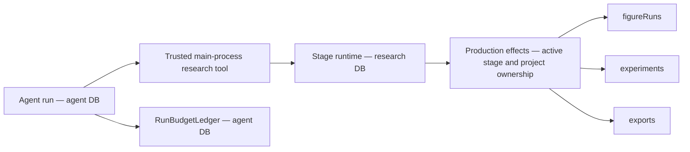

# Research optimization execution ledger

Task source: [execution plan](research-optimization-execution-plan.md).
User authorized sequential implementation and one commit per verified increment on 2026-11-03.
New contracts replace obsolete interfaces directly. No compatibility aliases are added.
Ownership, authorization, byte integrity and explicit failure contracts remain required.

## M0 — baseline and offline preparation

Status: `Verified passing` for local baseline and deterministic fixture contracts.

Workspace: `/Users/Apple_501/Desktop/Roc/Roc`, branch `main`.
Baseline: `c4bb32769b7815472966c6c620f143b914376752`.
Environment: Node `v26.13.0`, pnpm `12.5.1`, TypeScript `7.0.2`,
macOS `27.0.1` (`26A434`), `arm64`. No dependency installation required.

Pre-existing changes: `docs/README.md`, deletion of six Harness documents,
and untracked `plan/` source documents. These are excluded from implementation commits.
Relevant existing CodeGraph index used; no index creation or refresh.
ADRs 0020/0022/0023/0024/0025 reviewed.

The actual figure reproduction created
`research_run_13a5f9d6-617b-4a53-8455-3656497a44b1` and
`figure_run_3c8742c3-43fb-4852-9a40-a97ade07f30d` in isolated SQLite.
The figure remained `preparing`; passing its ID to the exposed experiment query raised
`research_experiment_not_found`. Its frozen role tools included `get_experiment`.
Evidence: `.artifacts/research-optimization/m0-figure-reproduction.log`.

### Ownership and storage

Agent and research plugins get separate managed SQLite connections through `DatabasePool`;
schemas, migrations, health probes and backup/restore apply per logical database.
The agent budget ledger is the existing authority for reservations and settlement.
Stage `createAgent()` currently runs outside that ledger. Research task accounting will use
the agent database authority for atomic aggregate admission; research execution rows retain
their own domain lifecycle. Cross-database execution startup must be idempotent and repairable,
without claiming one transaction spans both databases.

`research.*Owned` names in role profiles map to internal tool factories and production effects.
They are not public capability registrations. Public `research.figure.getRun` already exists
and uses `runId`; adding an internal owned read must not expose arbitrary renderer ownership.
Role names/policy/skill instructions are frozen in stage run snapshots. Changed tool contracts
must reject incompatible retries and require a new request.

### Samples and verification

Original CC0 synthetic PDF, metadata, CSV, TypeScript source, Vega-Lite specification,
LaTeX manuscript and bibliography are fixed in `tests/fixtures/research-workflow/manifest.json`.
PDF text/page and all byte hashes are exercised by
`tests/unit/research-workflow-fixture.test.mjs`. The sample is an engineering fixture, not an
independent scientific evaluation dataset.

Commands below ran from the workspace above:

| Command | Actual result |
| --- | --- |
| `pnpm typecheck` | Passed |
| `pnpm check:ipc` | Passed, generated files current |
| `node --test tests/unit/research-workflow-fixture.test.mjs tests/unit/research-job-cancellation.test.mjs tests/unit/database-migrations.test.mjs tests/unit/literature-import.test.mjs tests/unit/research-export-body-gate.test.mjs` | 32 passed, 0 failed |
| `pnpm harness:eval` | 94 deterministic cases passed |

Logs: `.artifacts/research-optimization/m0-{contracts,typecheck,ipc,harness}.log`.
These checks cover the current retrieval/import, job cancellation/cleanup, migration and
export body invariants; they do not establish live-provider quality or full scientific workflow
completion. PDF parsing here is PDF.js fixture readback, not a live OCR benchmark.

Real-model L2: `Blocked, not run`. No isolated account, trusted price table, task/total spend
limits or named operator authorization supplied. Continue offline runner and contract work.
No remote writes, public publication or model spending performed.

## Remaining scope

ROC-PR-01, ROC-PR-02A/B/C, ROC-PR-03A/B, P0 integration, ROC-PR-04/05,
X-UI, ROC-PR-06/07/09, X-SAFE, ROC-PR-08, X-NB/X-EXP, X-IDEA/X-WRITE,
ROC-PR-10, X-ECO/X-MON and X-PERF/X-CONTEXT/X-OBS remain pending.
