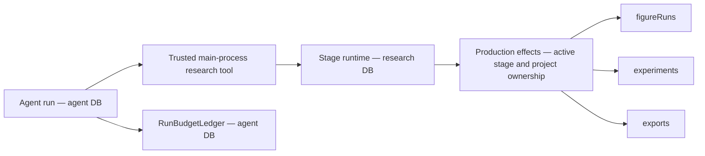

# Research optimization execution ledger

Task source: [execution plan](research-optimization-execution-plan.md).
User authorized sequential implementation and one commit per verified increment on 2026-11-03.
New contracts replace obsolete interfaces directly. No compatibility aliases are added.
Ownership, authorization, byte integrity and explicit failure contracts remain required.

## M0 — baseline and offline preparation

Status: `Verified passing` for local baseline and deterministic fixture contracts.

Workspace: `/Users/Apple_501/Desktop/Roc/Roc`, branch `main`.
Baseline: `c4bb32769b7815472966c6c620f143b914376752`.
Environment: Node `v26.13.0`, pnpm `12.5.1`, TypeScript `7.0.2`,
macOS `27.0.1` (`26A434`), `arm64`. No dependency installation required.

Pre-existing changes: `docs/README.md`, deletion of six Harness documents,
and untracked `plan/` source documents. These are excluded from implementation commits.
Relevant existing CodeGraph index used; no index creation or refresh.
ADRs 0020/0022/0023/0024/0025 reviewed.

The actual figure reproduction created
`research_run_13a5f9d6-617b-4a53-8455-3656497a44b1` and
`figure_run_3c8742c3-43fb-4852-9a40-a97ade07f30d` in isolated SQLite.
The figure remained `preparing`; passing its ID to the exposed experiment query raised
`research_experiment_not_found`. Its frozen role tools included `get_experiment`.
Evidence: `.artifacts/research-optimization/m0-figure-reproduction.log`.

### Ownership and storage

Agent and research plugins get separate managed SQLite connections through `DatabasePool`;
schemas, migrations, health probes and backup/restore apply per logical database.
The agent budget ledger is the existing authority for reservations and settlement.
Stage `createAgent()` currently runs outside that ledger. Research task accounting will use
the agent database authority for atomic aggregate admission; research execution rows retain
their own domain lifecycle. Cross-database execution startup must be idempotent and repairable,
without claiming one transaction spans both databases.

`research.*Owned` names in role profiles map to internal tool factories and production effects.
They are not public capability registrations. Public `research.figure.getRun` already exists
and uses `runId`; adding an internal owned read must not expose arbitrary renderer ownership.
Role names/policy/skill instructions are frozen in stage run snapshots. Changed tool contracts
must reject incompatible retries and require a new request.

### Samples and verification

Original CC0 synthetic PDF, metadata, CSV, TypeScript source, Vega-Lite specification,
LaTeX manuscript and bibliography are fixed in `tests/fixtures/research-workflow/manifest.json`.
PDF text/page and all byte hashes are exercised by
`tests/unit/research-workflow-fixture.test.mjs`. The sample is an engineering fixture, not an
independent scientific evaluation dataset.

Commands below ran from the workspace above:

| Command | Actual result |
| --- | --- |
| `pnpm typecheck` | Passed |
| `pnpm check:ipc` | Passed, generated files current |
| `node --test tests/unit/research-workflow-fixture.test.mjs tests/unit/research-job-cancellation.test.mjs tests/unit/database-migrations.test.mjs tests/unit/literature-import.test.mjs tests/unit/research-export-body-gate.test.mjs` | 32 passed, 0 failed |
| `pnpm harness:eval` | 94 deterministic cases passed |

Logs: `.artifacts/research-optimization/m0-{contracts,typecheck,ipc,harness}.log`.
These checks cover the current retrieval/import, job cancellation/cleanup, migration and
export body invariants; they do not establish live-provider quality or full scientific workflow
completion. PDF parsing here is PDF.js fixture readback, not a live OCR benchmark.

Real-model L2: `Blocked, not run`. No isolated account, trusted price table, task/total spend
limits or named operator authorization supplied. Continue offline runner and contract work.
No remote writes, public publication or model spending performed.

## Remaining scope

ROC-PR-02B/C, ROC-PR-03A/B, P0 integration, ROC-PR-04/05,
X-UI, ROC-PR-06/07/09, X-SAFE, ROC-PR-08, X-NB/X-EXP, X-IDEA/X-WRITE,
ROC-PR-10, X-ECO/X-MON and X-PERF/X-CONTEXT/X-OBS remain pending.

## ROC-PR-01 — owned figure polling and publication

Status: `Verified passing` for local tool contracts and real figure service integration.
Baseline: M0 commits `525b1ae2` and `5805839`.

The figure stage now exposes `get_figure` through the internal
`research.figure.getOwned` mapping. Start/query/publish all use `runId`; obsolete
`experimentId` figure inputs fail strict schema validation. Experiment tools keep their own
experiment contract. The effects boundary checks active stage, project and owner before reading.
No new public Owned IPC capability was registered; generated IPC remains current.
Old frozen figure snapshots cannot execute/retry with a changed contract; a new request is required.

The first regression failed against baseline. Real integration then found three additional
blockers needed to satisfy the planned start/query/publish path:

- Relative spec paths reached a job boundary requiring absolute paths.
- Default Vega padding expanded a requested 216×144 figure to 256×189 pixels/points.
- Published figures left their run snapshot's `artifactId` null.

Path resolution remains inside the existing file ownership boundary. Pipeline `/2` uses
fixed overall fit sizing and preserves physical SVG/PDF dimensions at high and fractional DPI.
Publication now attaches its artifact in the same SQLite transaction.
Original failure output is retained under
`.artifacts/research-optimization/figure-dimensions-before/`.
No validator was weakened. Fit limitations for composed/step-based Vega charts are documented.

Commands ran from `/Users/Apple_501/Desktop/Roc/Roc`:

| Command | Actual result |
| --- | --- |
| `node --test tests/unit/research-figure-owned.test.mjs tests/unit/research-figure-integration.test.mjs` | 9 passed before the additional fractional-size case |
| `node --test tests/unit/research-figure-integration.test.mjs` | Latest 3 passed: real render/publish, 300-DPI fractional dimensions, cancellation |
| `pnpm test:unit` | 582 passed, 0 failed |
| `pnpm check:ipc` | Passed, generated files current |
| `pnpm harness:eval` | 94 deterministic cases passed |
| `pnpm build` | Passed, includes typecheck and Electron production build |

Logs: `.artifacts/research-optimization/pr01-{before,contracts,integration,unit,ipc,harness,build}.log`.
The full unit run began before the additional fractional-size test was added; that final case
was independently exercised in the latest 3-case integration run.
Tests cover foreign project/owner rejection, terminal errors, restart interruption, stage
cancellation, request drift, duplicate starts/publication and immutable old snapshots.
Real renderer tests use original CC0 inputs and Skia PNG/SVG/PDF outputs. Human scientific
approval and real-model quality remain outside these deterministic checks.

Changed modules: role profiles/tools/prompts, production effects, stage snapshot execution,
figure renderer fingerprint/sizing, figure publication/run repositories, figure documentation
and focused tests. No model spending or external writes.

## ROC-PR-02A — trusted task identity and dispatch

Status: `Verified passing` for local task identity, dispatch and persistence contracts.
Baseline: `9ba15a00`.

Research tasks and immutable execution associations live in the agent database (migration 11).
Stage runs store their task ID in the research database (migration 6).
Existing snapshots acquire an explicit null task ID; no historical chat parentage is inferred.
Startup repairs task links only when the authority already contains the matching execution.

Chat dispatch requires a one-use, short-lived broker reference bound to a running chat,
thread, project, frozen manifest and exact stage request. Copied tokens, request drift,
expired/revoked references, changed project/manifest and inactive parents fail before scheduling.
The reference crosses the capability call through main-process asynchronous context.
It never enters renderer input or model arguments.

Direct stage starts create independent roots. Retries share the previous task. Review
roles preserve scientific stage parentage separately from chat parent execution.
Experiments, figures and exports associate before background work starts. Association failure
records a failed domain execution and sends no model/rendering request.
Public capability and IPC schemas reject ownerRunId; internal production effects supply it.
No compatibility aliases or permissive failure fallbacks were added.

Commands ran from `/Users/Apple_501/Desktop/Roc/Roc`:

| Command | Actual result |
| --- | --- |
| `pnpm test:unit` | 592 passed, 0 failed |
| `pnpm harness:eval` | 94 deterministic cases passed |
| `pnpm generate:ipc` and `pnpm check:ipc` | Passed, generated files current |
| `pnpm build` | Passed, includes typecheck |
| `node --test tests/unit/research-task-identity.test.mjs tests/unit/ipc-execution-boundary.test.mjs tests/unit/database-migrations.test.mjs tests/unit/research-figure-integration.test.mjs` | Final consumer audit: 24 passed, 0 failed |
| `git diff --check` | Passed |

The final IPC consumer correction occurred after the full unit run; the focused final run
exercised actual public IPC parsing and all affected contracts, and production build was repeated.
Logs: `.artifacts/research-optimization/pr02a-{unit,harness,ipc,build,contracts-final}.log`.
This increment establishes execution identity, not unified budget admission or task cancellation.
Those remain ROC-PR-02B/02C. Real-model L2 and scientific review remain unrun.

## ROC-PR-03A — offline protocol and runner foundation

Status: `Verified passing` for offline protocol, runner and data audit.
The full reviewed corpus and live Harness adapter remain `Blocked, not run`.

Protocol v2 requires complete baseline/candidate commit SHAs and permits same-model
comparisons across different commits. Active runner configuration is copied and frozen.
Each task receives three fixed paired repetitions, with counterbalanced arm order.
Adapters receive only the public task view. Independent validators never execute output scripts.
Null, invalid, oversized and failed outputs remain classified in the fixed denominator.
Unsent calls have zero spend; dispatched calls with unknown consumption retain their full ceiling.
Cost ceiling violations and unconfirmed aborts block later dispatch.

Exclusive journals are synced before each call and refuse rerun after process restart.
Reports distinguish fixture execution from live-model evidence.
No live adapter, model call, external account access or external write occurred.
Trusted adapter ceilings alone do not prove Provider enforcement or sandbox fidelity.

The current pilot has 16 tasks, all in the pilot split. Literature/evidence/memory/file/script
families have one source cluster each; the other three families have two clusters each.
The audit reports these actual deficits. No task duplicates or fabricated human reviews
were added to reach the target of 200. Domain review and independent train/dev/holdout
data remain necessary before full quality claims.

Commands ran from `/Users/Apple_501/Desktop/Roc/Roc`:

| Command | Actual result |
| --- | --- |
| `node --test tests/unit/quality-evaluation.test.mjs tests/unit/quality-runner.test.mjs` | Final 17 passed, 0 failed |
| `pnpm typecheck` | Passed, includes runner |
| `pnpm harness:quality:check` | Passed, reports actual pilot deficits, zero model/network calls |
| `pnpm harness:eval` | 94 deterministic cases passed |
| `pnpm check:ipc` | Passed |
| `git diff --check` | Passed |

Logs: `.artifacts/research-optimization/pr03a-{contracts,typecheck,audit,harness,ipc}.log`.
Continue authorized offline PR-02B/02C while the independent corpus, live adapter,
isolated credentials, attributable prices and spending authorization are prepared.

## ROC-PR-02B — shared task and stage accounting

Status: `Verified passing` for shared task/stage admission and model accounting.
Project-wide budget configuration remains pending.

Agent migration 12 preserves existing calls and progress records while admitting linked
stage executions. Tasks freeze their parent chat policy or the explicit direct-root default.
Missing historical task policies reject dispatch; no guessed caps are introduced.
One immediate SQLite transaction checks task and execution calls, tokens, concurrency
and integer microdollar reservations. Linking a chat attaches its existing calls once.
Unknown consumption survives restart. Permanent stop reasons survive retries and stages.
Temporary concurrency denial does not permanently stop a task.

Stage createAgent now uses the existing budget middleware and observer, with a capped
model output. The real structured-output handler returns messages with structuredResponse;
the middleware reads its raw AIMessage for trustworthy usage. Successful stage settlement
reads stage budget status without requiring a chat row. Envelopes record provider/model.
No model/network calls occurred; the integration model is a local BaseChatModel fixture.
Dollar-capped dispatch without trustworthy pricing rejects.

Commands ran from `/Users/Apple_501/Desktop/Roc/Roc`:

| Command | Actual result |
| --- | --- |
| `pnpm test:unit` | Final 610 passed, 0 failed |
| `pnpm harness:eval` | Final 94 deterministic cases passed |
| `node --test tests/unit/research-task-budget.test.mjs tests/unit/run-budget-observer.test.mjs` | Final 15 passed, including actual createAgent success/failure |
| `pnpm typecheck` | Passed |
| `pnpm build` | Final production build passed |
| `pnpm check:ipc` | Passed |
| `git diff --check` | Passed |

Logs: `.artifacts/research-optimization/pr02b-{unit,harness,success,typecheck,build,ipc}.log`.
Task cancellation, aggregate diagnostics and shell presentation continue in PR-02C.

## ROC-PR-02C.1 — persistent task cancellation

Status: `Verified passing` for the task cancellation API and cleanup propagation.
Pause, continuation, interruption diagnostics and shell presentation remain pending.

Task cancellation persists the cancelled identity before aborting executions. Shared budget
admission and stage retries refuse cancelled tasks before starting another execution.
Task get, execution tree and cancel capabilities have strict project-scoped IPC contracts.
Agent cancellation resolves its trusted task association and awaits task cleanup, including
when the chat has already ended but its stage is still active.
Task status prevents cancellation recursion.

Only the task's stage roots, review children, owned jobs and direct domain jobs stop.
Owned domain cleanup uses existing stage cleanup; direct experiment, figure and export
tasks use their own services. Concurrent cancellation requests share one pending cleanup.
Cleanup errors are reported after all affected operations settle.
Late model output cannot publish an artifact or run the human gate.
No separate shell, compatibility alias or model/network call was added.

Commands ran from `/Users/Apple_501/Desktop/Roc/Roc`:

| Command | Actual result |
| --- | --- |
| `pnpm test:unit` | Final 616 passed, 0 failed |
| `pnpm harness:eval` | Final 94 deterministic cases passed |
| `pnpm generate:ipc` and `pnpm check:ipc` | Passed |
| `pnpm build` | Final production build and typecheck passed |
| `git diff --check` | Passed |

Unit coverage includes the actual Agent plugin capability, actual stage runtime, review
child termination, unrelated active stage isolation, delayed cleanup, late output,
direct domain service routing, cleanup failure, persistent identity and IPC boundaries.
Logs: `.artifacts/research-optimization/pr02c-{unit,harness,build,ipc,contracts}.log`.

## ROC-PR-02C.2 — stage pause, continuation and recovery states

Status: `Verified passing` for stage lifecycle and persisted task states.
Aggregate diagnostics, task events, approval-only pause restoration and shell controls remain pending.

Task schema v2 and agent migration 13 distinguish active, paused, waiting approval,
interrupted, failed, cancelled and completed states. Status reasons persist with snapshots;
the checked task status column governs budget admission. Migration upgrades old task records
without inventing execution links or reasons. A schema change is required because the existing
migration engine skips data-only SQL when schema objects already match.

Pause refuses new dispatch before stopping executions and awaits cleanup.
The task policy explicitly keeps its original deadline running during pause.
Continuation of stopped stage work creates a new execution under the same task and frozen
budget. Failed continuation rolls back task activation; old executions remain terminal.
Existing stage retries can explicitly continue failed/interrupted/paused tasks.
Cancelled tasks require the task continuation API.
Permanent budget stop reasons and unknown reservations are retained.

Restart interrupts only linked executions actually left running, preserves cancelled identity,
and starts no new execution. Human approval remains distinct from task completion.
Task states follow actual gate outcomes. A stage cancellation signal is checked again before
the human gate commits after asynchronous verification, fencing late workflow advancement.

Commands ran from `/Users/Apple_501/Desktop/Roc/Roc`:

| Command | Actual result |
| --- | --- |
| `pnpm test:unit` | Final 623 passed, 0 failed |
| `pnpm harness:eval` | Final 94 deterministic cases passed |
| `pnpm generate:ipc` and `pnpm check:ipc` | Passed |
| `pnpm build` | Final production build and typecheck passed |
| `git diff --check` | Passed |

Seven lifecycle regressions exercise pause cleanup, unchanged deadline/budget, new execution
identity, activation rollback, real approval, cancellation during verification, restart and
the real v12 database upgrade. Logs: `.artifacts/research-optimization/pr02c-lifecycle-*.log`.
