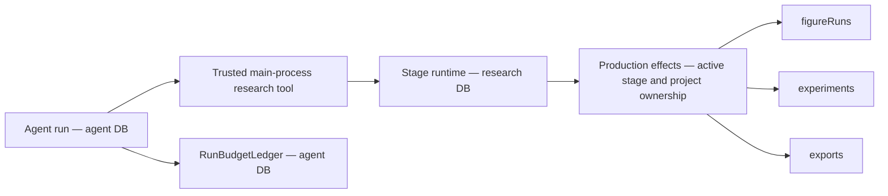

# Research optimization execution ledger

Task source: [execution plan](research-optimization-execution-plan.md).
User authorized sequential implementation and one commit per verified increment on 2026-11-03.
New contracts replace obsolete interfaces directly. No compatibility aliases are added.
Ownership, authorization, byte integrity and explicit failure contracts remain required.

## M0 — baseline and offline preparation

Status: `Verified passing` for local baseline and deterministic fixture contracts.

Workspace: `/Users/Apple_501/Desktop/Roc/Roc`, branch `main`.
Baseline: `c4bb32769b7815472966c6c620f143b914376752`.
Environment: Node `v26.13.0`, pnpm `12.5.1`, TypeScript `7.0.2`,
macOS `27.0.1` (`26A434`), `arm64`. No dependency installation required.

Pre-existing changes: `docs/README.md`, deletion of six Harness documents,
and untracked `plan/` source documents. These are excluded from implementation commits.
Relevant existing CodeGraph index used; no index creation or refresh.
ADRs 0020/0022/0023/0024/0025 reviewed.

The actual figure reproduction created
`research_run_13a5f9d6-617b-4a53-8455-3656497a44b1` and
`figure_run_3c8742c3-43fb-4852-9a40-a97ade07f30d` in isolated SQLite.
The figure remained `preparing`; passing its ID to the exposed experiment query raised
`research_experiment_not_found`. Its frozen role tools included `get_experiment`.
Evidence: `.artifacts/research-optimization/m0-figure-reproduction.log`.

### Ownership and storage

Agent and research plugins get separate managed SQLite connections through `DatabasePool`;
schemas, migrations, health probes and backup/restore apply per logical database.
The agent budget ledger is the existing authority for reservations and settlement.
Stage `createAgent()` currently runs outside that ledger. Research task accounting will use
the agent database authority for atomic aggregate admission; research execution rows retain
their own domain lifecycle. Cross-database execution startup must be idempotent and repairable,
without claiming one transaction spans both databases.

`research.*Owned` names in role profiles map to internal tool factories and production effects.
They are not public capability registrations. Public `research.figure.getRun` already exists
and uses `runId`; adding an internal owned read must not expose arbitrary renderer ownership.
Role names/policy/skill instructions are frozen in stage run snapshots. Changed tool contracts
must reject incompatible retries and require a new request.

### Samples and verification

Original CC0 synthetic PDF, metadata, CSV, TypeScript source, Vega-Lite specification,
LaTeX manuscript and bibliography are fixed in `tests/fixtures/research-workflow/manifest.json`.
PDF text/page and all byte hashes are exercised by
`tests/unit/research-workflow-fixture.test.mjs`. The sample is an engineering fixture, not an
independent scientific evaluation dataset.

Commands below ran from the workspace above:

| Command | Actual result |
| --- | --- |
| `pnpm typecheck` | Passed |
| `pnpm check:ipc` | Passed, generated files current |
| `node --test tests/unit/research-workflow-fixture.test.mjs tests/unit/research-job-cancellation.test.mjs tests/unit/database-migrations.test.mjs tests/unit/literature-import.test.mjs tests/unit/research-export-body-gate.test.mjs` | 32 passed, 0 failed |
| `pnpm harness:eval` | 94 deterministic cases passed |

Logs: `.artifacts/research-optimization/m0-{contracts,typecheck,ipc,harness}.log`.
These checks cover the current retrieval/import, job cancellation/cleanup, migration and
export body invariants; they do not establish live-provider quality or full scientific workflow
completion. PDF parsing here is PDF.js fixture readback, not a live OCR benchmark.

Real-model L2: `Blocked, not run`. No isolated account, trusted price table, task/total spend
limits or named operator authorization supplied. Continue offline runner and contract work.
No remote writes, public publication or model spending performed.

## Remaining scope

ROC-PR-02B/C, ROC-PR-03A/B, P0 integration, ROC-PR-04/05,
X-UI, ROC-PR-06/07/09, X-SAFE, ROC-PR-08, X-NB/X-EXP, X-IDEA/X-WRITE,
ROC-PR-10, X-ECO/X-MON and X-PERF/X-CONTEXT/X-OBS remain pending.

## ROC-PR-01 — owned figure polling and publication

Status: `Verified passing` for local tool contracts and real figure service integration.
Baseline: M0 commits `525b1ae2` and `5805839`.

The figure stage now exposes `get_figure` through the internal
`research.figure.getOwned` mapping. Start/query/publish all use `runId`; obsolete
`experimentId` figure inputs fail strict schema validation. Experiment tools keep their own
experiment contract. The effects boundary checks active stage, project and owner before reading.
No new public Owned IPC capability was registered; generated IPC remains current.
Old frozen figure snapshots cannot execute/retry with a changed contract; a new request is required.

The first regression failed against baseline. Real integration then found three additional
blockers needed to satisfy the planned start/query/publish path:

- Relative spec paths reached a job boundary requiring absolute paths.
- Default Vega padding expanded a requested 216×144 figure to 256×189 pixels/points.
- Published figures left their run snapshot's `artifactId` null.

Path resolution remains inside the existing file ownership boundary. Pipeline `/2` uses
fixed overall fit sizing and preserves physical SVG/PDF dimensions at high and fractional DPI.
Publication now attaches its artifact in the same SQLite transaction.
Original failure output is retained under
`.artifacts/research-optimization/figure-dimensions-before/`.
No validator was weakened. Fit limitations for composed/step-based Vega charts are documented.

Commands ran from `/Users/Apple_501/Desktop/Roc/Roc`:

| Command | Actual result |
| --- | --- |
| `node --test tests/unit/research-figure-owned.test.mjs tests/unit/research-figure-integration.test.mjs` | 9 passed before the additional fractional-size case |
| `node --test tests/unit/research-figure-integration.test.mjs` | Latest 3 passed: real render/publish, 300-DPI fractional dimensions, cancellation |
| `pnpm test:unit` | 582 passed, 0 failed |
| `pnpm check:ipc` | Passed, generated files current |
| `pnpm harness:eval` | 94 deterministic cases passed |
| `pnpm build` | Passed, includes typecheck and Electron production build |

Logs: `.artifacts/research-optimization/pr01-{before,contracts,integration,unit,ipc,harness,build}.log`.
The full unit run began before the additional fractional-size test was added; that final case
was independently exercised in the latest 3-case integration run.
Tests cover foreign project/owner rejection, terminal errors, restart interruption, stage
cancellation, request drift, duplicate starts/publication and immutable old snapshots.
Real renderer tests use original CC0 inputs and Skia PNG/SVG/PDF outputs. Human scientific
approval and real-model quality remain outside these deterministic checks.

Changed modules: role profiles/tools/prompts, production effects, stage snapshot execution,
figure renderer fingerprint/sizing, figure publication/run repositories, figure documentation
and focused tests. No model spending or external writes.

## ROC-PR-02A — trusted task identity and dispatch

Status: `Verified passing` for local task identity, dispatch and persistence contracts.
Baseline: `9ba15a00`.

Research tasks and immutable execution associations live in the agent database (migration 11).
Stage runs store their task ID in the research database (migration 6).
Existing snapshots acquire an explicit null task ID; no historical chat parentage is inferred.
Startup repairs task links only when the authority already contains the matching execution.

Chat dispatch requires a one-use, short-lived broker reference bound to a running chat,
thread, project, frozen manifest and exact stage request. Copied tokens, request drift,
expired/revoked references, changed project/manifest and inactive parents fail before scheduling.
The reference crosses the capability call through main-process asynchronous context.
It never enters renderer input or model arguments.

Direct stage starts create independent roots. Retries share the previous task. Review
roles preserve scientific stage parentage separately from chat parent execution.
Experiments, figures and exports associate before background work starts. Association failure
records a failed domain execution and sends no model/rendering request.
Public capability and IPC schemas reject ownerRunId; internal production effects supply it.
No compatibility aliases or permissive failure fallbacks were added.

Commands ran from `/Users/Apple_501/Desktop/Roc/Roc`:

| Command | Actual result |
| --- | --- |
| `pnpm test:unit` | 592 passed, 0 failed |
| `pnpm harness:eval` | 94 deterministic cases passed |
| `pnpm generate:ipc` and `pnpm check:ipc` | Passed, generated files current |
| `pnpm build` | Passed, includes typecheck |
| `node --test tests/unit/research-task-identity.test.mjs tests/unit/ipc-execution-boundary.test.mjs tests/unit/database-migrations.test.mjs tests/unit/research-figure-integration.test.mjs` | Final consumer audit: 24 passed, 0 failed |
| `git diff --check` | Passed |

The final IPC consumer correction occurred after the full unit run; the focused final run
exercised actual public IPC parsing and all affected contracts, and production build was repeated.
Logs: `.artifacts/research-optimization/pr02a-{unit,harness,ipc,build,contracts-final}.log`.
This increment establishes execution identity, not unified budget admission or task cancellation.
Those remain ROC-PR-02B/02C. Real-model L2 and scientific review remain unrun.

## ROC-PR-03A — offline protocol and runner foundation

Status: `Verified passing` for offline protocol, runner and data audit.
The full reviewed corpus and live Harness adapter remain `Blocked, not run`.

Protocol v2 requires complete baseline/candidate commit SHAs and permits same-model
comparisons across different commits. Active runner configuration is copied and frozen.
Each task receives three fixed paired repetitions, with counterbalanced arm order.
Adapters receive only the public task view. Independent validators never execute output scripts.
Null, invalid, oversized and failed outputs remain classified in the fixed denominator.
Unsent calls have zero spend; dispatched calls with unknown consumption retain their full ceiling.
Cost ceiling violations and unconfirmed aborts block later dispatch.

Exclusive journals are synced before each call and refuse rerun after process restart.
Reports distinguish fixture execution from live-model evidence.
No live adapter, model call, external account access or external write occurred.
Trusted adapter ceilings alone do not prove Provider enforcement or sandbox fidelity.

The current pilot has 16 tasks, all in the pilot split. Literature/evidence/memory/file/script
families have one source cluster each; the other three families have two clusters each.
The audit reports these actual deficits. No task duplicates or fabricated human reviews
were added to reach the target of 200. Domain review and independent train/dev/holdout
data remain necessary before full quality claims.

Commands ran from `/Users/Apple_501/Desktop/Roc/Roc`:

| Command | Actual result |
| --- | --- |
| `node --test tests/unit/quality-evaluation.test.mjs tests/unit/quality-runner.test.mjs` | Final 17 passed, 0 failed |
| `pnpm typecheck` | Passed, includes runner |
| `pnpm harness:quality:check` | Passed, reports actual pilot deficits, zero model/network calls |
| `pnpm harness:eval` | 94 deterministic cases passed |
| `pnpm check:ipc` | Passed |
| `git diff --check` | Passed |

Logs: `.artifacts/research-optimization/pr03a-{contracts,typecheck,audit,harness,ipc}.log`.
Continue authorized offline PR-02B/02C while the independent corpus, live adapter,
isolated credentials, attributable prices and spending authorization are prepared.

## ROC-PR-02B — shared task and stage accounting

Status: `Verified passing` for shared task/stage admission and model accounting.
Project-wide budget configuration remains pending.

Agent migration 12 preserves existing calls and progress records while admitting linked
stage executions. Tasks freeze their parent chat policy or the explicit direct-root default.
Missing historical task policies reject dispatch; no guessed caps are introduced.
One immediate SQLite transaction checks task and execution calls, tokens, concurrency
and integer microdollar reservations. Linking a chat attaches its existing calls once.
Unknown consumption survives restart. Permanent stop reasons survive retries and stages.
Temporary concurrency denial does not permanently stop a task.

Stage createAgent now uses the existing budget middleware and observer, with a capped
model output. The real structured-output handler returns messages with structuredResponse;
the middleware reads its raw AIMessage for trustworthy usage. Successful stage settlement
reads stage budget status without requiring a chat row. Envelopes record provider/model.
No model/network calls occurred; the integration model is a local BaseChatModel fixture.
Dollar-capped dispatch without trustworthy pricing rejects.

Commands ran from `/Users/Apple_501/Desktop/Roc/Roc`:

| Command | Actual result |
| --- | --- |
| `pnpm test:unit` | Final 610 passed, 0 failed |
| `pnpm harness:eval` | Final 94 deterministic cases passed |
| `node --test tests/unit/research-task-budget.test.mjs tests/unit/run-budget-observer.test.mjs` | Final 15 passed, including actual createAgent success/failure |
| `pnpm typecheck` | Passed |
| `pnpm build` | Final production build passed |
| `pnpm check:ipc` | Passed |
| `git diff --check` | Passed |

Logs: `.artifacts/research-optimization/pr02b-{unit,harness,success,typecheck,build,ipc}.log`.
Task cancellation, aggregate diagnostics and shell presentation continue in PR-02C.

## ROC-PR-02C.1 — persistent task cancellation

Status: `Verified passing` for the task cancellation API and cleanup propagation.
Pause, continuation, interruption diagnostics and shell presentation remain pending.

Task cancellation persists the cancelled identity before aborting executions. Shared budget
admission and stage retries refuse cancelled tasks before starting another execution.
Task get, execution tree and cancel capabilities have strict project-scoped IPC contracts.
Agent cancellation resolves its trusted task association and awaits task cleanup, including
when the chat has already ended but its stage is still active.
Task status prevents cancellation recursion.

Only the task's stage roots, review children, owned jobs and direct domain jobs stop.
Owned domain cleanup uses existing stage cleanup; direct experiment, figure and export
tasks use their own services. Concurrent cancellation requests share one pending cleanup.
Cleanup errors are reported after all affected operations settle.
Late model output cannot publish an artifact or run the human gate.
No separate shell, compatibility alias or model/network call was added.

Commands ran from `/Users/Apple_501/Desktop/Roc/Roc`:

| Command | Actual result |
| --- | --- |
| `pnpm test:unit` | Final 616 passed, 0 failed |
| `pnpm harness:eval` | Final 94 deterministic cases passed |
| `pnpm generate:ipc` and `pnpm check:ipc` | Passed |
| `pnpm build` | Final production build and typecheck passed |
| `git diff --check` | Passed |

Unit coverage includes the actual Agent plugin capability, actual stage runtime, review
child termination, unrelated active stage isolation, delayed cleanup, late output,
direct domain service routing, cleanup failure, persistent identity and IPC boundaries.
Logs: `.artifacts/research-optimization/pr02c-{unit,harness,build,ipc,contracts}.log`.

## ROC-PR-02C.2 — stage pause, continuation and recovery states

Status: `Verified passing` for stage lifecycle and persisted task states.
Aggregate diagnostics, task events, approval-only pause restoration and shell controls remain pending.

Task schema v2 and agent migration 13 distinguish active, paused, waiting approval,
interrupted, failed, cancelled and completed states. Status reasons persist with snapshots;
the checked task status column governs budget admission. Migration upgrades old task records
without inventing execution links or reasons. A schema change is required because the existing
migration engine skips data-only SQL when schema objects already match.

Pause refuses new dispatch before stopping executions and awaits cleanup.
The task policy explicitly keeps its original deadline running during pause.
Continuation of stopped stage work creates a new execution under the same task and frozen
budget. Failed continuation rolls back task activation; old executions remain terminal.
Existing stage retries can explicitly continue failed/interrupted/paused tasks.
Cancelled tasks require the task continuation API.
Permanent budget stop reasons and unknown reservations are retained.

Restart interrupts only linked executions actually left running, preserves cancelled identity,
and starts no new execution. Human approval remains distinct from task completion.
Task states follow actual gate outcomes. A stage cancellation signal is checked again before
the human gate commits after asynchronous verification, fencing late workflow advancement.

Commands ran from `/Users/Apple_501/Desktop/Roc/Roc`:

| Command | Actual result |
| --- | --- |
| `pnpm test:unit` | Final 623 passed, 0 failed |
| `pnpm harness:eval` | Final 94 deterministic cases passed |
| `pnpm generate:ipc` and `pnpm check:ipc` | Passed |
| `pnpm build` | Final production build and typecheck passed |
| `git diff --check` | Passed |

Seven lifecycle regressions exercise pause cleanup, unchanged deadline/budget, new execution
identity, activation rollback, real approval, cancellation during verification, restart and
the real v12 database upgrade. Logs: `.artifacts/research-optimization/pr02c-lifecycle-*.log`.

## ROC-PR-02C.3 — task diagnostics and approval restoration

Status: `Verified passing` for authoritative summaries and paused approval restoration.
Task event correlation and shell presentation remain pending.

Task and execution budget views share one aggregation implementation and the same call rows.
The task summary reports known, unknown and reserved consumption without adding run totals
again. Domain diagnostics expose execution status, actual model identity, error codes,
timestamps, parent associations and artifact IDs. Prompt envelopes and credentials are omitted.
External service costs remain explicitly unknown, separate from application model amounts.
Chat lookup validates the persisted thread and task project before returning diagnostics.
It supports the actual chat lifecycle states, including recovery and dispatch transitions.

Paused approval can be restored to waiting approval without recreating the completed stage,
resetting its budget/deadline or calling a model. Pending cleanup still blocks restoration.
The diagnostics contract identifies stopped stage continuation and approval restoration
from authoritative domain records, not renderer counters.

Commands ran from `/Users/Apple_501/Desktop/Roc/Roc`:

| Command | Actual result |
| --- | --- |
| `pnpm test:unit` | 626 passed, 0 failed |
| `pnpm harness:eval` | 94 deterministic cases passed |
| `node --test tests/unit/research-task-diagnostics.test.mjs tests/unit/research-task-cancellation.test.mjs tests/unit/research-task-lifecycle.test.mjs tests/unit/run-budget-ledger.test.mjs` | Final consumer audit: 19 passed, 0 failed |
| `pnpm generate:ipc` and `pnpm check:ipc` | Passed |
| `pnpm build` | Final production build and typecheck passed |
| `git diff --check` | Passed |

The final consumer audit expanded diagnostics to the canonical chat status schema after
the full unit run. Focused contracts and production build were repeated after that change.
Logs: `.artifacts/research-optimization/pr02c-diagnostics-*.log`. No model/network calls.

## ROC-PR-02C.4 — durable task and model-call events

Status: `Verified passing` for task event correlation and replay.
Shell presentation and live invalidation remain pending.

Agent migration 14 records task creation/status, execution linkage, prior-call attribution,
reservations, settlement and startup uncertainty. SQLite triggers write each event in the
same transaction as its authoritative change. Activation rollback removes its status event;
denied/duplicate calls and duplicate settlement create no success event.
Events carry task, execution kind/ID and call ID, with monotonic sequence cursors.
Project-scoped replay uses explicit page size and cursor and returns actual stored events.
Migration retains existing tasks without fabricating historical event rows.
Event payloads contain no prompt envelopes or credentials.

Commands ran from `/Users/Apple_501/Desktop/Roc/Roc`:

| Command | Actual result |
| --- | --- |
| `pnpm test:unit` | Final 630 passed, 0 failed |
| `pnpm harness:eval` | Final 94 deterministic cases passed |
| `pnpm generate:ipc` and `pnpm check:ipc` | Passed |
| `pnpm build` | Final production build and typecheck passed |
| `git diff --check` | Passed |

Coverage includes actual createAgent success/failure correlation, prior billed chat linkage,
startup unknown conversion, rollback, duplicate attempts, pagination/project isolation and
the real v13 database upgrade. Logs: `.artifacts/research-optimization/pr02c-events-*.log`.
No model/network calls; integration model attempts use local fixtures.

## ROC-PR-02C.5 — live invalidation and cleanup refusal

Status: `Verified passing` for backend notifications and persistent cleanup failure.
Shell presentation remains pending.

Native task notifications carry only task and project identifiers. Trusted linkage,
model budget observations, terminal stage state and task actions invalidate persisted
diagnostics. Delivery failure logs a warning without changing accounting or execution.
Cleanup failures persist their reason; continuation and approval restoration refuse
unconfirmed cleanup. Foreign-project requests produce no notification.

Commands ran from `/Volumes/Macintosh HD/Users/Apple_501/Desktop/Roc/Roc`:

| Command | Actual result |
| --- | --- |
| `pnpm test:unit` | 633 passed, 0 failed |
| `pnpm harness:eval` | 94 deterministic cases passed |
| `pnpm generate:ipc` and `pnpm check:ipc` | Passed |
| `pnpm build` | Production build and typecheck passed |
| `LANGSMITH_TRACING=false LANGCHAIN_TRACING_V2=false ROC_SMOKE_TARGET=dist node scripts/smoke-electron.mjs` | 12/12 passed, zero renderer errors, exit 0 |
| `git diff --check` | Passed |

Logs: `.artifacts/research-optimization/pr02c-notifications-*.log`.
Smoke used temporary application data/workspace and a local stub Provider.
No paid model requests or tracing exports.

## ROC-PR-02C.6 — assistant controls and management task diagnostics

Status: `Verified passing` for shell presentation, cursor task listing and event replay.
PR-02C implementation is complete; broader P0 integration remains pending.

The assistant shows persisted task progress and known/unknown/reserved budget amounts.
Pause, whole-task cancellation, continuation and approval restoration use authoritative
APIs. Pending stop actions remain pending until resource cleanup responds; failures remain
visible and unconfirmed cleanup disables continuation. User actions are the only dispatch
trigger. A task notification invalidates reads rather than incrementing a local counter.

The existing management drawer lists project tasks with stable creation cursors and shows
parent execution associations, provider/model identity, timestamps/duration, errors,
artifact IDs and paginated stored events. The shell owns selected task identity.
Project/thread/task changes drop stale reads and notification subscriptions are disposed.
Task metadata uses 12px system tokens. No extra route, shell or dependency was added.

Commands ran from `/Volumes/Macintosh HD/Users/Apple_501/Desktop/Roc/Roc`:

| Command | Actual result |
| --- | --- |
| `pnpm test:unit` | 634 passed, 0 failed |
| `pnpm harness:eval` | 94 deterministic cases passed |
| `pnpm generate:ipc` and `pnpm check:ipc` | Passed |
| `pnpm build` | Final production build and typecheck passed |
| `pnpm check:renderer-chunks` | Passed; eager JS 1,131,037 bytes across 6 files |
| `pnpm test:renderer` | Parallel run: 42 passed, 2 existing window/anchor tests timed out |
| `node --test --test-concurrency=1 tests/renderer/` | 44 passed, 0 failed before the final pagination test addition |
| `node --test tests/renderer/research-tasks.test.mjs` | Final 8 passed, 0 failed including added task pagination |
| `LANGSMITH_TRACING=false LANGCHAIN_TRACING_V2=false ROC_SMOKE_TARGET=dist node scripts/smoke-electron.mjs` | 12/12 passed, zero renderer errors, exit 0 |
| `git diff --check` | Passed |

The parallel renderer failures were transcript anchor and settings dialog focus timeouts;
their unchanged checks passed with serialized test files. The new renderer suite first
failed because its audit helper was evaluated as a function without invocation; corrected
the invocation and retained the cut=0 assertion. No production check was relaxed.

Logs: `.artifacts/research-optimization/pr02c-ui-*.log`. Real Electron screenshots and
four light/dark assistant/drawer audits are in `.artifacts/research-optimization/task-ui/`;
each audit reports cut=0 and hidden=0. The isolated smoke uses a localhost stub Provider.
No paid model requests or tracing exports. Artifact opening/inspection belongs to X-UI.

## ROC-PR-02B.2 — project-wide model budget authority

Status: `Verified passing` for project/task/stage model admission and explicit configuration.
Project model budgets are now complete; P0 integration/live evaluation remain pending.

Agent migration 15 attributes original call rows to their trusted project and records the
project policy revision used for each new model reservation. Root chats use their frozen
project snapshot before any research stage association. Later task linkage does not create
another call or charge. Historical calls gain only stored project attribution; historical
budgets/revisions are not invented.

An explicit project policy caps model calls, concurrency, aggregate Tokens and optional
integer microdollar cost. Missing policies refuse model dispatch. Project, task and stage
admission plus call INSERT share the same SQLite immediate transaction. Unknown attempts
retain their ceilings; missing cost ceilings reject dollar-capped dispatch. Revision history
is immutable, all project consumption remains cumulative, and raising a cap does not reset
spend. Temporary concurrency refusal is not permanent. A delayed old-policy refusal cannot
block a new policy revision. Project stop reasons do not permanently exhaust task budgets.

The existing management drawer provides explicit project budget configuration and live
known/unknown/reserved summaries. Writes retain the draft's original revision, surface
conflicts and lock inputs until completion. Native get/save/notification IPC validates the
project and contains no model prompts. Smoke fixtures configure their isolated budget.

Commands ran from `/Volumes/Macintosh HD/Users/Apple_501/Desktop/Roc/Roc`:

| Command | Actual result |
| --- | --- |
| `pnpm test:unit` | Final 641 passed, 0 failed |
| `pnpm harness:eval` | Final 94 deterministic cases passed |
| `pnpm generate:ipc` and `pnpm check:ipc` | Passed |
| `pnpm build` | Final production build and typecheck passed |
| `pnpm check:renderer-chunks` | Passed; eager JS 1,131,037 bytes across 6 files |
| `node --test --test-concurrency=1 tests/renderer/` | 47 passed before the final write-lock review |
| `node --test tests/renderer/research-tasks.test.mjs` | Final 10 passed including project policy configuration/revision and pending write locks |
| `LANGSMITH_TRACING=false LANGCHAIN_TRACING_V2=false ROC_SMOKE_TARGET=dist node scripts/smoke-electron.mjs` | 12/12 passed, zero renderer errors, exit 0 |
| `git diff --check` | Passed |

Initial failures were outdated v14 assertions, two hand-written database fixtures and
missing required thread goal/workspace values in new fixtures. The hand-written ledger
schema was removed in favor of real migrations, and required inputs were supplied without
relaxing constraints. Seven project regressions cover independent task competition, two
connections, retained unknown spend, actual provider refusal, root chat attribution, v14
migration, project ownership/revisions and stale-policy refusal.

Logs: `.artifacts/research-optimization/pr02b-project-*.log`. All model attempts are local
fixtures or the isolated localhost smoke Provider. No paid requests or tracing exports.

## P0.1 — fixed-data experiment, figure and human gate integration

Status: `Verified passing` for this bounded offline production chain. Full P0 remains
unfinished: retrieval/PDF/manuscript/review/export and the fault matrix need separate
checks; live L2 still requires isolated credentials, pricing and spending authorization.

The real TypeScript service launches Electron as Node under the native sandbox and Node
permissions, computes A=2/B=4 from the frozen CSV, indexes the output and publishes the
experiment. The figure stage captures that actual located result as evidence, renders
PNG/SVG/PDF with Skia, polls the correct figure repository, publishes and completes both
human gates. Chat, stage and owned domain jobs share one task identity. Original call
rows account for three local fixture attempts and 60 settled Tokens; costs remain unknown.

This regression exposed a production startup failure: the sandbox allowed Electron's
executable but omitted its bundled Frameworks. The bundled-node environment now declares
that directory for read access. Execution, networking and writes retain their existing
policies. The test uses public published figure source reads and actual template/export
services for cleanup; no approval or source evidence is mocked. The role model response
and tool choices are deterministic fixtures, so this does not establish model quality.

Commands ran from `/Users/Apple_501/Desktop/Roc/Roc`:

| Command | Actual result |
| --- | --- |
| `LANGSMITH_TRACING=false LANGCHAIN_TRACING_V2=false node --test tests/unit/research-p0-production-integration.test.mjs` | 1 passed; real process, renderer and approval |
| `LANGSMITH_TRACING=false LANGCHAIN_TRACING_V2=false pnpm test:unit` | 642 passed, 0 failed |
| `pnpm harness:eval` | 94 deterministic cases passed |
| `pnpm build` | Production build and typecheck passed |
| `pnpm check:ipc` | Passed |

Failed draft runs retained in planning progress: missing raw C loader, missing cleanup
dependency, then the reproduced dyld refusal and the correctly refused evidence-free
figure approval. Checks were corrected against real contracts; no human gate was relaxed.

Logs: `.artifacts/research-optimization/p0-*.log`. Real output files, SHA-256 records,
located evidence, sanitized task diagnostics, events, runtime identity and both database
backups are retained under `.artifacts/research-optimization/p0-production/<taskId>/`.
No paid Provider request, tracing upload or remote write occurred.

Final isolated Electron smoke:
`LANGSMITH_TRACING=false LANGCHAIN_TRACING_V2=false ROC_SMOKE_TARGET=dist node scripts/smoke-electron.mjs`
passed 12/12 with zero renderer errors and exit 0.

Follow-up discovery: the pinned toolchain exists at `.runtime/research-toolchain/darwin-arm64`;
the actual ResearchToolchain.status check verified its manifest and locked versions
(Tectonic 0.17.0, Vale 3.24.0, Typst 0.15.0). Missing system PATH binaries do not block
the next local manuscript/export integration.

## P0.2 — standard offline research workflow and real export

Status: `Verified passing` for the standard fixture chain and the report-failure case.
P0's other failure scenarios and authorized live L2 evaluation remain unfinished.

A trusted chat task now exercises discovery, frozen literature search, explicit import,
actual source PDF parsing and located evidence capture, ideation/planning, frozen TypeScript
data execution, published Skia figures, evidence-backed manuscript, three review children
and synthesis, human acceptance, native Tectonic/Typst compilation, export approval and
local ZIP delivery. Search/model responses are deterministic local fixtures. Parsing and
figure/PDF rendering call actual production implementations in process, so this does not
establish packaged-worker isolation, OCR or model quality.

The standard task has 17 executions and 14 original model calls / 280 settled Tokens.
Costs remain unknown. Source/output/ZIP SHA-256 values, execution tree, events, budgets,
source evidence, both databases, compiled PDFs and first-page previews are retained.
PDF text readback verifies A=2/B=4 and the report's project identity. Both previews were
visually inspected: chart bounds, text, captions/references and Chinese report tables render.

True export exposed a Typst bug: paths relative to rootPath were evaluated with jobDir cwd.
The compiler now runs in rootPath. Report generation is a required part of the delivery
contract; the old catch that returned success without report.pdf/report.typ was removed
under the user's no-defensive-code instruction. Export docs and ADR 0025 reflect the new
behavior. An injected Typst refusal now persists a failed export/stage/task and diagnostic,
with no archive or artifact. Publication and local write both refuse it.

Native-toolchain scenarios moved to `tests/integration/research-p0-production.test.mjs`
and `pnpm test:research-p0`; ordinary unit checks do not require a prepared .runtime.
The suite requires and verifies actual pinned tools, with no missing-tool skips.

Commands ran from `/Users/Apple_501/Desktop/Roc/Roc`:

| Command | Actual result |
| --- | --- |
| `pnpm test:research-p0` | Final 3 passed including real PDF readback/previews and report-failure refusal |
| `LANGSMITH_TRACING=false LANGCHAIN_TRACING_V2=false pnpm test:unit` | 641 passed, 0 failed |
| `pnpm harness:eval` | 94 deterministic cases passed |
| `pnpm build` | Production build and typecheck passed |
| `pnpm check:ipc` | Passed |

Draft failures were a guessed library list request, a guessed PDF chunk identity, a
shared fixture-model structured tool name across review children, and the real Typst
path failure. Fixture errors were corrected against actual APIs; temporary wrappers
were removed. No Provider spending, tracing upload, remote write or compatibility alias.
Logs: `.artifacts/research-optimization/p0-standard-*.log`. Outputs: the P0 production
artifact directory. Remaining P0 work is the cancellation/restart/stale-approval/retry/
unknown-usage/MCP/hostile-document matrix and packaged-worker checks.

Final P0.2 isolated Electron smoke:
`LANGSMITH_TRACING=false LANGCHAIN_TRACING_V2=false ROC_SMOKE_TARGET=dist node scripts/smoke-electron.mjs`
passed 12/12, zero renderer errors, exit 0.

## P0.3 — built worker isolation and strict worker availability

Status: `Verified passing` for native metadata/PDF/figure/preview workers. The remaining
P0 fault matrix and live L2 evaluation are still unfinished.

The P0 command now builds current production output and launches its test runner under
Electron's Node runtime. Fixtures copy the actual built CLI/chunks into an isolated module
directory. Metadata import, PDF parsing, Skia rendering and PDF previews run real child
processes under the native sandbox. The same full workflow and failed-report cases pass
without an in-process rendering/parser substitute. This verifies built-worker behavior,
not a signed release bundle or OCR model quality.

Real isolation found two product errors. Figure source paths are relative on the wire,
but the sandbox read list required absolute paths. The source is already inside the
readable frozen projectRoot, so the duplicate source grant was removed. The handwritten
package list omitted static/transitive CLI dependencies (the first refusal was yauzl).
Worker reads now use the application's package.json and installed node_modules code
directory, including pnpm links. Write, network, process and model-data boundaries are
unchanged. Missing application package scope fails explicitly.

The old jobInProcess downgrade and its ignored package-resolution errors were removed.
Every missing production worker now rejects with research_worker_unavailable. A regression
went red against the old path (metadata processing executed and raised a data error), then
passed after removal. Fixture cleanup hooks now remain at module scope; registration
inside before had removed worker files before the scenarios could exercise them.

Commands ran from `/Users/Apple_501/Desktop/Roc/Roc`:

| Command | Actual result |
| --- | --- |
| `pnpm test:research-p0` | Fresh production build/typecheck passed; initial final run passed 2/3 before a fixture preview-path correction |
| `node scripts/run-research-p0.mjs` | Final 3/3 native worker scenarios passed after moving fixture preview output under its writable job directory |
| `LANGSMITH_TRACING=false LANGCHAIN_TRACING_V2=false pnpm test:unit` | 642 passed, 0 failed |
| `pnpm harness:eval` | 94 deterministic cases passed |
| `pnpm check:ipc` | Passed |
| `git diff --check` | Passed |

The sandbox correctly rejected a fixture preview outside jobDir; the fixture was corrected
without granting additional writes. Host Homebrew Node was unsuitable for an Electron
worker test due to dylib paths; tests now use the actual Electron executable. All temporary
DEBUG-p0-worker instrumentation was removed. Logs: `.artifacts/research-optimization/p0-worker-*.log`.
Native outputs, task/accounting/event receipts and both DB backups remain in the P0
production artifact directory. No paid model request, tracing upload or remote write.

- P0.3 final isolated Electron smoke: `LANGSMITH_TRACING=false LANGCHAIN_TRACING_V2=false ROC_SMOKE_TARGET=dist node scripts/smoke-electron.mjs` passed 12/12, zero renderer errors, exit 0.

## P0.4 — native budget, cancellation, source and retry faults

Status: `Verified passing` for five core P0 fault scenarios. Restart, hostile PDF and
MCP unknown-side-effect integration remain pending, along with live L2 prerequisites.

The native suite now proves that a task model cap stops before the next actual SDK attempt
and persists the same stage/task/budget reason; missing model usage retains one original
unknown call and a nonzero token ceiling; and a figure published before stage failure is
retained on retry, with one native figure job/publication and both stage identities.
Retries use the frozen explicit Provider/model, and artifact/model provenance is retained.

Cancellation waits until a real native child creates its render directory while its owned
job is running. The task/controller then cancels the stage, renderer and chat identity,
waits for cleanup and rejects late publication. A separate human-approval race reparses
the actual source PDF during verification. Its old evidence reference becomes superseded;
approval refuses, leaves the artifact draft and task waiting, and records source/evidence/
parse IDs and source hash. Editing claims while waiting was correctly refused; that draft
probe was replaced with the legitimate source reparse event rather than bypassing the guard.

Every fault retains task diagnostics, original sanitized call rows, events, native execution
file/hash lists, both databases and changed/refused object identities under the P0 production
artifact directory. The fixture makes SDK/tool choices; these checks establish hard contracts,
not live model attack resistance or scientific quality.

Commands ran from `/Users/Apple_501/Desktop/Roc/Roc`:

| Command | Actual result |
| --- | --- |
| `node scripts/run-research-p0.mjs '--test-name-pattern=task model cap|untrusted model usage|stage retry'` | Final 3/3 passed |
| `node scripts/run-research-p0.mjs '--test-name-pattern=cancelling a task|claim version change'` | Cancellation passed; initial illegal fixture claim edit was correctly refused |
| `node scripts/run-research-p0.mjs '--test-name-pattern=source PDF reparse'` | Final 1/1 passed with real source reparse/invalidation |
| `pnpm test:research-p0` | Fresh production build/typecheck and all 8 native integration scenarios passed |
| `git diff --check` | Passed |

No product implementation changed in this increment. Runner supports Node test selection
flags. Unknown usage produces call_unknown instead of a successful settlement event; the
fixture now asserts that actual event. No check was weakened, no paid calls or remote writes.
Logs: `.artifacts/research-optimization/p0-fault-*.log`.

## P0.5 — native experiment and figure restart recovery

Status: `Verified passing` for two offline restart scenarios. Hostile PDF and MCP
unknown-side-effect integration remain pending. Live L2 prerequisites are unchanged.

The suite waits for a real sandboxed experiment output marker or native figure render
marker, backs up both databases while the job and stage are running, and shuts down the
owned native process. Reopening those running snapshots exercises the actual startup
budget, dispatch-grant, stage, experiment and figure recovery methods. Running executions
become interrupted, their ownership and task identities survive, an outstanding model
reservation remains unknown, issued grants are revoked, and late publication refuses.
No new stage or Provider request is automatically dispatched. Graceful cleanup cancels
the original owned job; the reopened crash snapshot correctly records it as interrupted.
This is persisted crash-state recovery with real child cleanup, not an OS process-kill test.

Command from `/Users/Apple_501/Desktop/Roc/Roc`:
`node scripts/run-research-p0.mjs '--test-name-pattern=restart during'` passed 2/2.
`git diff --check` passed. No product code changed, so no rebuild was needed.
Log: `.artifacts/research-optimization/p0-restart.log`. Before/after DB snapshots,
original running identities, recovered file/hash lists, diagnostics and events are retained
under `.artifacts/research-optimization/p0-production/<taskId>/`.

## P0.6 — hostile PDF and native secret boundaries

Status: `Verified passing` for the offline hostile-document contract scenario. MCP
unknown-side-effect integration is still pending; live model attack quality is untested.

An original Tectonic PDF contains actual authority-escalation and secret-exfiltration
instructions. The isolated parser reads those instructions, but the parent manifest and
issued grant count remain unchanged. Cross-project dispatch, cross-project production
read, out-of-workspace traversal and unavailable reading-stage shell/MCP/write tools
are refused. The real experiment then attempts to read and overwrite a synthetic secret
outside its frozen inputs. Node permission denies both accesses; the secret is unchanged
and no secret bytes appear in outputs/logs. This deterministic adversarial fixture proves
hard boundaries, not live-model prompt-injection success rates or a network attack trial.

From `/Users/Apple_501/Desktop/Roc/Roc`:
`node scripts/run-research-p0.mjs '--test-name-pattern=hostile PDF'` finally passed 1/1,
including retained PDF/parsed content. `git diff --check` passed. No product code changed.
Earlier fixture assertions guessed project/path denial names and omitted Node's
ERR_ACCESS_DENIED; all were corrected to real contracts without weakening any guard.
Logs: `.artifacts/research-optimization/p0-hostile-pdf-*.log`. Native denials, frozen source
hash, original PDF, actual parsed content, diagnostics, events and both DBs remain under
the P0 production artifact directory. No real credentials or remote writes were used.

## P0.7 — actual MCP timeout, receipt query and no-resend replay

Status: `Verified passing` for the complete 12-scenario offline native P0 suite.
Live L2 remains `Blocked, not run`: no isolated credentials, attributable prices,
spending authorization/limits or independently reviewed 200-task corpus.

A real local stdio MCP server commits one write, withholds the response, and exposes
its durable receipt through a query tool. The actual client adapter, discovered frozen
contracts and effect middleware retain the timeout as unknown. Another middleware call
refuses before invoking the handler; deleting unresolved history is also refused. A
queried receipt must match the input digest and operation identity. A different valid
operation hash is rejected. After reconciliation, the original tool result replays through
the middleware with no resend: one write, one receipt query and one handler invocation.
The actual MCP child exits after adapter cleanup. No shared remote service was written.

Commands from `/Users/Apple_501/Desktop/Roc/Roc`:

| Command | Actual result |
| --- | --- |
| `node scripts/run-research-p0.mjs '--test-name-pattern=MCP timeout'` | Final 1/1 passed |
| `node scripts/run-research-p0.mjs` | Complete offline/native P0 matrix 12/12 passed |
| `pnpm typecheck` | Passed |
| `git diff --check` | Passed |

The first fixture used runtime names in the remote allowlist; corrected to write/query
and bound actual discovered contracts. A malformed mismatch ID was corrected to a valid
different digest so the semantic mismatch check was exercised. No product behavior or
checks were weakened. Logs: `.artifacts/research-optimization/p0-mcp-timeout-*.log` and
`p0-fault-matrix-final.log`. Server receipts, unknown/resolved identities and both DBs are
retained under the P0 production artifact directory. Next: PR-04 academic search fusion.

### P0 fixture placement correction

A subsequent complete unit run during PR-04 found that the new MCP server had been
placed inside the frozen CC0 research-workflow directory. Its immutable file-list
check failed (644/645 unit checks passed). The server now lives in
`tests/fixtures/mcp/receipt-server.mjs`; the original dataset manifest and hashes stay
unchanged. From the repository root, `node --test tests/unit/research-workflow-fixture.test.mjs`
passed 2/2 and `node scripts/run-research-p0.mjs '--test-name-pattern=MCP timeout'`
passed 1/1 after relocation. Logs: `p0-mcp-fixture-manifest.log` and
`p0-mcp-fixture-relocated.log` in the research optimization artifact directory.
Status: `Verified passing` for the corrected fixture boundary.

## PR-04.1 — reproducible RRF and retained provider metadata

Status: `Verified passing` for deterministic ranking, frozen candidate provenance and
existing native consumers. The complete PR-04 remains in progress: Provider request/
pagination receipts, strict response contracts, cache/quota/health, arXiv/PMID aliases,
version/type/license/retraction UI and independently labelled retrieval metrics remain.

Search now uses RRF v1, k=60 and equal selected-source weights. Original source ranks
are retained; a source gives one contribution per identity despite duplicate records.
Source priority selects a whole canonical metadata record, independently of ranking
weight and completion order. Stable identity breaks score ties without locale. DOI
variants normalize to one identity; title similarity never merges papers. Candidate
snapshots retain all source records, original metadata hashes, ranks, dates, disagreements
and explicit selection reason. Both direct and stage-owned search use this ranking.
Model previews omit full provider records and bound conflict values; the scoped store
retains originals. Search alone still cannot import. Old search snapshots fail under the
new v2 contract without guessed fields or rewriting library/history.

Source changes: literature-fusion.ts, literature-service.ts, literature-import-service.ts,
literature-tools.ts and literature-import schema; focused regressions and
`docs/research-literature-fusion.md`. The documentation is explicitly allowed by the
existing docs whitelist. The obsolete first-source dedupe implementation was removed.
No dependency, database migration, compatibility alias or renderer change was added.

Commands from `/Users/Apple_501/Desktop/Roc/Roc`:

| Command | Actual result |
| --- | --- |
| `node --test tests/unit/literature-import.test.mjs` | 12/12 focused cases passed before adding the final old-snapshot case |
| `pnpm test:unit` | Final rerun 645/645 passed before that test-only addition |
| `node --test '--test-name-pattern=old search snapshot' tests/unit/literature-import.test.mjs` | Final added contract 1/1 passed |
| `pnpm harness:eval` | 94/94 deterministic cases passed |
| `pnpm generate:ipc` / `pnpm check:ipc` | Current generated contracts; no generated bytes changed |
| `pnpm test:research-p0` | Fresh production build/typecheck and all 12 native P0 cases passed |
| `git diff --check` | Passed |

The initial unit run caught the separately committed MCP corpus placement correction.
An existing source-index Retry-After assertion was updated to identify its source after
ordering became fixed. No check was weakened. Official OpenAlex help/Context7 and
Crossref tips were read on 2026-11-03; Semantic Scholar docs returned 429 and Europe PMC
returned 403. No live Provider, model, credential or external write was used. Docs make
those research/quality limits explicit. Logs: `.artifacts/research-optimization/pr04-fusion-*.log`.

## PR-04.2A — strict Provider response contracts

Status: `Verified passing` for all six response adapters and existing native consumers.
Remaining PR-04 work is unchanged: request/pagination receipts, caching/quota/health,
arXiv/PMID aliases, candidate metadata UI and independent retrieval evaluation.

Every adapter now validates result containers and required paper identity/title fields
with the installed Zod 4.6.7. A valid empty container remains empty; missing containers,
HTTP200 error objects, missing identities and invalid types fail that source explicitly
with literature_provider_response_invalid. Random IDs, invented Untitled titles, unchecked
payload casts and obsolete payload type guesses were removed. Optional metadata still
uses its declared unknown state. Source selection requires actual network sources; the
unused local empty-success branch was removed. OpenAlex now sends per_page. arXiv
validates XML grammar and Atom shape, refuses error entries and preserves declared DOI.

Changed: literature-provider-schemas.ts, literature-service.ts, focused regressions and
research-literature-fusion.md. No dependency, migration or renderer change.

Commands from `/Users/Apple_501/Desktop/Roc/Roc`:

| Command | Actual result |
| --- | --- |
| `node --test tests/unit/literature-import.test.mjs` | Initial 15/15 passed before the XML syntax addition |
| `pnpm typecheck` | Initial passed; final included in the production build |
| `pnpm test:unit` | Final 648/648 passed including malformed XML |
| `pnpm harness:eval` | 94/94 passed |
| `pnpm test:research-p0` | Fresh production build/typecheck and 12/12 native P0 passed |
| `git diff --check` | Passed |

Official arXiv Atom/error/DOI documentation and matching Zod/fast-xml-parser primary
Context7 docs were checked. Europe PMC and Semantic Scholar documentation fetch limits
remain recorded; no live API availability or academic coverage claim is made. All Provider
responses were local fixtures. Logs: `.artifacts/research-optimization/pr04-provider-contract-*.log`.

## PR-04.2B — per-source HTTP request receipts

Status: `Verified passing` for returned search outcomes and the complete native consumer
chain. Cache/quota/health, later paging and independently durable cancelled-inflight
request records remain pending, along with the rest of PR-04.

Search snapshot v3 retains each actual GET attempt: exact query URL and first-page
parameters, start/end times, HTTP status, Retry-After, raw-response-byte SHA-256 and
transport/HTTP failure code. Every source has its own AsyncLocal request context. HTTP
backoff waits occur outside each attempt; retries remain separate. HTTP200 schema errors
retain their actual transport receipt while the source records payload failure. Network
failure has no invented status or hash. Missing internal request context refuses explicitly.
The duplicate default fetch wrapper was removed; all requests still cross the common
URL allowlist and explicit GET/redirect:error boundary. Headers/credentials and response
bodies are not added to the receipts. Old snapshots are not upgraded with guessed fields.

Changed: literature-service.ts, literature-import-service.ts, literature-import schema,
focused regressions and research-literature-fusion.md. No dependency or migration added.

Commands from `/Users/Apple_501/Desktop/Roc/Roc`:

| Command | Actual result |
| --- | --- |
| `node --test tests/unit/literature-import.test.mjs` | Focused 17/17 passed |
| `pnpm typecheck` | Passed; final repeated inside production build |
| `pnpm test:unit` | Final 650/650 passed |
| `pnpm harness:eval` | 94/94 passed |
| `pnpm check:ipc` | Current generated contracts |
| `pnpm test:research-p0` | Fresh production build/typecheck and 12/12 native P0 passed |
| `git diff --check` | Passed |

Tests query actual persisted snapshots after HTTP429/200 retry, verify exact response
hashes, distinguish transport and payload errors, and force out-of-order concurrent
responses without cross-source receipts. Native P0 retained updated searches in its DB
backups. Logs: `.artifacts/research-optimization/pr04-provider-receipt-*.log`.
No live Provider/model request, credential access or external write.

## PR-04.2C1 — bounded validated-response cache and parent-first shutdown

Status: `Verified passing` for project-scoped cache and actual plugin/stage lifecycle.
Provider quotas/health, paging and independently durable cancelled-inflight receipts
remain pending. No academic retrieval metric or live availability claim.

Snapshot v4 records cache miss or hit with original retrieval timestamp and response
hash. The process-local LRU permits 32 entries, 8 MiB UTF-8 response text and a five-minute
TTL; its key includes trusted project, exact URL/query/page and response format. Only
validated results enter it. Hits make zero HTTP attempts and preserve metadata identity.
The import service persists the project supplied by trusted execution context.

Shutdown now starts actual parent interruption before search/import/native cleanup.
All cleanup runs through the existing aggregate helper. Search waits for active requests,
clears its cache and rejects new reads; late role output cannot publish an artifact.
No obsolete snapshot adapter, disk cache, dependency or migration was introduced.

Changed: literature-response-cache.ts, literature-service.ts, literature-import-service.ts,
research-plugin-lifecycle.ts, index.ts, literature-import schema, focused tests and
research-literature-fusion.md.

Commands from `/Users/Apple_501/Desktop/Roc/Roc`:

| Command | Actual result |
| --- | --- |
| `node --test --test-name-pattern='plugin shutdown interrupts' tests/unit/literature-import.test.mjs` | Red: closed service still accepted a new read |
| `node --test tests/unit/literature-import.test.mjs` | Final 21/21 passed |
| `pnpm typecheck` | Passed |
| `pnpm test:unit` | 654/654 passed |
| `pnpm harness:eval` | 94/94 passed |
| `pnpm check:ipc` | Current generated contracts |
| `pnpm test:research-p0` | Fresh production build/typecheck and 12/12 native cases passed |
| `LANGSMITH_TRACING=false LANGCHAIN_TRACING_V2=false ROC_SMOKE_TARGET=dist node scripts/smoke-electron.mjs` | 12/12 passed, zero renderer errors, exit 0 |
| `git diff --check` | Passed |

Retained logs: `.artifacts/research-optimization/pr04-cache-*.log`.

## PR-04.2C2 — shared host quota, concurrency and health

Status: `Verified passing` for application admission and local Provider fault fixtures.
Paging, durable cancelled-inflight receipts, strong aliases, candidate UI and independent
retrieval quality metrics remain pending.

Snapshot v5 records source host health, consecutive failures, local remaining requests
and quota reset, enforced interval, cooldown and observed success/failure timestamps.
Existing FIFO network resource claims serialize each host through payload validation;
unrelated hosts continue concurrently. PubMed/Europe PMC share the EBI gate and quota.
Application policy permits 300 attempts per host per fixed hour, one active connection,
one-second spacing and three-second arXiv spacing. Retry attempts consume quota. Cached
responses and denied admission do not. This process-local policy is not a remote quota
claim and resets on restart.

Retry-After applies to other projects and queued searches. Response rate headers can
tighten spacing, never increase local allowance. Three consecutive actual HTTP, transport,
timeout or payload failures open a 60-second breaker. Validated new responses restore
health; cached reads do not. User cancellation/shutdown do not count as source failures.
Queued cancellation prevents HTTP dispatch. Admission failures retain explicit errors
and no invented HTTP receipts.

Removed the unused unscoped search wrapper and its obsolete shared request type/schema;
the only production consumer uses the bounded, trusted-context import request. No alias,
dependency, migration, renderer flow or credential was added.

Changed: literature-provider-governor.ts, literature-service.ts, literature-import-service.ts,
literature-import/research schemas, research types, focused regressions and fusion docs.

Commands from `/Users/Apple_501/Desktop/Roc/Roc`:

| Command | Actual result |
| --- | --- |
| `node --test --test-name-pattern='concurrent searches share one host' tests/unit/literature-import.test.mjs` | Red: two simultaneous same-host dispatches |
| `node --test tests/unit/literature-import.test.mjs` | Final 27/27 passed |
| `pnpm typecheck` | Passed |
| `pnpm test:unit` | 660/660 passed before final unused API deletion |
| `pnpm harness:eval` | 94/94 passed before that deletion |
| `pnpm check:ipc` | Current after deletion |
| `pnpm test:research-p0` | Final fresh build/typecheck and all 12 native cases passed after deletion |
| `git diff --check` | Passed |

Initial focused19/26 failures were outdated test fixtures lacking required governance and
one v4 assertion; fixtures now record explicit unknown health. No guard or check weakened.
Newest official Crossref July21,2026 list-query guidance and arXiv API ToU were verified
on2026-11-03. Docs link both and distinguish stale generic Crossref limits. No live search,
paid model, account email or external write. Logs:
`.artifacts/research-optimization/pr04-governance-*.log`.

## PR-04.2D — durable owned-search execution and request receipts

Status: `Verified passing` for persisted cancellation, restart, write failures and native
consumers. Paging, strong aliases, candidate metadata UI and independent quality metrics
remain pending. Inspector/read surfaces for this backend ledger are also subsequent scope.

Research migration7 adds trusted owner/project/run-scoped search executions and original
transport receipts. Executions are saved before search; dispatched receipts are saved
before HTTP; local outcomes become received. Unknown HTTP status is never invented.
Snapshot v6 requires executionId, and candidate publication shares the transaction that
finishes its execution. Cancelled/interrupted searches retain chronology without a
candidate. Preview expiry leaves execution and receipt history intact.

Receipt write failures propagate: before dispatch they prevent HTTP; after dispatch they
prevent candidate publication and retain unknown transport state. Restart marks unfinished
requests unknown without inventing end times/hashes/status, terminates execution and fences
late receipt writes. Search drains every source promise; import shutdown awaits all search
audits. Existing old-stage migration test now pins its actual <6 baseline instead of a
moving slice. Migration does not fabricate executions for old candidates.

Changed: database-schemas.ts, literature-search-ledger.ts, literature-service.ts,
literature-import-service.ts, search result schema, literature and identity regressions,
fusion documentation. No dependency or renderer change.

Commands from `/Users/Apple_501/Desktop/Roc/Roc`:

| Command | Actual result |
| --- | --- |
| `node --test --test-name-pattern='owned search cancellation' tests/unit/literature-import.test.mjs` | Red: no durable execution/receipt table |
| `node --test tests/unit/literature-import.test.mjs tests/unit/research-task-identity.test.mjs` | Initial 36/36 passed before five final persistence/upgrade/shutdown cases |
| `pnpm typecheck` | Passed; final included in fresh build |
| `pnpm test:unit` | Final 666/666 passed, including all final cases |
| `pnpm harness:eval` | 94/94 passed |
| `pnpm check:ipc` | Current generated contracts |
| `pnpm test:research-p0` | Fresh production build/typecheck and 12/12 native cases passed |
| `LANGSMITH_TRACING=false LANGCHAIN_TRACING_V2=false ROC_SMOKE_TARGET=dist node scripts/smoke-electron.mjs` | 12/12 passed, zero renderer errors, exit 0 |
| `git diff --check` | Passed |

Read-only SQLite inspection of retained native standard-workflow backup confirmed one
complete owned search, one received hashed request and one atomically linked candidate
snapshot. The figure-only scenario correctly has none. Evidence:
`.artifacts/research-optimization/pr04-durable-native-ledger.log`; full logs:
`.artifacts/research-optimization/pr04-durable-*.log`.

## PR-04.3A — reported API coverage and continuation provenance

Status: `Verified passing` for single-page coverage metadata. Actual later-page fetching
remains the next increment; independent Recall/nDCG, aliases and candidate UI remain pending.

Snapshot v7 records declared API hit counts, validated page count, unknown/limited/
reported_end/failed coverage and typed page/offset/opaque-cursor continuation. Missing
statistics stay null with an explicit warning. Counts are never inferred from record
length as academic Recall. A known uncollected API remainder marks truncated and warns.
Invalid counts, impossible homepage totals and oversized pages fail the source while
retaining HTTP200/body-hash receipts. Cached snapshots preserve original counts/cursors.
Tool descriptions distinguish request success from academic coverage.

Changed: literature-provider-schemas.ts, literature-service.ts, literature-import-service.ts,
literature-import result schema, literature tools, focused regressions and fusion docs.
No migration or dependency change; research DB remains7 and agent DB15.

Commands from `/Users/Apple_501/Desktop/Roc/Roc`:

| Command | Actual result |
| --- | --- |
| `node --test --test-name-pattern='Provider coverage preserves' tests/unit/literature-import.test.mjs` | Red: coverage metadata absent |
| `node --test tests/unit/literature-import.test.mjs` | 36/36 passed |
| `pnpm typecheck` | Passed |
| `pnpm test:unit` | Final 669/669 passed |
| `node --test --test-name-pattern='template reader preserves extraction errors' tests/unit/research-archive-libraries.test.mjs` | Existing unchanged timeout case 1/1 passed in10ms |
| `pnpm harness:eval` | 94/94 passed |
| `pnpm check:ipc` | Current generated contracts |
| `pnpm test:research-p0` | Fresh production build/typecheck and12/12 native cases passed |
| `node --test --test-name-pattern='model tools preview\|main-process tool context' tests/unit/literature-import.test.mjs` | Final tool consumers2/2 passed |
| `pnpm build` | Final description update build/typecheck passed |
| `git diff --check` | Passed |

Initial fullunit668/669 hit the existing archive close test's30ms wall-clock deadline
while build ran concurrently. Its unchanged focused run passed, and the full rerun with
no overlapping build passed669/669. No check or timeout weakened.

Primary current OpenAlex/Semantic docs and Crossref Swagger2.0 /swagger-docs verified
pagination/count fields. One anonymous read-only Europe PMC official-example query
(`EXT_ID:28620943 AND SRC:MED`, pageSize1, JSON) returned current6.9 shape with one hit,
one record and omitted terminal cursor. HTTP status was not captured and stays null in
probe evidence. The same raw bytes then passed the actual adapter offline. This proves
one response shape, not a production-network integration or scientific quality score.
Sanitized evidence: `.artifacts/research-optimization/pr04-coverage-live-contract.json`;
logs: `.artifacts/research-optimization/pr04-coverage-*.log`. No model/credential/write call.

## PR-04.3B — bounded provider paging and exact cross-page ranks

Status: `Verified passing` for bounded paging. Frozen questions/confirmed plans, identity
aliases, candidate review UI and independent retrieval annotations remain subsequent work.

Snapshot8 replaces source-level cache with per-page position, exact URL, rankOffset,
returned count, coverage and cache provenance. maxPages defaults1 and caps3; limit caps
both each source page and final candidates. OpenAlex page, Crossref/arXiv offset,
Semantic reported offset and EBI opaque cursors retain the original query and page size.
RRF consumes explicit original ranks, including duplicates and offset gaps. Repeated
cursors and backward/overlapping offsets fail. Semantic stops before crossing1000.
Page caps, provider caps, unavailable continuation, reported endpoint and failed pages
have distinct stopReason values. Endpoint count mismatch downgrades aggregate coverage
to unknown. Later failures retain validated earlier records and publish partial,
with every attempt audited. Cancellation prevents later dispatch and snapshot publication.
Cached pages preserve original hashes/timestamps and create no new HTTP receipts.

Changed: search/fusion/import service, shared schema, tools, existing renderer action,
unit and renderer regressions, fusion documentation. Research DB7 and agent DB15;
no migration, new dependency or compatibility adapter.

Commands from `/Volumes/Macintosh HD/Users/Apple_501/Desktop/Roc/Roc`:

| Command | Actual result |
| --- | --- |
| `node --test --test-name-pattern='bounded search fetches' tests/unit/literature-import.test.mjs` | Initial red: maxPages rejected |
| `node --test --test-name-pattern='repeated cursors' tests/unit/literature-import.test.mjs` | Regression red: overlapping offset dispatched an extra page |
| `node --test tests/unit/literature-import.test.mjs` | Final46/46 passed |
| `pnpm typecheck` | Passed |
| `pnpm test:unit` | 679/679 passed |
| `pnpm harness:eval` | 94/94 passed |
| `pnpm check:ipc` | Generated contracts current |
| `node --test --test-name-pattern='literature search action' tests/renderer/lifecycles.test.mjs` | Actual Electron hook/IPC seam1/1 passed, no renderer errors |
| `pnpm test:research-p0` | Fresh production build/typecheck and12/12 native cases passed |
| `git diff --check` | Passed |

Initial draft type errors were resolved with independent per-page contexts and explicit
renderer maxPages1. Three new test fixtures were corrected to actual contracts: required
arXiv author, null unread HTTP error body hashes, cancellation at the streamed-body
cleanup boundary. No timeout or existing safety assertion was weakened. Native build
ran after fullunit, avoiding the unrelated archive deadline contention. No new live
Provider/model call; current official contracts were verified in PR-04.3A.
Evidence: `.artifacts/research-optimization/pr04-paging-*.log`.

## PR-04.3C — original question and human-confirmed search strategy

Status: `Verified passing` for typed proposals, actual human review, fixed query execution
and durable plan provenance. Identity aliases, candidate review metadata/UI and independently
reviewed retrieval metrics remain subsequent PR-04 work.

Discovery preserves its exact stored instruction as researchQuestion, separately from the
model's refinedQuestion, keywords, synonyms, domain, excludedTerms and up to3 fixed queries.
Queries freeze sources, year range, page/count limits and total candidates<=60. Original
stage instruction is preserved; it is not labelled as a missing verbatim original chat.
Excluded terms are screening criteria, not invented API filtering. Invalid/missing proposals,
question changes and searchPlan in other stages fail before publication.

All stages now require real artifacts and the existing human gate; the old automatic-approval
branch and artifact-free shortcut are removed. Discovery displays the complete typed plan
in the assistant's existing approval card. Keyboard approval submits the hash of the displayed
artifact content. Actual LangGraph resume re-reads the plan and refuses changed content or
missing hashes; the human capability gate also requires expectedSearchPlanHash. No new
approval service, shell, route, credentials, dependency or database migration.

Retrieval starts only with one typed, human-approved search_strategy. Its model tool accepts
queryIndex only; the main process supplies and verifies exact frozen parameters. Before every
HTTP audit start, it checks that the approved plan/current run still applies. Supersession
stops the next attempt, preserves original receipts and prevents a candidate snapshot.
Snapshot9 and durable execution request JSON retain artifact ID/content hash, original
question, approvedAt and query index. Ad hoc searches retain strategy:null; old data is not
reinterpreted as an independently confirmed plan. Research DB7 and agent DB15 stay unchanged.

Changed: search-plan schema/strategy helper, discovery/retrieval skills and prompts,
run/artifact/human-gate/search/tool consumers, shared HITL/workflow contracts, existing
assistant approval card, fixtures/regressions and scoped docs.

Commands from `/Volumes/Macintosh HD/Users/Apple_501/Desktop/Roc/Roc`:

| Command | Actual result |
| --- | --- |
| `node --test tests/unit/research-search-plan.test.mjs` | Red: untyped discovery output published |
| `node --test tests/unit/research-search-plan.test.mjs tests/unit/literature-import.test.mjs` | Initial52/52 passed |
| `node --test tests/unit/research-search-plan.test.mjs` | Final7/7, including actual interrupt/resume and candidate budget contract |
| `pnpm test:unit` | Final686/686 passed after obsolete automatic approval removal |
| `pnpm harness:eval` | 94/94 passed |
| `pnpm check:ipc` | Generated contracts current |
| `pnpm test:research-p0` | Final fresh production build/typecheck and12/12 native cases passed |
| `node --test tests/renderer/research-search-plan.test.mjs` | Actual Electron approval display/keyboard/invalid/long-layout3/3 passed; no renderer errors |
| `node --test --test-name-pattern='literature search action' tests/renderer/lifecycles.test.mjs` | Actual search action1/1 passed |
| `pnpm check:renderer-chunks` | Passed, eager JS1131076 bytes/6 files |
| `git diff --check` | Passed |

Inspected actual plan-review/light and long-plan/dark1099 screenshots. Light/dark at1100,
1099 and800px retained native keyboard scrolling, visible focus and no horizontal overflow.
Six shadow audits had cut0/hidden0. Evidence:
`.artifacts/research-optimization/search-plan-ui/` and `pr04-plan-*.log`.
Current official LangChain structured-output and LangGraph interrupt docs were checked via
Context7; installed packages remain pinned. Tests execute deterministic local tools and real
native workers, with no paid model or new live provider request. Reviewed200-task/L2 blockers
remain unchanged; no scientific-quality claim follows from these engineering tests.

## PR-04.4A — declared scholarly IDs, observed revisions and durable source records

Status: `Verified passing` for this declared-ID increment. PR-04 remains in progress.
Research DB8, agent DB15, search snapshot10.

Normalize modern and old arXiv IDs with exact observed vN. Four/five-digit sequence rules,
valid months, historical archive dates and positive safe revision numbers are enforced.
An unversioned ID retains version:null. Equivalent arXiv revisions contribute once; original
records/ranks remain in the candidate, and hash-linked version relationships connect only
adjacent observed revisions. PubMed and Europe PMC MED share PMID; Europe PMC retains all
other source namespaces. Non-MED PubMed results fail before cache/publication. Distinct DOIs
stay distinct; no publication/preprint relation is inferred from equal IDs or titles.

Candidate import freezes every distinct provider record. All bibliography preparations must
succeed without changing identity before one atomic library write. Sources retain the raw
providerRecord separately from normalized metadata/bibliography, including original hashes
and observed versions after the preview expires. File/DOI imports and historical observations
use providerRecord:null when original provider bytes/records were not retained.

DB8 replaces the obsolete unique identity constraint with an indexed canonical identity.
One-time data migration retains item IDs, bibliography, source metadata, archive state and
project/attachment references. Europe PMC's historical namespace comes only from the exact
retained article URL; absent matching evidence aborts and rolls back. Colliding historical
rows remain separate and automatic lookup/import fails with an actionable conflict.
There is no old-key fallback scan. Table replacement runs with FK enforcement temporarily
off outside the transaction, validates all references before commit and restores its prior
setting. Existing migration checksums remain unchanged; DB8 dataVersion is part of its ledger.

Changed: identity/migration/fusion/search/import/library consumers and failure messages,
library/search schemas, regression fixtures, renderer snapshot fixture and scoped docs.

Commands from `/Volumes/Macintosh HD/Users/Apple_501/Desktop/Roc/Roc`
(also exposed at `/Users/Apple_501/Desktop/Roc/Roc`):

| Command | Actual result |
| --- | --- |
| `node --test tests/unit/literature-import.test.mjs` | Red: MED/PMC namespace collision and arXiv revisions split |
| `node --test tests/unit/literature-import.test.mjs tests/unit/database-migrations.test.mjs` | Initial58/58, expanded67/67 passed |
| `pnpm test:unit` | Final699/699 passed; raw-provider normalization and identity-change regressions included |
| `pnpm harness:eval` | 94/94 passed |
| `pnpm generate:ipc` and `pnpm check:ipc` | Generated files unchanged; contracts current |
| `pnpm test:research-p0` | Final fresh build/typecheck and12/12 actual native cases passed |
| `node --test --test-name-pattern='literature search action' tests/renderer/lifecycles.test.mjs` | Actual Electron hook1/1 passed |
| `pnpm check:renderer-chunks` | Passed, eager JS1131076bytes/6files |
| `LANGSMITH_TRACING=false LANGCHAIN_TRACING_V2=false ROC_SMOKE_TARGET=dist node scripts/smoke-electron.mjs` | Application startup/UI12/12, zero renderer errors, exit0 |
| `git diff --check` | Passed |

Evidence: `.artifacts/research-optimization/pr04-identifiers-*.log`. Tests cover actual DB7→8
upgrade, repeated migration, missing namespace rollback, colliding row preservation, project
links, archive refusal, alternate-preparation failure and foreign-key-invalid rollback.
Current arXiv/NLM identity documentation was verified; pinned better-sqlite3 13.0.3 transaction
and pragma API docs checked via Context7. No new live literature query, paid model call,
remote write or real-user database migration. External-ID graph, complete review metadata/UI,
independent annotated retrieval metrics and all L2 prerequisites remain unfinished.

## PR-04.4B — uniquely anchored declared-ID graph and persistent library aliases

Status: `Verified passing` for this declared-ID graph increment. PR-04 remains in progress.
Research DB9, agent DB15, search snapshot11.

The prior fusion split DOI-free PubMed/arXiv observations from an observation of the same
declared identity with one DOI. The graph now connects these records only when exactly one
DOI is observed for that source identity. Competing DOIs retain separate candidates and
explicit identityConflicts, with DOI-free records still separate. Candidate aliases and
conflicts retain their actual declaration; titles never create edges and primary provider
metadata remains unchanged.

Search, frozen candidate import and library import share the graph. Canonical library
metadata/bibliography can acquire a uniquely witnessed DOI while retaining its item ID,
citation key, primary metadata selection and every raw origin. A later DOI-free import
resolves the persisted alias and never downgrades that DOI. Distinct known DOIs stay separate;
shared DOI-free aliases become explicitly ambiguous. Archive state remains authoritative.

DB9 adds a persistent alias index seeded from current primary metadata and actual retained
providerRecord observations. It does not rewrite DB8 rows or infer unknown historical
observations. Data-only migration transformations have an immutable dataVersion; existing
applied SQL/name/checksums remain unchanged. A matching table schema cannot prove an
unrecorded data/rebuild migration ran, so that fast path now refuses missing ledger evidence
without modifying data or recording success.

Changed: identity graph/alias migration, migration engine/schema, fusion/search/import/library
consumers, search schema and renderer fixture, focused regressions and scoped docs.

Commands from `/Volumes/Macintosh HD/Users/Apple_501/Desktop/Roc/Roc`
(also exposed at `/Users/Apple_501/Desktop/Roc/Roc`):

| Command | Actual result |
| --- | --- |
| `node .artifacts/research-optimization/pr04-alias-graph-baseline.mjs` | Fixed f73fc26 baseline red: expected one same-PMID candidate, received two |
| `node --test tests/unit/literature-import.test.mjs tests/unit/database-migrations.test.mjs` | Initial75/75 passed |
| `pnpm test:unit` | Final709/709 passed, including unproven ledger and competing stored-anchor regressions |
| `pnpm harness:eval` | 94/94 passed |
| `pnpm check:ipc` | Generated contracts current |
| `pnpm test:research-p0` | Fresh production build/typecheck and12/12 native cases passed |
| `LANGSMITH_TRACING=false LANGCHAIN_TRACING_V2=false ROC_SMOKE_TARGET=dist node scripts/smoke-electron.mjs` | Final application startup/UI12/12, zero renderer errors, exit0 |
| `node --test --test-name-pattern='literature search action' tests/renderer/lifecycles.test.mjs` | Actual Electron hook1/1 passed |
| `pnpm check:renderer-chunks` | Eager JS1131076bytes/6files passed |
| `git diff --check` | Passed |

Evidence: `.artifacts/research-optimization/pr04-alias-graph-*.log`. Provider docs research
verified OpenAlex ids.pmid in its current primary dictionary. Semantic graph docs remained
429 and its tutorial403; Ai2's authored code confirms externalIds.ArXiv, but the exact PubMed
JSON field remains unverified. Those additional API observations are not implemented here.
No new live literature query, paid model, remote write or real-user DB migration. Complete
candidate review metadata/UI and independent annotated retrieval metrics remain pending.

Final stored-anchor review adds a bounded three-row classification of exact DOI, provisional
identity and competing DOI. A provisional historical row cannot be promoted while another
stored DOI competes for its alias. DOI-free query origins consult stored identities before
attachment; a competing stored anchor rejects the whole candidate import, retains original
rows/sources and reports a conflict with retryable:false. Identity-change errors also do not
invite an automatic retry. Three actual DB/import regressions cover these cases.
Final full unit after this correction:709/709. Fresh production build/typecheck/native P0
after the correction:12/12. Final startup smoke12/12 and renderer hook1/1 passed.

## PR-04.4C — verified Provider external identifiers and durable observations

Status: `Verified passing` for this external-identifier increment.
Research DB10, agent DB15, search snapshot12. Full PR-04 remains in progress.

OpenAlex ids.doi/ids.pmid and Semantic externalIds.DOI/ArXiv now participate in the
identity graph. Each ranked origin retains original values, field names, normalized
identities and the complete identifier dictionary, including unknown keys. The verified
OpenAlex PMID connects direct PubMed/MED observations; Semantic ArXiv connects direct
arXiv observations without claiming that a declared revision was fetched. Unverified
Semantic PubMed keys stay opaque. Invalid known identifiers fail before cache admission.
Primary DOI versus external DOI conflicts retain competing anchors and exclude supplemental
PID edges; DOI-free components attach only to one unique DOI anchor. Original provider
metadata and original source bibliography remain unchanged.

Frozen candidate imports retain full origins and execution IDs. Library import validates
raw Provider hash, source, external ID, retrieval time and recomputed identifier mapping.
DB10 stores paginated observations independently of library list rows; original source
rank and execution provenance survive candidate expiry and library archive. Same execution,
source and rank can replay only with identical data and item identity. Conflicting replay
or persistence failure rolls back the whole candidate import and returns a nonretryable
failure. A canonical DOI witnessed only in external fields updates metadata, bibliography,
BibTeX DOI and existing CSL DOI. Stored provisional canonical keys remain stable on later
DOI-free imports; idempotent external-PMID replay does not increment library revision.

New readonly capability research.library.getIdentifiers and generated preload method
research.getLibraryIdentifiers use offset/limit pages, default20/max50. Missing items fail
explicitly; archived observations remain readable. Model search/read previews omit complete
raw dictionaries while retaining known mapped values. Old snapshots are refused rather
than converted, and DB10 does not infer historical identifier observations.

Changed files: Provider identifier/shared schemas, adapters, identity graph/fusion,
import/library repository/capability and generated IPC, focused regressions, renderer
snapshot fixture and scoped fusion documentation. Existing unrelated docs remain unstaged.

Commands from `/Users/Apple_501/Desktop/Roc/Roc`:

| Command | Actual result |
| --- | --- |
| `node .artifacts/research-optimization/pr04-external-ids-baseline.mjs` | Fixed8e53377 red: mapped OpenAlex PMID and direct PubMed produce two candidates (expected one) |
| `node --test tests/unit/literature-import.test.mjs tests/unit/database-migrations.test.mjs` | Initial79/79 passed |
| `node --test --test-name-pattern='observations\|external identifiers\|supplemental PMID\|identifier replay\|identifier API\|identifier dictionaries\|identifier persistence' tests/unit/literature-import.test.mjs` | New/related observation regressions10/10 passed |
| `node --test --test-name-pattern='repeated PMID-only' tests/unit/literature-import.test.mjs` | Red: repeated import incremented revision; fixed in final full suite |
| `pnpm test:unit` | Initial718/718; final719/719 passed after canonical-key fix |
| `pnpm harness:eval` | 94/94 passed |
| `pnpm generate:ipc` / `pnpm check:ipc` | Generated preload/registry current; check passed |
| `pnpm typecheck` | First run preceded generation completion and failed on missing preload method; subsequent check/final build passed |
| `pnpm test:research-p0` | Final fresh production build/typecheck and12/12 native cases passed |
| `pnpm check:renderer-chunks` | Passed; exact budget in retained log |

Evidence: `.artifacts/research-optimization/pr04-external-ids-*.log` and fixed baseline
script. Task-created scratch source and temporary baseline bundle removed after verification.
No new live literature query, paid model call, remote write or real-user DB migration.
Remaining: candidate type/license/retraction/conflict review UI, independent retrieval
annotation/metrics and later plan increments. L2/full reviewed corpus remains blocked.

Final application startup/UI smoke12/12, zero renderer errors, exit0; actual renderer literature hook1/1 and whitespace check passed. Eager JS1131076bytes/6files.

## PR-04.4D — candidate review metadata, durable provenance and desktop disclosure

Status: `Verified passing` for this candidate review increment. Full PR-04 remains in progress.
Research DB11, agent DB15, search snapshot13.

Candidate origins now retain declared types, copy-scoped versions/licenses, retraction
observations and update targets. OpenAlex maps type/primary_location/is_retracted; Crossref
maps type/license content-version/update-to; arXiv revisions come from actual entry.id.
Unverified/missing source fields remain unknown. False OpenAlex retraction means the source
has not reported a retraction at that observation time, never a credibility/safety score.
Crossref update-to names the current record's update target and never proves the current
record itself was retracted. Known field/schema failures are refused before caching.

DB11 persists review observations separately from normal library list items, retaining
execution/source/rank/hash/retrieval provenance. research.library.getReviews and generated
research.getLibraryReviews use default20/max50 pages. Old DB10 items remain unchanged and
receive no fabricated reviews; observations survive candidate expiry/archive. Identical
replay is idempotent, conflicting content/mismatched source metadata and persistence failure
roll back the whole import and return nonretryable failures.

The existing import dialog now uses dense candidate rows with all sources, type, version,
license, retraction and update status. Native keyboard details reveal original metadata,
copy scope, update targets, identity/field conflicts and actual arXiv revisions. Explicit
add remains separate; archived candidates stay disabled. Unknown fields do not become
normal/clear. Rows use semantic tokens,12/13px type and hairline boundaries; no second shell,
new route, decorative animation or heavy dependency. Explicit672px dialog width avoids the
conflicting max-width rules that left insufficient shadow room at800px.

Commands from `/Users/Apple_501/Desktop/Roc/Roc`:

| Command | Actual result |
| --- | --- |
| `ROC_REVIEW_BASELINE=1 node --test --test-name-pattern='candidate review exposes' tests/renderer/literature-review.test.mjs` | Fixed07319ba red: previous dialog has no candidate review rows |
| `pnpm test:unit` | Initial723/723; final724/724 passed |
| `node --test tests/unit/literature-import.test.mjs tests/unit/database-migrations.test.mjs` | Final94/94 passed, including DB10→11 preservation |
| `pnpm harness:eval` | 94/94 passed |
| `pnpm generate:ipc` / `pnpm check:ipc` | Generated contracts current; check passed |
| `pnpm test:research-p0` | Fresh build/typecheck and12/12 native cases passed |
| `pnpm build` | Final build/typecheck passed after dialog width correction |
| `node --test tests/renderer/literature-review.test.mjs` | Final3/3 actual Electron cases passed |
| `node --test --test-name-pattern='literature search action' tests/renderer/lifecycles.test.mjs` | Actual hook1/1 passed |
| `LANGSMITH_TRACING=false LANGCHAIN_TRACING_V2=false ROC_SMOKE_TARGET=dist node scripts/smoke-electron.mjs` | Final application startup/UI12/12, zero renderer errors, exit0 |
| `pnpm check:renderer-chunks` | Eager JS1131076bytes/6files passed |
| `git diff --check` | Passed |

UI evidence: `.artifacts/research-optimization/review-ui/` contains default, hover,
expanded, long text/light/dark1100/1099/800 screenshots and nine shadow audits; every final
cut0/hidden0. Screenshots inspected at normal light and long dark1099 states. Initial test
fixtures omitted the application's LazyMotion/MotionConfig, leaving panels at transparent
initial state; those invalid screenshots are superseded by actual providers and final-state
waits. Initial early native-details and shadow failures are retained in diagnostic logs.

Provider contract readings: current primary OpenAlex work/location dictionary and Crossref
Swagger4.5.1, as linked in docs/research-literature-fusion.md. No new live paper query, paid
model, remote write, real-user DB migration or fixture corpus modification. Source plan
still requires independent retrieval annotations/Recall@20/nDCG@10/duplicate metrics and
later plan increments. L2/full reviewed task corpus remains externally blocked.

## PR-04.5A — complete captured pools for independent ranking evaluation

Status: `Verified passing` for captured-pool infrastructure. Full PR-04 remains incomplete.
Research DB12, agent DB15, search snapshot13, pool schema1.

Previously, only final top-limit RRF candidates survived; year-excluded records and lower
ranks were lost, and expired candidate snapshots were deleted on a later search. Comparing
source order with RRF using that selected subset would bias the baseline. Successful capture
now saves all validated original ranked records before year filtering/candidate limiting,
including identifiers/review metadata and original ranks. The immutable pool also freezes
request, confirmed strategy, source status/coverage/page/HTTP evidence and observation time.
A SHA-256 content hash covers the full schema1 body. Pool, candidate publication and search
execution completion commit atomically; pool write failure publishes no candidate and leaves
an explicit failed execution. Existing historical executions receive no fabricated pool.

New readonly research.literature.getPool / research.getLiteraturePool paginates by trusted
owner/project and executionId, default20/max30. Candidate expiry/deletion does not delete the
pool; each read verifies the complete pool hash before slicing. Missing/other-owner/other-
project pools fail explicitly and tampered storage is nonretryable degraded data. This API
is not expanded by the model's candidate preview tools and does not import library papers.
Ranked record type now comes from the same shared persisted schema, removing a duplicate
handwritten contract. No candidate-snapshot compatibility branch or inferred old pool.

Commands from `/Users/Apple_501/Desktop/Roc/Roc`:

| Command | Actual result |
| --- | --- |
| `ROC_POOL_BASELINE=1 node --test --test-name-pattern='complete captured pool retains' tests/unit/literature-import.test.mjs` | Fixedaf32a2c red: zero captured pools after valid search, expected one |
| `node --test tests/unit/literature-import.test.mjs tests/unit/database-migrations.test.mjs` | 98/98 passed |
| `pnpm test:unit` | 728/728 passed |
| `pnpm harness:eval` | 94/94 passed |
| `pnpm typecheck` | Passed |
| `pnpm generate:ipc` / `pnpm check:ipc` | Generated contracts current; check passed |
| `pnpm test:research-p0` | Fresh build/typecheck and12/12 native cases passed |
| `LANGSMITH_TRACING=false LANGCHAIN_TRACING_V2=false ROC_SMOKE_TARGET=dist node scripts/smoke-electron.mjs` | Application startup/UI12/12, zero renderer errors, exit0 |
| `node --test --test-name-pattern='literature search action' tests/renderer/lifecycles.test.mjs` | Actual hook1/1 passed |
| `pnpm check:renderer-chunks` | Eager JS1131076bytes/6files passed |
| `git diff --check` | Passed |

Four new actual DB regressions cover retained exclusions/lower ranks, stable pagination and
hash reconstruction, expiry/deletion, owner/project isolation, integrity refusal, atomic
publication rollback, DB11→12 without historical fabrication and actual capability/IPC.
Evidence: `.artifacts/research-optimization/pr04-pool-*.log`. No new live literature query,
paid model, remote write, real-user DB migration or frozen workflow-fixture edit.

This is input/provenance preparation, not a Recall/nDCG/duplicate-rate result or independent
annotation. An independently reviewed query set and relevance labels are still missing;
complete scientific retrieval validation and later plan increments remain pending.

## PR-04.5B — offline judgment preparation and retrieval metrics

Status: `Verified passing` for offline tooling. Independent scientific retrieval acceptance:
`Blocked, not run` because independently reviewed queries/judgments are absent.
No product runtime, database version or captured-pool format changes.

Strict local corpus contracts distinguish engineering fixtures from declared independent
human review. Preparation strips ranks/scores/candidate grouping, unions original identifier
observations by metadata hash and retains execution/pool/content hashes. Evaluation compares
source-priority/rank with RRF v1 using the same current identity/year rules; this is not a
complete historical-app comparison. Labels independently group records by human paper ID.
Recall20/nDCG10 count duplicate relevance only once; mixed-paper merges gain nothing and are
reported. Missed labeled papers remain in denominators/ideal rankings. Failed queries stay
in equal-topic averages; duplicate rates pool top20 slots and empty rankings return null.

Reports retain code commit/bundle/corpus/pool hashes, declared sample minimum and explicit
annotation assurance. Human inputs require committed relevant source and capture limit>=20.
Declared reviewer identity/evidence cannot certify independent human review. Complete capture
cannot certify complete relevant-paper ground truth; pool-only Recall must be named as such.
No scientific gain, target value or confidence interval fabricated. CLI only reads explicit
local files; fully written private sibling files are atomically linked to exclusive new
outputs, never overwrite existing outputs, and are removed after publication/refusal.

Commands from `/Users/Apple_501/Desktop/Roc/Roc`:

| Command | Actual result |
| --- | --- |
| `node --test tests/unit/literature-retrieval-evaluation.test.mjs` | 6/6 passed before final atomic publication; all included in final fullunit |
| `pnpm test:unit` | Final734/734 passed after packet/docs/publication changes |
| `pnpm typecheck` | Final passed |
| `pnpm check:ipc` | Current, passed |
| `pnpm harness:eval` | 94/94 passed before final offline packet/publication edits; Harness runtime unaffected |
| `git diff --check` | Passed |

Actual CLI regressions exercise report/packet startup, exact output, EEXIST preservation and
no report for invalid input. Hand calculations verify graded gains, missed-paper ideal,
duplicates, false merges, failed queries and topic weighting. Evidence:
`.artifacts/research-optimization/pr04-metrics-*.log` and three retained explicitly synthetic
engineering corpus/report/unlabeled-packet JSON files. No live literature query/model call,
remote write, credentials read or frozen workflow fixture edit. Next independent authorized
increment: Zotero read-only adapter and import; PR-04's scientific acceptance remains open.

## PR-05A — instance-bound Zotero read-only local API

Status: `Verified passing` for adapter/capability/IPC foundation; full Zotero import and
real-client interoperability remain pending. Research DB12, agent DB15 unchanged.

Verified current primary Local API/Basics docs (updated2026-07-29), then pinned Zotero main
commit1ca9d58c9aa9aeca1032d3966f3765d4d40ab7b2 source. API3/Zotero10+ server IDs partition
local versions; older missing-ID clients explicitly unsupported. Personal library users/0,
group IDs distinct from local internal IDs. Group metadata has synced versions and no
aggregate Last-Modified-Version, unlike local item/collection pages.

Fixed127.0.0.1:23119 GET-only adapter, no keys/auth/Connector/write calls/redirect following.
Probe reports connected/disabled/unreachable/unsupported/invalid_response, never infers
installation from refused transport. Explicit20/default50/max paging, source raw fields,
local version/instance checks, byte hashes/time/total/next offset. Invalid/incomplete/duplicate
pages fail. Caller cancellation and plugin shutdown abort/drain requests, no late page;
10s timeout/8MiB bytes. Main-only attachment path reference uses file/view/url, validates
local file URI, does not read bytes or confer filesystem authority. Registered4 read-only
capabilities and generated preload IPC; startup itself performs no Zotero read.

Commands from `/Users/Apple_501/Desktop/Roc/Roc`:

| Command | Actual result |
| --- | --- |
| `node --test tests/unit/zotero-adapter.test.mjs` | Final10/10 passed, actual local HTTP fixture included |
| `pnpm test:unit` | Final744/744 passed |
| `pnpm harness:eval` | 94/94 passed |
| `pnpm generate:ipc` / `pnpm check:ipc` | Generated contracts current, passed |
| `pnpm test:research-p0` | Fresh typecheck/build plus12/12 native scenarios passed |
| `LANGSMITH_TRACING=false LANGCHAIN_TRACING_V2=false ROC_SMOKE_TARGET=dist node scripts/smoke-electron.mjs` | Actual startup/UI12/12, zero renderer error, exit0 |
| `pnpm check:renderer-chunks` |1131076bytes/6files, passed |
| `git diff --check` | Passed |

Evidence `.artifacts/research-optimization/pr05-adapter-*.log`. Initial fixture export/error
field guesses failed and were corrected to actual ipcRegistry/RocDomainError; guards/checks
unchanged. Primary Jina guessed page401 and old source path404; switched to official docs
and current pinned tree. Standard /Applications/Zotero.app absent; no actual user library,
DB/profile, credentials or global settings read/modified. No Zotero/plugin installation.
No paid model, remote write or frozen workflow fixture edit. Next: durable preview/import
object mapping through existing bounded metadata jobs, then settings/selection/attachments
and incremental checkpoints. Real Zotero client contract acceptance remains unrun.

## PR-05 prerequisite — retain migration application history

Status: `Verified passing`. New preview upgrade regression exposed that the common migration
writer deleted/reinserted all old ledger rows whenever appending a migration, changing their
original applied_at timestamps. A separate deterministic-time regression reproduced the
failure before the fix. Writer now reads validated applied versions and appends only missing
versions. Existing migration names/checksums/application times stay unchanged; checks for
rewritten migrations, unproven data transforms and transactional schema/FK rollback remain.
No applied migration SQL/name/checksum changed and no real-user DB was touched.

Checks from `/Users/Apple_501/Desktop/Roc/Roc`, on the source state including the uncommitted
Zotero preview increment (this correction itself has no dependency on that new migration):

| Command | Actual result |
| --- | --- |
| `node --test --test-name-pattern='preserves complete historical ledger' tests/unit/database-migrations.test.mjs` | Before-fix red: old applied_at replaced by upgrade timestamp |
| `node --test tests/unit/zotero-preview.test.mjs tests/unit/zotero-adapter.test.mjs tests/unit/literature-import.test.mjs tests/unit/database-migrations.test.mjs` | Final114/114 passed, full ledger rows preserved for synthetic append and actual DB12→13 |
| `pnpm test:unit` | Final750/750 passed |
| `pnpm harness:eval` | 94/94 passed |
| `pnpm test:research-p0` | Fresh typecheck/build and12/12 native scenarios passed |
| `pnpm check:ipc` / `pnpm check:renderer-chunks` | Current contracts and eager1131076bytes/6files passed |
| `git diff --check` | Passed |

Evidence `.artifacts/research-optimization/pr05-migration-history-red.log` and
`pr05-preview-focused-latest.log`, `pr05-preview-unit-latest.log`, `pr05-preview-native.log`.
Preview implementation remains for the following separate commit after startup verification.

## PR-05B1 — owned immutable Zotero review previews

Status: `Verified passing` for preview capture/readback. Full Zotero metadata import/object
mapping, settings/selection/attachment authorization and checkpoint acceptance remain pending.
Research DB13, agent DB15. Zotero preview schema1; no old snapshot conversion.

A source page is captured completely before returning a20-object review slice. Original
objects/unknown fields, local server/library/version, request, raw response hash and time are
frozen with a full contentHash and7-day review expiry. Trusted owner/project/run are stored
by main context; input cannot select another scope. Preview readback uses20/default30/max
pagination and checks the complete body before slicing, even for hidden final records.
Source total/nextOffset and capturedTotal/nextPreviewOffset remain distinct. No library import,
attachment read, normalization worker or indexing starts during preview. Database failure,
invalid page, cancellation, closure and late output cannot publish a successful snapshot.
Import service tracks/drains preview jobs; effective snapshots survive service restart.

New research.zotero.preview/getPreview capabilities and generated preload previewZotero/
getZoteroPreview. DB12→13 preserves real-shaped historical library source data and full old
migration ledger rows, and fabricates no Zotero preview. Migration history correction is
separately committed459f30df. Previous latest-schema test assertions now expect13, while
historical fixture version pins and row/hash assertions remain unchanged.

Commands from `/Users/Apple_501/Desktop/Roc/Roc`:

| Command | Actual result |
| --- | --- |
| `node --test tests/unit/zotero-preview.test.mjs tests/unit/zotero-adapter.test.mjs tests/unit/literature-import.test.mjs tests/unit/database-migrations.test.mjs` | Final114/114 passed |
| `pnpm test:unit` | Final750/750 passed |
| `pnpm harness:eval` | 94/94 passed |
| `pnpm generate:ipc` / `pnpm check:ipc` | Current generated contracts, passed |
| `pnpm test:research-p0` | Fresh typecheck/build and12/12 native scenarios passed |
| `LANGSMITH_TRACING=false LANGCHAIN_TRACING_V2=false ROC_SMOKE_TARGET=dist node scripts/smoke-electron.mjs` | Startup/UI12/12, zero renderer error, exit0 |
| `pnpm check:renderer-chunks` / `git diff --check` |1131076bytes/6files and whitespace passed |

Five new actual SQLite/capability regressions cover25-original capture, complete hash/paging,
service restart/no second HTTP, owner/project/expiry/hidden-record integrity, database refusal,
invalid remote page, late shutdown fence and DB12 upgrade. Initial fixture guessed wrong
ledger dbName/closed error/capability lexical order; corrected to existing contracts. No
checks weakened. Evidence `.artifacts/research-optimization/pr05-preview-*.log` plus primary
source/contract hash in pr05-zotero-primary-contract.json. No real Zotero DB/user library,
credential, external write, paid model or frozen workflow-fixture edit. Next: user-selected
Zotero items imported through existing bounded jobs with independent object mappings.

## PR-05B2 — Zotero object import and durable scoped receipts

Status: `Verified passing` for this increment. Full PR-05 remains incomplete.
Research DB14, agent DB15, Zotero preview schema2 (`data,csljson`).

User-selected preview objects enter existing owned, idempotent, cancellable metadata jobs.
Native exported CSL supplies complete bibliography fields; title/normalized DOI disagreement,
invalid frozen CSL, version regressions and same-version conflicts fail explicitly. Sync key
is instance/library kind+ID/itemKey, distinct from DOI literature identity. Canonical paper,
object mapping, raw version, scoped receipt and job result commit in one transaction. Tags,
collections, unknown fields and CSL remain in immutable original versions; local note/keywords
and archived state stay intact. Different same-DOI objects retain distinct mappings.

A reproduced fresh-request duplicate-work bug is fixed: unchanged object version reuses saved
bibliography and source revision, adds only a missing project link and a separate observation.
Required notification policy is explicit at all library.link callers; job publication follows
commit. New paginated sources capability checks trusted owner/project and raw key/version/hash;
receipts remain readable after preview expiry/archive. DB13 history/ledger rows stay intact,
old schema1 preview remains stored but is not converted into fabricated CSL.

Commands from `/Users/Apple_501/Desktop/Roc/Roc`:

| Command | Actual result |
| --- | --- |
| `node --test tests/unit/zotero-import.test.mjs tests/unit/zotero-preview.test.mjs tests/unit/zotero-adapter.test.mjs` | Final26/26 passed |
| `pnpm test:unit` | Final761/761 passed |
| `pnpm harness:eval` | 94/94 passed |
| `pnpm test:research-p0` | Fresh typecheck/build and13/13 native cases passed |
| `pnpm check:ipc` | Generated contracts current, passed |
| `LANGSMITH_TRACING=false LANGCHAIN_TRACING_V2=false ROC_SMOKE_TARGET=dist node scripts/smoke-electron.mjs` | Startup/UI12/12, zero renderer errors, exit0 |
| `pnpm check:renderer-chunks` | Eager1131095bytes/6files passed |
| `git diff --check` | Passed |

Evidence `.artifacts/research-optimization/pr05-object-*.log`, including deterministic fresh-
request red, plus `pr05-object-native-csl/research.sqlite` and `receipt.json` from actual native
worker. First native fixture was correctly refused for missing approved search plan; fixture
changed to independent user-import context without weakening the gate. No live literature
query, paid model call, remote write, real-user DB migration or frozen workflow fixture edit.
Settings/library/collection/conflict UI, checkpoints/deletions, attachment grants and actual
Zotero client acceptance remain pending. L2/full reviewed corpus/independent scientific labels
remain externally blocked.

## PR-05C1 — Zotero status in existing literature settings

Status: `Verified passing` for this settings increment. Research DB14 and preview schema2
unchanged. Full PR-05 remains incomplete. Click-only standard application-executable detection
and independent API probe expose found/not_found separately from connected/disabled/
unreachable/unsupported/invalid_response. Standard directory scope is explicit; no assertion
of absence elsewhere. Filesystem read errors are failures. No automatic client launch,
settings change or library read. New capability/preload: research.zotero.status/getZoteroStatus.

Actual Electron regression reproduced stale connected state during refresh. Unique probe
resource keys now remove prior data immediately; unmount discards late results. Uses existing
settings literature section with12/13px tokens, keyboard focus and0.5px separator.

Commands from `/Users/Apple_501/Desktop/Roc/Roc`:

| Command | Actual result |
| --- | --- |
| `node --test tests/unit/zotero-adapter.test.mjs` | 11/11 passed including installation/error path and capability/IPC |
| `pnpm test:unit` | 762/762 passed |
| `pnpm build` | Final production typecheck/build passed |
| `node --test tests/renderer/zotero-settings.test.mjs tests/renderer/radix-settings-dialog.test.mjs` | 4/4 passed |
| `node --test tests/renderer/zotero-settings.test.mjs` | Final3/3 after border-only correction passed |
| `pnpm harness:eval` | 94/94 passed |
| `pnpm check:ipc` / `pnpm check:renderer-chunks` | Current IPC/eager1131095bytes/6files passed |
| `LANGSMITH_TRACING=false LANGCHAIN_TRACING_V2=false ROC_SMOKE_TARGET=dist node scripts/smoke-electron.mjs` | 12/12, zero renderer errors, exit0 before final border-only correction |
| `git diff --check` | Passed |

Evidence `.artifacts/research-optimization/pr05-settings-*.log` and zotero-settings-ui/:
default/hover/light/dark/reduced-motion1100/1099/800 screenshots, all final cut0/hidden0;
connected default and final dark1099 inspected. Initial full-border utility corrected to
border-t-[0.5px], final production build and actual component checks rerun. No new literature
query, model call, external write or fixture corpus edit. Actual Zotero interoperability,
selection/conflict UI, sync checkpoints/deletions and attachment authorization remain pending.

## PR-05 prerequisite — scope actual preview/source and retrieval-pool IPC

Status: `Verified passing` for this bridge fix. Research DB14/preview2 unchanged.
Actual sender/project bridge tests reproduced failure for Zotero previews and retrieval pools:
the adapter only scoped search/add/get/cancel, leaving new context-dependent methods without
literatureContext. Structural generated-mapping checks did not exercise this runtime boundary.
Now pool and Zotero preview/read/source capabilities receive window sender ownership and
project scope. Required nullable projectId lives in Zotero IPC envelopes; capability entry
strips only that field before core service validation. Core snapshot request/hash stays intact.
No owner/run identity inputs, absent-project fallback, legacy alias or data migration.

Commands from `/Users/Apple_501/Desktop/Roc/Roc` (source includes separately uncommitted UI draft):

| Command | Actual result |
| --- | --- |
| `node --test --test-name-pattern='actual preload' tests/unit/zotero-preview.test.mjs` | Before-fix2/2 failed with internal errors, retained red |
| `node --test tests/unit/zotero-preview.test.mjs tests/unit/zotero-import.test.mjs tests/unit/zotero-adapter.test.mjs` | 30/30 passed |
| `pnpm test:unit` | 765/765 passed |
| `pnpm harness:eval` | 94/94 passed |
| `pnpm test:research-p0` | Fresh typecheck/build and13/13 native passed |
| `LANGSMITH_TRACING=false LANGCHAIN_TRACING_V2=false ROC_SMOKE_TARGET=dist node scripts/smoke-electron.mjs` | Startup12/12, zero renderer errors, exit0 |
| `pnpm generate:ipc` / `pnpm check:ipc` | Generated contracts current, passed |
| `pnpm check:renderer-chunks` | Eager1131135bytes/6files passed with UI draft |
| `git diff --check` | Passed |

Evidence `.artifacts/research-optimization/pr05-ipc-scope-*.log`. New actual bridge checks
include sender/project row values, foreign window/project refusal, required scope and owner
spoofing refusal, no second HTTP on readback, durable scoped sources and unchanged-object
replay with one CSL worker. UI draft remains separate and uncommitted; its initial renderer
run6/7 passed, native details test must wait for actual expansion. No real Zotero user library,
live paper query, model call, remote write or frozen workflow-fixture edit.

## PR-05C2 — user-reviewed Zotero selection and import UI

Status: `Verified passing` for this UI increment. Full PR-05 remains in progress.
No database/API format changes. Existing literature import dialog gains a Zotero tab with
keyboard Arrow/Home/End navigation, explicit connection, paginated personal/group libraries
and collections,20/30/50 source-page scope and separate frozen-preview pagination. Source
version is carried across pages; errors cannot publish an old preview as the new page.
Native keyboard details reveal complete raw tags/collections/attachment references/unknown
fields. Notes/annotations/attachments and missing title/CSL cannot be selected as papers;
actual metadata validation remains at the main boundary. At most30 papers per import.

Existing owned jobs provide outcomes, partial retry and request idempotency. Lost transport
retries keep requestId; actual failed results allow only declared retryable items. Cancel
looks up that requestId and sends the real operationId, retaining submitted-vs-final state.
Pending cancellation blocks another write and its acknowledgment is tied to the request.
Parent dialog retains active/final receipt across close/tab changes; project key remounts
it so old output cannot enter a new scope. Reopening within the same mounted canvas resumes
receipt display; cross-restart selection/checkpoint recovery is not claimed.

Commands from `/Users/Apple_501/Desktop/Roc/Roc`:

| Command | Actual result |
| --- | --- |
| `pnpm build` | Final production typecheck/build passed |
| `node --test tests/renderer/zotero-import.test.mjs tests/renderer/literature-review.test.mjs` | Final8/8 passed (new5, existing3) |
| `node --test --test-name-pattern='literature search action' tests/renderer/lifecycles.test.mjs` | Actual hook1/1 passed |
| `LANGSMITH_TRACING=false LANGCHAIN_TRACING_V2=false ROC_SMOKE_TARGET=dist node scripts/smoke-electron.mjs` | Final startup/UI12/12, zero renderer errors, exit0 |
| `pnpm check:ipc` / `pnpm check:renderer-chunks` | Current contracts/eager1131135bytes/6files passed |
| `git diff --check` | Passed |

Shared backend unit765/Harness94/native13 passed in preceding scoped IPC increment with the
UI draft present; final changes are renderer-only and received fresh build/runtime checks.
Evidence `.artifacts/research-optimization/pr05-ui-*.log` and zotero-import-ui/: default,
hover, expanded, long raw originals, reduced-motion light/dark1100/1099/800 allcut0/hidden0;
normal light and long dark1099 inspected. First details assertion preceded native expansion;
waiting for visible pre corrected the fixture, no product guard weakened. Additional checks
prove exact group/collection/scope/page request, no implicit import, source-vs-review paging,
selected-only import, retry-only failed entry, cancel/reopen/final receipt, explicit read
errors, same-ID lost-transport retry, library-only null scope, old project refusal and distinct
source50/selection30 caps. Temp Electron harness artifacts removed by test cleanup.

No new live literature query, paid model, actual Zotero user library read, external write or
frozen workflow-fixture edit. Next: source/local conflict review, incremental checkpoints and
remote deletion state, attachment input authorization. Actual Zotero interoperability and
independent scientific/L2/full-reviewed-corpus acceptance remain externally blocked.

## PR-05D — readonly source/local comparison

Status: `Verified passing` for this increment. Research DB14 and preview2 unchanged.
Full PR-05 and overall plan remain in progress.

Added scoped `research.zotero.review` / `reviewZotero`: frozen source, canonical current
metadata/bibliography/revision/archive, recorded object version, exact populated-field
differences and latest original receipt from this owner/project. Review performs no HTTP,
worker or DB write. Object states distinguish new/unchanged/new-version/regressed/conflicting/
identity-changed. Direct scoped SQL supports history beyond50; corrupt originals and ambiguous
canonical identity fail explicitly. Global canonical metadata remains distinct from scoped
raw source history.

Existing import dialog waits for current preview/selection review, retains local notes/tags
and both field values, and refuses conflicted/regressed/identity-changed/archived entries.
Stale or failed review cannot enable import. Review is a current read, not a durable approval
or semantic bibliography equivalence claim. Existing main import invariants still apply.

Runtime focus reproduced an outer ModalShell scroll144px and clipped title. The modal outer
panel uses overflow-clip; body remains independently scrollable. Keyboard expansion/wheel
regressions prove panel0, body414 and unchanged title position. Screenshot/audit retained.

Commands from `/Users/Apple_501/Desktop/Roc/Roc`:

| Command | Actual result |
| --- | --- |
| `pnpm test:unit` | Final769/769 passed |
| `pnpm harness:eval` |94/94 passed |
| `pnpm test:research-p0` | Fresh build/typecheck and actual native13/13 passed |
| `pnpm build` | Final shared-shell production build/typecheck passed |
| `node --test tests/renderer/zotero-import.test.mjs tests/renderer/literature-review.test.mjs` |9/9 passed after shell fix |
| `node --test tests/renderer/zotero-import.test.mjs` | Final wheel/keyboard6/6 passed |
| `node --test --test-concurrency=1 tests/renderer/` | Final shared-shell63/63 passed |
| `LANGSMITH_TRACING=false LANGCHAIN_TRACING_V2=false ROC_SMOKE_TARGET=dist node scripts/smoke-electron.mjs` | Final12/12, zero renderer errors |
| `pnpm check:ipc` / `pnpm check:renderer-chunks` | Current;1131133bytes/6files passed |
| `git diff --check` | Passed |

Evidence `pr05-review-*.log`, `pr05-review-native-csl/` and zotero-import-ui/ scroll/
screenshots/audits. Parallel full renderer initially62/63 exposed a pre-existing immediate
disabled-state assertion; now it awaits real DOM disabled state before the same assertion.
Next parallel run had Radix Escape contention across Electron windows; serial63/63 passed.
No checks weakened. No live paper query, real Zotero library, paid model call, remote write
or frozen workflow-fixture edit. Next: version checkpoints/recovery/deletion and attachments.

## PR-05E1 — durable reviewed-page checkpoints

Status: `Verified passing` for this backend/API increment. Research DB15; no applied
migration rewritten. Full PR-05 and overall plan remain in progress.

Scoped sync sessions retain mode/full-vs-incremental range, same-instance local baseline,
fixed batch version/total, revision, pending preview, committed position and explicit control.
Captured preview/session publication is atomic. Acknowledge requires all captured keys
to have an actual owned same-preview/version import observation or an explicit skip reason.
Page decisions/seen objects/next offset and the final completed-batch version checkpoint
commit together. Partial imports or errors do not advance. Prior committed literature stays.

Pause/abandon abort actual HTTP; resume is explicit. Concurrent duplicate reads refuse before
dispatch. Pending preview replacement is explicit, stale/expired selection cannot acknowledge.
Version/instance/total change or duplicate across pages requires reset without erasing old
history. Actual DB file reopen preserves paused pending source/offset with no automatic
HTTP/worker. API recovery currently requires saved syncId and the same trusted owner/project;
UI discovery/recovery entry remains next work.

Pinned official source re-read via Agent Reach/Jina on2026-11-04 verifies local since/
versions and trash support, not a permanent-deletion API. Absent incremental objects do not
prove deletion/membership loss. This increment makes no deletion inference or Zotero write.

Commands from `/Users/Apple_501/Desktop/Roc/Roc`:

| Command | Actual result |
| --- | --- |
| `node --test tests/unit/zotero-sync.test.mjs tests/unit/zotero-import.test.mjs tests/unit/zotero-adapter.test.mjs` | Final37/37 passed |
| `pnpm test:unit` | Final780/780 passed |
| `pnpm harness:eval` |94/94 passed |
| `pnpm test:research-p0` | Fresh production build/typecheck/native13/13 passed |
| `node --test tests/renderer/zotero-import.test.mjs` |6/6 passed |
| `LANGSMITH_TRACING=false LANGCHAIN_TRACING_V2=false ROC_SMOKE_TARGET=dist node scripts/smoke-electron.mjs` |12/12, zero renderer errors |
| `pnpm check:ipc` / `pnpm check:renderer-chunks` | Current;1131133bytes/6files passed |
| `git diff --check` | Passed |

Evidence `pr05-sync-*.log`, `pr05-sync-native-csl/` DB and native CSL/checkpoint receipts.
Initial test guessed bridge.handle; corrected to actual invoke/enveloped results. First full
suite detected three latest schema14 expectations after migration15; changed only latest
version assertions, preservation checks remain. Final full suite passes. No real Zotero
client/user library, new live literature query, paid model, remote write or frozen fixture edit.
Next: sync UI discovery/recovery, trash/membership state and attachment input grants.

## PR-05E2 — sync discovery, recovery and explicit rebaseline UI

Status: `Verified passing` for this UI/API increment. Research DB15 unchanged.
Full PR-05 and overall plan remain in progress.

Readonly scoped latest-session lookup and pending-page/imported-key read restore the actual
DB state and receipts, including tied timestamps. Existing dialog exposes full/incremental,
pause/resume/abandon, pending preview restore/recapture, authoritative refresh and explicit
page acknowledgement. It requires all captured objects loaded/displayed and actual import
receipts or user-entered skip reasons. Confirmation/source read/import are separate explicit
actions. Close/reopen restores paused state and receipts without automatic source/model work.
Prior-collection lookup cannot replace current scope; errors cannot become completion.

Review found full mode correctly retained the old version floor, leaving same-instance
rollback without an explicit reset entry. Added rebaseline mode/button: completed full-source
decisions may establish a lower latest checkpoint; old sync/library/source history and
object import version/conflict guards remain. Rebaseline is never automatic.

Commands from `/Users/Apple_501/Desktop/Roc/Roc`:

| Command | Actual result |
| --- | --- |
| `node --test tests/unit/zotero-sync.test.mjs tests/unit/zotero-adapter.test.mjs tests/unit/zotero-import.test.mjs` | Final39/39 passed |
| `pnpm test:unit` | Final782/782 passed |
| `pnpm harness:eval` | Final94/94 passed |
| `pnpm test:research-p0` | Final fresh build/typecheck/native13/13 passed |
| `node --test tests/renderer/zotero-import.test.mjs tests/renderer/literature-review.test.mjs` | Final12/12 passed (Zotero9, existing3) |
| `node --test --test-name-pattern='sync UI restores' tests/renderer/zotero-import.test.mjs` | Final keyboard/paused dark1099 layout1/1 passed |
| `LANGSMITH_TRACING=false LANGCHAIN_TRACING_V2=false ROC_SMOKE_TARGET=dist node scripts/smoke-electron.mjs` | Final12/12, zero renderer errors |
| `pnpm check:ipc` / `pnpm check:renderer-chunks` | Current;1131133bytes/6files passed |
| `git diff --check` | Passed |

Evidence `pr05-sync-ui-*.log`, current `pr05-sync-native-csl/`, zotero-import-ui/ paused/
complete/long screenshots and audits. Dark1099 paused screenshot inspected; fixed title/
close, counts and source/receipt rows readable, cut0/hidden0. New paused reconnect initially
used a helper that required preview enabled; corrected to wait for the paused resume action.
Rebaseline test initially expected a failed job but the existing guard refuses before job/
worker; corrected assertion verifies that stronger boundary. No production checks weakened.

No real Zotero user library/client, new live literature query, paid model, remote write or
frozen workflow-fixture changes. Next: truthful remote trash/membership state and attachment
path/access grants; actual client interoperability and independent scientific/L2 acceptance
remain externally blocked.

## PR-05E3A — owned current-source observations

Status: `Verified passing` for this backend/API increment. Research DB16 appends
immutable observations linked by composite FK to the actual owned import receipt.
Applied migration SQL/name/checksum and existing library/evidence/attachment data stay intact.
Full PR-05 and overall plan remain in progress; source-state UI and attachment grants follow.

Explicit sourceObserve validates owner/project/operation and original object hash before HTTP.
Single-item GET binds the original instance/library/key and validates its object version.
Present/trash come from actual data; only API/schema/instance-validated404 yields not_found,
which does not prove permanent deletion. Current top-level collections prove membership;
child omitted collections remain unknown. Same-version data equality ignores key order and
unrequested CSL. Immutable raw/hash/timestamp/version observations survive preview expiry.
Readonly replay verifies linkage/hash; transport/write failures preserve prior valid state.
Shutdown aborts actual HTTP and refuses late publication. No automatic source read or deletion.

Commands from `/Users/Apple_501/Desktop/Roc/Roc`:

| Command | Actual result |
| --- | --- |
| `node --test tests/unit/zotero-import.test.mjs tests/unit/zotero-adapter.test.mjs tests/unit/zotero-sync.test.mjs` | Final46/46 passed |
| `pnpm test:unit` | Final789/789 passed |
| `pnpm harness:eval` | Final94/94 passed |
| `pnpm test:research-p0` | Fresh production build/typecheck/native13/13 passed |
| `node --test tests/renderer/zotero-import.test.mjs tests/renderer/literature-review.test.mjs` |12/12 passed |
| `LANGSMITH_TRACING=false LANGCHAIN_TRACING_V2=false ROC_SMOKE_TARGET=dist node scripts/smoke-electron.mjs` |12/12, zero renderer errors |
| `pnpm check:ipc` / `pnpm check:renderer-chunks` | Current;1131133bytes/6files passed |
| `git diff --check` | Passed |

Evidence `pr05-source-state-*-complete.log`, `pr05-source-state-native-csl/` DB and receipt.
Regressions include native15→16 history preservation, owned refusal before HTTP,
validated404/key/version/deleted/collections, ordered present→membership removal→trash→missing
history, regressed/conflicting versions, expired-preview receipt access, damaged stored
observations, transport/write failure and shutdown abort. Native CSL proves actual stored
observation version8, readonly replay and unchanged paper revision.

Pinned official commit1ca9d58c9aa9aeca1032d3966f3765d4d40ab7b2 read via Agent Reach/Jina
on2026-11-04 verifies single-item object clientVersion, authenticated404 headers, top-level
collections/child omission and boolean deleted. Contract/read hashes retained. No actual
Zotero user library/client, new live literature query, paid model, remote write or frozen
workflow-fixture changes.

## PR-05E3B — current-source state in original-source details

Status: `Verified passing` for this UI increment. Existing dialog details read the last
owned local observation only on expansion; checking Zotero is an explicit action. Shows
true presence/trash/not-found, membership, original/current object versions and checked time.
Missing source does not prove permanent deletion; library/evidence/attachments stay intact.
Read damage differs from no observation. Check failure retains the valid observation and error.
Reopening reads saved state; scope/receipt keys prevent late old responses replacing current.
No original receipt means no source-check action. No automatic source read/import/checkpoint.

Commands from `/Users/Apple_501/Desktop/Roc/Roc`:

| Command | Actual result |
| --- | --- |
| `pnpm typecheck` / `pnpm build` | Passed |
| `node --test --test-concurrency=1 tests/renderer/` | Final69/69 passed |
| `node --test --test-name-pattern='source-state details|source-state UI' tests/renderer/zotero-import.test.mjs` | Final keyboard/layout2/2 passed |
| `LANGSMITH_TRACING=false LANGCHAIN_TRACING_V2=false ROC_SMOKE_TARGET=dist node scripts/smoke-electron.mjs` |12/12, zero renderer errors |
| `pnpm check:ipc` / `pnpm check:renderer-chunks` | Current;1131133bytes/6files passed |
| `git diff --check` | Passed |

Prior backend789 unit/13 native/94 Harness results remain applicable: no service/schema changes.
Evidence `pr05-source-state-ui-*.log`, source-state screenshots/audits in zotero-import-ui/.
Light/dark1100/1099/800 observation states pass cut0/hidden0. Dark1099 inspected: source
status, membership unknown, versions, checked time and preservation copy visible; title fixed.
Initial new3 failures came from focusing the nested summary before parent details visibility;
probe showed outer summary stayed focused. Await visible state retains native Enter assertions.
No checks weakened, task-only debug removed. Full PR-05 remains unfinished; attachment
input grants and actual-client acceptance follow. No actual Zotero/user library, new live
literature query, paid model, remote write or frozen workflow-fixture changes.

## PR-05F1 — owned attachment reference and file inspection

Status: `Verified passing` for this backend/API increment. Research DB17 appends immutable
inspection observations linked to actual parent import receipts. Owner/project/operation
validation happens before HTTP; current child type/parent/linkMode are verified before
requesting the file reference. No source path grants permission to read bytes or import.

Imported file/imported URL/linked file remain distinct. Linked URL/embedded image/trash/
not-found skip file-path requests. Actual lstat/realpath/access distinguish ready/missing/
denied/invalid/unsupported document format or size. Captured file identity includes device,
inode, size and modification/change times; inspection drift fails. Raw/hash/parent/source
receipts and real time are retained. Scoped replay verifies integrity, remains valid after
preview expiry and never issues HTTP. Transport/write failure preserves earlier records;
shutdown aborts actual HTTP and prevents late publication. No canonical/document change.

Commands from `/Users/Apple_501/Desktop/Roc/Roc`:

| Command | Actual result |
| --- | --- |
| `node --test tests/unit/zotero-import.test.mjs tests/unit/zotero-adapter.test.mjs tests/unit/zotero-sync.test.mjs` |51/51 passed |
| `pnpm test:unit` |794/794 passed |
| `pnpm harness:eval` |94/94 passed |
| `pnpm test:research-p0` | Fresh production build/typecheck/native13/13 passed |
| `node --test --test-concurrency=1 tests/renderer/zotero-import.test.mjs tests/renderer/literature-review.test.mjs` |15/15 passed |
| `LANGSMITH_TRACING=false LANGCHAIN_TRACING_V2=false ROC_SMOKE_TARGET=dist node scripts/smoke-electron.mjs` |12/12, zero renderer errors |
| `pnpm check:ipc` / `pnpm check:renderer-chunks` | Current;1131133bytes/6files passed |
| `git diff --check` | Passed |

Evidence `pr05-attachment-*.log`, `pr05-attachment-native-csl/` DB/receipt. Regressions use
actual chmod0 denial, real missing/symlink/unsupported files, sender bridge and migration16→17
history preservation, parent/type/mode refusal, corruption, expiry, writes/transport failure
and shutdown cancellation. Native CSL import inspects a real linked-file identity with
readonly replay, unchanged paper revision and zero documents. Prior15→16 regression explicitly
applies migrations through16 to preserve its named scope. Corrected the earlier ledger's
escaped regex separator to the exact executed keyboard/layout command; no product change.

Pinned official attachments.js read via Agent Reach/Jina verifies five exact linkMode names;
Item and Local API source establish parent fields and file/view/url reference semantics.
Source/read hashes retained. No actual Zotero client/user library, new live literature query,
paid model, remote write or frozen workflow-fixture edits. Next F2: native selected-file input
authorization, exact file validation and content import with provenance; UI follows.

## PR-05F2 — explicit native selected-file input grants

Status: `Verified passing` for this backend/API grant increment. Research DB18 appends
immutable scoped single-file grants linked to actual owned attachment inspections. Input
contains inspectionId/requestId/projectId only; renderer-selectedPath cannot authorize reads.
Validates current real path/file identity before opening the trusted sender's native picker,
then verifies the selected file is exactly the captured ready input before storing a grant.
Cancel has no grant; wrong/missing/symlink/changed file refuses. No file bytes or document import.

Grants retain read_one_file/path/device/inode/size/timestamps/inspection hash/granted time and
content hash. Readback validates owner/project/linkage/hash. Same request replays without
reopening; conflicting request reuse and active duplicate selections refuse. Write damage or
shutdown cannot become success. The picker dependency is explicit in production and tests;
agent thread owners cannot open the default native chooser. Electron loaded on user action.

Commands from `/Users/Apple_501/Desktop/Roc/Roc`:

| Command | Actual result |
| --- | --- |
| `node --test tests/unit/zotero-import.test.mjs tests/unit/zotero-adapter.test.mjs tests/unit/zotero-sync.test.mjs tests/unit/zotero-preview.test.mjs tests/unit/zotero-attachment-dialog.test.mjs` | Final66/66 passed |
| `pnpm test:unit` |801/801 passed |
| `pnpm harness:eval` |94/94 passed |
| `pnpm test:research-p0` | Fresh production build/typecheck/native13/13 passed |
| `node --test --test-concurrency=1 tests/renderer/zotero-import.test.mjs tests/renderer/literature-review.test.mjs` |15/15 passed |
| `LANGSMITH_TRACING=false LANGCHAIN_TRACING_V2=false ROC_SMOKE_TARGET=dist node scripts/smoke-electron.mjs` |12/12, zero renderer errors |
| `pnpm check:ipc` / `pnpm check:renderer-chunks` | Current;1131133bytes/6files passed |
| `git diff --check` | Passed |

Evidence `pr05-attachment-grant-*.log`, native-csl/ DB/declared-chooser receipt and actual
native-api-complete.json. The native desktop probe runs Electron45 with a real hidden window
and confirms dynamic API import/actual sender lookup/owning window/native dialog function;
its task-created temporary script/report directory was removed. Native CSL grant uses an
explicit synthetic selection seam and keeps zero documents. Two mocked native API contract
tests verify parent/options/cancel/late response. Actual native panel selection is unrun.
Abort ends the job's native-choice wait and refuses publication; the native sheet follows its
owning-window lifecycle, not a claimed active dismissal handle.

First focused63/64 expected the wrong shutdown code; corrected to the actual core closed
refusal. Initial dialog-contract build used unsupported Unicode flags in esbuild Go filters;
removed those flags while retaining the exact match and tests. Final66/66 passes; no product
checks weakened. Migration17→18 preserves inspections and applied ledger without fictional
authorizations; earlier16→17 test explicitly keeps its named migration range. Framework
contract verified using Context7 official Electron docs/local45 types; actual binding proved.
No real Zotero client/user library, new live literature query, paid model, remote write or
frozen workflow-fixture change. Next F3: validate/consume grant, read exact file bytes and
import through existing document service with atomic provenance, then attachment UI.

## PR-05F3 — granted file bytes and atomic document provenance

Status: `Verified passing` for this backend/API import increment. Research DB19 adds scoped
attachment/document receipts linked to actual grants. Explicit library_only/current_project
input, owned grant/inspection/original linkage and nonarchived target are required before
bytes. Canonical O_RDONLY/O_NOFOLLOW descriptor identity is checked before/after bounded read;
missing/denied/changed/cancelled inputs fail. Verified bytes go to existing document persistence
without reopening the original source. No Zotero HTTP, auto parse/index or model work.

Document/source SHA-256/size and scoped raw-parent/inspection/grant/destination/time/hash
receipt commit together. Failed receipt rolls back document/project link and deletes this
operation's private copy, preserving the grant for explicit retry. Project change notification
is deferred until receipt commit; observer failure logs without invalidating committed files.
Request replay reads committed provenance despite later original-file deletion; new requests
for the same paper/content reuse its document with separate receipts. Request rebinding,
foreign scope or corrupt receipts refuse. Cancel signals active copy/publication, and shutdown
propagates into the prepared document job; no late receipt or fake parse completion.

Commands from `/Users/Apple_501/Desktop/Roc/Roc`:

| Command | Actual result |
| --- | --- |
| `node --test tests/unit/zotero-import.test.mjs tests/unit/zotero-adapter.test.mjs tests/unit/zotero-sync.test.mjs tests/unit/zotero-preview.test.mjs tests/unit/zotero-attachment-dialog.test.mjs tests/unit/research-evidence-invalidation.test.mjs` |76/76 passed |
| `pnpm test:unit` |806/806 passed |
| `pnpm harness:eval` |94/94 passed |
| `pnpm test:research-p0` | Fresh production build/typecheck/native13/13 passed |
| `node --test --test-concurrency=1 tests/renderer/zotero-import.test.mjs tests/renderer/literature-review.test.mjs` |15/15 passed |
| `LANGSMITH_TRACING=false LANGCHAIN_TRACING_V2=false ROC_SMOKE_TARGET=dist node scripts/smoke-electron.mjs` |12/12, zero renderer errors |
| `pnpm check:ipc` / `pnpm check:renderer-chunks` | Current;1131133bytes/6files passed |
| `git diff --check` | Passed |

Evidence `pr05-attachment-import-*.log`, `pr05-attachment-import-native-csl/` DB/receipt.
Actual native CSL grant consumption copies and reads identical file bytes/hash, retains paper
revision and replays its receipt. Selection remains an explicitly declared injected synthetic
chooser; no actual native panel or real Zotero client is claimed. Regressions cover actual
sender API import/read/cancel and foreign refusal, content reuse/private-copy cleanup, original
loss, permission/change/archival refusal, write-trigger rollback/no early association event,
retry, cancellation/late prepared document, shutdown and native18→19 grant/ledger preservation.
Old17→18 test stays pinned to its named range. Existing direct document import consumers now
supply explicit notification policy; no compatibility alias or obsolete path added.

No real Zotero user library, new live literature query, paid model, remote write or frozen
workflow-fixture edits. Next: scoped attachment child discovery and original-source UI for
check/explicit selected-file grant/content import, then actual-client acceptance and X-UI.
Full PR-05 and overall plan remain unfinished.

## PR-05F4A — owned parent child discovery

Status: `Verified passing` for scoped backend/API discovery. Research DB19 unchanged.
`research.zotero.children` / `getZoteroChildren` require explicit project/source receipt and
pagination/version input. Owned original parent receipt is validated before HTTP; user/group
children endpoint stays on the fixed local API. Raw notes/attachments, exact counts, object
versions and library version remain distinct. Every child must match parentItem. No DB write,
file bytes, grant, worker or automatic HTTP. Shutdown aborts actual read and refuses late output.

Commands from `/Users/Apple_501/Desktop/Roc/Roc`:

| Command | Actual result |
| --- | --- |
| `node --test tests/unit/zotero-import.test.mjs tests/unit/zotero-adapter.test.mjs tests/unit/zotero-sync.test.mjs tests/unit/zotero-preview.test.mjs` |74/74 passed |
| `pnpm test:unit` |809/809 passed |
| `pnpm harness:eval` |94/94 passed |
| `pnpm test:research-p0` | Fresh production build/typecheck/native13/13 passed |
| `node --test --test-concurrency=1 tests/renderer/zotero-import.test.mjs tests/renderer/literature-review.test.mjs` |15/15 passed |
| `LANGSMITH_TRACING=false LANGCHAIN_TRACING_V2=false ROC_SMOKE_TARGET=dist node scripts/smoke-electron.mjs` |12/12, zero renderer errors |
| `pnpm check:ipc` / `pnpm check:renderer-chunks` | Current;1131133bytes/6files passed |
| `git diff --check` | Passed |

Evidence `pr05-children-*.log`; native CSL regression reads actual original-parent children
after granted import. Tests cover owned/project refusal before dispatch, raw kinds/pagination/
counts, parent/version mismatch, actual bridge isolation and shutdown abort. Actual native
panel and real Zotero client remain unrun. No real library/live literature/model/remote writes
or frozen fixtures touched. Next F4B: readonly original-source entry for already-imported rows
and child discovery/inspection/explicit native grant/content-import UI. Full plan unfinished.

## PR-05F4B — explicit attachment UI and readonly imported-source access

Status: `Verified passing` for this UI increment. Imported sync rows expose independent
readonly original-source review while their bibliography checkbox stays disabled, including
paused state. Original details contain explicit children discovery/paging, raw kinds/counts/
versions and separate inspection/native single-file grant/destination/content-import steps.
File references, linked/managed modes, missing/denied/invalid/unsupported and source states
remain distinct; notes have no grant action. No eager source check, bytes or automatic parsing.

Dialog-owned source/project-keyed jobs retain inspection/grant/request/receipt during details/
tab/dialog closure. Retry keeps actual request and destination; cancellation acknowledgment
waits for original import exit. Selection cancellation means no grant. Late source/project
output cannot authorize or publish in current scope. Committed receipts display real hashes
and translated document status, including imported/unparsed. Reopen explicitly rediscovers
children and displays saved dialog state without repeating file selection/import. This UI
does not claim automatic pipeline recovery across application restart; backend receipts remain
durable and accessible by formal IDs. No second modal, shell or route.

Commands from `/Users/Apple_501/Desktop/Roc/Roc`:

| Command | Actual result |
| --- | --- |
| `pnpm build` | Fresh production build/typecheck passed |
| `node --test --test-concurrency=1 tests/renderer/` |77/77 passed |
| `node --test --test-name-pattern='attachment steps' tests/renderer/zotero-import.test.mjs` | Focused retry1/1 passed |
| `LANGSMITH_TRACING=false LANGCHAIN_TRACING_V2=false ROC_SMOKE_TARGET=dist node scripts/smoke-electron.mjs` |12/12, zero renderer errors |
| `pnpm check:ipc` / `pnpm check:renderer-chunks` | Current;1131153bytes/6files passed |
| `git diff --check` | Passed |

Backend unchanged; previous F4A unit809/native13/Harness94 apply. Evidence
`pr05-attachment-ui-*.log` and `zotero-import-ui/attachment-*` screenshots/audits. Native
Electron renderer tests cover explicit steps, access modes, raw pagination, notes, paused
imported entry, exact input boundaries, selection cancel/new request, failure retry/same
request, real cancellation acknowledgment/exit, pending closure recovery, stale collection/
project/parent and keyboard/long-path light/dark1100/1099/800. Audits cut0/hidden0, fixed
title/close, no horizontal overflow or <12px new text. Initial18 run17 passed; the one new
JSX whitespace assertion was corrected without weakening action/state checks; final77 passed.
Native choice remains synthetic; actual panel/client interoperability unrun. No live model,
real library, remote writes or frozen fixtures. Next X-UI artifact inspector. Overall plan
and external scientific/model acceptance remain unfinished.

## X-UIA1 — project-scoped readonly artifact snapshots

Status: `Verified passing` for this backend/API increment. `research.artifacts.inspect` /
`research.inspectArtifact` require project/artifact IDs and explicit nullable expectedVersion.
One consistent read captures actual artifact/project/stage, saved role content and origin/task,
claims, artifact-local provenance and immutable evidence history. SHA-256 version includes
stored values, excludes read time and reports actual stale/new snapshots even for same-clock
edits. Null saved content remains null. Only real linked tasks expose return_to_task; this
increment cannot approve, edit or run work. It does not read arbitrary artifact.path bytes.

Evidence inspection retains original/hash-checked excerpts and recorded invalidation times;
recorded means no stored invalidation, not scientific or live source verification. Strict
getEvidence publication consumers still reject superseded references. Missing/cross-project/
corrupt sources fail explicitly. No DB migration/write, HTTP, model or worker. Production
files retain their existing inspectProduction/readProductionFile boundaries. Details in
`docs/research-artifact-inspector.md`; assistant/overlay/type modules/gate version binding next.

Commands from `/Users/Apple_501/Desktop/Roc/Roc`:

| Command | Actual result |
| --- | --- |
| `node --test tests/unit/research-artifact-inspector.test.mjs tests/unit/research-evidence-invalidation.test.mjs tests/unit/research-manuscript-integrity.test.mjs tests/unit/research-citation-integrity.test.mjs` |25/25 passed |
| `pnpm test:unit` |813/813 passed |
| `pnpm harness:eval` |94/94 passed |
| `pnpm test:research-p0` | Fresh production build/typecheck/native13/13 passed |
| `node --test --test-concurrency=1 tests/renderer/zotero-import.test.mjs tests/renderer/literature-review.test.mjs` |23/23 passed |
| `node --test tests/unit/research-artifact-inspector.test.mjs` | Final4/4 including exact missing-project category passed |
| `pnpm build` | Final production build/typecheck passed |
| `LANGSMITH_TRACING=false LANGCHAIN_TRACING_V2=false ROC_SMOKE_TARGET=dist node scripts/smoke-electron.mjs` | Final12/12, zero renderer errors |
| `pnpm check:ipc` / `pnpm check:renderer-chunks` | Final current;1131153bytes/6files passed |
| `git diff --check` | Passed |

Evidence `xui-inspector-*.log` and actual native workflow
`p0-production/<taskId>/artifact-inspections.json`. Native checks inspect every completed
output with real origin/task/content identity and unchanged total_changes. Unit regressions
cover empty/recorded content, exact origin metadata, source isolation, same-clock edits, claims/
stage/invalidation version change, immutable invalidated excerpt retention, damaged/missing
source refusal, explicit input/actual sender bridge and permission/not_found errors. Final
error-category refinement does not mutate records; final4/build/startup establish that branch.
No frozen fixtures, live literature/model/client/user-data read or remote writes. X-UI and full
plan remain unfinished; next actual artifact references from assistant gate and readonly overlay.

## X-UIA2 — real assistant artifact links and lazy readonly drawer

Status: `Verified passing` for this readonly UI increment. Gate tool emits unique actual
project/artifact/version/title/kind links from current stage snapshots. Title-only payload and
obsolete helpers removed; malformed links cannot authorize approval or invent identity. Required
open callback traverses assistant/transcript/memoized message to AppShell. Project switch drops
old selection. Existing ModalShell hosts the lazy drawer and separately lazy saved Markdown,
real claims/evidence/invalidation/raw source. Refresh preserves reviewed baseline; changed data
requires explicit recapture. Escape restores source focus; actual task link uses management
drawer. No new approval/edit/automatic model/file request, second shell/navigation or route.

Commands from `/Users/Apple_501/Desktop/Roc/Roc`:

| Command | Actual result |
| --- | --- |
| `node --test tests/unit/research-search-plan.test.mjs tests/unit/research-artifact-inspector.test.mjs` |11/11 passed |
| `pnpm test:unit` |813/813 passed |
| `pnpm harness:eval` |94/94 passed |
| `pnpm test:research-p0` | Fresh production build/typecheck/native13/13 passed |
| `node --test --test-concurrency=1 tests/renderer/artifact-inspector.test.mjs tests/renderer/research-search-plan.test.mjs` |8/8 passed after targeted harness corrections |
| `node --test --test-concurrency=1 tests/renderer/` |82/82 passed |
| `LANGSMITH_TRACING=false LANGCHAIN_TRACING_V2=false ROC_SMOKE_TARGET=dist node scripts/smoke-electron.mjs` |12/12, zero renderer errors |
| `pnpm check:ipc` / `pnpm check:renderer-chunks` | Current;1132666bytes/6files passed |
| `git diff --check` | Passed |

Evidence `xui-overlay-*.log`, `artifact-inspector-ui/` light/dark1100/1099/800/source screenshot
and audit. Electron checks call actual repository/registered capability/generated bridge from
a Playwright exposure seam in the Node test host with the true desktop sender ID; this is not
a claim of production preload transport. Actual persisted IDs/source/task, zero DB changes,
empty/missing/permission/integrity, invalidation/stale recapture, late response, focus/task
return without approving, keyboard and reduced-motion verified. Native13 covers runtime
persistence; production startup covers assembled shell.

Initial8 run5 passed: native summary text also matched closed raw JSON, selector corrected.
Second8 run6 passed: newly imposed hidden0 audit expectation conflicted with shared full-height
drawer physical top/right/bottom edges. Mandatory cut0 retained; exact3 hidden panel edges/gap0
asserted and all other issues refused. Left shadow visible; dark1099 screenshot inspected. Final
8 and full82 pass. No shared shadow/style changed or source/action guard weakened. Last source
changes only whitespace/comment attachment. No live client/model/literature, remote writes or
frozen workflow fixtures. Next X-UIA3: version-bound human gate context/approve/reject and refresh
back to assistant confirmation, then production type views/reading position. Full plan unfinished.

## X-UIA3A — whole-stage artifact versions bound to human decisions

Status: `Verified passing` for this gate contract increment. Readonly gateReview capability
returns a consistent entire current waiting-stage context with actual artifact versions and
strict discovery plan scope. Archived/missing/foreign/inactive/empty/nonwaiting inputs refuse.
Approve/reject require complete unique SHA versions; approve checks before production IO and
again in its write transaction. All decisions including review revision retain human versions
in audit events. HITL generic decisions carry optional research versions; custom gate requires
them. Cards disable all decisions for malformed IDs instead of accepting a no-op click.

Child review graph has one interrupt per node invocation. Known missing/changed review values
return an explicit failed decision and conditional edge to a new interrupt ID, with no DB
writes. Human must explicitly review and decide again; replay never adopts new values.
Unknown/domain publication failures propagate. No renderer direct approval endpoint introduced.

Commands from `/Users/Apple_501/Desktop/Roc/Roc`:

| Command | Actual result |
| --- | --- |
| `pnpm generate:ipc` / `pnpm typecheck` | Generated; final fresh build/typecheck passed |
| `node --test tests/unit/research-gate-review.test.mjs tests/unit/research-search-plan.test.mjs` |13/13 passed |
| `pnpm test:unit` |819/819 passed |
| `pnpm harness:eval` |94/94 passed |
| `node --test tests/unit/research-gate-review.test.mjs` | Final6/6 after archived/nonwaiting/selected-stage refinement |
| `pnpm test:research-p0` | Final fresh production build/typecheck/native13/13 passed |
| `node --test --test-concurrency=1 tests/renderer/` |83/83 passed |
| `LANGSMITH_TRACING=false LANGCHAIN_TRACING_V2=false ROC_SMOKE_TARGET=dist node scripts/smoke-electron.mjs` |12/12;zero renderer errors |
| `pnpm check:ipc` / `pnpm check:renderer-chunks` |Current;1132666bytes/6files passed |
| `git diff --check` |Passed |

Evidence `xui-gate-*.log` and existing native fault source receipt. Unit6 covers missing/empty/
duplicate/extra/foreign/stale versions, same-clock body change, source invalidation, set change,
readonly actual bridge and current-stage constraints, exact event payloads, pre/post async
verification, all stale decision kinds, distinct interrupt IDs and explicit reread/reconfirmation.
Synthetic production signature and incomplete review cycle seams are explicit; native13 covers
actual published production/evidence/review path. Initial fixture setup errors were corrected
without loosening production guards. Latest official LangGraph docs require conditional edges
instead of node-local repeated interrupt loops. Native initial12/13 expected old superseded
boundary: final version guard now rejects first, exact review_changed assertion plus separate
strict superseded getter retained. Final13 passes. Last repository status/selected-stage checks
verified by final6/fresh native and assembled UI. No frozen workflow fixtures, new live queries,
model spending, client operations or remote writes. Next A3B inspector/card whole-context refresh
and return to original confirmation, then production type views/reading location. Full plan pending.

## X-UIA3B — explicit whole-stage reread and return to assistant confirmation

Status: `Verified passing` for the version-bound inspector/assistant UI. Inspector explicitly
reads all stage artifacts and versions, then returns that context only on a separate action.
The displayed selected snapshot must match captured review version before return; stale body
requires explicit refresh and actual new content inspection. Card state is keyed by real
interrupt/project/stage, replaces all links/versions/discovery plan/hash, and requires another
explicit decision through existing chat resume. Pending/failed card reads disable all decisions;
malformed links can recover from real project/stage only. No title aliases or guessed identities.

Type-only open/context callbacks stay outside eager inspector graph; stable reader crosses
AssistantPanel/transcript/message memo. Escape returns actual source focus. Context return
focuses original card's reread control with preventScroll. Selection/project/interrupt changes
reject late response scope. No renderer direct approval API, DB write/model/worker on reads.

Commands from `/Users/Apple_501/Desktop/Roc/Roc`:

| Command | Actual result |
| --- | --- |
| `pnpm typecheck` / `pnpm build` | Final production build/typecheck passed |
| `node --test --test-concurrency=1 tests/renderer/artifact-inspector.test.mjs tests/renderer/research-search-plan.test.mjs` | Final13/13 passed |
| `node --test --test-concurrency=1 tests/renderer/` | Final87/87 passed |
| `LANGSMITH_TRACING=false LANGCHAIN_TRACING_V2=false ROC_SMOKE_TARGET=dist node scripts/smoke-electron.mjs` | Final12/12;zero renderer errors |
| `pnpm check:ipc` / `pnpm check:renderer-chunks` | Current;1132803bytes/6files passed |
| `git diff --check` |Passed |

A3A unit819/Harness94/native13 backend evidence applies unchanged; no backend files changed.
Evidence `xui-review-ui-*.log` and artifact-inspector-ui/gate-whole-context.png plus returned card.
Actual repository/registered/generated read bridge and real parent+child LangGraph interruptions
are called via declared Playwright-to-Node seam, not production chat/preload transport. Explicit
whole reread/return keeps total_changes unchanged and original interrupt ID; keyboard approval
then commits actual stage advancement. Stale original click returns a new actual interrupt with
no writes; explicit reread and rejection succeeds. Late context reads drop on selection/project.
Discovery synthetic reader covers malformed-link repair, read failure/pending refusal and complete
new plan/hash/versions. Light/dark1100/1099/800,reduced-motion,keyboard/actual source focus and
strict full-height cut0/three physical-edge hidden audit remain passing. Final screenshot exposed
new gate hashes with old body; added return guard, explicit new-body regression and rebuilt/reran
full87/startup. Final screenshot inspected: selected review/display hashes and latest body match.
No frozen fixtures/client/model/live queries/remote writes. Next production type views and reading
location; X-UI/full plan unfinished.

## X-UIA4 prerequisite — actual figure production file reader

Status: `Verified passing`. Production input file reads dispatch figure-run identities to the
figure reader, experiment identities to experiment reader and export identities to export reader.
Previously figure reads called experiment.read and actual approved PNG failed with
research_experiment_not_found. Required figure reader dependency replaces that incorrect route;
existing approved-artifact/path/preview-size/hash checks remain. No expanded draft/role authority.

Commands from `/Users/Apple_501/Desktop/Roc/Roc`:

| Command | Actual result |
| --- | --- |
| `node scripts/run-research-p0.mjs --test-name-pattern='trusted chat task spans'` | Red1/1 research_experiment_not_found; green1/1 passed |
| `pnpm test:unit` |819/819 passed |
| `pnpm harness:eval` |94/94 passed |
| `pnpm test:research-p0` |Fresh production build/type/native13/13 passed |
| `LANGSMITH_TRACING=false LANGCHAIN_TRACING_V2=false ROC_SMOKE_TARGET=dist node scripts/smoke-electron.mjs` |12/12;zero renderer errors |
| `pnpm check:ipc` / `pnpm check:renderer-chunks` |Current;1132803bytes/6files passed |
| `git diff --check` |Passed |

Evidence xui-production-read-*.log and real native task production-input-previews.json. Native
workflow now reads actual approved output files for experiment/figure/export, verifies returned
bytes SHA/size against saved file metadata and unchanged total_changes, and explicitly refuses
preapproval reads. Figure selection requires actual output PNG. Existing renderer87 from A3B
applies unchanged; no renderer files changed. No frozen workflow fixture modifications, client
operations, live queries, paid model or remote writes. Production reviewer contract/type views
and reading location still pending; full plan unfinished.

## X-UIA4B1 — source-aware versions and readonly human production inspection

Status: `Verified passing` for this backend contract increment. Artifact snapshots include
actual saved experiment/figure/export source/execution/publication/validation/file metadata;
SHA covers it without filesystem reads. Real production kinds require their saved publication,
no empty production fallback. Human production inspection/read accepts explicit current artifact
SHA and file read also requires exact selected file SHA. Draft access requires actual current
waiting gate, approved access remains available; archived/superseded/foreign/stale/nonwaiting
refuse before IO. Artifact SHA is checked again after async verify/read; current file metadata
and actual returned bytes must match. Existing role endpoints remain approved-only; new human
review capabilities are not added to role allowlists.

Experiment inspection verifies the existing published manifest and file hashes read-only.
It no longer calls the publication snapshot writer; missing manifest cannot regenerate.
Publication writer remains in the actual publish flow. New review IPC errors retain specific
validation/permission/conflict/not_found/degraded categories; unknown errors still propagate.
No DB migration, model, worker launch, arbitrary renderer path or production write introduced.

Commands from `/Users/Apple_501/Desktop/Roc/Roc`:

| Command | Actual result |
| --- | --- |
| `pnpm generate:ipc` / `pnpm typecheck` |Generated;final build/typecheck passed |
| `node --test tests/unit/research-production-review.test.mjs tests/unit/research-gate-review.test.mjs tests/unit/research-artifact-inspector.test.mjs tests/unit/research-search-plan.test.mjs` |22/22 passed |
| `pnpm test:unit` |824/824 passed |
| `pnpm harness:eval` |94/94 passed |
| `node --test tests/unit/research-production-review.test.mjs` |Final5/5 with generated-bridge error category assertions |
| `pnpm test:research-p0` |Final fresh production build/type/native13/13 passed |
| `node --test --test-concurrency=1 tests/renderer/` |87/87 passed before final error mapping refinement |
| `node --test --test-concurrency=1 tests/renderer/artifact-inspector.test.mjs tests/renderer/research-search-plan.test.mjs` |Final13/13 passed |
| `LANGSMITH_TRACING=false LANGCHAIN_TRACING_V2=false ROC_SMOKE_TARGET=dist node scripts/smoke-electron.mjs` |Final12/12;zero renderer errors |
| `pnpm check:ipc` / `pnpm check:renderer-chunks` |Current;1132803bytes/6files passed |
| `git diff --check` |Passed |

Evidence xui-production-review-*.log and real native production-review-previews.json. New unit5
uses actual local renderer, saved publication and captured fixed input evidence. Source metadata
edits at same clock change review SHA; actual draft PNG bytes hash/size and zero DB changes,
strict role refusal, invalid/foreign/stale/out-of-gate before-IO refusals, during-read/version
changes and real generated bridge contracts/categories pass. Previous synthetic timing source
is replaced by actual saved figure source. Initial fixture omitted required evidence; added
actual capture of copied synthetic input, without loosening figure evidence guards. Test-only
run_id typo and strict inspect/read envelope misuse corrected. Native reviewer reads actual
experiment/figure/export before approval with matching bytes/SHA/size and no writes. Removes
only its own resolved temporary experiment manifest, asserts ENOENT and no regeneration, then
restores exact bytes. Approved original role reads continue passing. No frozen fixture changes,
live clients/queries/model spending or remote writes. Lazy production type UI and reading position
remain next; X-UI/full plan unfinished.

## X-UIA4B2 — lazy production source and verified file views

Status: `Verified passing` for this UI increment. Explicit production opening loads actual
experiment/figure/export source modules on demand. Metadata reflects saved execution,
publication, validation and export identities. Files remain explicit readonly selections,
scoped by artifact version and file hash; escaped text and verified raster data have no Blob
URL. Old file/version/project responses cannot replace current content. Errors have explicit
retry; >4MiB reads are disabled. PDF positioning is visibly pending PR-07, ZIP is metadata-only.
No backend or role permission changes. Reading-location recovery remains next.

Commands from `/Users/Apple_501/Desktop/Roc/Roc`:

| Command | Actual result |
| --- | --- |
| `pnpm build` |Final fresh build/type passed |
| `node --test --test-concurrency=1 tests/renderer/artifact-production.test.mjs` |Initial6/6 passed |
| `node --test --test-concurrency=1 tests/renderer/` |Final94/94 including production7 passed |
| `LANGSMITH_TRACING=false LANGCHAIN_TRACING_V2=false ROC_SMOKE_TARGET=dist node scripts/smoke-electron.mjs` |Final12/12;zero renderer errors |
| `pnpm check:ipc` / `pnpm check:renderer-chunks` |Current;1132803bytes/6files passed |
| `git diff --check` |Passed |

Logs xui-production-ui-*.log. Electron actual saved figure preview verifies PNG216x144,
returned bytes SHA/size, original CSV, no DB changes and still-draft status. Typed synthetic
experiment/export cases isolate renderer presentation and explicit requests; A4B1 native13
establishes all three actual source/read contracts. Retry/failure/no-read limit regressions
passed. Final light800 and dark1099 source/PNG screenshots inspected; keyboard focus visible,
fixed title/close, wrap and nested scroll readable. Audit cut0, only full-height physical
panel top/right/bottom shadows hidden. Frozen workflow fixtures and unrelated docs untouched.
Full plan unfinished; reading-location recovery then evidence relationships next.

## X-UIA4B3 — version-bound window-local reading recovery

Status: `Verified passing`. One AppShell-owned Map retains per-project/artifact current-version
scroll, expanded native details, focus and production area/file metadata. Close/task/review
return captures position; reopening always inspects and re-reads actual production bytes.
Only verified identical SHA restores. New-version pending inspection cannot retain old file
metadata. Actual DOM/size changes restore lazy content; reader pointer/key/wheel stops
observers so delayed file delivery cannot overwrite a manual position. Shared ModalShell
accepts an explicit bodyRef, preserving existing overlay stack/Escape/return-focus behavior.
No localStorage, cached source bytes, review decisions, backend or role permission changes.

Commands from `/Users/Apple_501/Desktop/Roc/Roc`:

| Command | Actual result |
| --- | --- |
| `pnpm typecheck` |Initial undefined Map entry error fixed;second/final passed |
| `node --test --test-concurrency=1 tests/renderer/artifact-inspector.test.mjs tests/renderer/artifact-production.test.mjs` |Third17/17 passed |
| `pnpm build` |Final2 fresh build/type passed |
| `node --test --test-concurrency=1 tests/renderer/` |Final2 96/96 passed |
| `LANGSMITH_TRACING=false LANGCHAIN_TRACING_V2=false ROC_SMOKE_TARGET=dist node scripts/smoke-electron.mjs` |Final2 12/12;zero renderer errors |
| `pnpm check:ipc` / `pnpm check:renderer-chunks` |Current;1132980bytes/6files passed |
| `git diff --check` |Passed |

Evidence xui-reading-*.log. Same-version real source details restore expansion/scroll/focus
without a decision. Actual draft figure selected CSV revalidates bytes, restores area/body
and focus after Escape, retains manual pointer position on delayed response, rejects old
reading state after source changes and close-during-new-inspection. First broader UI test
expected old production visibility across a version change; updated it to require explicit
new-version opening. Early screenshot suspicion resolved by actual553/553px scroll-container
measurement with no overflow descendants, and final CSS-scale panel screenshot inspected.
All light/dark1100/1099/800 audits remain cut0 with only three physical full-height edge
shadows hidden. A4B1 unit824/Harness94/native13 backend evidence applies unchanged.
X-UI local offline acceptance complete; actual repository/parent-child gate path uses a named
Playwright-to-Node seam and does not claim production chat/preload transport. Next PR-06 evidence
semantics/locators; whole plan and external scientific/live-client acceptance remain unfinished.

## PR-06A1 — immutable managed-document source locators

Status: `Verified passing` for this source contract increment. DB20 sidecars capture the actual
managed document/parse/block association, source and canonical parsed-content SHA, parser
fingerprint, original locator and saved page/regions. Exact nonblank indexed block ordering,
excerpt and locator match prevents duplicate-prose mislocation. Current ready parse and
source hash required. Evidence/metadata/locator commit together. Re-capture idempotent; saved
location conflicts refuse replacement. Reparse preserves old evidence/coordinates and strict
consumers still refuse superseded references. Historical evidence is not backfilled or assigned
fake coordinates/reviewers. Unmanaged sources explicitly have nullable locator. HTML zero
geometry records page-only null region; invalid pages/inverted geometry refuse. Inspector
includes source locator in existing artifact SHA with no file read/write or worker launch.

Commands from `/Users/Apple_501/Desktop/Roc/Roc`:

| Command | Actual result |
| --- | --- |
| `pnpm generate:ipc` |Current generated contract |
| `pnpm typecheck` |Initial and final fresh build passed |
| `node --test tests/unit/research-source-locator.test.mjs tests/unit/research-artifact-inspector.test.mjs tests/unit/research-evidence-invalidation.test.mjs tests/unit/database-migrations.test.mjs tests/unit/research-manuscript-integrity.test.mjs tests/unit/research-citation-integrity.test.mjs` |Third43/43 passed before final geometry case |
| `pnpm test:unit` |Final3 830/830 passed including locator6 |
| `pnpm harness:eval` |Final2 94/94 passed; no harness changes after geometry check |
| `pnpm test:research-p0` |Final3 fresh build/type/native13/13 passed |
| `node --test --test-concurrency=1 tests/renderer/artifact-inspector.test.mjs tests/renderer/artifact-production.test.mjs tests/renderer/research-search-plan.test.mjs` |Final3 22/22 passed |
| `LANGSMITH_TRACING=false LANGCHAIN_TRACING_V2=false ROC_SMOKE_TARGET=dist node scripts/smoke-electron.mjs` |Final3 12/12;zero renderer errors |
| `pnpm check:ipc` / `pnpm check:renderer-chunks` |Current;1132980bytes/6files passed |
| `git diff --check` |Passed |

Logs pr06-source-locator-*.log. Unit synthetic parse input is clearly separate from native
actual PDF parsing. Native full workflows save evidence-source-locator.json and verify actual
document/parse/source/canonical parse hash/block/excerpt/regions plus zero inspection DB writes.
Initial test failures were expected digest before canonical schema ordering and incorrect
migration fixture stage/kind; fixed tests to actual persisted parse and discovery/search_strategy.
Three older literature migration tests expected final DB19 while applying all migrations;
updated final version to20 retaining every data/provenance assertion. No frozen fixture, live
query/client, paid model or remote write. Coordinate projection/preview belongs to PR-07.
Next PR-06 semantic relation proposal/review/history and consumers/UI; whole plan unfinished.

## ROC-PR-06A2 — versioned relation proposals, human decisions and history

DB21 stores complete claim/source snapshots and supports/contradicts/qualifies/depends_on/
supersedes proposals. User-only reviews bind relation/claim/source versions; confirmed
supersession invalidates the prior relation atomically. Claim/source writers invalidate active
relations in their existing transaction and retain original reviewers plus system reasons.
History-write failure rolls back every affected change. Historical evidenceIds migrate without
invented semantic reviews or changed claim status; invalid endpoints roll back to DB20.
Required inspector relations participate artifact SHA and stale the original gate capture.
User metadata review works at the current waiting gate; content editing remains stage locked.

Verification from `/Users/Apple_501/Desktop/Roc/Roc`:

| Command | Actual result |
| --- | --- |
| `pnpm typecheck` |Final2 passed |
| `pnpm test:unit` |Final2 841/841 passed |
| `pnpm harness:eval` |94/94 passed; subsequent change only adds waiting-gate user review boundary |
| `pnpm test:research-p0` |Final2 fresh build/type/native13/13 passed |
| `node --test --test-concurrency=1 tests/renderer/` |Clean96/96 passed |
| `LANGSMITH_TRACING=false LANGCHAIN_TRACING_V2=false ROC_SMOKE_TARGET=dist node scripts/smoke-electron.mjs` |Clean12/12; zero renderer errors |
| `pnpm check:ipc` / `pnpm check:renderer-chunks` |Current;1132980bytes/6files passed |
| `git diff --check` |Passed |

Logs pr06-relations-*.log. Native actual parsed PDF writing claim records explicit synthetic
local-user repository proposed→confirmed seam and retained evidence-relation-history.json;
old gate approval refuses without writes, then explicit new versions allow the original gate.
Model transport, strict semantic consumers and matrix UI remain next; PR-06 is not complete.
Two early full renderer runs timed out on the unchanged settings second Escape. Standalone1,
preceding pair4, prefix53, instrumented96 and final original clean96 passed. Temporary tagged
traces removed; settings source/test unchanged; intermittent cause not established or claimed
fixed. Name-filtered directory probe hung in an unmatched before hook and was terminated;
not counted as verification. Frozen research-workflow fixtures remain untouched. No remote
writes, paid models or live literature requests.

## ROC-PR-06A3A — trusted human relation IPC and exact source reads

Generated source inspection, relation listing/history and human proposal/review APIs. Main
adapter binds sender window+project+capability in asynchronous context; schemas accept no
caller-provided actor. Missing sender/direct capability calls/cross-scope context refuse.
Actual source digest and actionable permission/conflict/not_found/degraded errors remain
explicit. Concurrent windows keep separate requester identities. No agent review capability
added to role tools; model proposals, matrix UI and strict semantic consumers remain next.

Verification from `/Users/Apple_501/Desktop/Roc/Roc`:

| Command | Actual result |
| --- | --- |
| `pnpm generate:ipc` |Generated source contract and preload methods |
| `node --test tests/unit/research-evidence-relation-ipc.test.mjs tests/unit/research-evidence-relations.test.mjs tests/unit/research-artifact-inspector.test.mjs tests/unit/ipc-*.test.mjs` |Initial21/21 passed before extra forgery/no-write assertions |
| `pnpm test:unit` |Final845/845 passed |
| `pnpm harness:eval` |Final94/94 passed |
| `pnpm test:research-p0` |Final fresh build/type/native13/13 passed |
| `node --test --test-concurrency=1 tests/renderer/artifact-inspector.test.mjs tests/renderer/artifact-production.test.mjs tests/renderer/research-search-plan.test.mjs` |Final22/22 passed |
| `LANGSMITH_TRACING=false LANGCHAIN_TRACING_V2=false ROC_SMOKE_TARGET=dist node scripts/smoke-electron.mjs` |Final12/12; zero renderer errors |
| `pnpm check:ipc` / `pnpm check:renderer-chunks` |Current;1132980bytes/6files passed |
| `git diff --check` |Passed |

Logs pr06-relation-ipc-*.log. Native full workflow now invokes actual registered capabilities
through generated adapter for actual parsed-PDF source→proposal→review; direct capability
refusal/no-write checked, proposer window91/reviewer window92 recorded. Window IDs are
explicit synthetic main inputs; actual renderer user path is the next UI increment. Existing
old-gate refusal and new exact-version approval remain verified. No frozen fixture changes,
paid/live requests or remote writes. PR-06 and overall plan remain incomplete.
