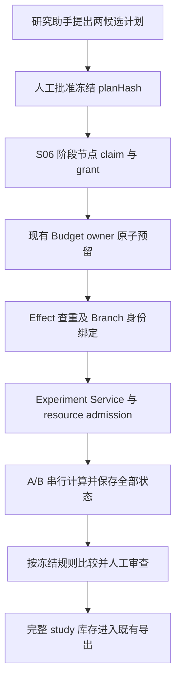

# S09 / RH-20：两候选实验树设计

日期：2026-11-07。状态：`Designed`；实现、工程验证、科学验证均未完成。
代码基线：`5b8ac3e95179b1a664760d11f37a2d110733dba0`。
依据：[阶段计划](phase-09-conditional.md)、[S09 启动报告](s09-execution-report.md)。
本文是待实施合同，不是已存在的 schema、接口或实验批准。

## 1. 本轮决定与输入关口

用户已要求启动 S09。先固定设计和接入顺序；具体研究问题、批准方法、数据、
指标/容差、重复次数、预算和资源要求尚缺，不能替用户填入示例实验并称科学验收。
这些输入由科研负责人提供，工程负责人核验可执行性。缺项时不创建可运行分支。
用户随后确认“暂不真实实验”；本次交付为合同设计与缺口审查，实际实验保持未运行。

第一版只有两个候选 A/B，A 同时是预注册对照，不另加隐藏对照运行。
树为一个不执行计算的 study 根及两个叶：总逻辑节点 3、最大深度 1、宽度 2。
每候选重复次数 r 必须为有限正整数并在批准时固定；总计算次数上限 2r，环境探测、验证、准备、
取消清理均计入总时间和资源预算。默认执行并发 1，沿用 S06 单写者。
没有自动补分支、自动追加重复、best-first 扩展或按模型主观评分选择的路径。
新增候选或扩大预算必须形成新的批准版本，保留旧版本全部记录。

## 2. 已核对的能力与真实缺口

| 范围 | 现有事实与源码 | S09 需要补齐 |
| --- | --- | --- |
| 实验输入 | [research-experiments.ts](../src/shared/schemas/research-experiments.ts)：requestId、环境/输入快照、超时、禁网；Python 必填 seed 与环境 hash，其他引擎不要求 seed | 分支假设、预注册方法/指标、全部引擎的种子策略、代码/数据批准前 hash；不能把执行后 inputHash 当作执行前批准 |
| 生命周期 | [experiment-service.ts](../src/main/plugins/research/experiment-service.ts)：start 关联 Task 后启动隔离子执行；source 校验字节；snapshot 仅接受 completed | 分支/重复与 experiment 的持久绑定、失败/取消记录冻结、跨所有分支的时间边界 |
| 调度 | [stage-runtime.ts](../src/main/plugins/research/stage-runtime.ts) 的 pump 与 [task-graph.ts](../src/main/plugins/research/execution/task-graph.ts) 的 claim/assertLease 均按 stage 查找；同项目写者互斥 | 实验是 stage-owned child，不能把 experimentId 填进 stage 的 DAG 节点；首版保留同一阶段 lease 串行执行 |
| Effect | [worker-effects.ts](../src/main/plugins/research/execution/worker-effects.ts)：start_experiment 去除 requestId 后计算逻辑身份，unknown 不盲重做 | 逻辑身份必须含 study hash、branchId、replicateIndex；仅换 requestId 不能表示一次独立重复 |
| 预算 | [run-budget-ledger.ts](../src/main/services/deep-agent/run-budget-ledger.ts) 支持 model/tool/child；[project-budget-ledger.ts](../src/main/services/deep-agent/project-budget-ledger.ts) 的 admission 由 model 调用触发 | 当前不是实验 CPU/GPU/传输费用预留器。要在同一 Budget owner 扩展预留/结算，不能以工具调用计数代替计算预算 |
| 资源 | [research-process-resources.ts](../src/shared/schemas/research-process-resources.ts)：macos-seatbelt、100ms 监测，CPU/内存 hardLimit=false，普通实验禁网且禁 GPU | 用户若要求内核硬隔离、Linux 或 GPU，当前执行路径不满足；不能把排队 admission 等同于硬限制 |
| 比较 | [experiment-result-service.ts](../src/main/plugins/research/experiment-result-service.ts)：人工 review 后签收指标；compare 的 comparable 要求 data/definitions/units/environment/parameters/seed/method 全一致 | 方法 A/B 通常本应不同；新增预注册实验比较语义，保留原严格比较的意义，不删掉差异检查 |
| 导出 | [export-sources.ts](../src/main/plugins/research/export-sources.ts) 从引用证据收集 completed 实验，未自动包括所有分支 | 完整 study inventory，涵盖负结果和失败；失败记录不能伪装为 completed 以通过已有闸门 |

这些是源码核对结论；S08 的历史工程通过不等于以上新增能力通过。

## 3. 冻结合同

设计实体暂称 StudyPlan、BranchRecord、StudyComparisonReceipt。实际实施时统一命名、
持久化和所有消费者；本轮不导出无消费者的 TypeScript 类型或建立空表。

| 合同部分 | 必填字段与约束 | 事实归属 |
| --- | --- | --- |
| 身份 | schemaVersion、studyId、projectId、taskId、ownerStageRunId、revision、planHash | 服务端分配并核对现有 Task/Stage 身份；模型不能指定可信主体 |
| 问题与方法 | researchQuestion、批准的方法工件 id/hash、两候选 hypothesis、差异轴、A 为对照 | 版本化研究工件；变更使旧批准失效 |
| 输入 | 源码版本/hash、每份数据相对路径/字节数/hash/版本/许可、Notebook 原文和转换 receipt、参数/argv | 工作区真实字节与现有 Notebook/Experiment owner；不得只散列路径 |
| 环境 | engine、运行时选择 receipt/hash、包/锁文件 hash、期望环境 hash、所需 OS/架构/资源能力 | 现有 Environment Service；unknown capability 不当作支持 |
| 随机性 | 明确 deterministic 或 seeded，预注册 seed 列表、各引擎传入方式；A/B 使用配对列表 | seed 相同不直接证明统计/字节复现 |
| 测量 | metric id/定义/单位/方向、结果文件路径与 schema、评估器代码 hash、样本集合与样本量规则 | 实验前冻结；禁止从日志自由抽取一个“看起来最好”的数字 |
| 规则 | primary metric、有效性约束、容差、重复汇总、失败处理、停止规则、选择及平局规则 | 科研负责人批准；先冻结再计算，不事后换指标 |
| 边界 | maxNodes=3、maxDepth=1、maxWidth=2、concurrency=1、r/maxRuns=2r、总 deadline、逐次 timeout、CPU/内存/输出上限 | 时间/资源数值必填且有限；缺预算拒绝 dispatch |
| 费用 | 计费单位、版本化报价/无外部费用依据、总上限、逐分支预留、清理余量、未知费用处理 | 同一 Budget owner；预算预留不是授权 |
| 批准 | 人工 actor、时间、planHash、方法工件 hash、scope/风险、预算 policy revision、撤销/失效状态 | 主进程人工上下文与现有 grant；Agent 不得生成 accepted |

planHash 使用固定版本的规范序列化；明确对象键排序、数组顺序语义、UTF-8 与有限数值。
不包含记录创建/更新的审计时间戳与运行状态；批准范围中的 deadline、限额与有效期仍参与 hash。
任何受批准字段改变都生成新 revision/hash。
批准页面必须展示具体代码/数据/环境与预算，并允许查看真实 diff。

BranchRecord 为每候选/重复保存 branchId、parentStudyId、hypothesis、replicateIndex、
seed、planHash、批准引用、reservationId、operation identity、experimentId、状态、
全部输出/日志的库存与 hash、失败/停止原因、实际用量和测量 receipt 引用。
执行状态从 Experiment/Task/Effect 投影；不再建一套独立运行状态机。
没有执行的分支保存 refusal/cancel 原因和空 execution 引用，不能补造资源回执。

## 4. 执行接线与原子边界

1. 同一研究助手、同一 Task、一个拥有写权限的阶段节点；用现有
   [production-effects.ts](../src/main/plugins/research/production-effects.ts) 调用 Experiment Service。
   两候选是科学计划中的叶，不新增 Runtime 或另一个 scheduler。
2. 在环境探测或计算之前检查项目/阶段/lease/grant、批准 hash、预算、输入字节和环境要求。
   capability 直接入口也必须做同样的 study 归属检查，不能只靠 prompt 或工具白名单。
   输入快照完成后再次核对冻结文件与环境，挡住批准与执行间的变化。
3. 在现有预算事实源内按 study+branch+replicate 原子预留时间/费用，并生成持久 reservation。
   所有重复、探测和清理共享总上限；停止或未知结果保留占用，确认未执行/已结算后才释放。
   不把失败调用记成零费用；非 model 费用必须实际受根 Task/项目 cap 约束。
4. 同一逻辑 effect 包含 planHash、branchId、replicateIndex、输入 hash 与工具版本；
   transport requestId/attempt 不改变逻辑 effect。调用方重试复用身份；科学重复用新的
   replicateIndex 且必须在已批准列表内。现有 start_experiment 合同须同步扩展并完整切换消费者。
5. Agent DB 的 Effect/预算与 research DB 的实验记录不假定跨库原子。
   先持久 intent/reservation，创建幂等 request 关联，记录服务 receipt，再提交结果；
   启动恢复逐个窗口对账。跨库未知先阻塞，无“没有本地 receipt 所以再运行”的推断。
6. 输入目录只读，每次实验使用现有独立 input/output/scratch 根；发布到共享工作区仍由
   阶段单写者处理。只读标记不得掩盖实际计算写出；未来并发必须先实现真实资源锁。
7. 一个候选普通计算失败可以形成分支终态并继续另一候选，但不得将基础设施/授权/
   预算/清理不明异常吞成普通负结果。后者停止整项 study，保留错误与未执行分支。
8. 阶段完成前所有子执行必须终止且归档结果。取消沿
   [task-controller.ts](../src/main/plugins/research/task-controller.ts) 先拒绝新 dispatch，再 abort/wait；
   清理未确认保持 blocked。继续执行沿现有显式 continue 和 effect 对账，不重置预算。

## 5. 指标与选择

只有实际执行生成、通过 schema/hash/单位校验且经人工 review 的指标才能入比较。
允许变化的轴在计划中列明，例如 source/method/parameters；数据、指标定义、单位与
对照条件必须满足冻结约束。沿用现有 receipt 验证，不把严格 compare 的 comparable 改成 true。

选择 receipt 保存全部候选、全部重复、有效/失败样本数、实际指标/成本、采用规则版本、
比较差异与结论。输出为 selected / tie / inconclusive / not_comparable；这些是设计状态。
缺值、NaN/Infinity、失败或样本不足不能以 0、主观模型分或只看成功样本参与排名。
负结果指有效实验未达到预注册假设，不等同程序失败。失败处理与最少有效重复数必须预先约定。
两候选全失败、差异超出允许轴、预算停止或统计证据不足均可得无胜者。
确定性规则给出候选排序也不自动将科研主张标为 verified。

## 6. 完整归档与复现

复用 [export-public-bundle.ts](../src/main/plugins/research/export-public-bundle.ts) 和
[export-ro-crate.ts](../src/main/plugins/research/export-ro-crate.ts) 的字节清单验证、公共投影和许可闸门。
新增 study 归档来源时必须按批准分支全量枚举，不从正文引用反推库存。
每个候选/重复都包含状态、拒绝/失败原因、输入/环境/结果 hash、批准和预算 receipt；
在许可范围内包含真实源码、数据、输出、负结果、日志与 Notebook provenance。
失败/取消/未执行只导出其真实可用证据，不调用 completed-only snapshot 冒充成功。
因安全或限额已清理的输出必须记缺失原因；不能绕过资源上限为“完整”保留危险文件。
私有字段和秘密继续经过既有公共投影；元数据占位明确说明不可复现的材料。

| 复现等级 | 必需证据 |
| --- | --- |
| byte | 同冻结输入/环境/seed 的独立重复，指定科学输出字节 hash 相同；时间戳/运行 ID 不当作科学输出 |
| functional | 各输出满足实验前冻结的绝对/相对容差；列明检查对象与实际差值 |
| statistical | 预注册重复、样本/检验方法、失败处理与不确定性报告；需真实独立科研评价 |
| unverifiable | 材料/环境/预算/receipt 不全或不可获取，记录精确缺项；不得降格称“复现成功” |

## 7. 实施顺序与验收

| 步骤 | 完整交付 | 接受证据 |
| --- | --- | --- |
| A 输入冻结 | 补齐第 3 节并确认可用引擎/隔离；制作可审查的精确计划 | 真实材料、批准 hash、有限预算；无派发 |
| B 合同接入 | 版本化 study 工件/分支记录、主进程人工批准、共享 schema/IPC/已有壳检查器；数据库迁移按实际顺序分配 | 跨项目/旧批准/输入漂移拒绝；消费者/type/生成合同一致 |
| C 两候选执行 | 同一 Stage/Task/Experiment/Effect/Budget 接线，串行、有界、全分支结果 | 实际 dispatch、预算前置拒绝、失联对账、取消和冷恢复 |
| D 比较与归档 | 冻结规则、人工指标回执、全分支 provenance/RO-Crate | 未引用失败与负结果仍入 ZIP；hash、许可/公共投影校验 |
| E 科学验收 | 获授权真实研究问题及独立评价 | 预注册容差/统计标准满足，报告全部失败与局限 |

必须新增的分支场景：A/B 成功与平局；负结果；单/双失败；指标缺失或不可比；
拒绝/旧批准/跨项目/预算不足的实际 dispatch=0；第 3 候选及超次数拒绝；输入 TOCTOU；
同 request 冲突；重复 effect；跨库各窗口崩溃；迟到 lease 提交；取消后无子进程；
费用未知不释放；失败分支完整导出；固定输入独立重复的容差检查。

实施后从仓库根运行 `pnpm test:research-resources`、`pnpm test:research-native-code`、
`pnpm test:research-p0`、新增 branch/E2E 与受影响 type/IPC/renderer 检查。
本设计轮未运行这些测试，也未完成 RH-20.1～20.7 的产品实现。
