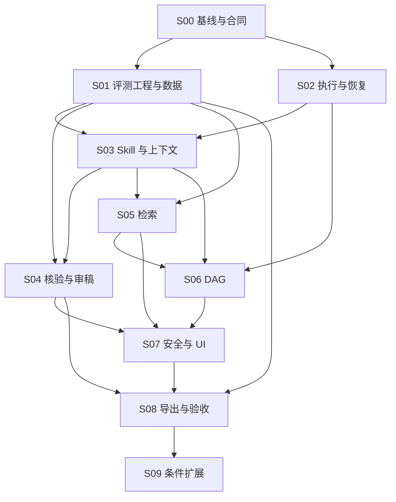

# Roc Research Agent Harness 分阶段执行总计划

编制日期：2026-11-06。
来源：[`Roc_Research_Agent_Harness_Plan.md`](../Roc_Research_Agent_Harness_Plan.md)。
当前执行范围：S02～S05 已提交，S06 工程验收完成，下一阶段 S07。S01 科学验收仍需独立材料。
计划编制、S00、S01 工程合同与 S02 已完成；S01 科学数据/双审/L2 未运行，S03 工程完成，S04 工程完成，S05 工程完成，S06 工程完成，S07～S09 尚未启动。
执行原则：允许大范围重构；不做向后兼容；不保留遗留路径；不以防御性兜底掩盖合同错误。

## 计划编制进度

| 编制步骤 | 状态 | 完成条件 |
| --- | --- | --- |
| 阅读方案与约束 | complete | 来源 862 行完整阅读；已核对关键入口、数据合同和检查命令 |
| 编写分阶段执行文件 | complete | 9 个主阶段 + 1 个条件阶段，均含依赖、任务、删除项、交付物和验收 |
| 文档一致性验证 | complete | 16 份文档、91 个本地链接、22 个现有测试路径、WP/RH 覆盖、依赖和 Git 差异检查通过 |

## 重构执行进度

2026-11-06 用户授权开始第一个阶段，S00 基线与合同交付完成。
状态为 `Verified passing（S00 文档与当前工程基线）`；系统重构、生产迁移与科学评价尚未实施。

| 阶段 | 优先级 | 依赖 | 状态 | 完成关口 |
| --- | --- | --- | --- | --- |
| S00 | P0 | 无 | complete | 固定 SHA 基线、能力/所有权清单、重构与迁移合同 |
| S01 | P0 | S00 | in_progress | 工程 Verified passing；独立样本 0/200，双审/L2/盲审未运行 |
| S02 | P0 | S00 | complete | 工程 Verified passing；执行合同、离线迁移、回放、冷恢复与故障验收见 s02-execution-report.md |
| S03 | P0/P1 | S01 工程合同、S02 | complete（工程） | Verified passing；11 阶段 Manifest、权限交集与上下文恢复，见 s03-execution-report.md；科学评价未运行 |
| S04 | P0/P1 | S01 最小独立数据、S02、S03 | complete（工程） | Verified passing；见 s04-execution-report.md；科学盲审未运行 |
| S05 | P1 | S01 协议、S02、S03 | complete（工程） | Verified passing；冻结查询与回执/冷迁移见 s05-execution-report.md；科学比较未运行 |
| S06 | P1 | S02、S03、S05 合同 | complete（工程） | Verified passing；DAG/lease/恢复与分轮补验见 s06-execution-report.md；科学对照未运行 |
| S07 | P1 | S02、S04、S05、S06 后端 | pending | 真实 effect 攻击回归、单壳 UI、焦点/布局/迟到响应 |
| S08 | P1 | S01～S07 | pending | 真实导出闭包、全链路、迁移/冷恢复、打包和分项报告 |
| S09 | P2 | S08、需求/预算/隔离条件 | pending | 独立立项；实验树和远程后端分别验收 |

每个阶段分别登记工程、科学、外部和发布结果。S01 标注工作贯穿 S03～S08；
数据不足不会阻止无依赖的确定性实施，但会阻止科学收益和默认发布结论。

## 执行依赖

图中 S01 箭头先表示评测工程合同依赖；真实数据/盲审与费用授权是科学验收依赖。
S07 安全合同从 S00 就确定，具体执行边界随每个阶段实现并检查，末期做组合攻击验收。

## 建议排程

以下沿用来源的“两名核心工程师 + 独立科研审核者”16 周估算，仅作安排，不是交付承诺。
本轮不派发子代理，不假定已有团队或审核者。

| 时间窗 | 主工作 | 同期工作 | 关口 |
| --- | --- | --- | --- |
| 第 1～2 周 | S00、S01 工程协议、S02 事件/恢复合同 | 独立样本来源和标注规范 | G-A：现状与目标差异确认，基线可重建 |
| 第 3～6 周 | S02 切换、S03、S04 最小核验 | S01 标注与小规模盲审 | G-B：真实标注可用；权限不扩张；旧 Skill 加载删除 |
| 第 7～10 周 | S04 审稿、S05、S03 长上下文 | S01 完整样本与各项 A/B | G-C：检索/压缩在质量约束下有采纳证据 |
| 第 11～14 周 | S06、S07 | 攻击、故障恢复和用户路径检查 | G-D：调度一致性成立；效率收益单独判断 |
| 第 15～16 周 | S08 | 全量独立评价、迁移、打包及材料 | G-E：分项验收与发布决定；S09 独立立项 |

单人执行顺序：S00 → S01 工程合同 → S02 → S03 → S04 → S05 → S06 → S07 → S08。
独立人工标注不能由实施者的模型自评代替；时间不足时延后 S09，不缩减主阶段合同。

## 每阶段执行流程

1. 阅读本文件、对应阶段页、`findings.md`、`progress.md` 和适用项目规则。
2. 记录开始 SHA 和工作区差异；保护用户或其他任务的改动。
3. 复核该阶段模块、消费者和测试；路径、类型或能力有漂移先更新计划依据。
4. 按 RH 任务完成输入输出、数据、运行时、IPC、renderer 和验证的完整切换。
5. 对被替代代码更新引用、删除旧实现和只服务旧合同的测试；保留有效行为回归。
6. 运行最小专项检查；共享边界改动按[验收矩阵](acceptance.md)补完整检查。
7. 保存成功和失败日志、固定结束 SHA、限制、删除清单和下一步。
8. 更新阶段状态；提交 Git、远端操作或发布只按实际授权执行。

## 完成定义

- 合同、调用方、数据读写和生成 IPC 一致；被替代生产路径已删除。
- 成功、失败、版本冲突、审批、取消和恢复等本阶段真实路径有相应证据。
- 验收命令记录完整工作目录、版本、退出码、SHA 和日志位置。
- 涉及科学收益时有独立数据与评价；工程 fixture 不充当科学证据。
- UI 使用既有壳、抽屉和工件检查器，所有重要动作键盘可达。
- 外部状态未核实时保持 `unknown`、`not_verified` 或 `null`。
- 没有 task-only 调试代码或临时生产实验分支；用户数据未被当成代码清理。

工作报告只使用一个范围状态：`Located`、`Changed, unverified`、
`Verified passing`、`Blocked, not run`。`Verified passing` 必须说明是文档、工程、
科学或外部哪一种验收，不能跨层推断。

## 已确定决策

- 用户要求优先于来源文档中的兼容读取、旧事件运行时迁移和长期双路径建议。
- 唯一研究助手、唯一 AppShell、真实工作区文件、项目隔离和人工审批继续作为产品与授权合同。
- 不把历史测试记录或本轮静态阅读标为最新运行验证结果。
- 所有计划文件置于根目录 `plan/`，不创建第二份计划目录。

## 关键风险与处置

| 风险 | 触发证据 | 处置与受影响关口 |
| --- | --- | --- |
| 基线漂移或已有能力重复建设 | 新 SHA、同义表/接口、消费者图变化 | 更新 inventory 和删改边界；重跑实际受影响基线，G-A |
| 迁移丢事实或新版本用旧审批 | 行数/ref/hash 不一致、snapshot 版本错 | 停止升级，修复转换或匹配版本冷恢复；不启用兼容读，S02/S08 |
| 标注不足或 holdout 泄漏 | 独立簇/配额不足、来源跨 split | 科学结论保持不足；修复数据并重新冻结，G-B/S08 |
| 新算法质量退步或误杀 | 任务族回退、漏反证、人工误阻断 | 不强化语义门，删除失败候选；当前合同继续，G-C |
| 并行重复操作或越权 | 重复 receipt、旧 generation 提交、预算异常 | 停止 dispatch/对账，修复 fence；当前 scheduler 降为 1，G-D |
| 安全或隐私边界失败 | 真实未授权 effect、secret/私有字段外泄 | 停止受影响能力，修复实际执行边界并保留攻击证据，S07/S08 |
| 科学/外部授权缺失 | 无数据、审核者、费用上限、目标批准 | 继续独立本地工作；对应验证不运行，最终分项报告 |

## 错误与环境记录

- 查询 `plan/`、`.planning/` 时目录尚不存在；本轮新建用户指定的 `plan/`。
- 初次搜索猜测了不存在的 `src/main/database/`；实际数据库基础设施在
  `src/main/infrastructure/`，后续计划使用已定位路径。
- 首轮文档校验误将 `git diff --no-index --check` 的差异退出码 1 当成空白错误；
  输出为空，文档无对应错误。校验按 Git 语义区分差异与错误，首轮报告保留。
